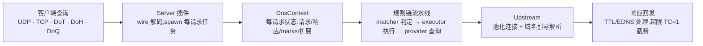

# 总览

> 基线:v1.6.1(`release/v1.7.0` 开发线) · 2026-11-05

## 核心请求路径

所有服务器插件共享同一条流水线;入口执行器由各 server 配置的 `entry:` 指定,通常是一个 `sequence` 规则链。

## 规模统计

| 指标 | 数值 | 说明 |
|------|------|------|
| Rust 源文件(`src/`) | 291 | 不含 `crates/` 下配套 crate |
| Workspace crate | 5 | 主程序 + proto / macros / zoneparser / ripset |
| 内置插件类型 | 65 | server 4 · matcher 20 · executor 35 · provider 6 |
| 入站协议 | 6 | UDP · TCP · DoT · DoH · DoH3 · DoQ |

## Workspace 组成

| Crate | 版本 | 职责 |
|-------|------|------|
| `oxidns`(根) | 1.6.1 | 主程序:二进制 + 库。CLI、启动编排、管理 API、插件系统、DNS 核心、基础设施都在此 crate |
| `oxidns-proto` | 0.1.6 | 自研 DNS 报文模型与 wire 编解码(Message / Name / Question / Record / RData),替代 hickory 依赖,以 `oxidns::proto` 导出 |
| `oxidns-macros` | 0.1.0 | `#[plugin_factory("type")]` 过程宏:把插件工厂提交进 `inventory`,实现编译期自注册 |
| `oxidns-zoneparser` | 0.1.2 | zone 文件解析器,供 `arbitrary` / `response` 插件使用 |
| `oxidns-ripset` | 0.1.3 | 纯 Rust 的 ipset / nftset netlink 操作,仅 Linux(供 `plugin-ipset` 特性使用) |

## 功能 Bundle(Cargo 特性层)

| Bundle | 内容 |
|--------|------|
| `minimal` | 仅转发:UDP/TCP 监听与上游、核心执行器与匹配器、domain_set / ip_set 提供者;不含 TLS / HTTP / QUIC 栈 |
| `standard` | + 管理 API、WebUI、指标、DoT/DoH/DoQ(服务端与上游)、protobuf(geosite/geoip)与 AdGuard 提供者、常用执行器(script/cron/download/http-request 等) |
| `full`(默认) | standard + DoH3(server/resolver/upstream)+ MikroTik RouterOS 插件 + Linux ipset 插件 |

> `Cargo.toml` 是特性图与 bundle 定义的唯一事实来源;上表只描述当前版本的分层意图。
