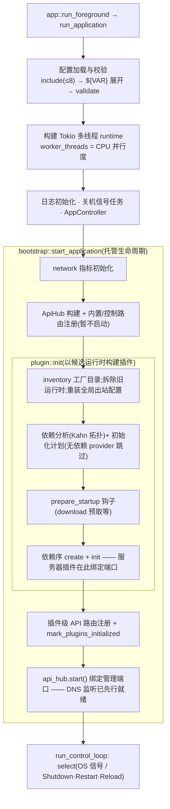
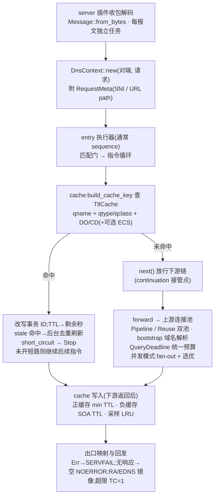
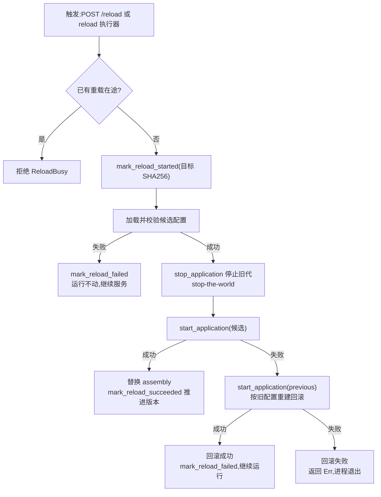

# 关键执行流程

> 基线:main v1.7.1(`ad2046d3`) · 2026-11-14
>
> 本章描述 upstream `main` 的实现。本仓库分支特有的 staged(Unix 零拒连)重载路径不在本章,见 `07-review.md` 的「分支特有(未进 main)」。

## 启动流程(前台)

1. **入口分发** — Windows 上先尝试 SCM 服务分发 `try_dispatch_windows_service()`(main.rs:14);非服务进程进入 `cli::run_from_args()` 解析参数。
2. **start 命令进入应用层** — `oxidns start -c config.yaml [-d dir] [-l level]` → `run_foreground`(app.rs:52)→ `run_application`(app.rs:264)。
3. **进程级准备** — 记录原始 exe 路径(供升级/重启使用)→ 启动 AppClock 单调时钟 → 切换工作目录 → 清理升级残留文件 → 打印 banner。
4. **加载并校验配置** — `config::init`:递归 include(深度 ≤8)→ 解析后展开 `${VAR}` → `validate()`(config/mod.rs:42)。
5. **构建 Tokio runtime** — 按 `runtime.worker_threads`(默认 CPU 并行度)建多线程 runtime,`block_on(run_async_main)`。
6. **初始化控制与日志** — 注册 OS 信号任务 → 创建 AppController(控制命令通道)→ CLI `-l` 覆盖日志级别 → 启动 tracing(控制台 + 滚动文件 + 1000 条环形缓冲)。
7. **bootstrap::start_application 托管装配** — ① 网络指标初始化 → ② 构建 ApiHub 并注册内置/控制路由(未启动)→ ③ 向插件系统注入 controller → ④ `plugin::init` → ⑤ 注册插件级 API 路由 → ⑥ `api_hub.start()` 绑定管理端口。API 准备、插件构建、监听启动与错误清理都在同一个托管生命周期操作内(bootstrap.rs:26),中途失败由 manager 销毁未激活的候选运行时,并按正常拆除顺序停 API、清全局状态。
8. **plugin::init 构建插件运行时** — 加载 inventory 工厂目录 → 拆毁旧运行时 + 重装全局出站配置 → 依赖分析与初始化计划;候选运行时构建完成后才发布激活(registry/runtime.rs:62 起 `StartupSession`)。
9. **按依赖序初始化插件** — 重复 tag / 未知类型检查 → Kahn 拓扑排序(无存活依赖的 provider 跳过)→ prepare_startup 钩子(如 download 预取)→ 逐个 create + init —— **服务器插件在 init 内绑定端口**并等待启动 oneshot,因此 DNS 监听先于 API 端口就绪(registry/mod.rs:187)。
10. **等待终止** — `run_control_loop` select:OS 信号(Unix SIGINT/TERM/QUIT;Windows Ctrl+C/Break/Close/Shutdown/Logoff)vs 控制命令 Shutdown / Restart / Reload(app.rs:339)。
11. **优雅关停** — `bootstrap::stop_application`(bootstrap.rs:97:停 API → 逆序销毁插件 → 清 controller)→ `task::stop_all` 停全局后台任务;Restart 在 Unix 上 exec 原始 exe(同 PID,适配监督器),Windows SCM 下以退出码 1 结束交由失败恢复动作重启。

## DNS 查询热路径(以 UDP 为例)

1. **收包与解码** — `run_server`(server/udp.rs:162)select(关停 vs 收包)→ 伪造包/非查询报文在 spawn 前 precheck 丢弃(udp.rs:213)→ `Message::from_bytes` wire 解码 → 每报文 spawn 到 TaskTracker,热循环不阻塞。
2. **构造请求上下文与入口预检** — `RequestHandle::handle_request`(server/request.rs:51):`DnsContext::new`(归一化 ipv4-mapped 对端, 请求);DoT/DoH/DoQ 层附 RequestMeta(SNI / URL path);非法入站在进流水线前拒绝(request.rs:62-67:QR≠0 → REFUSED,opcode≠QUERY → NOTIMP(RFC 8906),EDNS version>0 → BADVERS(RFC 6891))。
3. **进入入口执行器** — server 配置的 `entry:`(通常指向 sequence)以 `execute_with_next` 启动流水线(request.rs:96)。
4. **规则链程序计数器循环** — `ChainProgram::run_from_inner`(sequence/chain.rs:136)在展平的指令数组上推进:每条指令先做匹配,通过才执行。
5. **匹配判定** — `MatcherRef::evaluate`:谓词 + `!` 取反 + API 三态运行时覆盖(默认 / always_true / always_false);qname 匹配按成本递增:精确哈希 → 后缀 trie → AC 自动机子串 → RegexSet。
6. **指令执行** — executor `execute` → `ExecStep::Next/Stop/Return`;with_next 型(cache/redirect/query_summary/metrics_collector)包裹下游;内建 `accept/return/reject/jump/goto/mark`。
7. **缓存检查** — key = qname + qtype/qclass + DO/CD(+可选 ECS);命中改写事务 ID 并把各记录 TTL 改为剩余秒数;可选 short_circuit 直接 Stop(cache/mod.rs:843 `try_cache_hit`)。
8. **上游解析** — `Upstream::query`:QueryDeadline 统一单调预算;PipelinePool(轮询槽位,单连接 max_load 64)或 ReusePool(无锁空闲栈);域名上游经 bootstrap 解析 IP,ArcSwap 热换池。
9. **并发转发与选优** — ConcurrentForwarder 以 JoinSet 从随机起点 fan-out,按 Fastest / Balanced / PreferPositive / Consensus 选响应(forward/selection.rs)。
10. **回填与后处理** — `context.set_response`;各 with_next 执行器展开后处理:缓存写入(正缓存 min 答案 TTL;负缓存取 SOA TTL,默认 60s、上限 300s)、TTL 改写、摘要、指标。
11. **出口映射与定稿** — Err → SERVFAIL;Next 但无响应 → 空 NOERROR;`finalize_response` 设 RA=1 并镜像请求 EDNS/DO 位(request.rs:171)。
12. **编码回发** — UDP 按请求方 EDNS max_payload 截断(置 TC=1 而非字节截断);TCP/DoT 长度前缀 + 每连接 mpsc 写者;DoH 按 RFC 8484(GET `?dns=` / POST);DoQ 每双向流一查询。

> lazy 缓存:过期后仍可回 stale 应答(剩余 TTL 取 `min(lazy_cache_ttl, ttl)`),并经去重集合触发后台刷新(5s 超时,子上下文复用);采样 LRU 以 95%/85% 水位淘汰;可选 `dump_file` 持久化(600s 间隔,变更 ≥1024 才落盘;周期落盘仅在实例成功激活后启动)。冷/过期未命中并发的 single-flight 合并是分支特有实现,未进 main(见 07-review)。

## 配置热重载

1. **触发与防并发** — API `POST /reload` 或 reload 执行器插件 → `AppController::request_reload`:已有重载在途直接拒绝(ReloadBusy),`mark_reload_started` 记录目标文件 SHA256。
2. **加载校验候选配置** — `load_and_validate_reload_config`:解析或校验失败 → `mark_reload_failed`,**运行中的组装完全不动,继续服务**(app.rs:379 起)。
3. **快照旧配置** — `previous_config = current_config.clone()`,作为回滚依据。
4. **停止旧代** — `bootstrap::stop_application(assembly)`(bootstrap.rs:97):停管理 API → 逆序销毁插件 → 清全局状态。此期间 DNS 与管理面短暂不可用(stop-the-world;分支的 Unix 零拒连 staged 方案未进 main,见 07-review)。
5. **按候选配置重建** — `bootstrap::start_application(&candidate_config)`(bootstrap.rs:26):走与启动完全相同的托管装配路径;成功 → 替换 assembly、`mark_reload_succeeded` 推进运行版本号。
6. **失败回滚** — 候选装配失败 → `start_application(&previous_config)` 按旧配置重建:回滚成功 → `mark_reload_failed` 标注「reload failed and previous configuration was restored」继续运行;回滚也失败 → 返回 Err,进程退出。

> 复用与重建边界:Tokio runtime、AppClock、日志、AppController 跨重载复用;assembly 内的一切(API、插件、监听、出站配置)全部重建。`GET /reload/status` 返回 `ReloadSnapshot`(infra/control.rs:203):status / pending / in_progress / last_started_ms / last_completed_ms / last_success_ms / last_error,以及配置版本 SHA256(running_version / target_version);没有阶段(phase)字段。

## 自升级

1. **版本检查** — GitHub latest API(User-Agent: OxiDNS,可选 token)→ 按 bundle 选 asset(gnu→musl、windows-gnu→msvc 重映射)→ semver 比较。
2. **加锁与下载** — `cache_dir/.upgrade.lock` fs2 排它锁 → 共享 HTTP 客户端(支持代理)流式下载,对 asset digest 做 sha256 校验。
3. **解包** — Unix tar.gz / Windows zip;定位新二进制与 `webui/` 目录。
4. **替换二进制** — Unix:手动备份后替换、失败回滚;Windows:运行中 exe 先改名备份,新二进制原子落位(启动时还会清理 `.upgrade-new.exe` 残留)。
5. **替换 WebUI 与清理** — 备份旧目录后换新(跟随符号链接;`--skip-webui` 可跳过);可选清理缓存与备份。

> 触发方:CLI `oxidns upgrade`(check/download/apply)、API `POST /upgrade/apply`(单许可信号量防并发)、upgrade 执行器插件;升级后配合 Reload/Restart 生效。

## 服务安装与守护

1. **安装** — service-manager 原生后端(systemd / launchd / Windows SCM),System 级,服务名 `oxidns`,参数 `start -c <config> -d <dir>`,开机自启 + OnFailure 3s 重启。
2. **Windows SCM 生命周期** — 服务进程内 `run_windows_service`:StartPending → Running;SCM Stop → 报告 Stopped 后退出;应用请求 Restart 时**故意以退出码 1 结束**,由 SCM 失败恢复动作(3s 后重启)拉起新进程。
3. **Unix 行为** — 前台 Restart 走 exec 原始 exe(同 PID);systemd 侧由 RestartPolicy 负责故障重启。
