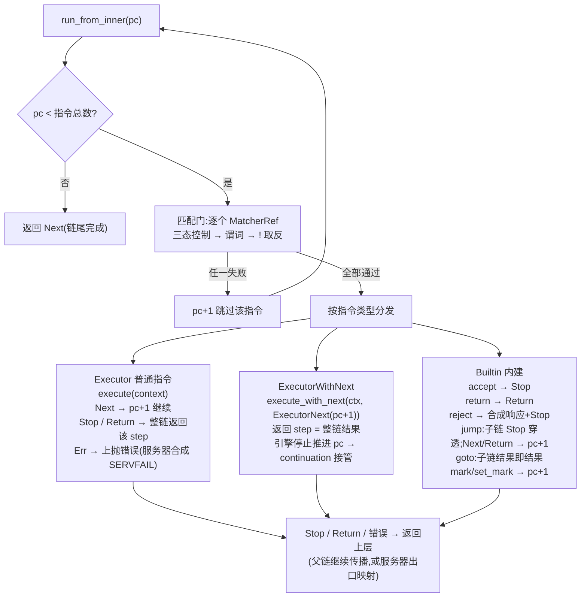

# 生命周期与嵌套

> 基线:v1.6.1(`release/v1.7.0` 开发线) · 2026-11-05

## 普通 executor 生命周期(四类插件通用路径)

1. **编译期注册** — `#[plugin_factory("type")]` 把工厂提交进 `inventory`,进程启动时聚合为全局工厂目录;插件没有独立清单文件,目录即事实。
2. **配置校验与依赖建图** — 各工厂 `get_dependency_specs` 展开字段级依赖边 → Kahn 拓扑排序;**DFS 环检测为硬错误**(报出完整 `A -> B -> A` 路径);未知类型 / 重复 tag 同期报错。`oxidns check` 可提前跑全套。
3. **初始化计划** — 按拓扑序生成 `init_order`;从非 provider 节点做可达性扫描,没有存活依赖者的 provider 跳过并告警。
4. **prepare_startup 钩子** — create 之前的前置动作(如 download 预建文件);失败即中止启动。
5. **create:只做浅解析** — 工厂解析 args 构造 `UninitializedPlugin` —— 仅反序列化与语法校验,不做 I/O、不建索引。
6. **init 并入注册表** — `init_and_wrap`:执行插件自己的 init(server 在此绑定端口、provider 在此加载规则文件)→ 插入 registry DashMap 并记录 `init_order`;api 启用时 matcher/provider 附运行时控制。
7. **运行期** — 被 `$tag` / server 的 `entry:` 引用,每请求 `execute()`;实例为不可变 `Arc` 共享,无锁并发。
8. **销毁:严格逆序** — 关停或重载 → 按 `init_order` **逆序**:drain 运行时控制 → `destroy()`(cache 落盘、dynamic_domain_set 持久化等);后初始化的先销毁,依赖者必然先于被依赖者消亡。
9. **quick-setup 变体路径** — 内联实例不走上述 2/3/6/8 步:由 owner(sequence / any_match / cron)在 init 时经 `init_quick_setup` 现场创建并 init,**不进 registry、不挂运行时控制**,由 owner 的 destroy 先行销毁。

## sequence 生命周期(容器型特殊路径)

1. **create:浅校验** — args → `Vec<Rule>`(matches 支持单串或列表);规则非空、exec/matches 至少有其一;jump/goto 必须带目标 tag 且不带 `$` 前缀(sequence/mod.rs:409-442)。此时只是保存规则文本,program 仍是空 OnceCell。
2. **依赖分析:字段级三路边** — matches → matcher 边;exec → executor 边;quick-setup 递归展开(`owner -> quick_setup(type).field`);jump/goto → `executor_type(tag, "sequence")` 类型约束边(mod.rs:347-407)。另产出 `SequenceFlowReport`(Plugin/QuickSetup/Builtin/Invalid 分类)供 check 与 WebUI 依赖图消费——坏引用在校验期即报 `args[i].exec` 精确位置。
3. **init:一次性编译为指令程序** — `ChainBuilder` 逐规则构建 `Instruction { matchers, op }`:matches → `MatcherRef`(命名引用带三态控制 + 取反;quick-setup 现场创建 `qs.match.*`);exec → 内建优先,否则 `$tag` / `qs.exec.*`,`with_next()` 决定指令类别;产出不可变 `Arc<ChainProgram>` 存入 OnceCell —— 运行期零解析零分配(chain.rs:474-675)。
4. **运行期:程序计数器解释循环** — 匹配门(全部 MatcherRef 通过才执行)→ 三类指令 → Next/Stop/Return 沿链与嵌套传播;链尾耗尽返回 Next;错误上抛由服务器层合成 SERVFAIL;`_sequence-step-recording` 开启时逐步记录事件(序列 tag + 节点号)。
5. **销毁:双层** — 先自行销毁私有的 qs 实例(先全部 executor 再全部 matcher,收集首个错误但不中断)——这些实例不在 registry,不会被重复销毁;随后 registry 逆序销毁 sequence 本体,必然早于它 `$tag` 引用的插件。

## sequence 深度剖析

### 编译模型:三层变换

| 层 | 表示 | 编译期完成的决策 |
|----|------|------------------|
| 配置层 | `Rule { matches, exec }` 原始文本 | matches untagged 反序列化(单串或列表);规则空 / exec 与 matches 全缺在 create 期报错 |
| 指令层 | `Instruction { matchers, op }` | jump/goto 目标解析为 `Arc<dyn Executor>` 存进指令(运行期无查表);mark 值 → `AHashSet<u32>`(逗号/空格分隔,u32 边界);reject rcode → 枚举(十进制或助记符、大小写不敏感、拒扩展位 ≥16、默认 REFUSED);`!` 取反折叠进 `MatcherRef.reverse` |
| 程序层 | `Arc<ChainProgram>` | 不可变 `Vec<Instruction>` 存入 `OnceCell`(只许装配一次);无锁并发共享,指令连续布局 cache 友好 |

### 执行引擎:程序计数器循环



### 核心机制:continuation 接管

整个 sequence 最不显眼但最关键的语义:`ExecutorWithNext` 指令执行后,返回的 step 直接作为当前 `run_from_inner` 的结果(chain.rs:233-273)——**引擎把推进权完全交给该执行器,不再前进 pc**。因此 with_next 指令之后的同序列指令,是否执行完全取决于执行器是否调用 `next`:

- `cache` 未命中 → 调 next → 从 pc+1 跑到底;命中(short_circuit)→ **不调 next → 后续指令整体跳过**——"缓存短路"没有任何专门指令,不调 continuation 就是短路。
- `redirect`:先改写 qname → next(剩余链用新名跑完)→ 恢复并前置 CNAME;`query_summary` / `metrics_collector`:next 之后做后处理。
- 多个 with_next 嵌套按**洋葱 LIFO** 顺序完成;with_next 内部出错先跑完清理再冒泡(均有测试钉死)。
- `with_next()` 只是向 ChainBuilder "要 continuation" 的开关(chain.rs:552-557);顺序编排权在插件的 `execute_with_next` 覆写——trait 默认实现是 "execute() 返回 Next 才透传 next"(executor/mod.rs:116-126)。

```mermaid
flowchart TD
    A["同一序列的指令流: cache(with_next) → forward → ttl → query_summary"]
    A -->|未命中 → 调 next()| B["continuation 从 pc+1 跑完剩余指令<br/>结果回到 cache:写缓存 → 返回"]
    A -->|命中 → 不调 next()| C["forward / ttl / … 整体跳过<br/>直接返回缓存应答(短路)"]
    B --> D["with_next 指令返回后引擎不再推进 pc<br/>后续是否执行完全由执行器决定"]
    C --> D
```

### 控制流代数:三种调用约定

| 调用方式 | 引擎形式 | 设计意图 |
|----------|----------|----------|
| `$sub` 直接引用 | `execute()`:子链 Next → 父链 pc+1;Stop / Return 穿透 | 内联展开——保留 Return 的向上传播语义 |
| `jump sub` | `execute_with_next(None)`:Stop 穿透结束父链;Next / Return 回父链 | 过程调用——除非子链 accept,否则回来继续 |
| `goto sub` | 子链任何结果直接作为父链结果 | 尾调用切换——父链剩余指令作废 |

传播行为由 `test_run_jump_resumes_parent_program_after_child_return` 与 `test_run_goto_propagates_child_return_without_resuming_parent` 钉死。

### MatcherRef 求值管线

1. **三态控制先于谓词** — AlwaysFalse → `matched=reverse`;AlwaysTrue → `matched=!reverse`(matcher/mod.rs:145-161)——覆盖生效时**真实匹配逻辑根本不执行**(省热路径),取反在覆盖层即应用,保证 `!$matcher` 与运行时开关组合语义正确。
2. **谓词本体** — `matcher.is_match(context)`。
3. **XOR 合成取反** — `matched != reverse`;结果为六值枚举 `MatcherEvaluation`(供 step-recording 区分 `always_true_not_matched` 等细节)。

`runtime_control` 字段整体被 `cfg(feature="api")` 门控——无 API 构建里字段不存在,零开销;quick-setup 分支不挂控制(chain.rs:671)是遗留缺口。

### 可观测性与行为保证

- `record_sequence_event!` 宏在 `_sequence-step-recording` 关闭时**编译为空**;连 `sequence_tag` / `node_index` 字段本身都 cfg 门控——彻底零成本抽象;由 query_recorder 按查询开启,供 WebUI 执行路径视图消费。
- chain.rs 约一半是测试,行为契约全部钉死:mark 追加/替换、matcher 不通过时内建不执行、reject 三种响应构造、accept 不构造响应直接 Stop、jump/goto 的 Return 传播、continuation LIFO、错误清理后冒泡、三态覆盖保留取反。

### 设计评述

- **亮点**:扁平指令 + pc 循环消灭每请求解释开销;`ExecutorNext(program, pc)` 用数据化 continuation 替代闭包,包裹型插件无需捕获环境;Jump 存 Arc 消灭运行期查表;依赖图保证编译期解析必然成功——运行期没有"找不到引用"的路径。
- **改进空间**:恒真匹配门可在编译期消融整条指令;ExecutorNext 每次构造 clone 一个 Arc(原子递增);with_next "吞推进权"的语义未在配置层显式表达——规则书写者容易误以为 cache 之后的指令总会执行。

## 嵌套形态与结果传播语义

| 嵌套形式 | 写法 | 执行与传播 |
|----------|------|------------|
| 直接引用子序列 | `exec: $sub` | 子链 `execute()`:Next → 父链继续下一条;**Stop / Return 穿透**,父链以该结果结束(Return 继续向上层传播) |
| jump 子序列 | `exec: jump sub` | 子链 `execute_with_next(None)`:**Stop 穿透结束父链;Next / Return 回父链继续**(Return 被吞)。语义:跑子链,除非它 accept,否则继续父链 |
| goto 子序列 | `exec: goto sub` | 子链任何结果(Next/Stop/Return)**直接作为父链结果**,父链剩余指令不执行。语义:切换到子链 |
| 内联执行器 | `exec: forward 1.1.1.1` | init 时现场创建 `qs.exec.<seq>.<n>.<type>`,owner 持有生命周期;支持者需工厂覆写 quick_setup |
| 内联匹配器 | `matches: qname domain:x.com` | 现场创建 `qs.match.<seq>.<n>.<idx>.<type>`;支持 `!` 取反;**不挂运行时控制** |
| any_match 子表达式 | `any_match args: [expr, ...]` | 元素可为 `$tag` 或 quick-setup(`qs.match.<any>.<idx>.<type>`),init 时创建、自持生命周期(any_match.rs:131-171) |
| cron 任务内联 | cron 任务的 exec 列表 | 可 `$tag` 引用或内联(`qs.cron.<tag>.<job>.<idx>`,cron.rs:568);离开请求路径按计划触发 |
| probe 委托 | dual_selector 的 `probe_executor` | 被引执行器在**复制的子上下文**中代发探测请求,与主查询隔离 |

## 限制

- **sequence / any_match 自身不支持 quick-setup**(工厂未覆写,默认报 "quick setup is not supported")→ 子链必须是顶层命名插件;`jump/goto` 目标必须是命名 sequence 且写裸 tag(带 `$` 会被校验拒绝)。
- 不支持 quick-setup 的执行器还有:fallback、hosts、arbitrary、response、redirect、script、http_request、reverse_lookup、learn_domain、query_recorder、ros_* 等(只能命名声明)。
- 用户 tag 禁用 `qs.exec.` / `qs.match.` / `qs.cron.` 前缀(config/types.rs:283),与合成 tag 空间隔离。
- **循环引用是静态硬错误**:序列互指 jump、`$tag` 成环等在配置校验/初始化期被 DFS 检出并报完整路径,直接拒绝启动——不是运行期问题。
- 内联 quick-setup 的依赖能进图,前提是工厂覆写了 `get_quick_setup_dependency_specs`(qname / client_ip / cname / resp_ip / ptr_ip / question / reload_provider 已覆写)。

## 暗坑

| 坑 | 说明与正确姿势 |
|----|----------------|
| jump 的 Stop/Return 方向反直觉 | jump **传播 Stop、吞掉 Return**(chain.rs:326-329):子链 `accept` 会终止整条父链;`return` 只结束子链自己。想让"子链接受即全局接受"用 accept;想"跑完子链无论如何回父链"不能依赖 goto(goto 会把 Next 当父链结果提前结束) |
| 内联 matcher 不可运行时开关 | quick-setup matcher 的 `MatcherRef::new` 不带控制包装(chain.rs:671),命名引用才挂三态控制(chain.rs:649)。要让 matcher 支持 API / WebUI 动态开关,必须命名声明 + `$tag` 引用 |
| with_next 会"接管推进权" | ExecutorWithNext 指令返回后引擎不再前进 pc(chain.rs:233-273)——**之后同序列的指令是否执行,完全取决于该执行器是否调 next**:cache 命中不调 next 即整体跳过后续(这就是短路机制);子序列里的 cache 只覆盖子链;父链的 cache 会把整个 jump 指令(含子链执行)包进去 |
| qs 实例对 API 不可见 | 内联实例不进 registry:插件列表、统计、运行时控制都看不到它们;需要独立观测/控制的插件应命名声明 |
| 探测副作用不可回滚 | dual_selector 的 probe 在子上下文运行(dual_selector.rs:23-25):probe_executor 若含 ipset / script 等外部副作用,效果已发生、不会随主查询取消 |
| 无运行期深度守卫 | 嵌套深度完全由配置决定(静态无环 → 必然有限),每层嵌套是一次 async 调用;极深的 jump 链会累积栈帧与延迟,但"环"在验证期即失败,不会运行期死循环 |
