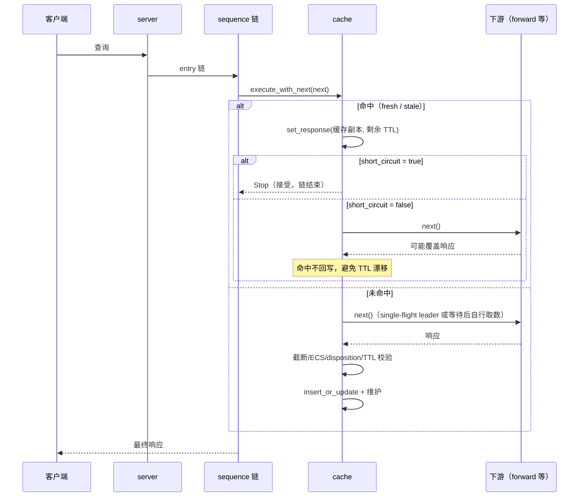
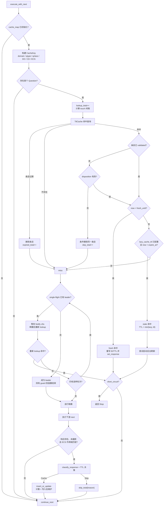
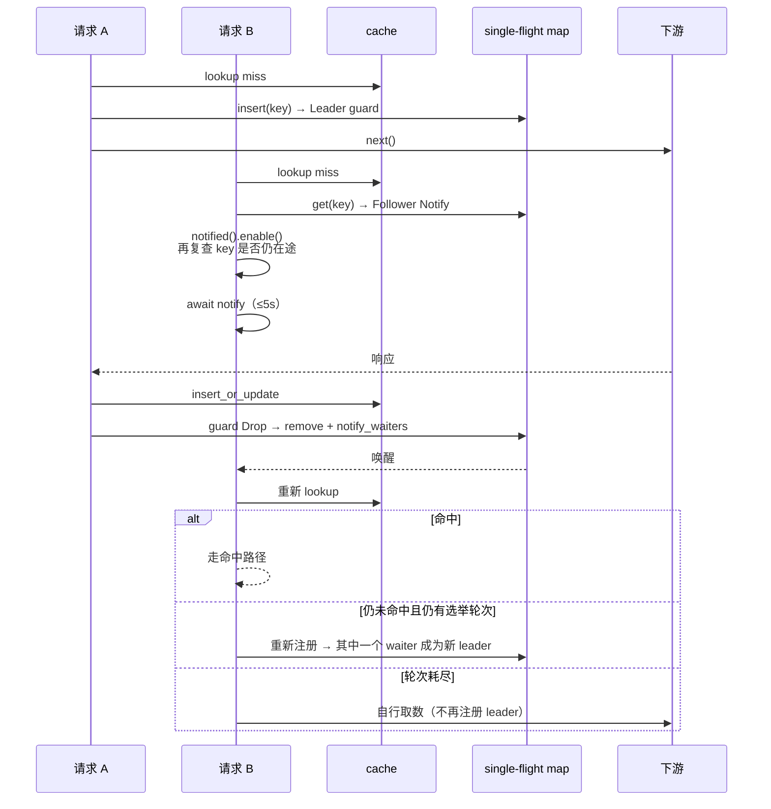
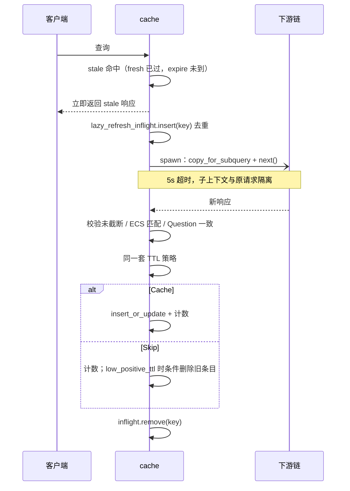
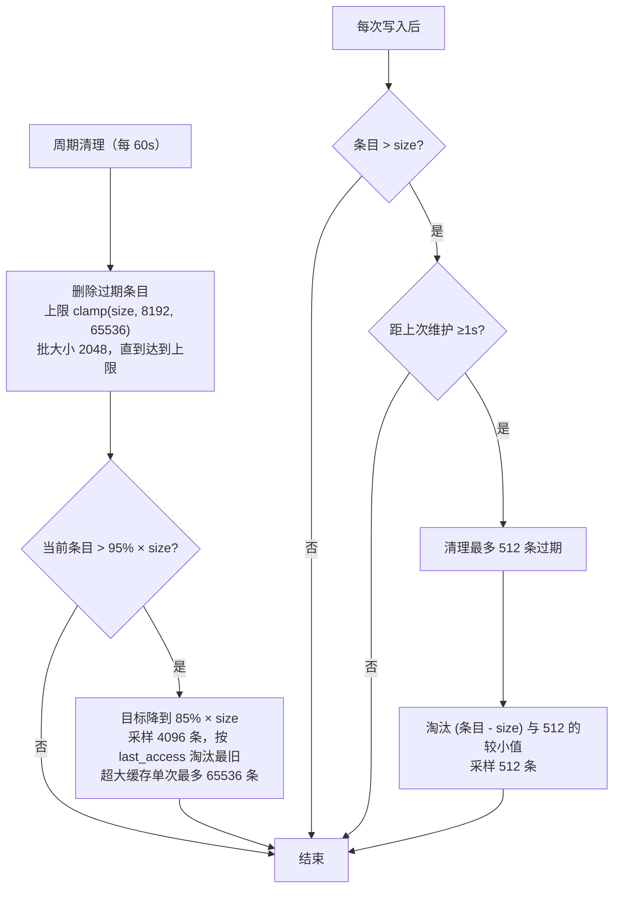
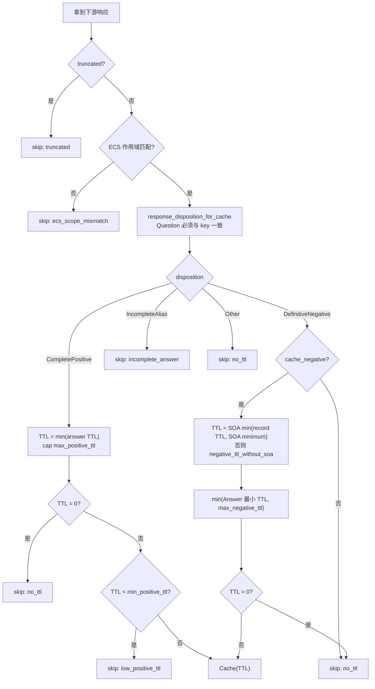

# OxiDNS `cache` 插件实现解析

> 分析基线：`v1.6.1`，分支 `fix/code-review-priorities`（含评审修复与 staged reload 改动）。
> 代码位置：`src/plugin/executor/cache/`，缓存容器复用 `src/infra/cache/ttl.rs`，响应分类复用 `src/core/response.rs`。
> 本文只描述当前代码实际行为；与文档/注释不一致之处集中在第 12 节。

## 1. 插件定位

`cache` 是一个 **executor 插件**，不是 matcher，也不提供运行时三态控制。它通过 `with_next() = true` 包裹下游链，因此典型形态是：

```yaml
- tag: cache_main
  type: cache
  args:
    size: 8192
    short_circuit: true
- exec: $cache_main
- exec: forward 1.1.1.1
```

核心能力：

| 能力 | 实现位置 |
|---|---|
| normalized qname + qtype/qclass/DO/CD(+ECS) 键 | `key.rs:128-152` |
| fresh / stale / expired / miss 四态判定 | `mod.rs:941-1082` |
| 命中可选短路（`short_circuit`） | `mod.rs:1085-1095`、`1575-1577` |
| 冷/过期 miss 的 single-flight 合并 | `mod.rs:1218-1240`、`1502-1556` |
| stale 命中后台异步刷新（去重、5s 超时） | `mod.rs:1242-1378` |
| 正/负缓存 TTL 策略 | `mod.rs:1098-1176`、`1640-1715` |
| ECS 跨客户端污染防护 | `mod.rs:1633-1638` |
| 采样 LRU + 分层水位淘汰 | `mod.rs:747-905` |
| wincode dump/load 持久化 | `persistence.rs` |
| 插件 API（条目/清空/导出/导入） | `api.rs` |

## 2. 代码地图

| 文件 | 行数（含测试） | 职责 |
|---|---:|---|
| `mod.rs` | 3888 | 配置解析、运行时结构、热路径、TTL 策略、清理/淘汰、工厂注册 |
| `key.rs` | 275 | 缓存键、ECS scope 摘要、响应 ECS 回显检测 |
| `persistence.rs` | 544 | dump 编码/落盘、load 解码/重建键/TTL 钳制 |
| `api.rs` | 592 | `/entries`、`/entries/{id}`、`/flush`、`/dump`、`/load_dump` |

运行时结构：

| 结构 | 关键点 |
|---|---|
| `CacheConfig` | 全部字段 `Option<T>`，缺省值在 `build_cache` 中落地（`mod.rs:1924-1959`） |
| `Cache` | 不可变配置 + `OnceCell<CacheMap>` + 原子计数 + 两个 `Mutex` 集合（single-flight / lazy 去重） |
| `CacheItem` | `resp: Message`、`ttl`（原始计算值）、`fresh_until_ms`、`validation` |
| `CacheKey` | `domain`（小写、去尾点）、`record_type`、`dns_class`、`do_bit`、`cd_bit`、`Option<EcsScopeDigest>` |
| `CacheMap` | `TtlCache<CacheKey, Arc<CacheItem>>`，底层 `DashMap` + AHash |
| `CacheMetrics` | 按 `plugin_tag` 注册的 `MetricSource`，计数器用 `Relaxed` 原子 |
| `MissSingleFlightGuard` | `Drop` 时从 single-flight map 删除 key 并 `notify_waiters()` |

`TtlCache` 提供的语义（`src/infra/cache/ttl.rs`）：

- `get_retained_cloned_status()`：以 `expire_at_ms` 为唯一保留边界；过期条目顺手删除并返回 `Expired`（`ttl.rs:160-196`）。
- `insert_or_update*()`：已存在则原位替换 value 与元数据，不增长条目数（`ttl.rs:103-133`）。
- `remove_expired_batch()`：按迭代顺序取最多 `batch` 个过期键，逐个 `remove_if` 条件删除（`ttl.rs:233-260`）。
- `sample_last_access()`：从轮转起点采样，避免永远淘汰同一批分片（`ttl.rs:268-292`）。

## 3. 生命周期

```mermaid
flowchart LR
    F["CacheFactory::create / quick_setup<br/>parse + validate"] --> I["Plugin::init"]
    I --> I1["创建 TtlCache<br/>容量 = clamp(size, 1, 16384)"]
    I1 --> I2["注册插件 API<br/>register_plugin_api!"]
    I2 --> I3["注册指标源<br/>register_metric_source"]
    I3 --> I4["spawn load task<br/>仅 dump_file 配置时"]
    I4 --> I5["spawn dump task<br/>周期 dump_interval"]
    I5 --> I6["spawn cleanup task<br/>固定 60s"]
    I6 --> R["运行期"]
    R --> D["Plugin::destroy"]
    D --> D1["注销指标源"]
    D1 --> D2["stop dump / cleanup 任务"]
    D2 --> D3["最终 dump<br/>仅 dump_file 配置时"]
```



要点：

- 缓存 map 在 `init` 中创建并写入 `OnceCell`，因为 API 注册需要同一个 `CacheMap` 句柄（`mod.rs:1387-1400`）。
- 启动加载是独立 `tokio::spawn`，不阻塞 `init`；加载完成后按 `size` 清理（`mod.rs:555-580`）。
- 两个后台任务通过 `task_center::spawn_fixed` 托管，名为 `cache:<tag>:dump` / `cache:<tag>:cleanup`（`mod.rs:582-645`）。
- `init` 中途失败会回滚：注销指标源、停掉已启动的 dump 任务（`mod.rs:1410-1442`）。
- `destroy` 停任务后**无条件**做一次最终 dump，不受“变更数 ≥1024”限制（`mod.rs:1450-1476`）。
- staged reload 时新旧实例各自持有独立 map；插件 API 路由进入候选 hub，dump 临时文件名带 pid + 序号避免交错。

## 4. 请求主路径

### 4.1 总览



`cache_map` 尚未初始化时直接 `continue_next!`（`mod.rs:1496-1498`）。没有 Question 的请求无法构建键，同样直接放行。

### 4.2 主判定流程



两个容易忽略的分支：

1. **命中但未开启短路**：`cache` 已经把响应写进 context，仍会执行下游；下游若产生新响应，`cache` **不会**回写（`mod.rs:1579-1583`）。这避免每次命中都刷新 TTL 造成“永不过期”，但下游行为可能覆盖缓存结果。
2. **单飞只覆盖 miss/expired**：stale 命中走的是另一套“后台刷新去重”，不进入 single-flight map。

### 4.3 缓存键

`build_cache_key()`（`key.rs:128-152`）包含：

| 维度 | 取值 |
|---|---|
| domain | `question.name().normalized()`，小写、无尾点 |
| record_type / dns_class | 原样进入键 |
| DO | 请求 EDNS 的 `dnssec_ok` |
| CD | `request.checking_disabled()` |
| ECS | 仅 `ecs_in_key: true` 时提取 |

ECS 摘要（`key.rs:74-99`）：

- 记录 `family`、`source_prefix`、`scope_prefix`，以及按 source prefix 截断后的网络字节（最多 16 字节）。
- IPv4 前缀钳到 32，IPv6 钳到 128；部分字节用掩码清零，保证 `/20` 与 `/24` 不会误命中。
- `ecs_in_key: false` 时键中 ECS 恒为 `None`，但写入前仍会做 4.6 的匹配检查。

键只包含上述维度，**不包含**入站协议、源 IP、server tag、响应中的 CNAME 目标等；同一个 cache 实例被多个 server 复用时共享条目（配置决定）。

### 4.4 命中与 TTL 重写

- fresh：`remaining_ttl = (fresh_until_ms - now) / 1000`（向下取整），通过 `clone_with_id_and_record_ttl()` 复制响应，改写 answer/authority/additional 的 TTL，替换为当前请求 ID；EDNS 保留，RRSIG 等 `signature` 区不重写 TTL（`mod.rs:913-916`、`crates/proto/src/message.rs`）。
- stale：返回 TTL 为 `min(lazy_cache_ttl, item.ttl)`（`mod.rs:919-924`）。
- 两种命中都会 `context.set_response(...)`，是否继续链由 `short_circuit` 决定。
- 命中路径**不更新** `cache_time_ms` / `expire_at_ms`，只可能按 touch 间隔更新 `last_access_ms`。

### 4.5 single-flight（冷/过期 miss）



实现细节：

- leader 的 guard 一直持有到 `execute_with_next` 返回，确保唤醒发生在写入完成之后（`mod.rs:1502-1556`）。
- follower 先 `enable()` 再复查 map，专门处理“注册前 leader 已离开”的竞态（`mod.rs:1526-1537`）。
- 等待上限由 `single_flight_wait_ms`（默认 5000ms）控制，所有轮次共享该预算；leader 失败后又未写入缓存时，waiter 会重新注册参与选举，最多 `single_flight_max_rounds`（默认 3）轮，让其中一个接任 leader，其余继续等待，避免所有 waiter 同时打向下游；轮次耗尽后才自行取数。
- leader 的 `Drop` 无论成功、失败还是取消都会清理并唤醒（`mod.rs:543-552`）。
- 代价：每次 miss 需要一次 `Mutex<AHashMap>` 短临界区；命中路径不触碰该锁。

### 4.6 ECS 防护（写入前）

键在进入 `cache` 时就算好，而下游 `ecs_handler` 可能再次注入 ECS，因此写入前必须复核（`mod.rs:1633-1638`）：

```text
extract_any_ecs_scope(当前请求) == key.ecs_scope
且（key 带 ECS 或 响应未回显 scope > 0 的 ECS）
```

不满足则跳过缓存，计入 `cache_skip_total{reason="ecs_scope_mismatch"}`。这带来两个直接结果：

- `ecs_in_key: false` 时，**任何携带 ECS 的客户端请求都不会被缓存**（键里没有 ECS，请求里有 → 不匹配）。这不是 bug，而是避免把子网相关答案塞进全局键。
- 需要按子网分别缓存时，把 `cache` 放在 `ecs_handler` 之后，并开启 `ecs_in_key`；或让客户端自带 ECS 并开启 `ecs_in_key`。

### 4.7 stale 后台刷新



细节：

- 只有存在 `next` 时才刷新；没有下游句柄时直接放弃（`mod.rs:1250-1252`）。
- 子查询用 `context.copy_for_subquery()` 并清空响应，避免污染当前请求的 marks/response。
- 刷新失败（超时、错误、无响应、截断、ECS 不匹配、TTL 策略 Skip）都会计入 `cache_lazy_refresh_total{result="failed"}`；`low_positive_ttl` 还会在“条目未被替换”的前提下删除 stale 条目（`mod.rs:1326-1346`）。
- `short_circuit: false` 时前台链会继续执行，后台刷新也在跑，**可能出现重复上游查询**；这是“命中不短路 + stale 刷新”的固有成本。

## 5. 时间语义

```text
插入 now
  |<---------------- fresh (TTL) ---------------->|<---- stale ----|
  now                                        fresh_until        expire_at
  命中返回剩余 TTL                            命中返回 min(lazy, TTL)
                                              并触发后台刷新

expire_at = now + max(TTL, lazy_cache_ttl)   // 仅 CompletePositive 且配置了 lazy
```

| 条件 | 结果 |
|---|---|
| `now < fresh_until_ms` | fresh 命中 |
| `fresh_until_ms ≤ now < expire_at_ms` 且配置了 `lazy_cache_ttl` | stale 命中 + 后台刷新 |
| 未配置 `lazy_cache_ttl`，或 `lazy_cache_ttl ≤ TTL` | 没有 stale 窗口，`expire_at == fresh_until`，到期即删 |
| `now ≥ expire_at_ms` | 查询时删除，按 miss 处理（`expired_total++`） |

注意：

- stale 窗口长度是 `max(TTL, lazy) - TTL`；想要“长 TTL 域名也有 stale 兜底”，`lazy_cache_ttl` 必须大于这些域名的原始 TTL。
- fresh 剩余 TTL 向下取整到秒，最后不足 1 秒时可能返回 TTL=0 的应答。
- `lazy_cache_ttl` 不改写 fresh TTL，也不延长 fresh 窗口，只延长“可返回 stale 的保留期”。

## 6. 容量治理与淘汰

`size` 是**软上限**：写入路径每轮最多淘汰 512 条，突发写入期间实际条目数可以暂时超过 `size`，由周期任务收敛。



| 参数 | 值 | 说明 |
|---|---:|---|
| 初始 DashMap 容量 | `clamp(size, 1, 16384)` | 避免超大 `size` 启动即分配巨量内存 |
| 周期清理间隔 | 60s | 常量，不可配置 |
| 周期过期清理上限 | `clamp(size, 8192, 65536)` | 小缓存也允许一次清 8192 条积压 |
| 高/低水位 | 95% / 85% | 周期淘汰触发与目标 |
| 周期采样量 | 4096 | 近似 LRU，非精确 LRU |
| 写入后维护频率 | ≤1 次/秒 | CAS 抢占，避免每写必扫 |
| 写入后淘汰上限 | 512 | 控制热路径尾延迟 |
| 超大缓存批量上限 | 65536 | `size > 100k` 时限制单次淘汰量 |

采样 LRU 通过 `scan_cursor` 轮转起点，避免总是扫描 DashMap 前几个分片；排序后只淘汰最旧的一部分，因此是“近似”而非严格 LRU（`mod.rs:747-776`、`ttl.rs:262-292`）。

命中侧 touch 是自适应的（`mod.rs:652-709`）：

| 占用率 | touch 间隔 | 效果 |
|---|---|---|
| < 50% | 0 | **不更新** `last_access`（低占用无需维护 LRU） |
| 50%–75% | 30s | 降低写放大 |
| 75%–90% | 5s | 提高淘汰精度 |
| ≥ 90% | 1s | 接近实时 LRU |

间隔还会按缓存规模缩放：`size ≤ 4096` 时除以 4，`≤ 32768` 时除以 2，下限 1s。计算结果最多每秒重算一次。

## 7. 持久化

```mermaid
flowchart TD
    subgraph Dump
        A["触发：周期 / destroy / GET dump"] --> B["iter_entries_cloned<br/>全量快照"]
        B --> C{"未过期且 disposition 有效?"}
        C -- 否 --> X["跳过"]
        C -- 是 --> D["Message::to_bytes + 元数据"]
        D --> E["wincode 序列化为 Vec"]
        E --> F["周期 dump：spawn_blocking 编码"]
        F --> G["写 &lt;path&gt;.&lt;pid&gt;.&lt;seq&gt;.tmp<br/>fsync → rename"]
        G --> H["原子替换正式文件"]
    end

    subgraph Load
        I["init 后台加载 / POST load_dump"] --> J["读取文件或请求体"]
        J --> K{"wincode 反序列化成功?"}
        K -- 否 --> Y["warn，加载 0 条"]
        K -- 是 --> L["重建 CacheKey<br/>域名规范化 + ECS 元数据"]
        L --> M["Message::from_bytes + disposition 复核"]
        M --> N["负缓存 TTL 按协议上限重新钳制"]
        N --> O["insert_or_update_with_meta<br/>保留原始时间戳"]
        O --> P["清理过期 + 裁剪到 size"]
    end
```



持久化格式（`persistence.rs:31-47`）：

| 字段 | 说明 |
|---|---|
| `domain` / `record_type` / `dns_class` / `do_bit` / `cd_bit` | 键主体 |
| `ecs_family` / `ecs_source_prefix` / `ecs_scope_prefix` / `ecs_network` | ECS 元数据，必须同时存在或同时缺失 |
| `resp_bytes` | 完整 DNS 报文的 wire bytes |
| `cache_age_ms` / `last_access_age_ms` | 相对进程启动时钟的年龄 |
| `ttl` / `remaining_ttl_ms` | 原始 TTL 与剩余保留时间 |

关键行为：

- **触发条件**：周期任务仅在累计更新 ≥1024 时落盘；`destroy` 与 API `GET /dump` 无条件执行。
- **原子写**：临时文件名含 pid + 全局序号，重载期新旧实例不会写进同一个临时文件；`sync_all` 后 `rename`（`persistence.rs:49-73`）。
- **加载重建**：`cache_time` / `expire_at` / `last_access` 由“当前时间 - 年龄”反推，避免停机时间被算进 TTL。
- **负缓存钳制**：加载时按 SOA/Answer 的协议上限重新收紧 TTL，防止旧 dump 携带超长负缓存（`persistence.rs:1730-1756`）。
- **ECS 开关变化**：`ecs_in_key: false` 时，历史上按 ECS 分开的条目会被合并到同一个非 ECS 键（`persistence.rs:183-187`）。
- **兼容性**：`wincode` 结构没有版本号；字段变更导致反序列化失败时只 warn 并跳过加载，不会破坏运行中的缓存。
- **API 导入是替换语义**：`POST /load_dump` 会先 `clear()` 再导入（`api.rs:138`、`persistence.rs:232-234`）。

## 8. 管理 API

路由通过 `register_plugin_api!` 注册（`api.rs:26-56`），前缀由 API 框架决定；下表按既有文档写作 `/api/plugins/<tag>`。

| 方法 | 路径 | 行为 |
|---|---|---|
| `GET` | `/entries` | 分页列出未过期条目；`limit` 默认 100、范围 1–500；`cursor` 偏移；`qname` 大小写不敏感包含过滤 |
| `DELETE` | `/entries/{id}` | 删除单条；`id` 是 base64url(JSON 键) |
| `GET` | `/flush` | 清空并返回 `cleared_entries` |
| `GET` | `/dump` | 返回 wincode 字节流，`Content-Disposition: <tag>.dump` |
| `POST` | `/load_dump` | 请求体为 dump 字节，替换当前缓存并返回 `loaded_entries` |

`/entries` 的实现特点：

- 先 `iter_entries_cloned()` 全量快照，过滤 `expire_at_ms > now`，再按 `last_access` 倒序 + 域名/类型/类排序，最后切片分页（`api.rs:266-316`）。缓存很大时，这一接口的内存与 CPU 成本是 O(n log n)。
- 返回值包含完整 answer/authority/additional/signature 的 JSON 形式，以及 fresh/stale 标记和 Unix 时间戳。

两个实现层面的注意点：

- `GET /flush` 是有副作用的 GET，但语义幂等，便于直接在浏览器/脚本里调用。
- `/dump` 与 `/load_dump` 在 API 任务中**同步**完成编码/解码；周期 dump 已经放进 `spawn_blocking`，而 API 路径没有。大缓存导出/导入会占用 API 运行时，建议在低峰期操作。

## 9. 指标

通过全局 `GET /api/metrics` 导出，`plugin_tag` 区分实例：

| 指标 | 类型 | 标签 | 含义 |
|---|---|---|---|
| `cache_lookup_total` | counter | `plugin_tag` | 成功构建键的查询次数 |
| `cache_hit_total` | counter | `plugin_tag`、`kind=fresh\|stale` | 命中次数 |
| `cache_miss_total` | counter | `plugin_tag` | 未命中次数 |
| `cache_expired_total` | counter | `plugin_tag` | 查询时发现并删除过期条目 |
| `cache_insert_total` | counter | `plugin_tag` | 写入/更新次数 |
| `cache_skip_total` | counter | `plugin_tag`、`reason` | 写入被拒：`truncated` / `no_ttl` / `incomplete_answer` / `low_positive_ttl` / `ecs_scope_mismatch` |
| `cache_lazy_refresh_total` | counter | `plugin_tag`、`result=started\|success\|failed` | 后台刷新结果 |
| `cache_single_flight_wait_total` | counter | `plugin_tag` | 等待（含重新选举后再次等待）leader 的 miss 次数 |
| `cache_entry_count` | gauge | `plugin_tag` | 当前条目数 |

计数全部是进程内 `Relaxed` 原子；`cache_entry_count` 从 `OnceLock<CacheMap>` 读取，未初始化时为 0。

## 10. 配置

| 字段 | 类型 | 默认 | 作用 |
|---|---|---:|---|
| `size` | usize | 1024 | 软上限；影响初始容量与淘汰水位 |
| `lazy_cache_ttl` | u32 秒 | 无 | 延长保留期，开启 stale 窗口与后台刷新 |
| `dump_file` | string | 无 | 持久化路径；设置后启用加载 + 周期 dump |
| `dump_interval` | u64 秒 | 600 | 周期 dump 间隔 |
| `short_circuit` | bool | false | 命中后直接 `Stop` |
| `cache_negative` | bool | true | 是否缓存 NXDOMAIN / NODATA |
| `max_negative_ttl` | u32 秒 | 300 | 负缓存 TTL 上限 |
| `negative_ttl_without_soa` | u32 秒 | 60 | 无 SOA 负响应回退；0 表示不缓存 |
| `max_positive_ttl` | u32 秒 | 无 | 正响应 TTL 上限 |
| `min_positive_ttl` | u32 秒 | 无 | 正响应进入缓存的最小 TTL（裁剪后判断） |
| `ecs_in_key` | bool | false | ECS 是否进入键 |
| `single_flight_wait_ms` | u64 毫秒 | 5000 | 冷/过期 miss 等待 leader 的预算（所有选举轮次共享） |
| `single_flight_max_rounds` | usize | 3 | leader 失败后重新选举的最大轮次；1 表示关闭重新选举 |

校验（`mod.rs:1825-1898`）：

- `size > 0`；
- 设置 `dump_file` 时 `dump_interval > 0`；
- `lazy_cache_ttl`、`max_negative_ttl`、`max_positive_ttl`、`min_positive_ttl` 均不得为 0；
- `min_positive_ttl ≤ max_positive_ttl`；
- `single_flight_wait_ms`、`single_flight_max_rounds` 均不得为 0。

quick setup 只支持短路开关：

```yaml
- exec: "cache"
- exec: "cache short_circuit"
- exec: "cache short_circuit=false"
```

其它 token 会直接报错（`mod.rs:1976-2017`）。

## 11. TTL 决策细节



补充：

- `CompletePositive` 的判定由 `classify_response()` 完成：请求类型必须出现在 QNAME 或 CNAME 链尾；裸 CNAME 对地址查询属于 `IncompleteAlias`，不会写进地址键（`src/core/response.rs:62-141`）。
- 正响应 TTL 取**全部 answer 的最小值**（包含 CNAME 链上的 CNAME TTL）。
- 负响应 TTL 先取 SOA 的 `min(record TTL, SOA.minimum)`，再与“同类 answer 最小 TTL”和 `max_negative_ttl` 取最小；这样 CNAME + NODATA 的负缓存不会比 CNAME 活得更久。
- `SERVFAIL`、`REFUSED` 等非 `NOERROR/NXDOMAIN` 响应归类为 `Other`，不缓存。
- 响应 Question 与键不一致时直接 `Other`，防止串包/错配写入。
- 写入的 `CacheItem.ttl` 是最终 TTL，`fresh_until = now + ttl`；`expire_at` 仅在 `CompletePositive` 且配置了 lazy 时扩展为 `max(ttl, lazy)`。

## 12. 设计评述

### 做得好的地方

- **热路径克制**：命中路径只有一次 DashMap 查找 + 一次 `Message` 克隆；没有每请求扫描、没有后台锁竞争；touch 采用占用率自适应的写抑制。
- **正确性边界清楚**：键在链路前固定，写入前复核 ECS；响应 Question 与键一致性校验；负缓存按 SOA 与 Answer TTL 双重钳制；截断响应不入缓存。
- **并发语义完整**：single-flight 的 `enable()` + 复查避免唤醒丢失；guard 在 `Drop` 中清理，取消/错误也能唤醒；后台刷新用独立上下文并设 5s 超时。
- **持久化安全**：唯一临时文件 + fsync + rename；加载时反推时间戳并重新钳制负 TTL；不兼容 dump 只跳过，不影响运行。
- **淘汰可控**：周期任务与写入后维护分离，超大缓存限制单次批量，避免一次清理造成长时间停顿。

### 需要留意的取舍

1. **`size` 不是硬上限**：突发写入可以超过 `size`，直到下一次写入维护（≤1 次/秒，最多淘汰 512）或 60s 周期任务。对内存敏感的场景应留出余量。
2. **ECS 客户端在 `ecs_in_key: false` 下完全不缓存**：这是防污染检查的直接后果；如果流量以带 ECS 的递归器为主，命中率会明显低于预期。
3. **stale + 非短路会重复取数**：前台链继续跑，后台刷新也在跑。对上游成本敏感时，建议 `short_circuit: true`，或把 stale 兜底放在更靠近出口的位置。
4. **命中不回写**：好处是 TTL 不会因命中而漂移；代价是运行期修改 TTL 策略（例如热重载前）不会影响既有条目，直到它们自然过期或被替换。
5. **无版本号的 dump 格式**：跨版本升级时旧 dump 可能整体失效（加载 0 条），属于“安全失败”，但会损失重启后的缓存预热效果。
6. **API 大缓存操作成本**：`/entries` 全量快照排序、`/dump` 与 `/load_dump` 同步编解码，都在 API 任务内完成。

### 与注释/文档不一致之处

- `CacheConfig.lazy_cache_ttl` 的注释写的是“replaces computed positive/negative TTL”（`mod.rs:104-107`），但实现只延长保留期，fresh TTL 不变（`mod.rs:932-937`、`1192-1216`）。插件参考文档的描述是准确的，注释应同步修正。
- 插件参考文档的指标清单缺少 `cache_single_flight_wait_total` 与 `cache_skip_total{reason="ecs_scope_mismatch"}`，API 清单缺少 `DELETE /entries/{id}`。
- `POST /load_dump` 的 400 分支实际不可达：`load_cache_from_bytes()` 对无法反序列化的输入返回 `Ok(0)`（`persistence.rs:227-230`），因此无效 dump 会得到 `200 { ok: true, loaded_entries: 0 }`，且不会清空现有缓存。
- `CacheItem::new()`（未验证构造）在非测试构建中被标记 `allow(dead_code)`，仅用于测试/历史路径；线上条目全部是 `new_validated()`。

## 13. 相关测试（节选）

| 测试 | 覆盖点 |
|---|---|
| `concurrent_cold_misses_share_one_downstream_fetch` | 并发冷 miss 只打一次下游 |
| `miss_single_flight_follower_falls_back_when_leader_fails` | leader 失败后 follower 自行取数 |
| `ecs_injected_by_downstream_executor_is_not_cached` | 下游注入 ECS 不写缓存 |
| `client_supplied_ecs_is_not_cached_under_global_key` | 客户端 ECS + 全局键不写缓存 |
| `truncated_response_is_not_cached` | TC=1 不入缓存 |
| `cname_only_response_is_not_cached_under_address_key` | 裸 CNAME 不满足地址键 |
| `lazy_cache_hit_returns_stale_response_with_lazy_ttl` | stale 回包 TTL 与刷新 |
| `cache_hit_low_occupancy_does_not_update_last_access` | 低占用不更新 LRU 时间 |
| `periodic_prune_removes_large_expired_backlog` | 周期清理积压 |
| `load_cache_clamps_cname_nodata_to_cname_ttl` | 加载时负 TTL 钳制 |

运行方式：

```bash
cargo test --lib cache
```
