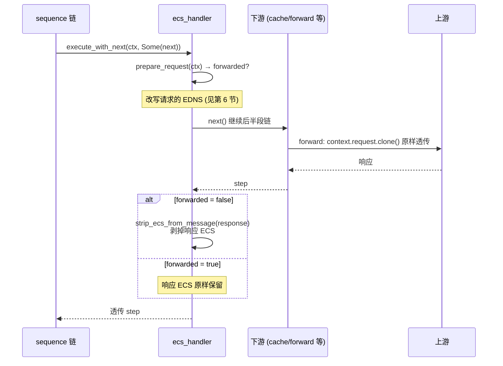
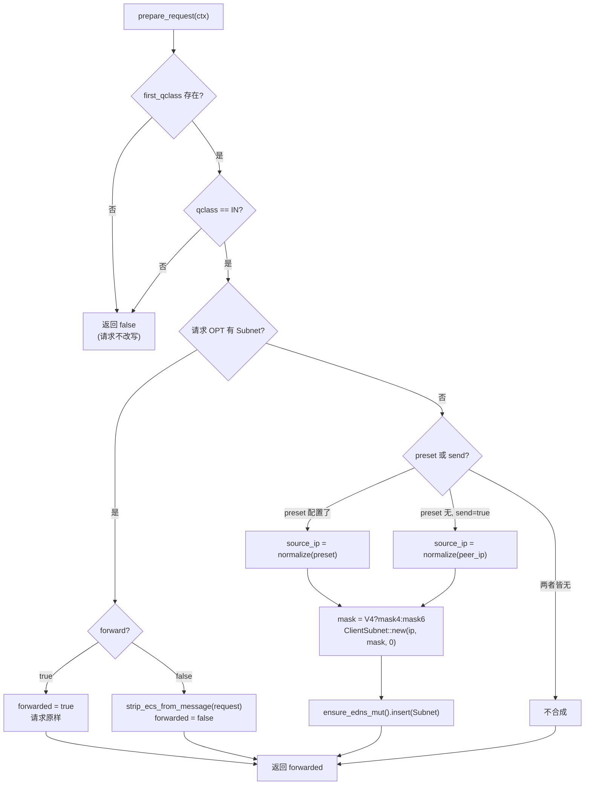
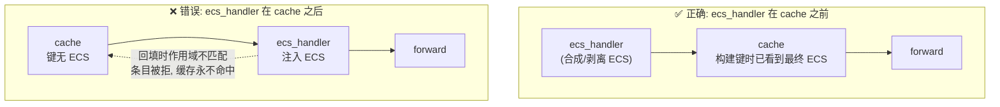
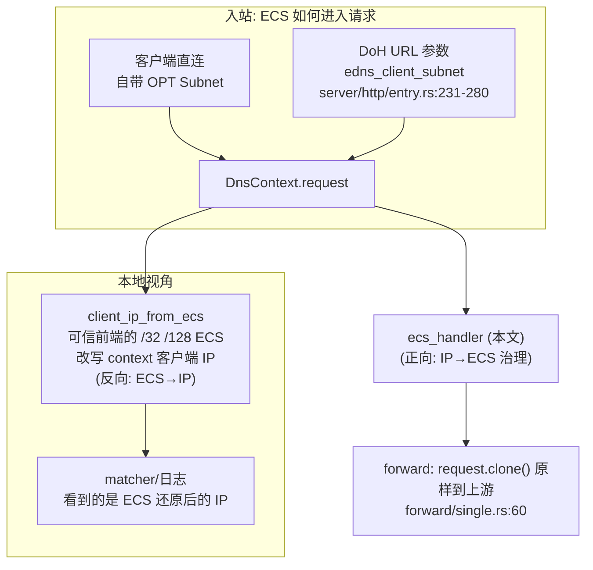

# OxiDNS `ecs_handler` 插件实现解析

> 分析基线：`v1.6.1`，分支 `fix/code-review-priorities`（HEAD `9ed5f08f`）。
> 代码位置：`src/plugin/executor/ecs_handler.rs`（434 行，含测试；实现约 238 行）。
> 关联模块：ECS 载荷模型在 `crates/proto/src/rdata/basic.rs`（`ClientSubnet`），IPv4-mapped 归一化在 `src/infra/network/ip.rs`，cache 的 ECS 作用域联动在 `src/plugin/executor/cache/key.rs`。
> 本文只描述当前代码实际行为；与文档/注释不一致之处集中在第 12 节。

## 1. 插件定位

`ecs_handler` 是一个 **executor 插件**（`with_next() = true` 的包裹式插件），实现 RFC 7871 EDNS Client Subnet 在**出站方向**（本服务器 → 上游）的治理：客户端带来的 ECS 是转发、剥离还是以它为源合成新的 ECS，由配置决定；下游链返回后，还要决定响应里的 ECS 是否剥掉。

它不做 DNS 语义判断，也**不按查询内容分流**——那是 sequence + matcher 的职责；它只做"请求 EDNS 准备 + 响应 EDNS 清理"这一对包裹动作。

```yaml
- tag: ecs
  type: ecs_handler
  args:
    forward: false   # 客户端自带 ECS 时: true=保留, false=剥离
    send: true       # 请求无 ECS 时: 用客户端源 IP 合成 ECS
    # preset: 203.0.113.7   # 可选: 固定 ECS 源 IP (优先于源 IP)
    mask4: 24        # 合成 IPv4 ECS 的前缀长度, 默认 24
    mask6: 48        # 合成 IPv6 ECS 的前缀长度, 默认 48
```

核心能力：

| 能力 | 实现位置 |
|---|---|
| 客户端 ECS 保留 / 剥离（`forward`） | `ecs_handler.rs:115-120` |
| 无 ECS 时从源 IP 或 `preset` 合成（`send`/`preset`） | `ecs_handler.rs:121-138` |
| 响应侧 ECS 剥离（防泄漏内部子网元数据） | `ecs_handler.rs:93-99`、`229-233` |
| quick setup `ecs [ip[/mask]]` | `ecs_handler.rs:160-178` |
| 非 IN class 请求跳过请求侧处理 | `ecs_handler.rs:106-112` |

## 2. 代码地图

| 结构 | 关键点 |
|---|---|
| `EcsHandlerConfig` | serde 配置：`forward`/`send`（默认 `false`）、`preset: Option<String>`、`mask4`/`mask6: Option<u8>`（`ecs_handler.rs:33-47`） |
| `EcsHandler` | 运行时结构：全部字段在 `create` 期固化，**无内部状态、无依赖、无后台任务**（`ecs_handler.rs:49-57`） |
| `EcsHandlerFactory` | `#[plugin_factory("ecs_handler")]`：`create` 走 YAML 配置，`quick_setup` 走 `ecs [ip[/mask]]` 参数（`ecs_handler.rs:145-179`） |

辅助函数：

| 函数 | 位置 | 语义 |
|---|---|---|
| `request_has_ecs` | `ecs_handler.rs:222-227` | 请求 OPT 里是否存在 `EdnsOption::Subnet` |
| `strip_ecs_from_message` | `ecs_handler.rs:229-233` | `edns.remove(EdnsCode::Subnet)`——只删 Subnet 选项，OPT 记录与其他选项保留 |
| `ensure_opt_record` | `ecs_handler.rs:235-237` | `Message::ensure_edns_mut()`，OPT 不存在时创建（`crates/proto/src/message.rs:545-550`） |

proto 层语义（`crates/proto/src/rdata/basic.rs`）：

- `ClientSubnet::new(addr, source_prefix, scope_prefix)`（`basic.rs:171-183`）：`addr` **原样保存不掩码**，线编码阶段才按 `source_prefix` 截断网络位；`scope_prefix` 按构造参数存。
- `Edns::insert`（`basic.rs:798-807`）：**先删后插**，同 code 选项不重复——所以合成 ECS 时即使 OPT 里已有别的 Subnet（理论上 `request_has_ecs` 已排除）也会被覆盖。

## 3. 配置语义

| 字段 | 默认 | 作用 |
|---|---|---|
| `forward` | `false` | 请求**已带** ECS 时：`true` 保留转发；`false` 从请求中剥离 |
| `send` | `false` | 请求**不带** ECS 时：用客户端源 IP（经 IPv4-mapped 归一化）合成 ECS |
| `preset` | 无 | 固定 ECS 源 IP。**独立于 `send` 生效**：只要配置了 `preset`，即使 `send=false` 也会合成（`ecs_handler.rs:122-128`） |
| `mask4` | `24` | 合成 IPv4 ECS 的 `source_prefix`，>32 在 `create` 期报错 |
| `mask6` | `48` | 合成 IPv6 ECS 的 `source_prefix`，>128 在 `create` 期报错 |

quick setup（sequence 内联 `ecs [ip[/mask]]`，`ecs_handler.rs:160-178`）：

- 等价于 `forward=false, send=false, mask4=24, mask6=48`，参数可选给 `preset`。
- **`/mask` 后缀会被丢弃**：`ecs 203.0.113.7/24` 只取 IP 作为 `preset`，前缀仍用默认 24；`ecs 2001:db8::/32` 的 mask6 仍是 48 而非 32。要改前缀必须用完整 `args` 配置。

`preset`/源 IP 在使用前都经 `normalize_ipv4_mapped_ip`（`infra/network/ip.rs:9-17`）：`::ffff:a.b.c.d` 归一为纯 IPv4，因此掩码选择走 `mask4` 分支。

## 4. 生命周期


- `init`/`destroy` 均为空实现（`ecs_handler.rs:65-71`）；无 `$tag` 依赖声明（工厂不实现 `get_dependency_specs`），在依赖图中是零出边节点，初始化顺序无约束。
- 无内部可变状态：所有决策输入来自配置 + `DnsContext`，天然支持并发与 staged reload。

## 5. 请求主路径

`execute_with_next`（`ecs_handler.rs:86-101`）是唯一的执行入口，`execute` 直接委托给它（`next=None`，用于 standalone 场景）：



关键点：

- **返回值透传**：`continue_next!` 的结果原样返回（`Next`/`Stop`/`Return` 都不拦截），ecs_handler 只包络、不改控制流。链上后续执行器返回 `Stop`/`Return` 时同样先做响应侧剥离再上抛。
- **`forwarded` 的判定发生在请求改写期**：只有"客户端自带 ECS 且 `forward=true`"才置位。合成 ECS（`send`/`preset`）不置位——合成路径下响应 ECS 一律剥离。
- **响应剥离是无条件兜底**：即使 `context.response()` 尚未设置（比如下游链还没产出响应就返回了），`response_mut()` 为 `None` 时是 no-op；反之只要响应存在且 `forwarded=false`，其 OPT 中的 Subnet 选项被移除。

为什么默认剥响应 ECS（模块文档 `ecs_handler.rs:14-16`）：当 ECS 是本服务器合成的（`send`/`preset`），它是**给上游看**的内部子网元数据，不是客户端声明的；上游应答可能回显带非零 `scope_prefix` 的 ECS（RFC 7871：scope 非零表示应答按该子网定制）。把这类元数据透传给下游客户端既泄漏内部拓扑，也可能违反 RFC 7871 第 7.1 节"代理不应把 ECS 转发给不期望它的客户端"的精神。只有客户端自己带了 ECS 且被转发时，响应里的 ECS 才是客户端预期的。

## 6. `prepare_request` 决策逻辑

请求侧改写的完整分支（`ecs_handler.rs:105-142`）：



三个值得注意的分支行为：

1. **`preset` 独立于 `send`**：`preset` 命中时完全不看 `send`。`preset + send=true` 的组合里 `send` 只对"没配 preset 的部署"有意义；`preset` 未配置且 `send=false` 时，无 ECS 请求保持无 ECS。
2. **合成的 `scope_prefix` 恒为 0**（`ClientSubnet::new(source_ip, mask, 0)`，`ecs_handler.rs:135`）：向上游声明"我没有作用域约束"，上游可自由决定是否返回 scope。响应侧的 scope 语义由 cache 的联动逻辑消化（第 7 节）。
3. **非 IN class 的不对称处理**（`ecs_handler.rs:106-112`）：qclass 非 IN（或无 question）时请求侧完全不动——**即使 `forward=false`，客户端自带的 ECS 也留在请求里**（forward 透传后仍会到达上游）；但响应侧剥离照常生效（`forwarded=false`）。ECS 只对 IN 查询有意义，这是防御性的边界行为，见第 12 节。

## 7. 与 `cache` 的 ECS 作用域联动

cache 是 ECS 语义的另一半：同一域名对不同子网可能返回不同应答（CDN 场景），所以缓存键必须感知 ECS，否则会出现**跨客户端污染**。

cache 侧机制（`src/plugin/executor/cache/`）：

| 机制 | 位置 | 语义 |
|---|---|---|
| `ecs_in_key` 配置 | `cache/mod.rs:138` | 是否把 ECS 作用域纳入缓存键 |
| `EcsScopeDigest` | `cache/key.rs:14-20` | `(family, source_prefix, scope_prefix, network_len, network[..])`——按 `source_prefix` 截断网络位的摘要 |
| `build_cache_key` | `cache/key.rs:128-147` | `ecs_in_key=true` 时提取请求当前 ECS 摘要进键 |
| 插入时校验 | `cache/mod.rs:1624-1644` | 键中作用域 ≠ 请求当前作用域 → 拒绝入缓存；无作用域键 + 响应回显非零 scope → 拒绝入缓存 |

插入时校验的存在理由（`cache/mod.rs:1627-1630` 注释直接点名本插件）：**缓存键在 cache 执行点构建**，而 `ecs_handler` 在链的更上游或下游都可能改 ECS。若 ecs_handler 排在 cache **之后**合成 ECS，cache 构建键时请求还没有 Subnet（键无作用域），等回填时请求已带 ECS——校验发现不一致，条目被拒绝，缓存**永远不命中**，且上游每次真实回源。

由此得出编排约束：



- `send`/`preset` 部署：ecs_handler **必须**在 cache 之前；cache 侧还要开 `ecs_in_key: true`，否则不同子网的应答会竞争同一个无 ECS 键——插入校验（请求当前作用域 ≠ 键作用域，`cache/mod.rs:1633-1635`）会把它们全部拒绝，退化为"不缓存但也不污染"。
- `forward=false` 部署：ecs_handler 在 cache 之前剥离 ECS，所有客户端共享无作用域键，命中率最高。
- `forward=true` 部署：客户端自带的 ECS 参与键（cache `ecs_in_key: true` 时按 source_prefix 截断聚合）。

## 8. ECS 数据面的其他入口（协作全景）



| 插件 / 入口 | 方向 | 职责 | 与 ecs_handler 的关系 |
|---|---|---|---|
| `ecs_handler` | 出站 | 治理"发给上游"的 ECS | —— |
| `client_ip_from_ecs` | 入站 | 把可信前端（默认仅环回）带来的 **完整主机前缀**（`/32`//`/128`）ECS 还原成 `DnsContext` 的客户端 IP（`client_ip_from_ecs.rs:54-97`） | 互补：它改"我是谁"，ecs_handler 改"我告诉上游我是谁"；注意它只认主机前缀，对 `/24` 这类子网前缀 ECS 不生效 |
| DoH `edns_client_subnet` URL 参数 | 入站 | 解析为 `ClientSubnet` 插入请求 OPT（`server/http/entry.rs:231-280`） | 对 ecs_handler 而言等价于"客户端自带 ECS"，走 `forward` 分支 |
| `forward_edns0opt` | 出站→响应 | 按 code 白名单把请求 OPT 选项回显到响应 | 与 ECS 无直接耦合，但若配置了 code 8（Subnet）会把 ECS 回显进响应——与 ecs_handler 的剥离语义叠加时，执行顺序决定最终结果 |
| `query_recorder` | 旁路 | 查询记录里捕获 ECS（`query_recorder/capture.rs`） | 只读，不受剥离影响（录制的是当时刻的状态） |

典型组合（dnsmasq/stubby 前置场景）：前端把真实客户端 IP 放进 ECS → `client_ip_from_ecs` 还原为上下文客户端 IP 供 matcher 分流 → `ecs_handler send=true mask4=24` 用还原后的 IP 重新合成标准 ECS 发给上游。

## 9. 性能要点

- **热路径成本极低**：一次 `first_qclass` 读取、一次 OPT 选项线性查找（选项数通常个位数）、命中时一次 `remove`+`push`（`Arc::make_mut` 写时克隆 EDNS 内层）或一次 `remove`；无分配密集操作、无 I/O、无锁。
- **包裹但不深**：`with_next=true` 使它成为 continuation 包络，async 栈深 +1 层；除 `next()` 外无额外 await。
- **无启动成本**：`create` 期完成全部解析/校验（mask 范围、preset 解析），`init` 为空。
- `execute`/`execute_with_next` 均挂 `#[hotpath::measure]`（`ecs_handler.rs:80,85`）。
- 请求改写发生在**入链一次**，链上多个下游（cache、forward、多个 upstream 并发）共享同一份最终 EDNS 状态，不存在每上游重复合成。

## 10. 测试盘点

`ecs_handler.rs:239-433`，8 个用例：

| 测试 | 验证点 |
|---|---|
| `test_parse_handler_from_value_validation` | `mask4: 64` 在解析期报错；无 args 走默认 |
| `test_ecs_handler_send_inserts_request_ecs_and_strips_response_ecs` | send 合成进请求 + 响应 ECS 被剥离 |
| `test_ecs_handler_forward_keeps_client_and_response_ecs` | forward 保留请求与响应两侧 ECS |
| `test_ecs_handler_strips_client_ecs_when_forward_disabled`（及重复用例 `_from_request`） | forward=false 剥请求 ECS |
| `test_ecs_handler_send_appends_ecs_to_existing_opt` | 已有 OPT（无 Subnet）时追加不重建 |
| `test_ecs_handler_send_creates_opt_when_request_has_none` | 无 OPT 时创建 |
| `test_ecs_handler_strips_ecs_from_response` | 合成路径下响应 ECS 剥离 |

覆盖缺口（与第 12 节对应）：无 `preset` 生效路径的测试、无非 IN class 分支的测试、无 quick setup `/mask` 丢弃行为的测试。

## 11. 使用模式速查

```yaml
# 场景 1: 对上游隐藏客户端精确 IP, 但让 CDN 按城市级子网调度
- tag: ecs_privacy
  type: ecs_handler
  args: { forward: false, send: true, mask4: 24, mask6: 48 }
# 编排: ecs_privacy → cache(ecs_in_key: true) → forward

# 场景 2: 指定出口 ECS (如部署在多出口网关后)
- tag: ecs_egress
  type: ecs_handler
  args: { preset: 203.0.113.7, mask4: 24 }
# preset 不需要 send; 无 ECS 请求也会带上 203.0.113.7/24

# 场景 3: 上游不支持 ECS, 彻底剥离
- tag: ecs_strip
  type: ecs_handler
  args: { forward: false }
# 无 send/preset → 不合成; 只剥客户端 ECS

# sequence 内联 (等价 forward=false send=false + 可选 preset, 掩码固定 24/48)
- exec: ecs 203.0.113.7
```

## 12. 已知边界与注意点

1. **quick setup 丢弃 `/mask`**（第 3 节）：`ecs 2001:db8::/32` 的语义容易被误读为"前缀 32"，实际仍是 48。要精确控制前缀必须写完整 args。
2. **非 IN class 时 `forward=false` 不剥请求侧 ECS**（第 6 节第 3 条）：客户端 ECS 原样到上游，与 IN class 行为不对称。因为剥离逻辑在 qclass 检查之后，可视为有意豁免（CH/TXT 类排查查询不改写），但依赖此行为前请确认上游预期。
3. **`preset` 不校验与 `mask` 的匹配**：`preset` 为 IPv6 而 `mask6` 缺省 48——若期望 `mask4`/`mask6` 跟随 preset 书写的前缀（quick setup 场景），会得到默认值。
4. **合成 ECS 的 `scope_prefix` 恒 0**：不会向上游表达"请勿回显更宽 scope"；上游若回显非零 scope，响应 ECS 会被本插件剥掉（`forwarded=false`），cache 侧无作用域键 + scoped 回显的组合也会拒绝入缓存（第 7 节）——两层防御独立生效。
5. **`cache` 之后的 ecs_handler 会让缓存永不命中**（第 7 节）：这是编排错误而非插件 bug，`oxidns check` 的依赖树能看到顺序，但不会对"语义顺序"报警。
6. **响应剥离与 LIFO 收尾顺序的相互作用**：continuation 后处理按 LIFO 执行——**上游包裹插件的收尾最后执行**（见 `learning/oxidns-plugin-sequence.md` §6，`chain.rs:1124-1156` 测试）。ecs_handler 在链上游时，它的响应剥离在所有下游包裹插件收尾**之后**运行，能兜底剥掉下游回显的 ECS；反过来，若回显类插件（如配置了 code 8 的 `forward_edns0opt`）排在 ecs_handler **上游**，其收尾在最后，可能把 ECS 重新写回响应，绕过剥离。
