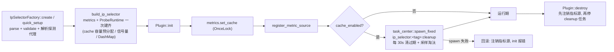
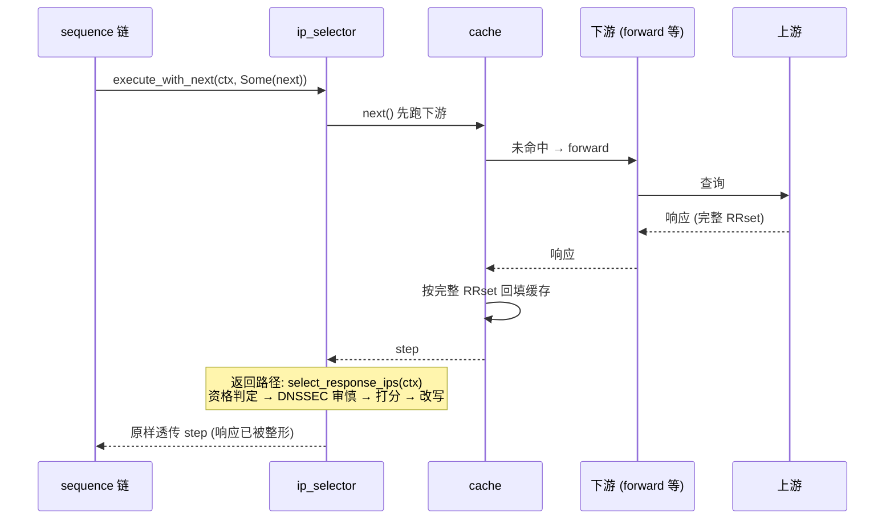
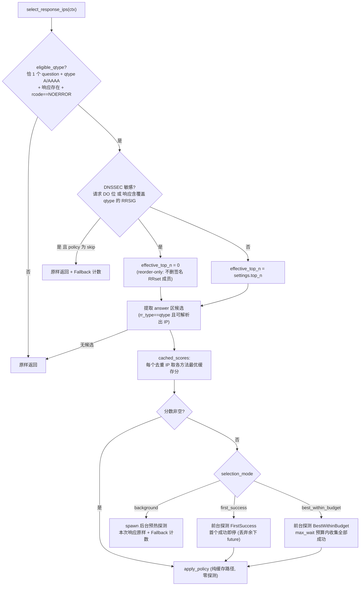
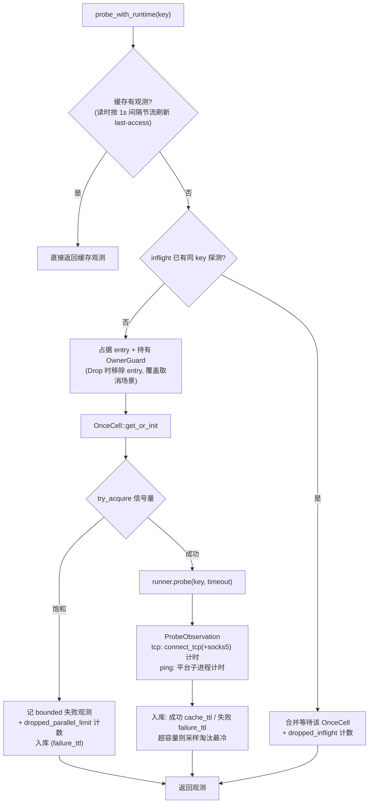

# OxiDNS `ip_selector` 插件实现解析

> 分析基线：`v1.6.1`，分支 `fix/code-review-priorities`（HEAD `f17930ec`）。
> 代码位置：`src/plugin/executor/ip_selector/`（`mod.rs` 424、`config.rs` 484、`probe.rs` 470、`policy.rs` 220、`metrics.rs` 253、`tests.rs` 682 行）。
> Feature 门控：`plugin-ip-selector`（`Cargo.toml:294-295`）；探测缓存复用 `src/infra/cache/ttl.rs` 的 `TtlCache`（与 `cache` 插件同一容器）。
> 本文只描述当前代码实际行为；与文档/注释不一致之处集中在第 14 节。

## 1. 插件定位

`ip_selector` 是一个 **executor 插件**（`with_next() = true` 的包裹式插件），对**已有响应**里的 A/AAAA 记录做"选优"：把缓存探测分数 + 有界主动探测的时延结果套在 answer 区上，按延迟重排、可裁剪到 top-N。它是**响应整形器**，不是上游选择器——模块文档（`mod.rs:4-22`）明确划定了分工：

| 职责 | 归属 | 与本插件的关系 |
|---|---|---|
| 上游并发/竞速 | `forward` / `fallback` | 不参与；本插件只处理已拿到的响应 |
| 双栈抑制（A/AAAA 互斥） | `prefer_ipv4` / `prefer_ipv6`（`dual_selector.rs`） | 不参与；文件名里的 "selector" 易混淆，实际是两类插件 |
| 域名分流规则 | `sequence` + matcher/provider | 不参与；放哪条链由 sequence 编排 |
| A/AAAA 记录按时延重排与裁剪 | **本插件** | 探测 TCP 连接/ICMP 时延 → 排序 → top-N |

设计上**全面 fail-open**（`mod.rs:14-15`）：探测失败、超时、缓存未命中、并发饱和都不会移除原始响应——最坏结果是"保持上游顺序"。

```yaml
- tag: ip_select
  type: ip_selector
  args:
    selection_mode: best_within_budget   # first_success | best_within_budget | background
    probe_methods: ["tcp:443", "tcp:80"] # tcp:<port> | ping | none
    probe_stagger: 200                   # 相邻方法错峰启动 (ms)
    probe_timeout: 600                   # 单次探测超时 (ms)
    max_wait: 1000                       # 前台探测总预算 (ms)
    top_n: 1                             # 保留前 N 个地址; 0 = 仅重排
    dnssec_policy: reorder_only          # reorder_only | skip
    max_parallel_probes: 256
    cache:
      enabled: true
      size: 4096
      ttl: 3600        # 成功观测缓存 (s)
      failure_ttl: 60  # 失败观测缓存 (s)
    # outbound: my_proxy   # 可选: 出站 profile (探测经其代理)
    # socks5: "user:pass@host:1080"  # 可选: 插件级 SOCKS5
```

推荐编排位置（模块文档 `mod.rs:17-22`）：**在 cache 之前、上游执行器之前**——`ip_selector -> cache -> forward/hosts/...`。因为 `with_next` 返回路径处理在 cache 回填之后才运行，cache 存的是完整上游 RRset，客户端拿到的才是裁剪后的响应。

## 2. 代码地图

| 文件 | 行数 | 职责 |
|---|---:|---|
| `mod.rs` | 424 | 执行器入口、三种选择模式编排、init/destroy、工厂注册、socks5/outbound 解析 |
| `config.rs` | 484 | YAML + quick setup 解析、默认值、校验（`deny_unknown_fields`，无兼容别名） |
| `probe.rs` | 470 | 探测执行、`(IP, method)` 缓存、in-flight 合并、信号量并发上限、TCP/ping 后端、缓存清理与淘汰 |
| `policy.rs` | 220 | 响应资格判定、候选提取、DNSSEC 审慎处理、排序与替换（唯一触碰 DNS 语义的地方） |
| `metrics.rs` | 253 | 按方法/来源/丢弃原因的原子计数器 + 缓存 gauge |
| `tests.rs` | 682 | 23 个用例，`FakeProbeRunner` 注入确定性观测 |

运行时结构：

| 结构 | 关键点 |
|---|---|
| `IpSelector` | `tag` + 不可变 `settings` + `Arc<ProbeRuntime>` + cleanup 任务句柄（`mod.rs:68-78`） |
| `IpSelectorSettings` | 全部默认值在 `settings_from_config` 落地；YAML/quick setup/无参数走同一条校验路径（`config.rs:177-193`、`255-337`） |
| `ProbeRuntime` | `TtlCache<ProbeKey, Arc<ProbeObservation>>` + `Semaphore` + `DashMap<ProbeKey, Arc<OnceCell>>` + runner + metrics（`probe.rs:110-145`），`create` 期一次构建 |
| `ProbeKey` | `(IpAddr, ProbeMethod)`——同 IP 按方法分别观测 |
| `ProbeObservation` | `{success, latency_ms, sampled_at_ms}`，**失败也缓存**（`probe.rs:72-77`） |
| `ProbeRunner` | trait 抽象后端；生产实现 `SystemProbeRunner`（tcp connect / ping 子进程），测试用 `FakeProbeRunner`（`probe.rs:151-186`） |

## 3. 配置语义

| 字段 | 默认 | 说明 |
|---|---|---|
| `selection_mode` | `first_success` | 见第 6 节三模式 |
| `probe_methods` | `["tcp:443", "tcp:80"]` | `tcp:<port>`（端口 >0）/ `ping` / `none`（仅被动，不能与其他方法混用，`config.rs:414-418`）；单串或列表均可，去重**保留顺序**——顺序决定错峰优先级（`config.rs:407-409`） |
| `probe_stagger` | 200ms | 第 i 个方法的启动延迟 = `stagger × i`（`probe.rs:463-470`），让优先方法抢先、失败后兜底方法不必等满超时 |
| `probe_timeout` | 600ms | 单次探测超时，必须 >0 |
| `max_wait` | 1000ms | 前台探测总预算，必须 >0 |
| `top_n` | 1 | 保留的地址记录数；`0` = 仅重排不删 |
| `dnssec_policy` | `reorder_only` | `skip` = DNSSEC 敏感响应完全不动；旧字段 `reorder_only: true` 等价于默认值（`config.rs:266-269`） |
| `max_parallel_probes` | 256 | 插件级探测信号量；饱和 = 记一次失败观测而非排队 |
| `cache.*` | enabled/4096/3600s/60s | 失败 TTL 更短：抑制重试风暴同时让恢复被及时察觉（`probe.rs:329-335`） |
| `outbound` / `socks5` | 无 | 探测走哪个出站。两者同时给出时 `outbound` profile 的代理生效（`outbound::global().resolve_policy` 的代理字段覆盖，`mod.rs:395-404`） |

quick setup：`ip_selector [mode] [methods...]` 位置式——首 token 若是三种模式名之一则取为模式，其余 token 全部当探测方法（`config.rs:221-253`）。例如 `ip_selector best_within_budget tcp:443 ping`。

校验特征：`deny_unknown_fields`——拼错字段名/模式名直接启动失败（`config.rs:116,164`），不静默忽略。

## 4. 生命周期



- `create` 期完成一切可能失败的工作（解析、校验、代理解析、runtime 构建）；`init` 只挂指标源和后台任务，失败即回滚已注册的指标源（`mod.rs:110-113`）。
- `destroy` 顺序与 `init` 镜像：先注销指标源再停任务（`mod.rs:123-136`）。
- 无 `$tag` 依赖声明，依赖图中零出边，初始化顺序无约束。

## 5. 请求主路径



- `execute_with_next`（`mod.rs:151-164`）：先 `continue_next!` 让下游填好 `context.response`，再 `select_response_ips`，最后**原样透传 step**——不改控制流，只整形响应。
- 无 next（standalone）时退化为"处理 context 里已有的响应"。
- fail-open 是贯穿主路径的底线：所有提前返回路径都保持响应原样，只多记一次 `selected_fallback_total`。

## 6. 选择决策流程

`select_response_ips`（`mod.rs:168-227`）的完整分支：



三种模式是**延迟换质量**的旋钮：

| 模式 | 本次查询延迟 | 效果 |
|---|---|---|
| `background` | 零增加 | 本次保持上游顺序；探测结果给后续查询用 |
| `first_success`（默认） | ≤ 首个成功探测耗时（受 `max_wait` 封顶） | 有分即改写；胜出 future 被丢弃时未完成探测自动取消 |
| `best_within_budget` | ≤ `max_wait` | 预算内收全部分数，选延迟最低者 |

## 7. 探测层：并发、合并与缓存

`probe.rs` 是唯一的网络副作用所在处。单个 `(IP, method)` 探测的完整路径（`probe_with_runtime`，`probe.rs:247-303`）：



要点：

- **合并而非排队**：并发查询打到同一 `(IP, method)` 时，后到者 `Arc<OnceCell>` 等待首个探测结果（`probe.rs:259-275`）；`InflightOwnerGuard` 的 `Drop` 保证 owner future 被 `first_success` 提前取消后 inflight 表不残留（`probe.rs:50-59`，测试 `cancelled_owner_probe_removes_inflight_entry`）。
- **饱和即失败，不排队**：`try_acquire_owned` 失败时记录一个**会入库的失败观测**——既保护本查询的延迟预算，又短暂抑制对该 IP 的重试风暴（`probe.rs:282-288`）。
- **失败观测也入库**（`failure_ttl` 60s vs 成功 3600s），见第 3 节。
- **前台收集循环**（`collect_probe_scores`，`probe.rs:201-235`）：`FuturesUnordered` + `tokio::select!` 对 `max_wait` deadline；只收录成功观测，每 IP 保留最低延迟（`update_best_score`）。`first_success` 模式在首个成功时 `break`——整个 futures 集合被 drop，未完成探测随之取消。
- **后台预热**（`spawn_background_probes`，`mod.rs:297-342`）：请求任务同步完成过滤/快照，`tokio::spawn` 后只执行探测；与前台走同一 `probe_with_runtime`，共享信号量、inflight 与缓存。
- **TCP 探测**走 `connect_tcp(DialTarget, SocketOptions, socks5)`——可经 SOCKS5 或 outbound profile 代理（代理在 `create` 期解析定死，`mod.rs:389-404`）；**ping 探测**是子进程（unix `ping -c 1`，IPv6 先试 `ping6` 再试 `ping -6`；Windows `ping -n 1`；其余平台恒失败），输出丢弃、`kill_on_drop`（`probe.rs:393-461`）。探测延迟按 wall-clock 计，ping 含进程启动开销。
- **缓存节流细节**：读命中按 1s 间隔刷新 last-access（`probe.rs:36,313-321`）；清理任务 30s 一轮、每轮按批次清过期并做采样淘汰（样本 ≤1024，按 last-access 升序移除最冷，`probe.rs:342-355`）。

## 8. 响应改写策略

`policy.rs` 是唯一解释 DNS 语义的模块。`apply_response_policy`（`policy.rs:144-204`）的排序与替换规则：

排序比较器（`policy.rs:164-177`）：

| 左候选 | 右候选 | 结果 |
|---|---|---|
| 有分 | 有分 | 按 `latency_ms` 升序；同延迟按 `original_index`（上游顺序稳定） |
| 有分 | 无分 | 有分在前（已知可用优先） |
| 无分 | 有分 | 无分在后 |
| 无分 | 无分 | 按 `original_index` |

替换（`replace_target_records`，`policy.rs:206-220`）：只替换 answer 区中 `rr_type == qtype` 且可解析 IP 的记录，**按原位置逐一换回选中记录**；CNAME 链与非地址记录保持原有相对位置不动。

前置门槛（不满足即 `Fallback`，响应不动）：

- 候选 ≤ 1 条（单地址无排序意义，`policy.rs:153-155`）；
- 没有任何候选有分（`policy.rs:157-162`）——**保证"全失败/全无分"时绝不删记录**，fail-open 在策略层的最后防线。

`top_n` 语义：`0` = 全保留仅重排；`N` = 保留排序后前 `min(N, len)` 条。`SelectionSource` 指标取自排序后第一条选中记录的分数来源（有分必排最前，故实际只有 `probe`/`cache` 两种取值）。

DNSSEC 审慎（`response_requires_dnssec_caution`，`policy.rs:112-125`）：请求 DO 位**或**响应任意区含覆盖 qtype 的 RRSIG/SIG 即视为敏感——`skip` 模式完全不动；`reorder_only` 模式强制 `top_n=0`（重排不影响 RRset 签名验证，删除会）。RRSIG 扫描覆盖 answer/authority/additional/signature 四个区（`policy.rs:127-142`）。

## 9. 可观测性

| 指标 | 类型 | 标签 | 含义 |
|---|---|---|---|
| `ip_selector_probe_total` | counter | `method`, `result` | 各方法探测成功/失败数 |
| `ip_selector_probe_latency_count` / `_sum_ms` | counter | `method` | 成功探测延迟样本数/累计（可算均值） |
| `ip_selector_selected_total` | counter | `source=probe\|cache\|fallback` | 每次响应整形决策的分数来源 |
| `ip_selector_cache_entries` | gauge | —— | 当前探测缓存条目数 |
| `ip_selector_dropped_probe_total` | counter | `reason=parallel_limit\|inflight` | 信号量饱和丢弃 / 合并等待次数 |

全部原子计数（`Relaxed`），按 `plugin_tag` 注册为 `MetricSource`（`metrics.rs:134-252`）。注意 `dropped_inflight` 名为 dropped 实为**合并**——等待者是加入了已有探测而非被丢弃（第 14 节第 5 条）。

## 10. 性能要点

- **create 期建齐**：缓存容量、信号量、DashMap、metrics 全在 `create` 构建；请求路径只读 `Arc`（`mod.rs:406-424` 注释明示）。
- **热路径无锁竞争点**：`TtlCache`/`DashMap` 分片；读命中按 1s 节流刷新访问元数据，高频命中成本近似一次 map 读。
- **缓存命中即短路探测**：`cached_scores` 非空就完全不发探测（`mod.rs:197-201`）——warm 之后的查询是纯内存排序。
- **预算即边界**：`max_wait` deadline + `first_success` 主动丢弃 + 信号量 `try_acquire`，三重机制保证前台等待有上界，无排队放大。
- `execute`/`execute_with_next` 均挂 `#[hotpath::measure]`（`mod.rs:145,150`）。
- 后台预热的过滤在请求任务内同步完成，spawn 出去的任务只做探测（`mod.rs:299-301`）。

## 11. 测试盘点

`tests.rs` 23 个用例，`FakeProbeRunner` 按预置 `(ProbeKey, Observation)` 表返回（可加延迟），使策略测试不依赖真实 socket：

| 分组 | 用例 | 验证点 |
|---|---|---|
| 配置 | `parse_config_*` ×7、`quick_setup_parses_mode_and_methods`、`factory_create_accepts_default_config` | 原生字段名、outbound/socks5 校验、未知字段/缓存字段/模式拒绝、位置式解析、默认配置可建 |
| 资格 | `non_a_aaaa_query_passes_through` | 非 A/AAAA、多 question、非 NOERROR 均直通 |
| 选择 | `best_within_budget_selects_fastest_probe_candidate`、`cache_hit_avoids_probe_and_selects_cached_score` | 预算内选最快；缓存命中零探测 |
| fail-open | `failure_without_scores_keeps_original_response`、`background_mode_returns_original_and_warms_cache` | 全失败保原序；background 返回原响应且预热 |
| 保真 | `keeps_cname_and_non_address_records`、`handles_aaaa_records`、`with_next_processes_downstream_response` | CNAME/非地址记录保留、AAAA 路径、with_next 回程处理 |
| DNSSEC | `dnssec_reorder_only_prevents_deletion`、`dnssec_skip_keeps_original` | 敏感响应禁删 / 完全不动 |
| top_n | `top_n_zero_reorders_without_deleting` | `top_n=0` 仅重排 |
| 并发 | `inflight_probes_are_coalesced`、`cancelled_owner_probe_removes_inflight_entry` | 同 key 合并；owner 取消后 inflight 清理 |

## 12. 使用模式速查

```yaml
# 典型: 探测优选 + 缓存 + 转发
- tag: ip_select
  type: ip_selector
  args: { selection_mode: best_within_budget, probe_methods: ["tcp:443"], top_n: 1 }
- tag: cache_main
  type: cache
  args: { size: 8192 }
- tag: main
  type: sequence
  args:
    - exec: $ip_select     # 必须在 cache 之前: 返回路径整形, cache 存完整 RRset
    - exec: $cache_main
    - exec: forward 223.5.5.5
    - exec: accept

# 被动模式: 只用缓存分数, 不主动探测 (由其他实例或历史数据喂分)
- exec: ip_selector none

# 代理出站的探测 (探测路径 = 实际使用路径)
- tag: ip_select_via_proxy
  type: ip_selector
  args: { outbound: my_proxy, probe_methods: ["tcp:443"] }
```

- 想要"零延迟代价"用 `background`（首次查询保持原序，后续受益）；能接受 ≤1s 换最优选 `best_within_budget`；默认 `first_success` 是折中。
- `top_n: 1` 会把多地址响应裁成 1 条——对需要完整 RRset 的客户端（如做自身连通性测试的应用）改用 `top_n: 0`。
- 探测经 `outbound`/`socks5` 时测得的是"服务器经代理到目标"的延迟，与客户端直连体验可能不同。

## 13. 与其他插件的协作

| 插件 | 关系 |
|---|---|
| `cache` | 编排上 ip_selector 在前。cache 在**链中**按完整 RRset 建键回填；ip_selector 的整形发生在 cache 的 `execute_with_next` 返回之后，不影响缓存内容。反序（cache 在前）时：命中且 `short_circuit: true` 会直接短路返回，整形完全被绕过；`short_circuit: false` 则每次命中都在返回路径重新整形（缓存里存的是未整形 RRset，整形结果不被复用） | |
| `forward` / `fallback` | 无交互：上游竞速归它们，本插件只看最终响应 |
| `prefer_ipv4` / `prefer_ipv6`（`dual_selector.rs`） | 互补：双栈抑制（A/AAAA 互斥）归它们；同族内选优归本插件。可串联 |
| `ecs_handler` | 同为 with_next 返回路径处理器。两者都在链上游时，LIFO 决定整形先后（见 `learning/oxidns-plugin-sequence.md` §6）——ip_selector 重排不影响 ECS 剥离，但若 ecs_handler 在其上游，其收尾（剥 ECS）最后执行 |
| `sequence` | 依赖图零出边；放置顺序全靠 sequence 编排，静态检查不做语义顺序告警 |

## 14. 已知边界与注意点

1. **默认 `top_n: 1` 会裁响应**：任何候选有分时，多地址 A/AAAA 响应被裁到 1 条。这是插件的预期行为但容易被忽视；客户端需要完整 RRset 时显式配 `top_n: 0`。
2. **DNSSEC reorder_only 仍会重排**：RRSIG 验证与 RRset 顺序无关，但个别客户端若对响应顺序有自身预期（如按上游顺序做故障切换），重排仍可观察。
3. **`cache.enabled: false` 时每次冷查询都会真探测**：不读也不写缓存，信号量与 `max_wait` 是唯一防线；前台模式下探测失败也无记忆，每次查询重试。被动 `none` 方法同理（仅当缓存里有分才生效）。
4. **ping 探测的延迟含进程启动开销**，且依赖系统 `ping` 二进制与权限；跨平台行为差异大（unix `ping6`/`ping -6` 回退、Windows `-n`、其他平台恒失败）。生产建议优先 `tcp:` 方法。
5. **`dropped_inflight` 语义名实不符**：该计数器记录的是合并等待（coalesced），不是丢弃；排障时不要把它的增长误读为探测被拒绝（真正的拒绝是 `reason=parallel_limit`）。
6. **代理在 `create` 期解析定死**：`outbound` profile / `socks5` 的解析结果固化进 `SystemProbeRunner`，运行期改 outbound 配置需走插件重载才生效。
7. **探测饱和写失败观测**：信号量打满时产生的是一次入库的失败观测（60s TTL），期间该 `(IP, method)` 不会重试——高负载下这会把"服务器忙"误记为"IP 不可达"，属于用可用性换延迟预算的有意取舍。
8. **多 question / 非 NOERROR / 非 A-AAAA 查询完全直通**，包括 rcode != NOERROR 的响应（负答案无地址可选）。
