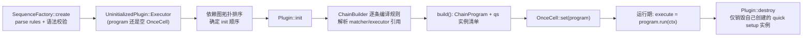
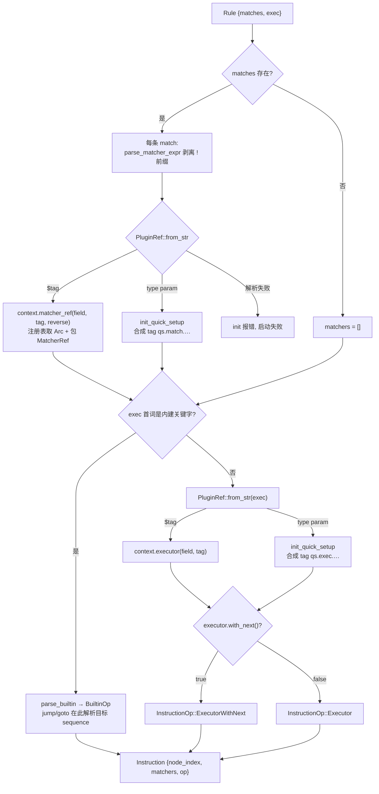
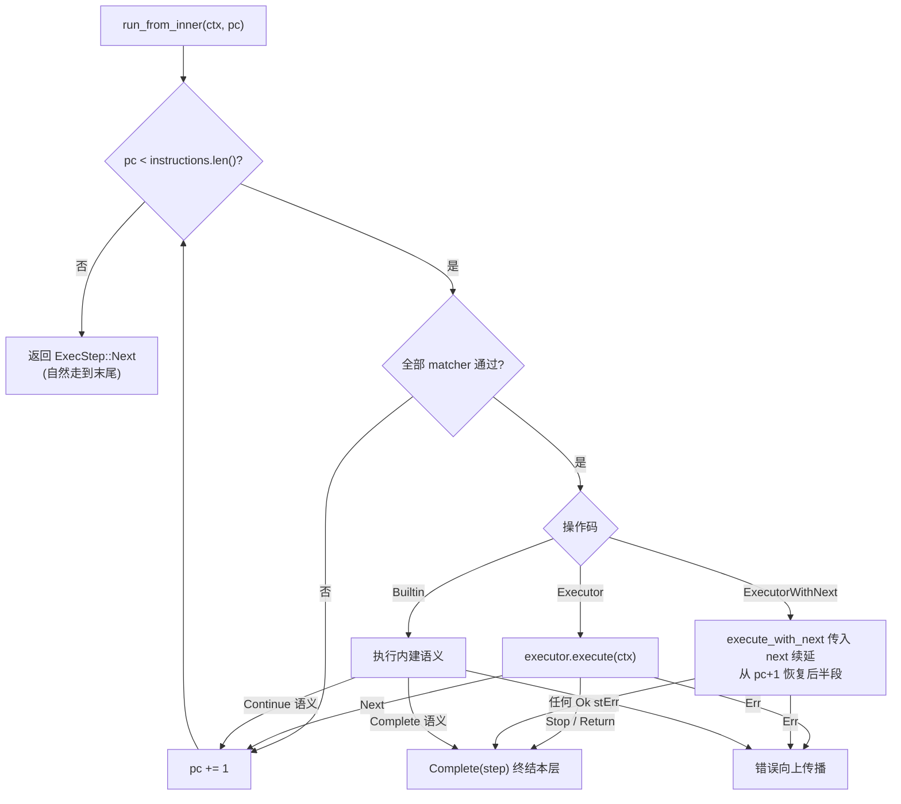
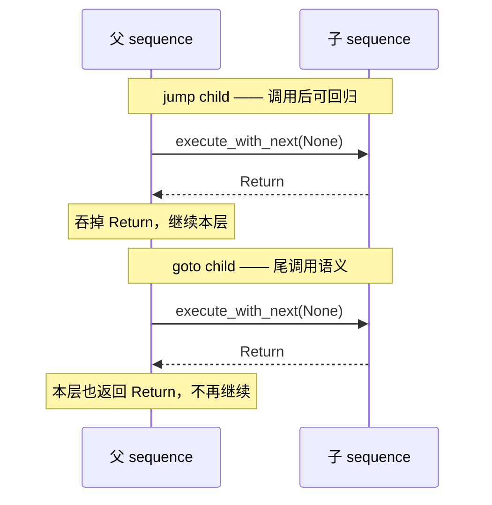

# OxiDNS `sequence` 插件实现解析

> 分析基线：`v1.6.1`，分支 `fix/code-review-priorities`（HEAD `9ed5f08f`）。
> 代码位置：`src/plugin/executor/sequence/`（`mod.rs` 609 行、`chain.rs` 1507 行，均含测试）。
> 生态位概述见 `learning/oxidns-plugin.md` 第 7 节；本文是对 sequence 自身的完整展开。
> 本文只描述当前代码实际行为；与文档/注释不一致之处集中在第 13 节。

## 1. 插件定位

`sequence` 是一个 **executor 插件**，也是 OxiDNS 请求管线的**编排中枢**：所有 server 的 `entry` 都指向一个 sequence，由它按规则顺序调度其他 executor 与 matcher。它自己不做任何 DNS 语义处理——转发、缓存、改写、拒绝全部委托给被编排的插件。

```yaml
# config.yaml 的最小形态
- tag: main_sequence
  type: sequence
  args:
    - exec: $forward
    - exec: accept

- tag: udp_server
  type: udp_server
  args:
    entry: main_sequence
    listen: ":5335"
```

核心能力：

| 能力 | 实现位置 |
|---|---|
| 规则顺序匹配 + 执行（matcher 与 executor 解耦） | `chain.rs:132-180` |
| 7 个内建控制流指令（accept/return/reject/jump/goto/mark/set_mark） | `mod.rs:29-65`、`chain.rs:275-384` |
| `$tag` 引用与 quick setup 内联表达式两种写法 | `plugin/mod.rs:521-560`（`PluginRef`） |
| 启动期把规则"编译"为扁平指令流，请求期零注册表查询 | `chain.rs:474-675`（`ChainBuilder`） |
| `with_next` 包裹式 executor（cache 等）的 continuation 接线 | `chain.rs:233-273` |
| 请求级 marks 集合的追加/替换 | `chain.rs:367-382` |
| 依赖图静态流分析（CLI check/graph 用） | `mod.rs:194-340` |

## 2. 代码地图

| 文件 | 行数（含测试） | 职责 |
|---|---:|---|
| `mod.rs` | 609 | `Sequence` 结构、`Rule` 反序列化、工厂注册、控制流语法校验、依赖声明、静态流分析（`analyze_sequence_flow`） |
| `chain.rs` | 1507 | `ChainBuilder`（规则→指令编译）、`ChainProgram`（指令循环）、`BuiltinOp`/`InstructionOp`、`ExecutorNext` continuation、单元测试 |

运行时结构：

| 结构 | 关键点 |
|---|---|
| `Sequence` | `tag` + `OnceCell<Arc<ChainProgram>>` + 原始 `rules` + quick setup 实例两个 `Vec`（`mod.rs:114-122`） |
| `Rule` | `matches: Option<Vec<String>>`（单个字符串或列表均接受）+ `exec: Option<String>`（`mod.rs:107-112`） |
| `ChainProgram` | `instructions: Vec<Instruction>` 扁平指令流，按规则顺序排列（`chain.rs:102-109`） |
| `Instruction` | `matchers: Vec<MatcherRef>`（全部通过才执行）+ `op: InstructionOp`（`chain.rs:80-89`） |
| `InstructionOp` | 三种操作码：`Executor`（普通）/ `ExecutorWithNext`（包裹式）/ `Builtin`（内建控制流）（`chain.rs:71-78`） |
| `BuiltinOp` | `Accept` / `Return` / `Reject{rcode}` / `Jump(Arc<dyn Executor>)` / `Goto(...)` / `Mark{mode, values}`（`chain.rs:33-53`） |
| `ExecutorNext` | continuation 句柄：`program: Arc<ChainProgram>` + `pc: usize`，`next()` 即 `run_from_inner(pc)`（`chain.rs:436-450`） |
| `SequenceFactory` | `#[plugin_factory("sequence")]` 静态注册，声明依赖 + 创建实例（`mod.rs:342-443`） |

## 3. 配置语法

### 3.1 规则结构

`args` 是规则数组，每条规则是 `{matches, exec}`；`exec` 必填、`matches` 可省略（省略即恒匹配）。两者都至少要有一个，否则 `create` 报 "sequence rule cannot be empty"（`mod.rs:426-433`）。

### 3.2 matches 表达式

每条 match 是一个字符串，支持三种形态：

| 写法 | 解析结果 | 示例 |
|---|---|---|
| `$tag` | 引用已声明的 matcher 插件 | `$blocked` |
| `!expr` | 前缀 `!` 表示取反（`parse_matcher_expr`，`matcher/mod.rs:178-192`） | `!$blocked` |
| `type param` | quick setup：按类型内联创建 matcher | `qname domain:example.com` |

一条规则的多个 matches 是 **AND** 关系：全部通过才执行 `exec`（`chain.rs:386-403`）。

### 3.3 exec 表达式

| 写法 | 含义 |
|---|---|
| `$tag` | 执行已声明的 executor 插件 |
| `type param` | quick setup：按类型内联创建 executor，如 `forward 1.1.1.1` |
| `accept` | 内建：停止当前 sequence，视作"已处理" |
| `return` | 内建：停止当前 sequence，把控制权交回调用方 |
| `reject [rcode]` | 内建：构造指定 RCODE 的响应并停止；缺省 `REFUSED`，支持十进制（`reject 2`）或助记名（`reject SERVFAIL`，大小写不敏感），仅限基础 RCODE 0..15（`chain.rs:677-708`） |
| `jump <tag>` | 内建：调用另一个 sequence，之后可能继续本层 |
| `goto <tag>` | 内建：调用另一个 sequence 并以其结果终结本层 |
| `mark v...` | 内建：向请求级 marks **追加**值（`mark 1` / `mark 1,2,3` / `mark 1 2 3`） |
| `set_mark v...` | 内建：**清空后设置** marks |

内建关键字**优先于**插件引用解析（`chain.rs:547-558`）：先按首词匹配 `BuiltinKind`（`mod.rs:40-52`），匹配不上才走 `PluginRef::from_str`。因此 `$` 引用永远不可能与内建冲突，而裸写 `accept` 也不会被当成名为 `accept` 的插件 tag。

### 3.4 jump / goto 目标语法约束

- 必须携带参数且**不允许 `$` 前缀**：`jump next` 合法，`jump $next` 在 `create` 阶段报错（`parse_control_flow_sequence_tag`，`mod.rs:67-82`）。语义上 jump/goto 的参数本来就是 tag，`$` 只在 matches/exec 的插件引用形态里出现。
- 目标必须是 `sequence` 类型插件：通过 `executor_of_type(field, tag, "sequence")` 解析（`chain.rs:592-604`），依赖声明同样带 `expected_plugin_type: "sequence"`（`mod.rs:385-388`）。

## 4. 生命周期



要点：

- **`create` 与 `init` 分离**是 sequence 的关键设计。`create`（`mod.rs:409-443`）只做 YAML 解析和语法校验（规则非空、jump/goto 目标格式合法），此时被引用的插件还没有初始化，无法解析 `Arc`。真正的引用解析推迟到 `init`（`mod.rs:130-143`），那时依赖图已按拓扑序保证被引用插件先初始化完毕。
- `program` 用 `OnceCell` 承载：`create` 时空、`init` 时写入一次、请求期只读（`mod.rs:137-139`、`171-175`）。
- **依赖所有权二分**：通过 `$tag` 引用的 executor/matcher 归注册表所有，sequence 只持有 `Arc`；quick setup 内联创建的实例归本 sequence 所有，tag 是确定性合成名，记录在 `quick_setup_executors` / `quick_setup_matchers`，`destroy` 时逐个销毁（`mod.rs:145-166`）。
- 合成 tag 格式（`chain.rs:617-620`、`653-656`）：
  - executor：`qs.exec.<sequence_tag>.<node_index>.<plugin_type>`
  - matcher：`qs.match.<sequence_tag>.<node_index>.<match_index>.<plugin_type>`

## 5. 编译期：ChainBuilder 把规则变成指令

`init` 时 `ChainBuilder` 逐条规则执行 `create_instruction`（`chain.rs:523-561`），产出 `Instruction`：



编译期特征：

- **quick setup 在 `init` 中即时初始化**（`init_quick_setup`，`registry/context.rs:133-143`）：工厂按类型创建实例后立刻走完整的 `init_and_wrap`，所以内联表达式不是"语法糖延迟到请求期"，而是启动期就物化成真实插件实例。
- **jump/goto 的目标在编译期就解析成 `Arc<dyn Executor>`** 存进 `BuiltinOp::Jump/Goto`，请求期只是一次 `Arc` 调用。
- 所有解析失败（未知 tag、类型不匹配、语法非法）都在 `init` 阶段暴露，请求路径上不存在"运行中发现配置错误"的可能。

## 6. 运行期：ChainProgram 指令循环

`execute` 就一行：`self.program.get().unwrap().run(context)`（`mod.rs:170-175`）。`run` 从 `pc = 0` 进入 `run_from_inner`（`chain.rs:132-180`），这是一个显式程序计数器循环，而不是递归链表：



三种操作码的精确语义（`chain.rs:182-384`）：

| 操作码 | 调用方式 | `Next` | `Stop` | `Return` | `Err` |
|---|---|---|---|---|---|
| `Executor` | `execute(ctx)` | `pc += 1` 继续 | 终结本层，返回 `Stop` | 终结本层，返回 `Return` | 向上传播 |
| `ExecutorWithNext` | `execute_with_next(ctx, Some(next))`，`next` 从 `pc+1` 恢复 | —— executor 的返回值**直接终结本层**（被包裹 executor 自己决定是否调用 `next`） | 同左 | 同左 | 向上传播 |
| `Builtin` | 见第 7 节 | —— | —— | —— | 向上传播 |

`ExecutorWithNext` 是给 cache 这类**包裹式**插件用的（`with_next() == true`）：它拿到 `next` 后可以"前后做事"，比如 cache 先查缓存、未命中再调 `next()` 走完后半段、最后回写。注意关键差异：普通 executor 的 `Next` 只是"本条指令结束"；with_next executor 的返回值**就是整个 sequence 的最终返回值**，`pc+1` 之后的指令全部被折叠进 `next` continuation 里，由它决定走不走。两个 with_next executor 连续出现时，continuation 按调用栈形成 **LIFO** 后处理顺序（`chain.rs` 测试 `test_run_executes_continuation_callbacks_in_lifo_order`，`chain.rs:1124-1156`：先 `post:second` 后 `post:first`）。

错误传播有一个保证：即使后半段指令报错，外层 with_next executor 的 `next()` 调用返回错误后仍能执行自己的收尾逻辑（`?` 在其内部消化），测试 `test_run_bubbles_execute_error_after_running_with_next_cleanup`（`chain.rs:1158-1191`）验证了这一点。

## 7. 控制流语义：ExecStep 与内建指令

### 7.1 三态 ExecStep

`ExecStep`（`executor/mod.rs:130-137`）是 sequence 控制流的通用货币：

| 值 | 含义 | 服务端视角（`server/request.rs:121-130`） |
|---|---|---|
| `Next` | 链自然走完 | `RequestExit::Completed` |
| `Stop` | 立即停止，通常已设置响应（accept / reject） | `RequestExit::Controlled` |
| `Return` | 把控制权交回调用方，不恢复当前 sequence | `RequestExit::Controlled` |

### 7.2 内建指令语义表

| 指令 | BuiltinOp | 行为 | 循环效果 |
|---|---|---|---|
| `accept` | `Accept` | 不构造响应，直接终止 | `Complete(Stop)` |
| `return` | `Return` | 终止并上抛 `Return` | `Complete(Return)` |
| `reject [rcode]` | `Reject` | `context.set_response(request.response(rcode))` 构造响应后终止（`chain.rs:304-315`） | `Complete(Stop)` |
| `mark v…` | `Mark{Append}` | `marks.extend(values)` | `Continue` |
| `set_mark v…` | `Mark{Replace}` | 先 `clear()` 再 `extend(values)` | `Continue` |
| `jump <tag>` | `Jump(child)` | 调用子 sequence | 子 `Stop` → `Complete(Stop)`；子 `Next`/`Return` → `Continue` |
| `goto <tag>` | `Goto(child)` | 调用子 sequence | 子的任何 `Ok(step)` → `Complete(step)` 原样传播 |

marks 存放在 `DnsContext.runtime`（`core/context.rs:82`），由 `mark` matcher（`matcher/mark.rs`）消费——典型的"先 `mark` 再在下游 sequence 用 `$mark_matcher` 分支"的配对用法。`copy_for_subquery` 会把 marks 克隆进子请求上下文、`apply_subquery_result` 再合并回来（`core/context.rs:370-390`），所以 marks 能穿透 forward 发起的子查询。

### 7.3 jump / goto / return 的交互矩阵

`jump` 与 `goto` 都是对子 sequence 的调用，差别只在于**对子返回值的处理**（`chain.rs:316-366`）：

| 子 sequence 结束方式 | `jump child` 之后 | `goto child` 之后 |
|---|---|---|
| 子走完（`Next`） | 继续本层 jump 后的下一条 | 本层以 `Next` 终结（向上表现为本层走完） |
| 子 `accept`（`Stop`） | `Stop` 向外传播，本层终结 | 本层以 `Stop` 终结 |
| 子 `return`（`Return`） | **吞掉** `Return`，继续本层下一条 | `Return` 穿透本层继续上抛 |



直觉模型：`jump` 是函数调用（子 `return` 回到调用点之后），`goto` 是尾调用替换（子的结束就是本层的结束，`return` 会被交给**本层的调用方**）。测试 `test_run_jump_resumes_parent_program_after_child_return`（`chain.rs:1441-1475`）与 `test_run_goto_propagates_child_return_without_resuming_parent`（`chain.rs:1477-1506`）分别固化了这两种行为。

### 7.4 请求入口的接线

服务端拿到请求后调用 `entry_executor.execute_with_next(&mut context, None)`（`server/request.rs:117-120`）。传 `None` 表示"最外层链之后没有更多指令"——sequence 内部把 `continue_next!(None)` 定义为返回 `Next`（`executor/mod.rs:94-102`），所以最外层 sequence 的 `return` 与 `accept` 在服务端不可区分（都是 `Controlled`），差异只存在于多层 sequence 之间。

## 8. 与依赖分析系统的协作

### 8.1 依赖声明（启动顺序的依据）

`SequenceFactory::get_dependency_specs`（`mod.rs:347-407`）在不创建实例的前提下重放一遍规则解析，为每个引用产出 `DependencySpec`：

| 引用位置 | 产出的边 |
|---|---|
| `matches[i]` = `$tag` | `DependencySpec::matcher(field, tag)` |
| `matches[i]` = quick setup | `expand_quick_setup_dependency_specs`（`plugin/mod.rs:264-276`）委托目标类型的工厂 `get_quick_setup_dependency_specs(param)` 声明参数隐含的插件依赖，边字段形如 `args[N].matches[M] -> quick_setup(type).<field>` |
| `exec` = `$tag` | `DependencySpec::executor(field, tag)` |
| `exec` = quick setup | 同上委托展开 |
| `exec` = `jump <tag>` / `goto <tag>` | `DependencySpec::executor_type(field, tag, "sequence")`——既校验目标是 sequence 类型，又建立依赖边 |
| `exec` = 其他内建（accept/reject/mark/…） | 无依赖 |

`analyze_dependencies`（`dependency.rs`）用这些边做缺失节点 / 自引用 / 类型校验和拓扑排序，产出 `init_order`——这保证了 `$blocked`、`jump child` 里的目标插件一定先于本 sequence 完成初始化，第 4 节的"`init` 时才解析引用"才安全。自跳（`jump self`）会被自引用检查拒绝。

### 8.2 静态流分析（配置可视化）

`analyze_sequence_flow`（`mod.rs:194-229`）把规则解析成不含运行时对象的 `SequenceFlowReport`（每条 match/exec 标注为 `Plugin` / `QuickSetup` / `Builtin` / `Invalid` 四类，含取反与目标 tag）。它在 `analyze_configuration` 中被统一收集进 `DependencyGraphReport.sequence_flows`（`plugin/mod.rs:160-165`），最终被两个 CLI 面：

- `oxidns check` / 相应命令：打印插件依赖树，sequence 节点展开成 `#N IF … THEN …` 的规则列表（`cli/graph.rs:184-248`）；
- `init_plan.rs:88-89`：把 flow 报告带进初始化计划（重载诊断/一致性用途）。

这份分析只服务于可观测性，失败时静默跳过（解析不出就不进报告），不会阻塞启动。

## 9. 可观测性

- **执行路径录制**：feature `_sequence-step-recording`（`Cargo.toml:365`，由 `plugin-query-recorder` 拉起）启用后，`record_sequence_event!` 宏（`chain.rs:21-31`）在 matcher 求值、executor 进入/退出、builtin 执行时向 `DnsContext` 推 `ExecutionPathEvent{sequence_tag, node_index, kind, tag, outcome}`。feature 关闭时宏展开为空，热路径零开销。事件只在 `context.execution_path_enabled()` 时真正落盘（`chain.rs:405-424`）。
- matcher 求值结果受运行时三态控制影响时，outcome 会是 `always_true_matched` / `always_false_not_matched` 等（`matcher/mod.rs:140-170`），录制保真正/取反引用各自的实际判定。
- `execute` 挂了 `#[hotpath::measure]`（`mod.rs:171`），纳入性能采样。

## 10. 性能与设计要点

- **一次编译，反复执行**：规则 → 指令流的全部解析（YAML、`$` 引用、quick setup 实例化、jump 目标解析）都在 `init` 完成；请求期只有 `Vec` 下标、matcher 谓词和 `Arc<dyn Executor>` 虚调用，没有注册表查询、字符串解析或分配（指令流与 matchers 集合都是预构建的）。
- **显式 pc 循环而非递归**：`run_from_inner` 用 `while pc < len` 迭代，同层指令切换没有 async 递归帧；只有 jump/goto 和 `next()` 才真正加深调用栈。深层嵌套 sequence（jump 链）的栈深度与嵌套层级成正比，与单层规则数无关。
- **`AHashSet<u32>` marks**：`mark`/`set_mark` 只做集合插入，`mark` matcher 查询是 O(1)。
- **错误即短路**：任何 executor 报错立即从 `run_from_inner` 冒泡，不做重试或降级——降级策略（fallback 等）是独立插件，由 sequence 编排而不是内建。

## 11. 测试盘点

`chain.rs` 内嵌测试（`chain.rs:746-1507`）覆盖的核心不变量：

| 测试 | 验证点 |
|---|---|
| `test_mark_mutations_append_and_replace_context_marks` | `set_mark` 清空、`mark` 追加的组合效果 |
| `test_set_mark_does_not_run_when_instruction_matchers_fail` | matcher 不通过时 builtin 不执行 |
| `test_run_executes_continuation_callbacks_in_lifo_order` | with_next continuation LIFO 后处理 |
| `test_run_bubbles_execute_error_after_running_with_next_cleanup` | 错误传播仍保证外层收尾逻辑执行 |
| `test_run_reject_sets_response_and_stops` / `_builds_response_from_request_message` / `_noerror_builds_simple_response` | reject 构造响应（保留请求 id、空应答形态） |
| `test_run_accept_stops_without_building_response` | accept 不设置响应、后续指令不执行 |
| `test_run_return_returns_to_caller` | return 语义 |
| `test_run_jump_resumes_parent_program_after_child_return` | jump 吞掉子的 Return |
| `test_run_goto_propagates_child_return_without_resuming_parent` | goto 透传子的 Return |
| `test_parse_builtin_reject_*`（5 个） | rcode 缺省/助记名大小写/多余参数/扩展 RCODE 拒绝 |
| `test_parse_mark_values_*`（2 个） | mark 值解析（分隔符、u32 边界、非法值） |
| `test_sequence_records_execution_path_*`（feature 门控 4 个） | 步骤录制事件、三态 matcher 录制、feature 关闭时零事件 |

`mod.rs` 内嵌测试（`mod.rs:460-609`）覆盖：`PluginRef` / 控制流依赖解析（`$` 前缀禁止）、`matches` 单串与列表两种反序列化、`analyze_sequence_flow` 对 match/exec/quick setup/builtin 的分类、`set_mark` 不产生依赖边。

## 12. 使用模式速查

```yaml
# 分流 + 标记 + 子链编排
- tag: mark_cn
  type: mark
  args: [1]
- tag: seq_child
  type: sequence
  args:
    - matches: $is_ad
      exec: reject NXDOMAIN
    - exec: $forward_dns
    - exec: accept
- tag: main
  type: sequence
  args:
    - matches: "qname domain:cn"
      exec: "set_mark 1"          # 打标记供下游 mark matcher 使用
    - matches: "$mark_cn"         # 命中 mark 1
      exec: "jump seq_child"      # 调用子链，子链 accept/return 都会回来
    - exec: "forward 223.5.5.5"   # quick setup 兜底
    - exec: accept
```

- 需要"处理后不再回父链"用 `goto`；需要"子链只是步骤之一"用 `jump`。
- `accept` 表达"本链负责完毕"；`return` 表达"本层提前结束，交给上层决定"——在子 sequence 里提前退出但让父链继续兜底时用。
- 包裹式插件（cache、fallback 等）在 sequence 里是**截断点**：它后面的规则进入它的 `next`，它的返回值就是整个 sequence 的返回值，不要在 with_next executor 之后写"预期一定执行"的指令。

## 13. 已知边界与注意点

1. **`get_dependency_specs` 吞解析错误**（与 `learning/oxidns-plugin.md` 第 14 节第 5 条一致）：`mod.rs:350-355` 中 YAML 解析失败直接返回空依赖列表，依赖图看起来正常；真正的报错推迟到 `create()`。配置复杂时建议配合 `oxidns check` 使用。
2. **with_next executor 之后的主观顺序假设**：见第 12 节最后一条，这是 continuation 模型的固有语义而非 bug，但容易误用。
3. **jump/goto 目标只能是 sequence**：想在 `exec` 里"跳转"到普通 executor 直接写 `$tag` 即可；jump 的额外价值只在子链控制流。
4. **最外层 `return` ≡ `accept`**：服务端把两者都归为 `Controlled`（第 7.4 节），`Return` 的"交回调用方"语义只在 sequence 嵌套中可观察。
5. **`mark` 内建与 `mark` matcher 同名不同物**：前者是 sequence builtin（写 marks），后者是独立 matcher 插件（读 marks），配置里前者只能出现在 `exec`、后者只能出现在 `matches`。
6. **`reject` 只支持基础 RCODE 0..15**：扩展 RCODE（EDNS BADVERS 等）在解析期被拒（`chain.rs:701-705`）。
