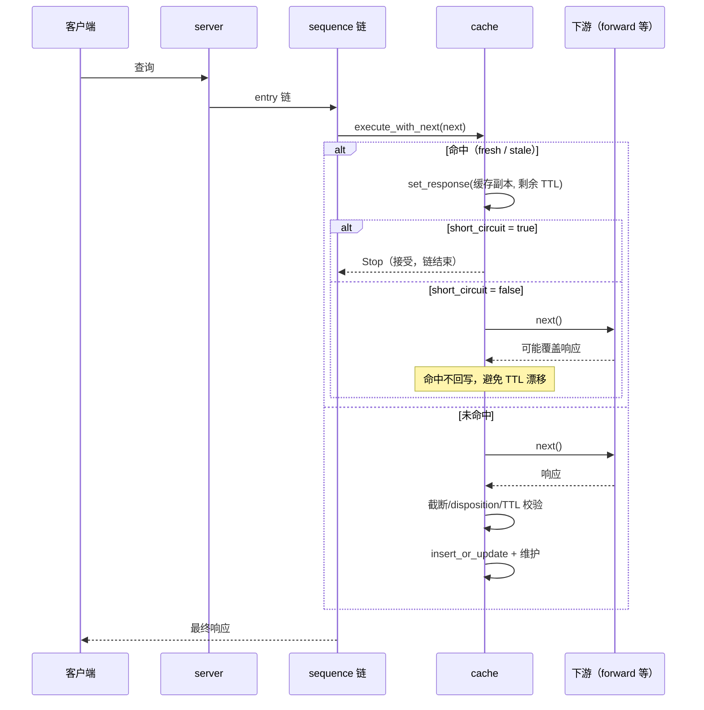
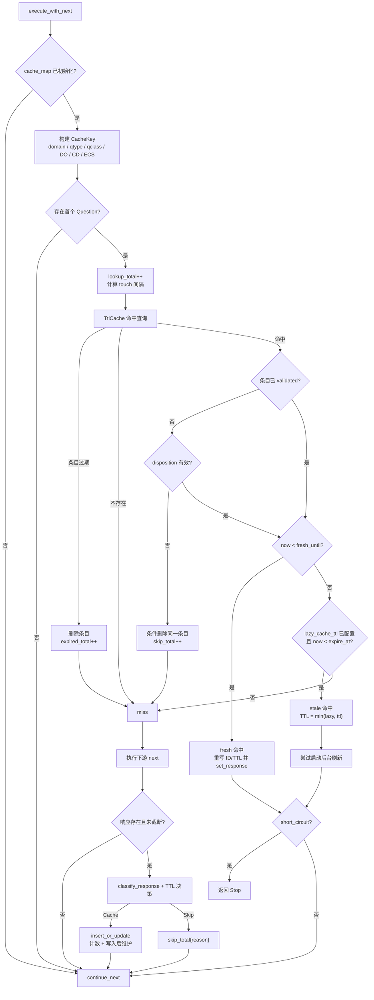
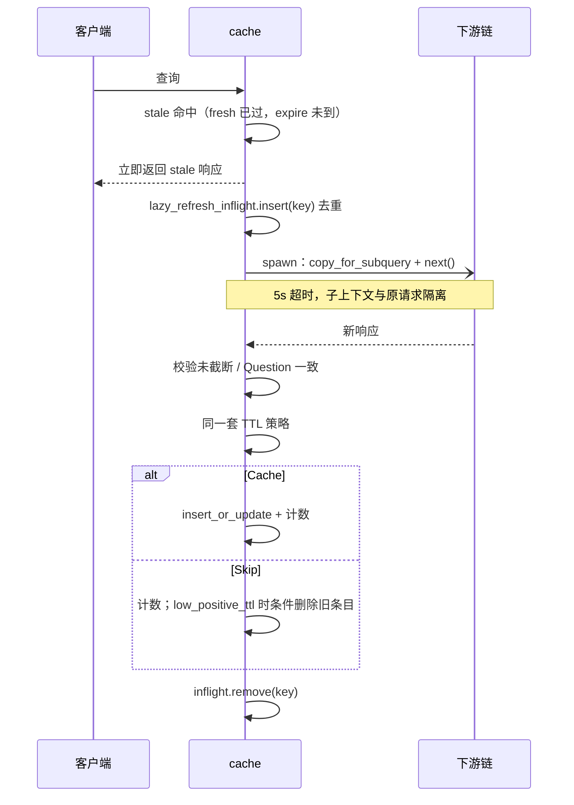
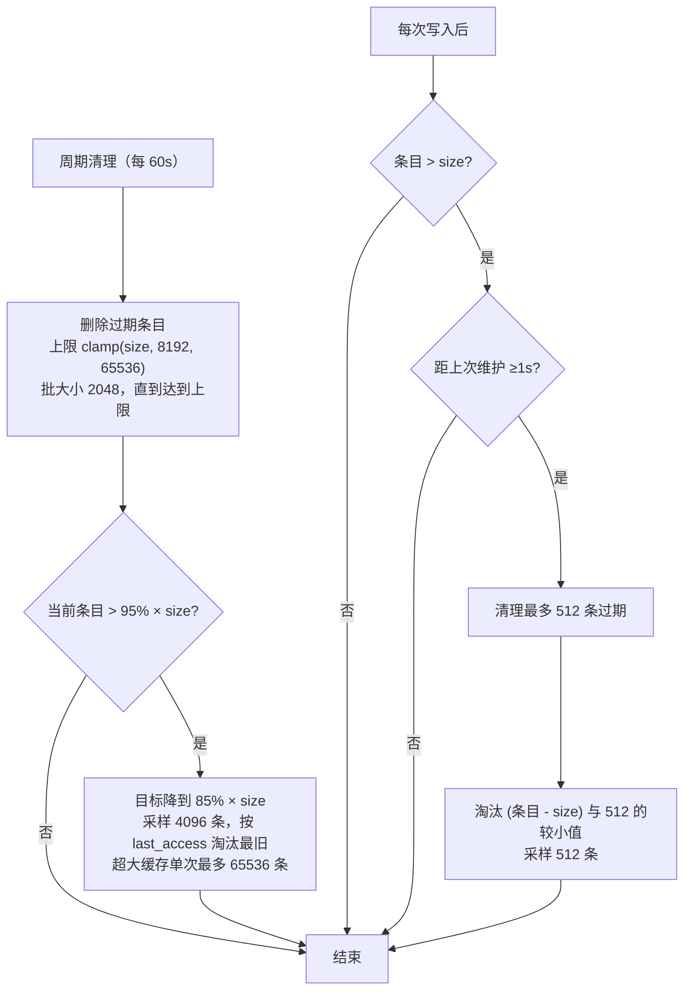
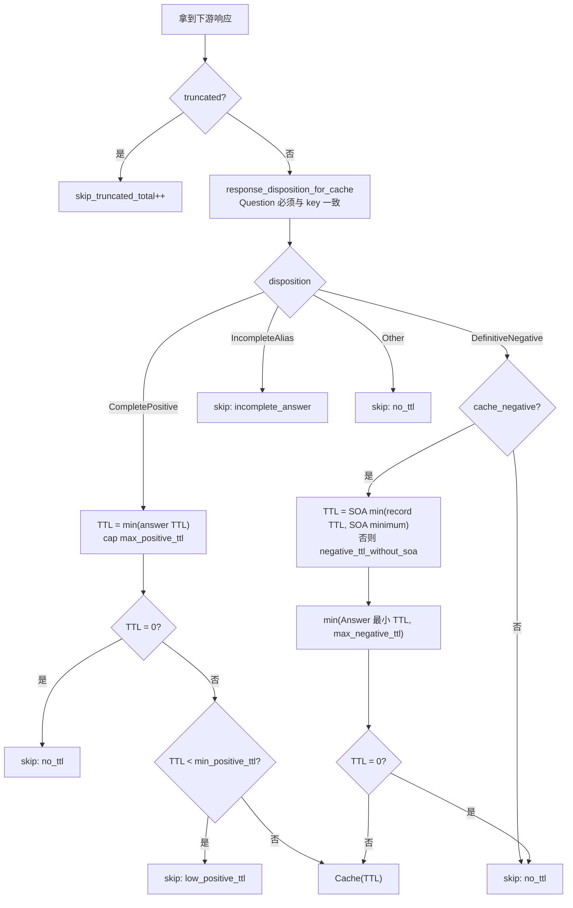

# OxiDNS `cache` 插件实现解析

> 分析基线：main v1.7.1（`ad2046d3`）· 2026-11-14。
> 代码位置：`src/plugin/executor/cache/`，缓存容器复用 `src/infra/cache/ttl.rs`，响应分类复用 `src/core/response.rs`。
> 本文只描述 main 实际行为；本分支（`fix/code-review-priorities`）独有的实现集中在文末「分支特有实现（未进 main）」一节，与文档/注释不一致之处集中在第 12 节。

## 1. 插件定位

`cache` 是一个 **executor 插件**，不是 matcher，也不提供运行时三态控制。它通过 `with_next() = true` 包裹下游链，因此典型形态是：

```yaml
- tag: cache_main
  type: cache
  args:
    size: 8192
    short_circuit: true
- exec: $cache_main
- exec: forward 1.1.1.1
```

核心能力：

| 能力 | 实现位置 |
|---|---|
| normalized qname + qtype/qclass/DO/CD(+ECS) 键 | `key.rs:114-144` |
| fresh / stale / expired / miss 四态判定 | `mod.rs:844-986`（`try_cache_hit`） |
| 命中可选短路（`short_circuit`） | `mod.rs:988-999`、`1422-1424` |
| stale 命中后台异步刷新（去重、5s 超时） | `mod.rs:1119-1248` |
| 正/负缓存 TTL 策略 | `mod.rs:1060-1093`、`1466-1542` |
| ECS 进入缓存键（可选）+ 链前 ECS 治理由 `ecs_handler` 承担 | `key.rs:74-112`、`mod.rs:811-813` |
| 采样 LRU + 分层水位淘汰 | `mod.rs:615-809` |
| wincode dump/load 持久化（激活门控 + 失败保护，PR #422） | `persistence.rs`、`mod.rs:1255-1381` |
| 插件 API（条目/批量删除/清空/导出/导入） | `api.rs:28-62` |

## 2. 代码地图

| 文件 | 行数（含测试） | 职责 |
|---|---:|---|
| `mod.rs` | 3724 | 配置解析、运行时结构、热路径、TTL 策略、清理/淘汰、持久化门控、工厂注册 |
| `key.rs` | 234 | 缓存键、ECS scope 摘要 |
| `persistence.rs` | 626 | dump 编码/落盘、load 解码/重建键/TTL 钳制、启动恢复预算 |
| `api.rs` | 891 | `/entries`、`/entries/delete`、`/entries/{id}`、`/flush`、`/dump`、`/load_dump` |

运行时结构：

| 结构 | 关键点 |
|---|---|
| `CacheConfig` | 全部字段 `Option<T>`，缺省值在 `build_cache` 中落地（`mod.rs:1732-1768`） |
| `Cache` | 不可变配置 + `OnceCell<CacheMap>` + 原子计数 + `persistence_ready`/`persistence_writable` 持久化门控 + 一个 `Mutex` 集合（lazy 去重）（`mod.rs:417-479`） |
| `CacheItem` | `resp: Message`、`ttl`（原始计算值）、`fresh_until_ms`、`validation`（`mod.rs:136-182`） |
| `CacheKey` | `domain`（小写、去尾点）、`record_type`、`dns_class`、`do_bit`、`cd_bit`、`Option<EcsScopeDigest>` |
| `CacheMap` | `TtlCache<CacheKey, Arc<CacheItem>>`，底层 `DashMap` + AHash（`ttl.rs:17-18、48`） |
| `CacheMetrics` | 按 `plugin_tag` 注册的 `MetricSource`，缓存 map 句柄存于 `OnceLock`，计数器用 `Relaxed` 原子（`mod.rs:218-276`） |

`TtlCache` 提供的语义（`src/infra/cache/ttl.rs`）：

- `get_retained_cloned_status()`：以 `expire_at_ms` 为唯一保留边界；过期条目顺手删除并返回 `Expired`（`ttl.rs:154-192`）。
- `insert_or_update*()`：已存在则原位替换 value 与元数据，不增长条目数（`ttl.rs:97-135`）。
- `remove_if_expired()`：条件删除已过期条目，用于命中路径的兜底清理（`ttl.rs:194-200`）。
- `remove_expired_batch()`：按迭代顺序取最多 `batch` 个过期键，逐个 `remove_if` 条件删除（`ttl.rs:227-256`）。
- `sample_last_access()`：从轮转起点采样，避免永远淘汰同一批分片（`ttl.rs:258-267`）。

## 3. 生命周期

```mermaid
flowchart LR
    F["CacheFactory::create / quick_setup<br/>parse + validate"] --> I["Plugin::init"]
    I --> I1["创建 TtlCache<br/>容量 = clamp(size, 1, 16384)"]
    I1 --> I2["注册插件 API（api feature）<br/>注册指标源"]
    I2 --> I3["同步等待 load_cache_from_file<br/>仅 dump_file 配置时"]
    I3 --> I4["成功恢复 → prune_after_load<br/>persistence_writable = true<br/>失败 → 保持 false，保护原文件"]
    I4 --> I5["spawn cleanup task<br/>固定 60s"]
    I5 --> R["运行期"]
    R --> RD["on_ready：运行时成功激活后<br/>spawn dump task（周期 dump_interval）"]
    RD --> D["Plugin::destroy"]
    D --> D1["注销指标源"]
    D1 --> D2["stop dump / cleanup 任务"]
    D2 --> D3["最终 dump（仅 readiness+writable 均为真）"]
```



要点（PR #422 持久化门控，`mod.rs:1255-1381`）：

- **init 同步等待恢复**：dump 恢复与容量裁剪在 `init` 内完成（`mod.rs:1279-1295`），缓存实例在 init 返回后才参与请求与 API。避免后台恢复让旧 dump 条目覆盖新答案、或回填 API 已清空的缓存。
- **`persistence_writable` 在 init 期定格**：文件缺失是合法空起点；其他 I/O 错误、读取超时（5s 预算）、整文件解码失败都会让该实例保持 `persistence_writable = false`，本实例生命周期内自动持久化（周期 dump 与最终 dump）被禁用，原 dump 文件被保护不被覆盖（`mod.rs:1279-1287`）。readiness 与 API 导入都不能解除该保护。
- **`on_ready` 才启动周期 dump**：`on_ready` 在整个运行时成功启动后被调用（`mod.rs:1312-1340`）；失败的候选实例（激活被回滚）不会收到该钩子，因此不会把临时数据写进 dump。
- **destroy 的最终 dump 同样受门控**：仅当 `persistence_ready && persistence_writable` 时执行（`mod.rs:1345-1381`）；成功激活的缓存允许保存 0 条（例如运行期被 flush）。
- 周期 dump 与 cleanup 通过 `task_center::spawn_fixed` 托管，名为 `cache:<tag>:dump` / `cache:<tag>:cleanup`（`mod.rs:482-549`）。
- `init` 中途失败会回滚：cleanup 任务启动失败时注销指标源并返回错误（`mod.rs:1297-1310`）。

## 4. 请求主路径

### 4.1 总览



`cache_map` 尚未初始化时直接 `continue_next!`（`mod.rs:1398-1400`）。没有 Question 的请求无法构建键，同样直接放行。

### 4.2 主判定流程



两个容易忽略的分支：

1. **命中但未开启短路**：`cache` 已经把响应写进 context，仍会执行下游；下游若产生新响应，`cache` **不会**回写（`mod.rs:1426-1429`）。这避免每次命中都刷新 TTL 造成“永不过期”，但下游行为可能覆盖缓存结果。
2. **并发 miss 无合并**：main 没有 single-flight——同一时刻多个并发冷 miss 会各自执行下游取数，写入路径靠 `insert_or_update` 的原位替换收敛（并发冷 miss 是分支特有实现的修复目标，见文末）。

### 4.3 缓存键

`build_cache_key()`（`key.rs:114-144`）包含：

| 维度 | 取值 |
|---|---|
| domain | `question.name().normalized()`，小写、无尾点 |
| record_type / dns_class | 原样进入键 |
| DO | 请求 EDNS 的 `dnssec_ok` |
| CD | `request.checking_disabled()` |
| ECS | 仅 `ecs_in_key: true` 时提取 |

ECS 摘要（`key.rs:74-100`）：

- 记录 `family`、`source_prefix`、`scope_prefix`，以及按 source prefix 截断后的网络字节（最多 16 字节）。
- IPv4 前缀钳到 32，IPv6 钳到 128；部分字节用掩码清零，保证 `/20` 与 `/24` 不会误命中。
- `ecs_in_key: false` 时键中 ECS 恒为 `None`。

键只包含上述维度，**不包含**入站协议、源 IP、server tag、响应中的 CNAME 目标等；同一个 cache 实例被多个 server 复用时共享条目（配置决定）。

### 4.4 命中与 TTL 重写

- fresh：`remaining_ttl = (fresh_until_ms - now) / 1000`（向下取整），通过 `clone_with_id_and_record_ttl()` 复制响应，改写 answer/authority/additional 的 TTL，替换为当前请求 ID；EDNS 保留，RRSIG 等 `signature` 区不重写 TTL（`mod.rs:816-820`、`crates/proto/src/message.rs`）。
- stale：返回 TTL 为 `min(lazy_cache_ttl, item.ttl)`（`mod.rs:822-828`）。
- 两种命中都会 `context.set_response(...)`，是否继续链由 `short_circuit` 决定。
- 命中路径**不更新** `cache_time_ms` / `expire_at_ms`，只可能按 touch 间隔更新 `last_access_ms`。

### 4.5 并发 miss 行为（无 single-flight）

main 的 miss 路径没有请求合并：并发到达的冷/过期 miss 各自执行下游、各自竞争写入。由于 `TtlCache::insert_or_update` 是原位替换（不增长条目数），最终缓存内容收敛为“最后写入者”，不存在结构性错误，但上游查询次数与并发度成正比。等待合并（single-flight）是本分支独有的增强，见文末。

### 4.6 ECS 作用域与缓存键

main 上 cache 侧的 ECS 防护只发生在**键级别**（`key.rs:74-144`），写入前没有额外的 scope 复核：

- `ecs_in_key: true`：请求当前携带的 ECS 摘要进入键，不同子网的应答天然分开。
- `ecs_in_key: false`：键恒为无 ECS 维度；此时**任何**携带 ECS 的请求（客户端自带，或下游执行器注入的）的响应都会被写进全局键——不同子网的答案可能互相覆盖，形成跨客户端污染风险。

main 的正确编排是把 `ecs_handler` 放在 `cache` 之前：upstream PR #426 之后，`ecs_handler` 在**链前**就剥离/合成请求 ECS（见 `oxidns-plugin-ecs-handler.md` §5），因此 cache 构建键时看到的已经是最终 EDNS 状态：

- `forward=false`（默认）：客户端 ECS 在链前被剥掉，所有客户端共享无作用域键，`ecs_in_key` 关闭即可安全缓存。
- `send`/`preset` 部署：链前合成的 ECS 对 cache 可见，需要 `ecs_in_key: true` 才能按子网分键。
- `forward=true` 部署：客户端自带的 ECS 原样保留进 cache（`ecs_in_key: true` 时按 source_prefix 截断聚合）。

把 cache 放在会注入请求 ECS 的执行器之后且 `ecs_in_key: false`，是 main 上实际存在的污染路径（没有插入时校验兜底）。

### 4.7 stale 后台刷新



细节：

- 只有存在 `next` 时才刷新；没有下游句柄时直接放弃（`mod.rs:1126-1128`）。
- 子查询用 `context.copy_for_subquery()` 并清空响应，避免污染当前请求的 marks/response。
- 刷新失败（超时、错误、无响应、截断、TTL 策略 Skip）都会计入 `cache_lazy_refresh_total{result="failed"}`；`low_positive_ttl` 还会在“条目未被替换”的前提下删除 stale 条目（`mod.rs:1215-1233`）。
- `short_circuit: false` 时前台链会继续执行，后台刷新也在跑，**可能出现重复上游查询**；这是“命中不短路 + stale 刷新”的固有成本。

## 5. 时间语义

```text
插入 now
  |<---------------- fresh (TTL) ---------------->|<---- stale ----|
  now                                        fresh_until        expire_at
  命中返回剩余 TTL                            命中返回 min(lazy, TTL)
                                              并触发后台刷新

expire_at = now + max(TTL, lazy_cache_ttl)   // 仅 CompletePositive 且配置了 lazy
```

| 条件 | 结果 |
|---|---|
| `now < fresh_until_ms` | fresh 命中 |
| `fresh_until_ms ≤ now < expire_at_ms` 且配置了 `lazy_cache_ttl` | stale 命中 + 后台刷新 |
| 未配置 `lazy_cache_ttl`，或 `lazy_cache_ttl ≤ TTL` | 没有 stale 窗口，`expire_at == fresh_until`，到期即删 |
| `now ≥ expire_at_ms` | 查询时删除，按 miss 处理（`expired_total++`） |

注意：

- stale 窗口长度是 `max(TTL, lazy) - TTL`；想要“长 TTL 域名也有 stale 兜底”，`lazy_cache_ttl` 必须大于这些域名的原始 TTL。
- fresh 剩余 TTL 向下取整到秒，最后不足 1 秒时可能返回 TTL=0 的应答。
- `lazy_cache_ttl` 不改写 fresh TTL，也不延长 fresh 窗口，只延长“可返回 stale 的保留期”（`mod.rs:822-842`）。

## 6. 容量治理与淘汰

`size` 是**软上限**：写入路径每轮最多淘汰 512 条，突发写入期间实际条目数可以暂时超过 `size`，由周期任务收敛。



| 参数 | 值 | 说明 |
|---|---:|---|
| 初始 DashMap 容量 | `clamp(size, 1, 16384)` | 避免超大 `size` 启动即分配巨量内存（`mod.rs:74`、`551-554`） |
| 周期清理间隔 | 60s | 常量，不可配置（`mod.rs:53`） |
| 周期过期清理上限 | `clamp(size, 8192, 65536)` | 小缓存也允许一次清 8192 条积压 |
| 高/低水位 | 95% / 85% | 周期淘汰触发与目标（`mod.rs:73-74`） |
| 周期采样量 | 4096 | 近似 LRU，非精确 LRU |
| 写入后维护频率 | ≤1 次/秒 | CAS 抢占，避免每写必扫 |
| 写入后淘汰上限 | 512 | 控制热路径尾延迟 |
| 超大缓存批量上限 | 65536 | `size > 100k` 时限制单次淘汰量 |

采样 LRU 通过 `scan_cursor` 轮转起点，避免总是扫描 DashMap 前几个分片；排序后只淘汰最旧的一部分，因此是“近似”而非严格 LRU（`mod.rs:650-679`、`ttl.rs:258-267`）。

命中侧 touch 是自适应的（`mod.rs:556-613`）：

| 占用率 | touch 间隔 | 效果 |
|---|---|---|
| < 50% | 0 | **不更新** `last_access`（低占用无需维护 LRU） |
| 50%–75% | 30s | 降低写放大 |
| 75%–90% | 5s | 提高淘汰精度 |
| ≥ 90% | 1s | 接近实时 LRU |

间隔还会按缓存规模缩放：`size ≤ 4096` 时除以 4，`≤ 32768` 时除以 2，下限 1s。计算结果最多每秒重算一次（`mod.rs:586-613`）。

## 7. 持久化

```mermaid
flowchart TD
    subgraph Dump
        A["触发：周期 / destroy / GET dump"] --> B["iter_entries_cloned<br/>全量快照"]
        B --> C{"未过期且 disposition 有效?"}
        C -- 否 --> X["跳过"]
        C -- 是 --> D["Message::to_bytes + 元数据"]
        D --> E["wincode 序列化为 Vec"]
        E --> F["周期 dump：在维护任务内编码"]
        F --> G["写 &lt;path&gt;.tmp<br/>fsync → rename"]
        G --> H["原子替换正式文件"]
    end

    subgraph Load
        I["init 内同步加载 / POST load_dump"] --> J["读取文件或请求体"]
        J --> K{"wincode 反序列化成功?"}
        K -- 否（启动路径） --> Y["Err → persistence_writable=false<br/>保护原文件，禁用自动保存"]
        K -- 否（API 路径） --> Y2["warn，加载 0 条，缓存不动"]
        K -- 是 --> L["重建 CacheKey<br/>域名规范化 + ECS 元数据"]
        L --> M["Message::from_bytes + disposition 复核"]
        M --> N["负缓存 TTL 按协议上限重新钳制"]
        N --> O["insert_or_update_with_meta<br/>保留原始时间戳"]
        O --> P["清理过期 + 裁剪到 size"]
    end
```



持久化格式（`persistence.rs:26-41`）：

| 字段 | 说明 |
|---|---|
| `domain` / `record_type` / `dns_class` / `do_bit` / `cd_bit` | 键主体 |
| `ecs_family` / `ecs_source_prefix` / `ecs_scope_prefix` / `ecs_network` | ECS 元数据，必须同时存在或同时缺失 |
| `resp_bytes` | 完整 DNS 报文的 wire bytes |
| `cache_age_ms` / `last_access_age_ms` | 相对进程启动时钟的年龄 |
| `ttl` / `remaining_ttl_ms` | 原始 TTL 与剩余保留时间 |

关键行为：

- **触发条件与门控（PR #422）**：周期 dump 任务只在 `on_ready`（运行时成功激活）之后创建；每轮 `updated_keys.swap(0)`，低于 1024 时把计数加回去并跳过落盘（低写入负载最终仍会持久化）（`mod.rs:482-517`）。`destroy` 的最终 dump 要求 `persistence_ready && persistence_writable`；加载失败或未激活的候选实例都不会写 dump 文件。
- **原子写**：临时文件名固定为 `<path>.tmp`，`sync_all` 后 `rename`（`persistence.rs:43-53`）。序列化在维护任务内同步完成，main 没有 `spawn_blocking` 也没有带 pid/序号的交错防护（分支特有方案见文末）。
- **启动加载预算**：文件 I/O 等待 5s（`LOAD_IO_TIMEOUT`，`persistence.rs:182`）；先 `fs::metadata` 校验必须是普通文件（拒绝 FIFO/设备，防止阻塞 worker），再读取；解码在改 map 之前完成（`persistence.rs:193-226`）。
- **加载重建**：`cache_time` / `expire_at` / `last_access` 由“当前时间 - 年龄”反推，避免停机时间被算进 TTL（`persistence.rs:299-302`）。
- **负缓存钳制**：加载时按 SOA/Answer 的协议上限重新收紧 TTL，并相应收紧 `remaining_ttl_ms`，防止旧 dump 携带超长负缓存（`mod.rs:1600-1626`、`persistence.rs:285-291`）。
- **ECS 开关变化**：`ecs_in_key: false` 时，历史上按 ECS 分开的条目会被合并到同一个非 ECS 键（`persistence.rs:170-174`）。
- **兼容性**：`wincode` 结构没有版本号；启动路径解码失败会让实例禁用自动持久化（但 DNS 服务继续，内存缓存可用），API 导入路径解码失败只 warn 并返回 0 条。
- **API 导入是替换语义**：`POST /load_dump` 以 `replace=true` 调用，先整体解码成功才 `clear()` 再导入，随后做一次 load 后清理（`persistence.rs:228-248`、`api.rs:142-178`、`mod.rs:720-746`）。
- **上游回归测试**：`failed_candidate_preserves_both_cache_dumps`（`src/plugin/registry/tests.rs:722`）、`failed_reload_restores_historical_cache`（`src/app.rs:456`）、`failed_api_start_preserves_cache_dump`（`src/app/bootstrap.rs:140`）覆盖“激活失败不覆盖历史 dump”；插件内 `persistence_readiness_and_load_failure_protection`（`mod.rs:3564`）与 `persistence_init_waits_for_restore_or_io_timeout`（`mod.rs:3666`）覆盖门控与同步恢复语义。

## 8. 管理 API

路由通过 `register_plugin_api!` 注册（`api.rs:28-62`，`api` feature），前缀由 API 框架决定；下表按既有文档写作 `/api/plugins/<tag>`。

| 方法 | 路径 | 行为 |
|---|---|---|
| `GET` | `/entries` | 分页列出未过期条目；`limit` 默认 100、范围 1–500；`cursor` 偏移；`qname` 大小写不敏感包含过滤；`answer_ip` 精确匹配 Answer 中的完整 IPv4/IPv6 |
| `POST` | `/entries/delete` | 批量删除：请求体给 `ids`（base64url 键 id 列表）或 `filter`（`qname`/`answer_ip`，至少一个非空）；过滤删除用条件 `remove_if`（指针 + 时间戳一致）防误删新条目（`api.rs:494-499`） |
| `DELETE` | `/entries/{id}` | 删除单条；`id` 是 base64url(JSON 键) |
| `GET` | `/flush` | 清空并返回 `cleared_entries` |
| `GET` | `/dump` | 返回 wincode 字节流，`Content-Disposition: <tag>.dump` |
| `POST` | `/load_dump` | 请求体为 dump 字节，替换当前缓存并返回 `loaded_entries`，随后做 load 后裁剪 |

`/entries` 的实现特点：

- 先 `iter_entries_cloned()` 全量快照，过滤 `expire_at_ms > now`，再按 `last_access` 倒序 + 域名/类型/类排序，最后切片分页（`api.rs:273-326`）。缓存很大时，这一接口的内存与 CPU 成本是 O(n log n)。
- 返回值包含完整 answer/authority/additional/signature 的 JSON 形式，以及 fresh/stale 标记和 Unix 时间戳。

两个实现层面的注意点：

- `GET /flush` 是有副作用的 GET，但语义幂等，便于直接在浏览器/脚本里调用。
- `/dump` 与 `/load_dump` 在 API 任务中**同步**完成编码/解码；大缓存导出/导入会占用 API 运行时，建议在低峰期操作。

## 9. 指标

通过全局 `GET /api/metrics` 导出，`plugin_tag` 区分实例（`mod.rs:278-414`）：

| 指标 | 类型 | 标签 | 含义 |
|---|---|---|---|
| `cache_lookup_total` | counter | `plugin_tag` | 成功构建键的查询次数 |
| `cache_hit_total` | counter | `plugin_tag`、`kind=fresh\|stale` | 命中次数 |
| `cache_miss_total` | counter | `plugin_tag` | 未命中次数 |
| `cache_expired_total` | counter | `plugin_tag` | 查询时发现并删除过期条目 |
| `cache_insert_total` | counter | `plugin_tag` | 写入/更新次数 |
| `cache_skip_total` | counter | `plugin_tag`、`reason=truncated\|no_ttl\|incomplete_answer\|low_positive_ttl` | 写入被拒 |
| `cache_lazy_refresh_total` | counter | `plugin_tag`、`result=started\|success\|failed` | 后台刷新结果 |
| `cache_entry_count` | gauge | `plugin_tag` | 当前条目数 |

`truncated` 用独立原子计数（`skip_truncated_total`），导出时与其他 reason 一起归入 `cache_skip_total`。计数全部是进程内 `Relaxed` 原子；`cache_entry_count` 从 `OnceLock<CacheMap>` 读取，未初始化时为 0。

## 10. 配置

| 字段 | 类型 | 默认 | 作用 |
|---|---|---:|---|
| `size` | usize | 1024 | 软上限；影响初始容量与淘汰水位 |
| `lazy_cache_ttl` | u32 秒 | 无 | 延长保留期，开启 stale 窗口与后台刷新 |
| `dump_file` | string | 无 | 持久化路径；设置后启用同步加载 + 门控周期 dump |
| `dump_interval` | u64 秒 | 600 | 周期 dump 间隔 |
| `short_circuit` | bool | false | 命中后直接 `Stop` |
| `cache_negative` | bool | true | 是否缓存 NXDOMAIN / NODATA |
| `max_negative_ttl` | u32 秒 | 300 | 负缓存 TTL 上限 |
| `negative_ttl_without_soa` | u32 秒 | 60 | 无 SOA 负响应回退；0 表示不缓存 |
| `max_positive_ttl` | u32 秒 | 无 | 正响应 TTL 上限 |
| `min_positive_ttl` | u32 秒 | 无 | 正响应进入缓存的最小 TTL（裁剪后判断） |
| `ecs_in_key` | bool | false | ECS 是否进入键 |

校验（`mod.rs:1649-1707`）：

- `size > 0`；
- 设置 `dump_file` 时 `dump_interval > 0`；
- `lazy_cache_ttl`、`max_negative_ttl`、`max_positive_ttl`、`min_positive_ttl` 均不得为 0；
- `min_positive_ttl ≤ max_positive_ttl`。

quick setup 只支持短路开关：

```yaml
- exec: "cache"
- exec: "cache short_circuit"
- exec: "cache short_circuit=false"
```

其它 token 会直接报错（`mod.rs:1777-1816`）。

## 11. TTL 决策细节



补充：

- `CompletePositive` 的判定由 `classify_response()` 完成：请求类型必须出现在 QNAME 或 CNAME 链尾；裸 CNAME 对地址查询属于 `IncompleteAlias`，不会写进地址键（`src/core/response.rs:63-141`）。
- 正响应 TTL 取**全部 answer 的最小值**（包含 CNAME 链上的 CNAME TTL）。
- 负响应 TTL 先取 SOA 的 `min(record TTL, SOA.minimum)`，再与“同类 answer 最小 TTL”和 `max_negative_ttl` 取最小；这样 CNAME + NODATA 的负缓存不会比 CNAME 活得更久。
- `SERVFAIL`、`REFUSED` 等非 `NOERROR/NXDOMAIN` 响应归类为 `Other`，不缓存。
- 响应 Question 与键不一致时直接 `Other`，防止串包/错配写入（`mod.rs:1544-1560`）。
- 写入的 `CacheItem.ttl` 是最终 TTL，`fresh_until = now + ttl`；`expire_at` 仅在 `CompletePositive` 且配置了 lazy 时扩展为 `max(ttl, lazy)`（`mod.rs:1095-1117`）。

## 12. 设计评述

### 做得好的地方

- **热路径克制**：命中路径只有一次 DashMap 查找 + 一次 `Message` 克隆；没有每请求扫描、没有后台锁竞争；touch 采用占用率自适应的写抑制。
- **正确性边界清楚**：键在链路前固定；响应 Question 与键一致性校验；负缓存按 SOA 与 Answer TTL 双重钳制；截断响应不入缓存。
- **持久化安全（PR #422）**：恢复在 init 内同步完成、周期 dump 延迟到运行时成功激活；加载失败/超时/未激活的实例都会保护原 dump 不被覆盖；唯一临时文件 + fsync + rename；加载时反推时间戳并重新钳制负 TTL。
- **淘汰可控**：周期任务与写入后维护分离，超大缓存限制单次批量，避免一次清理造成长时间停顿。

### 需要留意的取舍

1. **`size` 不是硬上限**：突发写入可以超过 `size`，直到下一次写入维护（≤1 次/秒，最多淘汰 512）或 60s 周期任务。对内存敏感的场景应留出余量。
2. **并发冷 miss 各自取数**：没有 single-flight 合并，突发对同一冷域名的并发查询会全部打到下游（分支已实现合并方案，见文末）。
3. **ECS 防污染依赖编排**：写入前没有 scope 复核；`ecs_in_key: false` 且 cache 之前没有 `ecs_handler` 剥离时，带 ECS 请求的响应会进入全局键，可能互相覆盖。需要按子网缓存时必须“ecs_handler 在前 + `ecs_in_key: true`”。
4. **stale + 非短路会重复取数**：前台链继续跑，后台刷新也在跑。对上游成本敏感时，建议 `short_circuit: true`，或把 stale 兜底放在更靠近出口的位置。
5. **命中不回写**：好处是 TTL 不会因命中而漂移；代价是运行期修改 TTL 策略（例如热重载前）不会影响既有条目，直到它们自然过期或被替换。
6. **无版本号的 dump 格式**：跨版本升级时启动加载可能整体失败（该实例禁用自动持久化），属于“安全失败”，但会损失重启后的缓存预热效果。
7. **API 大缓存操作成本**：`/entries` 全量快照排序、`/dump` 与 `/load_dump` 同步编解码，都在 API 任务内完成。

### 与注释/文档不一致之处

- `CacheConfig.lazy_cache_ttl` 的注释写的是 “When set, this replaces computed positive/negative TTL”（`mod.rs:98`），但实现只延长保留期，fresh TTL 不变（`mod.rs:822-842`、`1095-1117`）。插件参考文档的描述是准确的，注释应同步修正。
- `POST /load_dump` 的 400 分支实际不可达：`load_cache_from_bytes()` 对无法反序列化的输入返回 `Ok(0)`（`persistence.rs:228-235`），因此无效 dump 会得到 `200 { ok: true, loaded_entries: 0 }`，且不会清空现有缓存。
- `CacheItem::new()`（未验证构造）在非测试构建中被标记 `cfg_attr(not(test), allow(dead_code))`（`mod.rs:159-160`），仅用于测试/历史路径；线上条目全部是 `new_validated()`。

## 13. 相关测试（节选）

| 测试 | 覆盖点 |
|---|---|
| `persistence_readiness_and_load_failure_protection` | 激活门控 + 加载失败保护（`mod.rs:3564`） |
| `persistence_init_waits_for_restore_or_io_timeout` | init 同步等待恢复/超时（`mod.rs:3666`） |
| `periodic_prune_removes_large_expired_backlog` | 周期清理积压（`mod.rs:2128`） |
| `periodic_prune_trims_small_cache_to_low_watermark` | 水位淘汰目标（`mod.rs:2149`） |
| `cache_key_separates_do_cd_and_ecs_when_enabled` | 键维度划分（`mod.rs:2361`） |
| `cache_hit_low_occupancy_does_not_update_last_access` | 低占用不更新 LRU 时间（`mod.rs:2431`） |
| `negative_ttl_uses_soa_and_applies_max_cap` | 负缓存 SOA/上限（`mod.rs:2473`） |
| `truncated_response_is_not_cached` | TC=1 不入缓存（`mod.rs:2716`） |
| `cname_only_response_is_not_cached_under_address_key` | 裸 CNAME 不满足地址键（`mod.rs:2742`） |
| `lazy_cache_hit_returns_stale_response_with_lazy_ttl` | stale 回包 TTL 与刷新（`mod.rs:2933`） |
| `stale_hit_triggers_only_one_background_refresh` | 后台刷新去重（`mod.rs:3137`） |
| `lazy_refresh_skips_low_positive_ttl_response` | 刷新 TTL 策略（`mod.rs:3353`） |
| `test_load_cache_clamps_cname_nodata_to_cname_ttl` | 加载时负 TTL 钳制（`persistence.rs:568`） |

运行方式：

```bash
cargo test --lib cache
```

## 分支特有实现（未进 main）

以下实现只存在于 `fix/code-review-priorities` 分支，main v1.7.1（`ad2046d3`）没有对应代码：

- **冷/过期 miss single-flight 合并**（`4c4cb1dc`、`659dcf15`）：leader/follower 模型 + `MissSingleFlightGuard`（`Drop` 时清理并 `notify_waiters`）、等待预算 `single_flight_wait_ms`（默认 5000ms，所有轮次共享）、leader 失败后的重新选举 `single_flight_max_rounds`（默认 3）、指标 `cache_single_flight_wait_total`；main 的 miss 路径没有任何请求合并。
- **插入时 ECS 作用域校验**（`cc079fc7`）：写入前复核 `extract_any_ecs_scope(请求) == key.ecs_scope` 且响应未回显非零 scope，不满足则计入 `cache_skip_total{reason="ecs_scope_mismatch"}`；main 只有键级别的 `ecs_in_key`，没有插入时校验。
- **dump 临时文件 pid + 序号交错防护**（`c3078f54`）：周期 dump 编码放 `spawn_blocking`，临时文件名 `<path>.<pid>.<seq>.tmp` 避免重载期新旧实例写同一临时文件；main 固定 `<path>.tmp` 且在维护任务内同步编码，交错防护由 on_ready 门控（候选实例不启动 dump 任务）承担。
- **staged reload 下的缓存实例并存**：新旧实例各自持有独立 map、插件 API 路由进候选 hub；main 没有 staged reload，实例生命周期由 init/on_ready/destroy 直接管。
