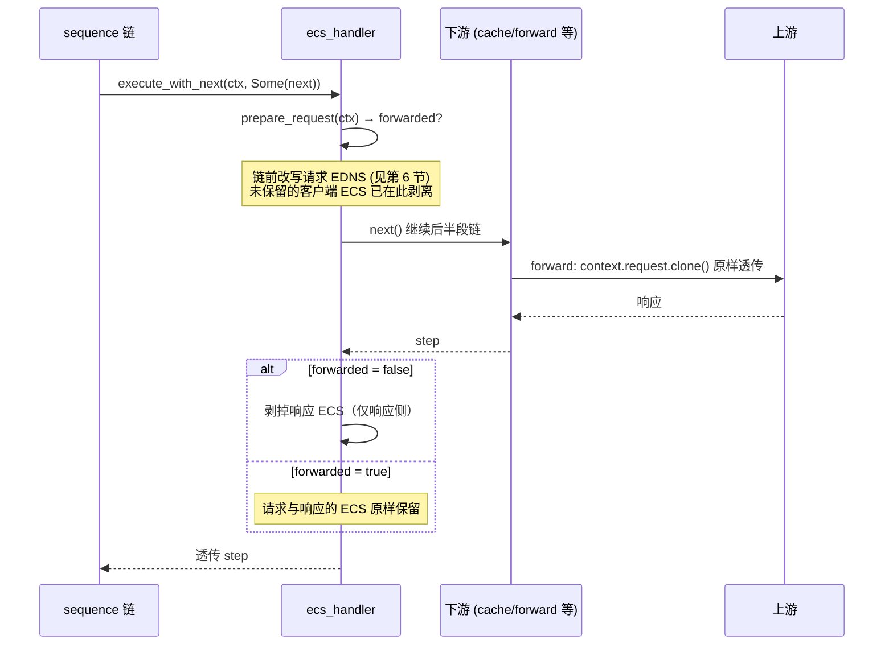
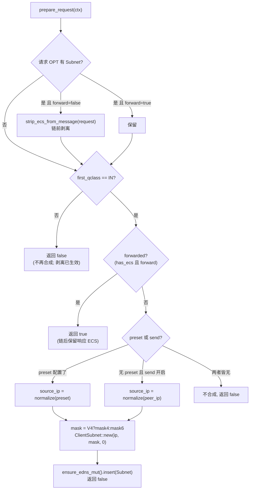
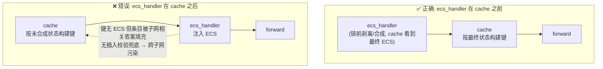
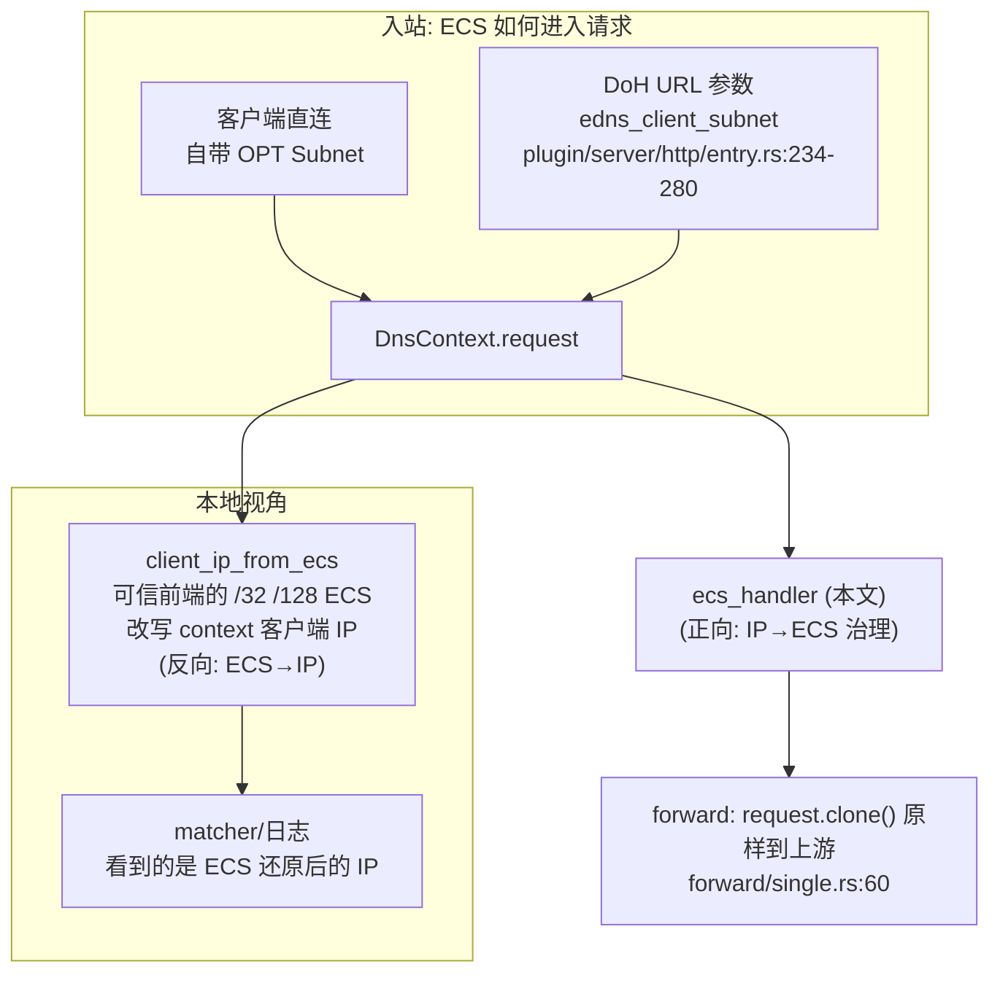

# OxiDNS `ecs_handler` 插件实现解析

> 分析基线：main v1.7.1（`ad2046d3`）· 2026-11-14，含 upstream PR #426（`afc23736`）的链前剥离语义。
> 代码位置：`src/plugin/executor/ecs_handler.rs`（578 行，含测试；实现约 241 行）。
> 关联模块：ECS 载荷模型在 `crates/proto/src/rdata/basic.rs`（`ClientSubnet`），IPv4-mapped 归一化在 `src/infra/network/ip.rs`，cache 的 ECS 键联动在 `src/plugin/executor/cache/key.rs`。
> 本文只描述 main 实际行为；本分支（`fix/code-review-priorities`）独有的实现集中在文末「分支特有实现（未进 main）」一节，与文档/注释不一致之处集中在第 12 节。

## 1. 插件定位

`ecs_handler` 是一个 **executor 插件**（`with_next() = true` 的包裹式插件），实现 RFC 7871 EDNS Client Subnet 在**出站方向**（本服务器 → 上游）的治理。PR #426 之后语义是**链前（chain-pre）改写**：在把请求交给下游链**之前**就完成客户端 ECS 的保留或剥离与合成，下游（cache、forward 等）看到的即是最终 EDNS 状态；链返回后再决定响应里的 ECS 是否剥掉。

它不做 DNS 语义判断，也**不按查询内容分流**——那是 sequence + matcher 的职责；它只做"请求 EDNS 准备（链前）+ 响应 EDNS 清理（链后）"这一对包裹动作。

```yaml
- tag: ecs
  type: ecs_handler
  args:
    forward: false   # 客户端自带 ECS 时: true=保留, false=链前剥离
    send: true       # 未保留/未自带 ECS 时: 用客户端源 IP 合成 ECS
    # preset: 203.0.113.7   # 可选: 固定 ECS 源 IP (优先于源 IP)
    mask4: 24        # 合成 IPv4 ECS 的前缀长度, 默认 24
    mask6: 48        # 合成 IPv6 ECS 的前缀长度, 默认 48
```

核心能力：

| 能力 | 实现位置 |
|---|---|
| 客户端 ECS 保留 / 链前剥离（`forward`） | `ecs_handler.rs:112-116` |
| 未保留时从 `preset` 或源 IP 合成（仅 IN class） | `ecs_handler.rs:118-141` |
| 响应侧 ECS 剥离（`forwarded=false` 时链后，防泄漏内部子网元数据） | `ecs_handler.rs:96-105` |
| quick setup `ecs [ip[/mask]]` | `ecs_handler.rs:160-183` |
| 非 IN class：只应用剥离策略，不合成 ECS | `ecs_handler.rs:116-118` |

## 2. 代码地图

| 结构 | 关键点 |
|---|---|
| `EcsHandlerConfig` | serde 配置（带 `Default`）：`forward`/`send`（默认 `false`）、`preset: Option<String>`、`mask4`/`mask6: Option<u8>`（`ecs_handler.rs:38-52`） |
| `EcsHandler` | 运行时结构：全部字段在 `create` 期固化，**无内部状态、无依赖、无后台任务**（`ecs_handler.rs:54-61`） |
| `EcsHandlerFactory` | `#[plugin_factory("ecs_handler")]`：`create` 走 YAML 配置，`quick_setup` 走 `ecs [ip[/mask]]` 参数（`ecs_handler.rs:146-183`） |

辅助函数：

| 函数 | 位置 | 语义 |
|---|---|---|
| `request_has_ecs` | `ecs_handler.rs:226-231` | 请求 OPT 里是否存在 `EdnsOption::Subnet` |
| `strip_ecs_from_message` | `ecs_handler.rs:233-237` | OPT 存在时 `edns.remove(EdnsCode::Subnet)`——只删 Subnet 选项，OPT 记录与其他选项保留；不存在 OPT 时是 no-op |
| `ensure_opt_record` | `ecs_handler.rs:239-241` | `Message::ensure_edns_mut()`，OPT 不存在时创建（`crates/proto/src/message.rs:545`） |

proto 层语义（`crates/proto/src/rdata/basic.rs`）：

- `ClientSubnet::new(addr, source_prefix, scope_prefix)`（`basic.rs:241`）：`addr` **原样保存不掩码**，线编码阶段才按 `source_prefix` 截断网络位；`scope_prefix` 按构造参数存。
- `Edns::insert`（`basic.rs:878-884`）：**先删后插**，同 code 选项不重复——所以合成 ECS 时即使 OPT 里已有别的 Subnet（理论上链前剥离已排除）也会被覆盖。

## 3. 配置语义

| 字段 | 默认 | 作用 |
|---|---|---|
| `forward` | `false` | 请求**已带** ECS 时：`true` 保留转发；`false` 在链前从请求中剥离（剥离后仍可按 `preset`/`send` 合成替代 ECS） |
| `send` | `false` | ECS 未保留且无 `preset` 时：用客户端源 IP（经 IPv4-mapped 归一化）合成 ECS |
| `preset` | 无 | 固定 ECS 源 IP。**优先级高于 `send`**：配置了 `preset` 就用它，否则 `send=true` 才用源 IP（`ecs_handler.rs:120-124`） |
| `mask4` | `24` | 合成 IPv4 ECS 的 `source_prefix`，>32 在 `create` 期报错 |
| `mask6` | `48` | 合成 IPv6 ECS 的 `source_prefix`，>128 在 `create` 期报错 |

ECS 来源优先级（`test_ecs_handler_source_priority`，`ecs_handler.rs:279-334` 全组合验证）：**客户端 ECS（仅 `forward=true` 时保留）> `preset` > 源 IP（`send=true`）> 不合成**。

quick setup（sequence 内联 `ecs [ip[/mask]]`，`ecs_handler.rs:160-183`）：

- 等价于 `forward=false, send=false, mask4=24, mask6=48`，参数可选给 `preset`；preset 解析失败直接报错。
- **`/mask` 后缀会被丢弃**：`ecs 203.0.113.7/24` 只取 IP 作为 `preset`，前缀仍用默认 24；`ecs 2001:db8::/32` 的 mask6 仍是 48 而非 32。要改前缀必须用完整 `args` 配置。

`preset`/源 IP 在使用前都经 `normalize_ipv4_mapped_ip`（`infra/network/ip.rs:9-17`）：`::ffff:a.b.c.d` 归一为纯 IPv4，因此掩码选择走 `mask4` 分支。空字符串或纯空白的 `preset` 视为未配置（`ecs_handler.rs:202-205`）。

## 4. 生命周期


- `init`/`destroy` 均为空实现（`ecs_handler.rs:69-75`）；无 `$tag` 依赖声明（工厂不实现 `get_dependency_specs`），在依赖图中是零出边节点，初始化顺序无约束。
- 无内部可变状态：所有决策输入来自配置 + `DnsContext`，天然支持并发。

## 5. 请求主路径

`execute_with_next`（`ecs_handler.rs:90-107`）是唯一的执行入口，`execute` 直接委托给它（`next=None`，用于 standalone 场景）：



关键点（与 PR #426 之前的链后模式不同）：

- **客户端 ECS 在链前就被剥离**：`forward=false` 时，下游链与上游在整个执行期间都看不到客户端自带的 ECS（`ecs_handler.rs:112-114`）——不需要等链后兜底清理。
- **`forwarded` 的判定**：只有"客户端自带 ECS 且 `forward=true` 且 IN class"才置位（`test_ecs_handler_source_priority` 断言 `forwarded == forward && has_client_ecs`）。合成 ECS（`send`/`preset`）不置位——合成路径下链后只剥响应 ECS。
- **链后只清理响应侧**：`forwarded=false` 时链结束剥掉响应 ECS（`ecs_handler.rs:101-105`）；请求侧不再清理——链前准备好的请求（含合成 ECS 或被保留的客户端 ECS）在执行结束后保持原样（模块文档 `ecs_handler.rs:19-20`）。日志、query_recorder 等链后读取请求的阶段看到的是"准备后"的 EDNS 状态。
- **返回值透传**：`continue_next!` 的结果原样返回（`Next`/`Stop`/`Return` 都不拦截），ecs_handler 只包络、不改控制流；链上返回 `Err` 时 `?` 直接上抛，响应侧剥离也不会执行。

为什么默认剥响应 ECS（模块文档 `ecs_handler.rs:16-18`）：当 ECS 是本服务器合成的（`send`/`preset`），它是**给上游看**的内部子网元数据，不是客户端声明的；上游应答可能回显带非零 `scope_prefix` 的 ECS（RFC 7871：scope 非零表示应答按该子网定制）。把这类元数据留在响应里透传给客户端既泄漏内部拓扑，也违背 RFC 7871 第 7.1 节"代理不应把 ECS 转发给不期望它的客户端"的精神。只有客户端自己带了 ECS 且被转发时，响应中的 ECS 才原样保留。

## 6. `prepare_request` 决策逻辑

请求侧改写的完整分支（`ecs_handler.rs:109-143`）：



值得注意的分支行为：

1. **剥离与合成可以叠加**：客户端自带 ECS + `forward=false` + `send=true` 时，链前先剥掉客户端 ECS，再用源 IP 合成标准前缀的 ECS 发给上游——即模块文档说的 "remove existing ECS before selecting a replacement"（`ecs_handler.rs:10`）。dnsmasq/stubby 前置场景正是依赖这个组合。
2. **合成的 `scope_prefix` 恒为 0**（`ClientSubnet::new(source_ip, mask, 0)`，`ecs_handler.rs:137`）：向上游声明"我没有作用域约束"，上游可自由决定是否返回 scope。
3. **非 IN class 只应用剥离策略**：qclass 非 IN 时**不合成** ECS（ECS 只对 IN 查询有意义），但 `forward=false` 的链前剥离照常生效（`ecs_handler.rs:116-118`）——非 IN 请求的上游在链中就看不到客户端 ECS。这是 PR #426 修正的边界行为。
4. **`forward=true` 但请求无 ECS**：`forwarded=false`（没有"客户端 ECS 可保留"），若配置了 `send`/`preset` 仍会合成，且链后响应 ECS 会被剥掉；若两者皆无则请求保持无 ECS。

## 7. 与 `cache` 的 ECS 作用域联动

cache 是 ECS 语义的另一半：同一域名对不同子网可能返回不同应答（CDN 场景），所以缓存键必须感知 ECS，否则会出现**跨客户端污染**。

cache 侧机制（main，`src/plugin/executor/cache/`）：

| 机制 | 位置 | 语义 |
|---|---|---|
| `ecs_in_key` 配置 | `cache/mod.rs:126-130`（字段）、`build_cache` 落地 | 是否把 ECS 作用域纳入缓存键 |
| `EcsScopeDigest` | `cache/key.rs:14-20` | `(family, source_prefix, scope_prefix, network_len, network[..])`——按 `source_prefix` 截断网络位的摘要 |
| `build_cache_key` | `cache/key.rs:114-144` | `ecs_in_key=true` 时提取请求当前 ECS 摘要进键 |

注意：main 的 cache **没有插入时的 scope 复核**（分支的 `ecs_scope_mismatch` 校验未进 main，见 `oxidns-plugin-cache.md` §4.6 与文末分支节）。防污染完全依赖"键级别正确 + 执行顺序正确"。

由此得出编排约束：



- `send`/`preset` 部署：ecs_handler **必须**在 cache 之前；PR #426 后链前合成对 cache 可见，cache 侧还要开 `ecs_in_key: true`，否则不同子网的应答会竞争同一个无 ECS 键——且没有插入校验拦截，是**污染**而不是"退化为不缓存"。
- `forward=false` 部署：ecs_handler 在 cache 之前链前剥离 ECS，所有客户端共享无作用域键，命中率最高。
- `forward=true` 部署：客户端自带的 ECS 参与键（cache `ecs_in_key: true` 时按 source_prefix 截断聚合）。

## 8. ECS 数据面的其他入口（协作全景）



| 插件 / 入口 | 方向 | 职责 | 与 ecs_handler 的关系 |
|---|---|---|---|
| `ecs_handler` | 出站 | 治理"发给上游"的 ECS | —— |
| `client_ip_from_ecs` | 入站 | 把可信前端（默认仅环回）带来的 **完整主机前缀**（`/32`//`/128`）ECS 还原成 `DnsContext` 的客户端 IP（`client_ip_from_ecs.rs:56-97`） | 互补：它改"我是谁"，ecs_handler 改"我告诉上游我是谁"；注意它只认主机前缀，对 `/24` 这类子网前缀 ECS 不生效 |
| DoH `edns_client_subnet` URL 参数 | 入站 | 解析为 `ClientSubnet` 插入请求 OPT（`src/plugin/server/http/entry.rs:234-280`） | 对 ecs_handler 而言等价于"客户端自带 ECS"，走 `forward` 分支 |
| `forward_edns0opt` | 出站→响应 | 按 code 白名单把请求 OPT 选项回显到响应（main 上是独立插件，`src/plugin/executor/forward_edns0opt.rs`） | 与 ECS 无直接耦合，但若配置了 code 8（Subnet）会把 ECS 回显进响应——与 ecs_handler 的剥离语义叠加时，执行顺序决定最终结果 |
| `query_recorder` | 旁路 | 查询记录里捕获 ECS（`query_recorder/capture.rs:222`） | 只读；PR #426 后记录的是"链中当时刻"的状态——ecs_handler 上游时看到原始 ECS，下游时看到准备后的 ECS |

典型组合（dnsmasq/stubby 前置场景）：前端把真实客户端 IP 放进 ECS → `client_ip_from_ecs` 还原为上下文客户端 IP 供 matcher 分流 → `ecs_handler send=true mask4=24` 用还原后的 IP 重新合成标准 ECS 发给上游（客户端 ECS 在链前已被剥掉，合成直接生效）。

## 9. 性能要点

- **热路径成本极低**：一次 OPT 选项线性查找（选项数通常个位数）、命中时链前一次 `remove`+`push`（`Arc::make_mut` 写时克隆 EDNS 内层）或一次 `remove`；`forwarded=false` 时链后追加一次响应侧 `remove`；无分配密集操作、无 I/O、无锁。
- **包裹但不深**：`with_next=true` 使它成为 continuation 包络，async 栈深 +1 层；除 `next()` 外无额外 await。
- **无启动成本**：`create` 期完成全部解析/校验（mask 范围、preset 解析），`init` 为空。
- `execute`/`execute_with_next` 均挂 `#[hotpath::measure]`（`ecs_handler.rs:80,85`）。
- 请求改写发生在**入链一次**（链前），链上多个下游（cache、forward、多个 upstream 并发）共享同一份最终 EDNS 状态，不存在每上游重复合成。

## 10. 测试盘点

`ecs_handler.rs:243-578`，12 个用例：

| 测试 | 验证点 |
|---|---|
| `test_parse_handler_from_value_validation` | `mask4: 64` 在解析期报错；无 args 走默认 |
| `test_ecs_handler_source_priority` | preset/send/forward/客户端 ECS 全组合下的来源优先级与 `forwarded` 标志（含 IPv4-mapped 归一） |
| `test_ecs_handler_non_in_only_applies_strip_policy` | 非 IN class：不合成、`forward=false` 链前剥离仍生效 |
| `test_ecs_handler_quick_setup_rejects_invalid_preset` | quick setup 非法 IP 报错 |
| `test_ecs_handler_quick_setup_presets_and_empty_args` | quick setup preset/空参数行为（`/mask` 丢弃） |
| `test_ecs_handler_send_inserts_request_ecs_and_strips_response_ecs` | send 合成进请求 + 链后响应 ECS 剥离 |
| `test_ecs_handler_forward_keeps_client_and_response_ecs` | forward 保留请求与响应两侧 ECS |
| `test_ecs_handler_strips_client_ecs_when_forward_disabled` | forward=false 剥请求 ECS |
| `test_ecs_handler_strips_client_ecs_from_request` | 链前剥离的直接断言 |
| `test_ecs_handler_send_appends_ecs_to_existing_opt` | 已有 OPT（无 Subnet）时链前追加 |
| `test_ecs_handler_send_creates_opt_when_request_has_none` | 无 OPT 时链前创建 |
| `test_ecs_handler_strips_ecs_from_response` | 合成路径下响应 ECS 剥离 |

`test_ecs_handler_source_priority` 通过对 `prepare_request` 的全组合调用覆盖了"合成确实发生过"的断言；覆盖缺口（与第 12 节对应）：无 quick setup `/mask` 丢弃行为对 IPv6 前缀的独立断言。

## 11. 使用模式速查

```yaml
# 场景 1: 对上游隐藏客户端精确 IP, 但让 CDN 按城市级子网调度
- tag: ecs_privacy
  type: ecs_handler
  args: { forward: false, send: true, mask4: 24, mask6: 48 }
# 编排: ecs_privacy → cache(ecs_in_key: true) → forward

# 场景 2: 指定出口 ECS (如部署在多出口网关后)
- tag: ecs_egress
  type: ecs_handler
  args: { preset: 203.0.113.7, mask4: 24 }
# preset 不需要 send; 无 ECS 请求也会带上 203.0.113.7/24

# 场景 3: 上游不支持 ECS, 彻底剥离
- tag: ecs_strip
  type: ecs_handler
  args: { forward: false }
# 无 send/preset → 不合成; 链前剥掉客户端 ECS

# sequence 内联 (等价 forward=false send=false + 可选 preset, 掩码固定 24/48)
- exec: ecs 203.0.113.7
```

## 12. 已知边界与注意点

1. **quick setup 丢弃 `/mask`**（第 3 节）：`ecs 2001:db8::/32` 的语义容易被误读为"前缀 32"，实际仍是 48。要精确控制前缀必须写完整 args。
2. **链后请求 EDNS 是"准备后"状态**（第 5 节）：链结束后请求里保留合成 ECS（或被保留的客户端 ECS），链后阶段（日志、包裹插件）读到的是改写后的 EDNS，不是客户端原始声明；需要原始状态请放在 ecs_handler 上游或使用 query_recorder。
3. **`preset` 不校验与 `mask` 的匹配**：`preset` 为 IPv6 而 `mask6` 缺省 48——若期望 `mask4`/`mask6` 跟随 preset 书写的前缀（quick setup 场景），会得到默认值。
4. **合成 ECS 的 `scope_prefix` 恒 0**：不会向上游表达"请勿回显更宽 scope"；上游若回显非零 scope，响应 ECS 会被本插件剥掉（`forwarded=false`）。
5. **`cache` 之后的 ecs_handler 会导致跨子网污染**（第 7 节）：main 的 cache 没有插入时校验，缓存键在 cache 执行点构建；ecs_handler 排在其后时键里没有 ECS，子网相关答案进入共享键。`oxidns check` 的依赖树能看到顺序，但不会对"语义顺序"报警。
6. **两侧清理与 LIFO 收尾顺序的相互作用**：continuation 后处理按 LIFO 执行——**上游包裹插件的收尾最后执行**（见 `oxidns-plugin-sequence.md` §6，`chain.rs:1125` 测试）。ecs_handler 在链上游时，它的响应侧清理在所有下游包裹插件收尾**之后**运行，能兜底剥掉下游回显的 ECS；反过来，若回显类插件（如配置了 code 8 的 `forward_edns0opt`）排在 ecs_handler **上游**，其收尾在最后，可能把 ECS 重新写回响应，绕过清理。链返回 `Err` 时响应清理不执行（`?` 提前上抛）。

## 分支特有实现（未进 main）

以下实现只存在于 `fix/code-review-priorities` 分支，main v1.7.1（`ad2046d3`）没有对应代码：

- **链后（chain-post）两侧清理**（`e23a1870`）：`forwarded=false` 时链结束后**同时剥离请求与响应**的 ECS，覆盖"非 IN 分支未处理的客户端 ECS（请求侧）、下游注入的 ECS、本插件合成的 ECS"三种残留来源。main（PR #426，`afc23736`）改为链前剥离 + 链后仅剥响应：客户端 ECS 在下游/上游执行期间就不可见，请求侧无需链后清理。本分支是在 main 旧语义（链前准备 + 链后两侧清理，请求侧靠 post 兜底）基础上的修正方向；上游最终选择了更彻底的链前方案。
- 分支笔记中"合成 ECS 后链中可见性探测桩（`EcsProbe`）+ 链后两侧清理回归测试"（如 `test_ecs_handler_send_inserts_ecs_mid_chain_and_strips_both_after`、`test_ecs_handler_strips_unforwarded_client_ecs_from_non_in_request`）与"窄化合成条目剥离"的提案随 chain-post 方案一起仅存于分支。
