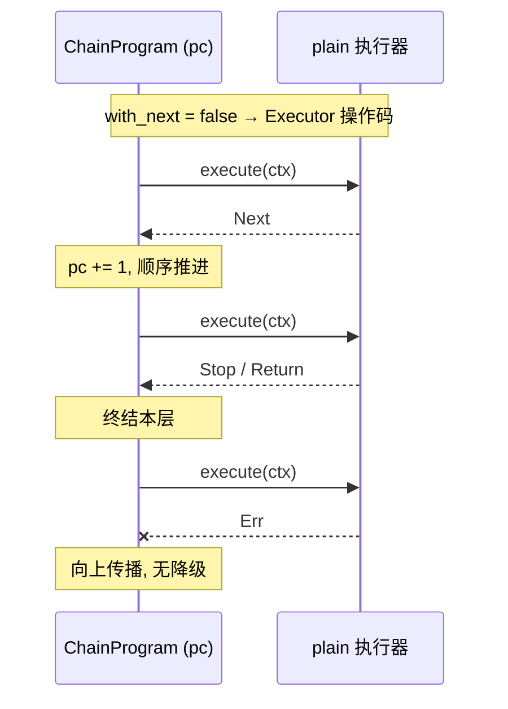
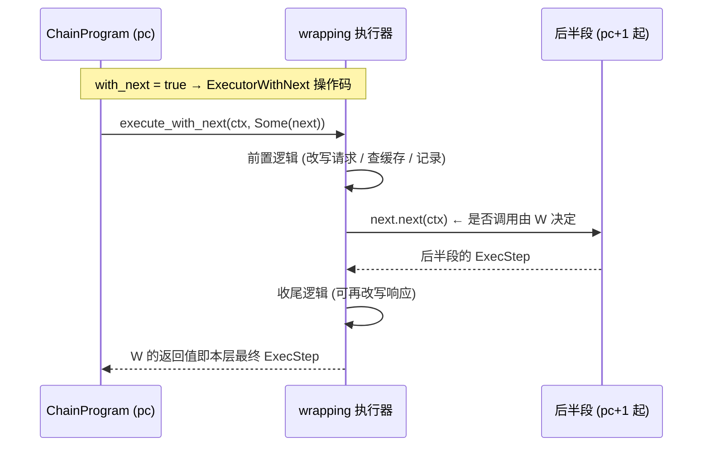
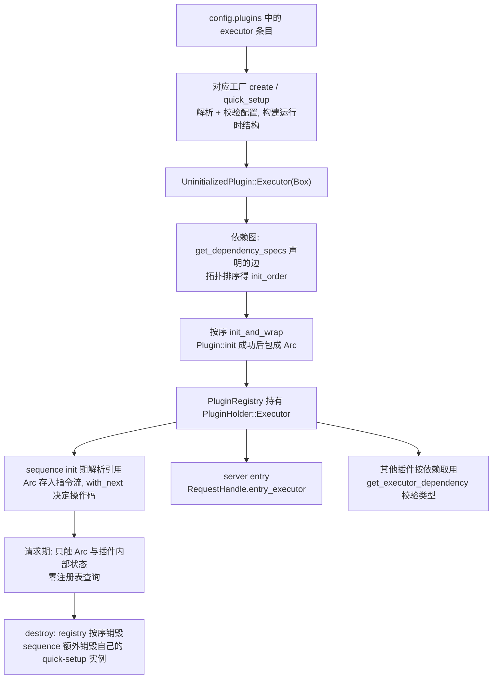
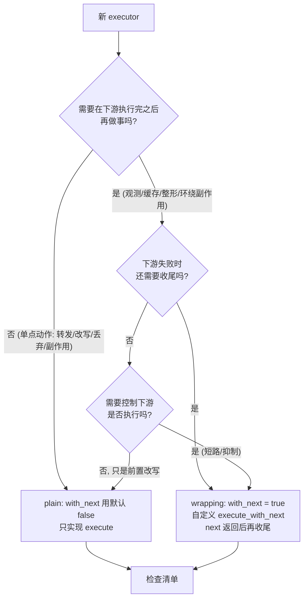
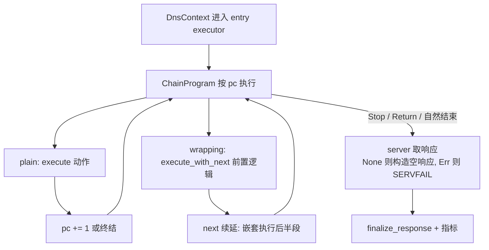

# OxiDNS Executor 插件类别实现解析

> 分析基线：`v1.6.1`，分支 `fix/code-review-priorities`（HEAD `5d7173bb`）。
> 代码位置：契约在 `src/plugin/executor/mod.rs`（138 行），实现在 `src/plugin/executor/*` 33 个工厂类型 + `prefer_ipv4`/`prefer_ipv6`，continuation 类型本体在 `src/plugin/executor/sequence/chain.rs`。
> 系统级视角见 `../oxidns-plugin.md`；单个 executor 深析见 `oxidns-plugin-cache.md` / `oxidns-plugin-sequence.md` / `oxidns-plugin-ecs-handler.md` / `oxidns-plugin-ip-selector.md`。
> 本文只描述当前代码实际行为；与文档/注释不一致之处集中在第 11 节。

## 1. 定位：四类插件中唯一的"主动"类别

executor 是 OxiDNS 请求管线中的**主动阶段**：matcher 只做谓词判定，provider 只备数据集，server 只收发报文——真正推动请求前进、产生和整形响应的都是 executor。类别模块文档（`executor/mod.rs:3-24`）归纳了五种职责：

1. 在上游解析前改写请求（`ecs_handler`、`client_ip_from_ecs`）；
2. 调用上游并填充响应（`forward`、`hosts`、`fallback`）；
3. 改写或过滤已有响应（`cache`、`ip_selector`、`response`、`ttl`）；
4. 更新请求级 marks / 元数据（`sequence` 的 mark builtin、`query_summary`）；
5. 触发副作用（`metrics_collector`、`query_recorder`、`ipset`/`nftset`、`script`）。

executor 自身不做编排——执行顺序完全由 `sequence` 的 `ChainProgram` 决定；server 也只持有**一个**入口 executor（`server/request.rs:20` 的 `entry_executor`），其余全靠链式串联。这个设计把"策略"（sequence 规则）与"动作"（executor 实现）分离。

## 2. 契约：三方法 trait 与三态 ExecStep

```rust
// src/plugin/executor/mod.rs:104-127（节选）
#[async_trait]
pub trait Executor: Plugin {
    fn with_next(&self) -> bool { false }                    // 默认非包裹式

    async fn execute(&self, context: &mut DnsContext) -> Result<ExecStep>;  // 必需

    async fn execute_with_next(&self, context: &mut DnsContext,
                               next: Option<ExecutorNext>) -> Result<ExecStep> {
        let result = self.execute(context).await?;           // 默认实现:
        match result {                                       // 先做自己的事
            ExecStep::Next => continue_next!(next, context), // Next → 继续下游
            ExecStep::Stop | ExecStep::Return => Ok(result), // Stop/Return → 短路
        }
    }
}
```

三个方法构成完整契约：

| 方法 | 语义 | 默认值 |
|---|---|---|
| `with_next()` | 声明是否为**包裹式**执行器。**只被 sequence 在 `init` 期读取一次**（`chain.rs:553-557`，据此把规则编译成 `Executor` 或 `ExecutorWithNext` 操作码），请求期不再查询——因此实现必须对同一实例恒定 | `false` |
| `execute()` | 对当前 `DnsContext` 执行动作，返回 `ExecStep` 指示链如何推进。必需方法 | 无 |
| `execute_with_next()` | 环绕式执行：拿到 `next` 续延，自行决定是否/何时调用它。默认实现 = "先 `execute`，`Next` 则继续" | 见上 |

`ExecStep` 三态（`mod.rs:129-137`）与 `continue_next!` 宏（`mod.rs:93-102`，`next` 为 `None` 时展开为 `Ok(Next)`）：

| `ExecStep` | 含义 | 在服务端最终表现为 |
|---|---|---|
| `Next` | 当前链继续；自然走完 | `RequestExit::Completed` |
| `Stop` | 立即停止当前链，通常已写入响应 | `RequestExit::Controlled` |
| `Return` | 把控制权交回调用方（多层 sequence 间才有差异） | `RequestExit::Controlled` |

一个值得注意的结构事实：**`ExecutorNext` 类型本体定义在 `sequence::chain`**（`mod.rs:31` 只是 re-export）。continuation 是"调用方"（sequence 的程序计数器）铸造的句柄，executor 是纯消费方——它只能 `next.next(ctx)` 或丢弃，无法反向感知链的形状。这保证了 executor 与编排引擎的解耦：executor 眼里只有一个 `Option<ExecutorNext>` 黑盒。

## 3. 两种执行模式

`with_next()` 的返回值决定 sequence 在编译期给规则生成的操作码（`InstructionOp::Executor` vs `ExecutorWithNext`，`chain.rs:553-557`），即两种截然不同的调用协议：





两种模式的关键差异（详见 `oxidns-plugin-sequence.md` §6）：

| 维度 | plain | wrapping |
|---|---|---|
| sequence 调用 | 只调 `execute()` | 只调 `execute_with_next(Some(next))` |
| `Next` 的含义 | 本条结束，pc+1 | ——返回值直接终结本层 |
| 后续指令归属 | 链的自然下一步 | **折叠进 `next`**，是否执行、何时执行由包裹器决定 |
| 收尾时机 | 无（动作即结束） | `next()` 返回后、向上返回前——多包裹器按 **LIFO** 收尾 |
| 典型代表 | `forward`、`hosts`、`response` | `cache`、`ip_selector`、`ecs_handler`、`query_summary` |

自定义 `execute_with_next` 而不调 `next` 是合法的短路（如 `cache` 的 `short_circuit` 命中、`prefer_ipv4` 的双栈抑制），但意味着 `next` 里折叠的后续指令**本次请求永远不执行**——这是 wrapping 模式最大的语义陷阱（详见第 11 节）。

## 4. 生产清单：35 个类型，两种模式

当前注册的 executor 类型（受 feature 裁剪影响，以 `Cargo.toml` 与 `executor/mod.rs` 的 `cfg` 守卫为准）：

**plain 模式（20 个）**——`with_next` 用默认 `false`：

| 类型 | 职责 | 门控 |
|---|---|---|
| `forward` | 上游转发（single/concurrent 双实现） | 无 |
| `fallback` | 上游失败降级 | 无 |
| `hosts` | 本地 hosts 解析 | 无 |
| `response` | 合成响应 | `plugin-response` |
| `sequence` | 编排器本体（自身是 plain，链在其内部） | 无 |
| `ttl` | 改写响应 TTL | 无 |
| `sleep` | 延迟（调试/演练） | 无 |
| `black_hole` / `drop_resp` / `debug_print` | 丢弃/黑洞/调试输出 | 无 |
| `client_ip_from_ecs` | 从 ECS 还原客户端 IP | `plugin-client-ip-from-ecs` |
| `reload` / `reload_provider` | 触发重载 | 无 |
| `ipset` / `nftset` | 把解析结果写入防火墙集合 | `plugin-ipset` |
| `arbitrary` | 任意记录合成 | `plugin-arbitrary` |
| `cron` | 定时任务 | `plugin-cron` |
| `download` | 下载资源 | `plugin-download` |
| `script` | 外部命令 | `plugin-script` |
| `upgrade` | 自升级 | `plugin-upgrade` |

**wrapping 模式（15 个）**——全部自定义了 `execute_with_next`（无一使用默认实现）：

| 类型 | 包裹语义 | 门控 |
|---|---|---|
| `cache` | 前查缓存，未命中放行 + 回填，命中可短路 | 无 |
| `ip_selector` | 返回路径整形：下游填响应后按探测分排序/裁剪 | `plugin-ip-selector` |
| `ecs_handler` | 前改请求 ECS，后剥响应/请求 ECS | 无 |
| `forward_edns0opt` | 提取指定 EDNS0 选项，收尾回显到响应 | 无 |
| `query_summary` | 汇总请求/响应写日志 | 无 |
| `query_recorder` | 录制查询/响应入库 | `plugin-query-recorder` |
| `metrics_collector` | 请求指标包裹 | `metrics` |
| `redirect` | 域名重定向（前改写 qname） | 无 |
| `reverse_lookup` | 反查 PTR 并回填 | `plugin-reverse-lookup` |
| `http_request` | 外部 HTTP 通知 | `plugin-http-request` |
| `learn_domain` | 学习域名进动态集合 | `plugin-dynamic-domain` |
| `ros_address_list` / `ros_route` | RouterOS 地址表/路由副作用 | `plugin-ros-address-list` / `plugin-ros-route` |
| `prefer_ipv4` / `prefer_ipv6` | 双栈抑制（A/AAAA 互斥） | 无 |

三个结构性观察：

1. **wrapping 是少数派但都是"横切关注点"**：缓存、观测、副作用、响应整形——需要"下游做完之后我再做事"的能力，这正是 continuation 的价值；plain 多是"单点动作"。
2. **`sequence` 本身是 plain**：编排器不包裹下游（它的规则就是下游），`execute` 即 `program.run`（`sequence/mod.rs:170-175`）。
3. **观察者三件套**（`query_summary`/`query_recorder`/`metrics_collector`）都是 wrapping——它们需要看到**最终**响应再记录，纯前置动作会漏掉下游的改写。

## 5. 注册方式与生命周期

工厂注册有两条路径（`ai/plugin-dev.md` Registration 节）：

- `#[plugin_factory("type")]` 属性宏（`crates/macros/src/lib.rs:13-31`）：仅支持 unit struct / 空花括号 struct，自动提交 inventory——33 个类型用这种方式；
- `register_plugin_factory!("type", expr)` 声明宏（`plugin/mod.rs:177-190`）：工厂需要构造参数或一个 struct 注册多个类型名时使用——executor 类别里只有 `dual_selector` 用了它（`dual_selector.rs:405-406`，同一 `DualSelectorFactory` 参数化后注册为 `prefer_ipv4`/`prefer_ipv6`）。

从 YAML 到请求路径的完整链路：



要点：

- `UninitializedPlugin::Executor(Box<dyn Executor>)`（`plugin/mod.rs:70-82`）是工厂的产物；`init_and_wrap`（`plugin/mod.rs:84+`）完成 `init` 并升级为 `Arc`。**Box 在创建期、Arc 在 init 后**——create 阶段还无法拿到依赖（被引用的插件可能未初始化）。
- 拓扑顺序保证"被引用者先初始化"，这是"sequence 在 init 期才解析 `Arc`"安全的前提（见 `oxidns-plugin-sequence.md` §4）。
- 请求路径上没有注册表查找：所有引用在启动期固化（系统级设计三约束之一，`../oxidns-plugin.md` §1）。

## 6. 错误与控制流语义

- **`Err` 一律向上传播，无内建降级**：任何 executor 返回错误即从 `ChainProgram` 冒泡到 server，服务端统一 SERVFAIL（`server/request.rs:132-141`）。降级是插件职责（`fallback`）由 sequence 显式编排，不是运行时隐式行为。
- wrapping 执行器的 `next()` 返回错误时，收尾逻辑仍会执行（`?` 在其内部消化）——`chain.rs` 测试 `test_run_bubbles_execute_error_after_running_with_next_cleanup` 固化了这一保证。
- `ExecStep` 的跨层传播规则（jump/goto 对 `Stop`/`Return` 的不同处理）见 `oxidns-plugin-sequence.md` §7.3，此处不重复。

## 7. 热路径规范与可观测性

类别模块文档的三条硬期望（`executor/mod.rs:19-24`）与 `ai/plugin-dev.md` 热路径规则共同约束 executor 实现：

- 每请求避免不必要的分配、克隆、解析、加锁、阻塞 I/O；
- 开销放 `create`/`init`（预编译、预分配、Arc 化），不进请求路径；
- 副作用（指标、持久化、外部系统调用）尽量不占延迟敏感路径，除非正确性需要；
- 每个 `Arc`/`DashMap`/后台任务都要有明确理由，警惕锁竞争与无界增长。

**`#[hotpath::measure]` 覆盖**：executor 类别 32 个文件的执行入口均挂采样（`Cargo.toml:77,374-375` 的 `hotpath`/`hotpath-alloc` feature 控制，未启用时展开为空）。这是性能回归定位的统一入口——新 executor 应当沿用。

可观测性的分工：类别级指标由各插件自注册 `MetricSource`（如 `cache`、`ip_selector`、`forward`、`sequence`），横切的请求级观测由 wrapping 插件在链上完成（`query_summary`/`query_recorder`/`metrics_collector`）——想给全链加观测，在 sequence 里包一层 wrapping executor 即可，不需要改任何 plain executor。

## 8. 测试模式

executor 类别的测试惯用法（可直接复制）：

| 模式 | 出处 | 用途 |
|---|---|---|
| `StubExecutor`（动态 `with_next`） | `fallback.rs:440-443`、`chain.rs:810` 测试桩 | 模拟 plain/wrapping/Return/Err 四种行为，驱动 sequence 循环测试 |
| `ChainProgram::single_with_next_executor_for_test` | `sequence/chain.rs`（`#[cfg(test)] pub(crate)`） | 把任意 executor 包成单指令程序，测试 wrapping 协议 |
| 探测桩（捕获链中状态） | `ecs_handler.rs` 的 `EcsProbe` | 验证"链中可见、链后被清理"这类前后状态分离的断言 |
| `FakeProbeRunner` 式后端注入 | `ip_selector/tests.rs` | 用确定性观测表替换真实网络后端，测策略不测网络 |

集成测试放 `tests/plugin_integration.rs`（feature 门控同步守卫），gated 插件的正/负覆盖进 `tests/feature_gating.rs`（`ai/plugin-dev.md`）。

## 9. 开发新 executor 的模式选择



检查清单（来自 `ai/plugin-dev.md` 与现行代码惯例）：

1. 模块级 doc 注释：用途、配置形态、依赖期望、生命周期、热路径/副作用行为；
2. 命名即行为：`selection_mode` 等三模式命名（first_success/best_within_budget/background 的风格）避免发明新词汇表；
3. fail-open 倾向：探测/外部依赖失败时不破坏原响应（`ip_selector`、`ecs_handler` 是范本）；
4. 注册：unit struct 用属性宏；有状态/多类型名用 `register_plugin_factory!`；
5. 依赖声明实现 `get_dependency_specs`——**不要吞解析错误**（sequence 的教训，见第 11 节）；
6. 门控标准（新依赖/重协议/非基础转发/显著副作用任一满足即加 feature），同步 `build_info.rs`、WebUI 定义、`feature_gating.rs`；
7. `#[hotpath::measure]` 挂执行入口；
8. 测试：行为测试随包（含 wrapping 语义与错误传播），集成测试按门控放置。

## 10. 请求期全景

把契约、两种模式与编排拼起来，一次查询中 executor 层的完整图景：



## 11. 已知边界与注意点

1. **wrapping 是截断点**：`with_next=true` 的执行器之后的规则折叠进 `next`，其返回值就是整层的最终 `ExecStep`。在 sequence 中把它后面的指令当作"一定会执行"是错误假设（`oxidns-plugin-sequence.md` §12 第 2 条）。
2. **`with_next()` 必须恒定**：sequence 在 init 期读一次就编译成操作码，请求期不查。trait 允许返回动态值（`fallback.rs:440-443` 的测试桩就动态返回），但生产实现若让该值随请求变化，init 期的操作码选择会与运行期实际行为错配。
3. **`with_next=false` 时自定义 `execute_with_next` 不被 sequence 调用**：sequence 只会走 `Executor` 操作码调 `execute()`。想让环绕逻辑生效必须同时返回 `true`。反向（`with_next=true` 却不调 `next`）是合法短路，但等价于丢弃后续指令——需要显式文档化。
4. **默认 `execute_with_next` 无实际使用者**：15 个 wrapping 执行器全部自定义了该方法。默认实现（`execute` + 透传）语义上是"透明包裹"，保留它主要为了 standalone 调用路径（如 `execute` 委托 `execute_with_next(None)` 的模式，`ecs_handler.rs:82-85`）。
5. **工厂吞依赖解析错误的风险**：`get_dependency_specs` 在 YAML 解析失败时返回空列表会让依赖图"看起来正常"（`../oxidns-plugin.md` §14 第 5 条，sequence 实例）。新 executor 应让解析失败直接报错。
6. **嵌套深度与 async 栈**：每层 wrapping 是一层 async 栈；`sequence` 内部用显式 pc 循环避免同层递归（`oxidns-plugin-sequence.md` §10），但 jump/goto/多层包裹仍按嵌套加深。深链配置需留意。
7. **`dual_selector` 是双类型注册的唯一特例**：`prefer_ipv4`/`prefer_ipv6` 共享实现、仅 `RecordType` 不同。再遇到"同一实现多个类型名"时照此模式，不要用属性宏复制粘贴两个空 struct。
