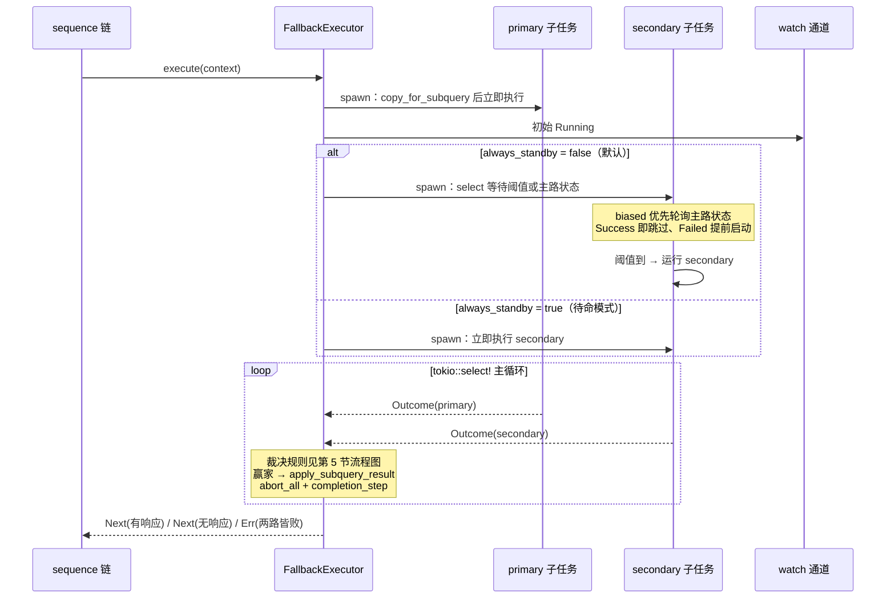
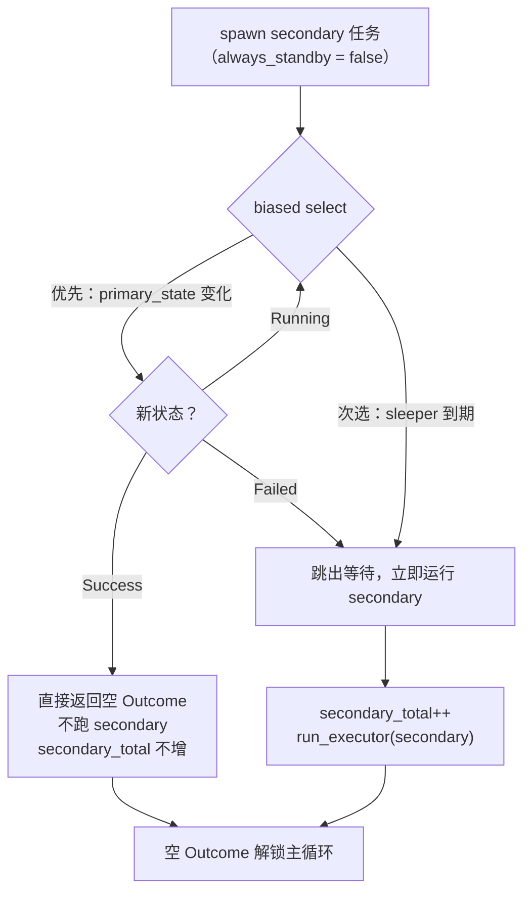
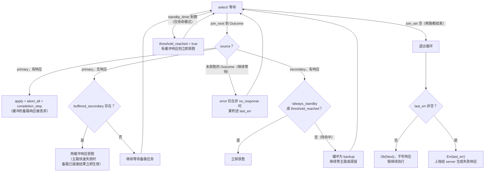
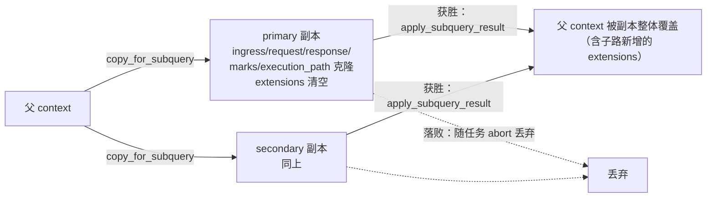

# OxiDNS `fallback` 插件实现解析

> 分析基线：`v1.6.1`，分支 `fix/code-review-priorities`（HEAD `4e5cf32a`）。
> 代码位置：`src/plugin/executor/fallback.rs`（669 行，含约 267 行测试），子查询上下文模型在 `src/core/context.rs:367-386`。
> 类别契约见 `oxidns-plugin-executor.md`；与 forward 并发扇出的对比见第 10 节。
> 本文只描述当前代码实际行为；与文档/注释不一致之处集中在第 11 节。

## 1. 插件定位

`fallback` 是一个 **executor 插件**，实现"主备双路径赛跑"：`primary` 立即执行，`primary` 迟迟无果（超过 `threshold`）或失败时启动 `secondary`，**谁先产出响应谁赢**，未完成的一方被取消。它不包裹下游链（`with_next()` 保持默认 `false`），主备两路都通过 `execute_with_next(ctx, None)` 隔离运行（`fallback.rs:379`），裁决后把赢家结果并回当前上下文。

```yaml
# 典型配置（args 为唯一创建路径，无 quick setup）
- tag: fb_main
  type: fallback
  args:
    primary: $forward_default     # 主路 executor tag
    secondary: $forward_backup    # 备路 executor tag
    threshold: 500                # ms，默认 500；0 = 备路立即启动
    always_standby: false         # true = 备路无视阈值始终并行（待命模式）
    short_circuit: false          # 拿到响应后 Stop（true）还是 Next（false）
```

子路径是任意 executor：可以是 `$forward`、`$cache`，甚至嵌套 sequence——这让 fallback 成为"路径级"的容错/加速原语，而 forward 的并发扇出是"上游级"的（见第 10 节对比）。

核心能力：

| 能力 | 实现位置 |
|---|---|
| 主备两路并发赛跑（JoinSet + watch 通道） | `fallback.rs:164-233` |
| 阈值触发 / 主路失败触发备路 | `fallback.rs:196-233` |
| 待命模式（always_standby）+ 阈值前缓冲备路响应 | `fallback.rs:236-251`、`277-288` |
| 三态结果语义（响应/无响应/错误） | `fallback.rs:292-310`、`374-400` |
| 子查询上下文隔离与合并 | `fallback.rs:169`、`191`、`267`；`core/context.rs:367-386` |
| 三计数器指标 | `fallback.rs:80-128` |
| `short_circuit` 短路 | `fallback.rs:314-323` |

## 2. 代码地图

单文件实现，无子模块：

| 区段 | 行数 | 职责 |
|---|---:|---|
| `FallbackConfig` + 默认值 | 45-65 | YAML 反序列化：primary/secondary/threshold/always_standby/short_circuit |
| `FallbackExecutor` / `FallbackMetrics` | 67-128 | 运行时结构、指标定义与 `MetricSource` 导出 |
| `Outcome` / `PrimaryState` | 131-143 | 子任务结果载体（context 可空 + source + error + no_response）、主路状态机 |
| `execute` | 161-311 | 热路径：双任务 spawn + `tokio::select!` 主循环裁决 |
| `run_executor` | 374-400 | 单路执行包装：调用子 executor 并归一化为 `Outcome` |
| 工厂 | 325-372 | `#[plugin_factory("fallback")]`、依赖声明、create |
| 测试 | 402-669 | Stub executor 驱动的行为测试 |

运行时结构：

| 结构 | 关键点 |
|---|---|
| `FallbackExecutor` | 两个 `Arc<dyn Executor>`（create 期解析，拓扑序保证已初始化）+ `threshold: Duration` + 三个布尔 + `Arc<FallbackMetrics>` |
| `Outcome` | `context: Option<DnsContext>`（None = 该路无响应）+ `source: &'static str`（"primary"/"secondary"）+ `error: Option<String>` + `no_response: bool` |
| `PrimaryState` | watch 通道上的三态：`Running` / `Success` / `Failed`（`fallback.rs:138-143`） |
| `FallbackMetrics` | `primary_total` / `primary_error_total` / `secondary_total`，`Relaxed` 原子（`fallback.rs:80-97`） |

## 3. 配置与创建路径

工厂只实现 `create`，**不支持 quick setup**（未覆写 `PluginFactory::quick_setup`，走默认的 "quick setup is not supported" 报错）。`create`（`fallback.rs:344-371`）在解析 YAML 后立即通过 `init_context.executor("args.primary", ...)` 解析两个子 executor——依赖图保证它们先于 fallback 初始化（registry 拓扑序）。

依赖声明（`fallback.rs:330-342`）：

```rust
plugin_config.args.clone()
    .and_then(|args| serde_yaml_ng::from_value::<FallbackConfig>(args).ok())
    .map(|cfg| vec![
        DependencySpec::executor("args.primary", cfg.primary),
        DependencySpec::executor("args.secondary", cfg.secondary),
    ])
    .unwrap_or_default()
```

注意 `.ok()`：YAML 解析失败时依赖列表**静默为空**，依赖图校验跳过，错误延迟到 `create` 才暴露——这是类别文档中"工厂吞依赖解析错误"风险的又一实例（`oxidns-plugin-executor.md` §11.5）。

`threshold` 语义（`fallback.rs:51-54` 注释 + 实现）：`0` 表示备路立即启动；默认 500ms。`always_standby=true` 时 threshold 仍有意义——它变成"备路响应最早何时可以获胜"的缓冲窗口（第 5 节）。

## 4. 请求主路径

`execute`（`fallback.rs:164-311`）一次请求的全景：



要点：

- 两个子任务各自持有 `context.copy_for_subquery()` 的独立副本（`fallback.rs:169`、`191`），**并发修改互不可见**；赢家副本经 `apply_subquery_result` 并回（第 6 节）。
- 主任务完成时通过 watch 通道广播 `Success`/`Failed`（`fallback.rs:186`），备任务的等待循环据此提前决策。
- `JoinError`（子任务 panic/取消）记入 `last_err` 后继续等另一路（`fallback.rs:257-261`）。
- 胜出路径统一为 `context.apply_subquery_result(赢家)` → `join_set.abort_all()` → `completion_step()`（`Stop` if short_circuit else `Next`）。

## 5. 备任务决策与主循环裁决

### 5.1 备任务：biased select（默认模式）

默认模式下备任务先"等"再"跑"（`fallback.rs:196-228`）：



要点：

- `biased;`（`fallback.rs:205`）让 select 按声明顺序轮询：**状态变化优先于计时器**。当主路成功与阈值到期同时就绪时，先看到 Success，避免发射一个注定被 abort 的无效备路查询。
- 通道发送方（tx）随主任务结束而 drop，`changed()` 返回 Err 时按"主路已终结"处理跳出（`fallback.rs:207-209`）——主路**快速失败也会提前触发备路**，不必等满阈值。
- 跳过路径返回的是空 Outcome（`context: None, no_response: false`，`fallback.rs:215-220`），仅用于解锁主循环的 `join_next`，不产生裁决影响。

### 5.2 主循环：裁决状态机

主循环的 `tokio::select!`（`fallback.rs:240-299`）有两个分支；理解它的关键是**两个模式变量**：`threshold_reached` 初始为 `!always_standby`（默认模式恒真、待命模式初始假），以及待命模式专属的 `standby_timer`。



要点：

- **默认模式**（`threshold_reached` 初始真）：备路响应永远立即获胜；主路响应永远优先于已到手的备路结果（主路 Outcome 先被 join 到就先裁决，且主路获胜丢弃缓冲）。
- **待命模式**：备路响应在阈值前**永不直接获胜**——先缓冲，直到三种解锁之一：① 主路终结且无响应 → 缓冲立即生效（`fallback.rs:271-275`）；② 阈值到期 → 刷新缓冲获胜（`fallback.rs:242-251`）；③ 阈值已过后备路才完成 → 直接获胜（`fallback.rs:279-282`）。即待命模式下主路在阈值窗口内始终保有优先权，即使它最终失败。
- **错误过滤的语义**（`fallback.rs:292-297`）：`outcome.error.filter(|_| !outcome.no_response)`——"执行成功但没产生响应"（`no_response=true`）的 Outcome **不计入** `last_err`。这直接实现模块头注释的三态：两路都"无响应" → `last_err` 为空 → `Ok(Next)` 链继续；任一路真实报错且无人产出响应 → `Err`。
- 主循环唯一的正常退出是 `join_next()` 返回 `None`（两个任务都终结且无人获胜）；胜出路径全部提前 return。

### 5.3 结果语义总表

| 场景 | 行为 | 返回 |
|---|---|---|
| 任一路产出响应 | 并回响应，取消另一路 | `Ok(Stop/Next)` |
| 两路都正常结束但无响应 | 不写响应，debug 日志 | `Ok(Next)`，链继续 |
| 两路真实失败（或 join 错误） | 错误拼接 `"primary: ...; secondary: ..."` | `Err`，server 生成失败响应 |
| 一路失败、另一路无响应 | 错误保留（失败路），无响应路不计 | `Err` |

## 6. 子查询上下文模型

主备两路能安全并发的前提是上下文隔离（`core/context.rs:367-386`）：



- 副本继承请求、响应（父级可能已有）、marks、execution_path 事件流（`_sequence-step-recording` 的步骤记录在副本上继续，获胜后并回），但 **extensions 从空开始**——子路径不能读到父级的 extensions，落败路径的 extensions 修改也不会污染父级。
- `apply_subquery_result` 是整体覆盖（`core/context.rs:380-386`）：request 可能被子路径改写（如 ECS 处理、重写插件），并回后父级看到的是子路径加工过的请求。
- 同一模型的其他使用者：`dual_selector`（A/AAAA 双路查询）、`cache`（stale 后台刷新）——fallback 是第三个消费者，模式一致。

## 7. run_executor 的归一化

`run_executor`（`fallback.rs:374-400`）把"任意 executor 的一次执行"归一化为 `Outcome`：

- 调用 `execute_with_next(&mut ctx, None)`——**支持包裹式子 executor**：子 `cache`/`sequence` 的 continuation 在 `None` 上自然终止（`continue_next!` 对 None 返回 `Ok(Next)`），子序列的 `Return` 语义把控制权交还给 fallback。
- `Ok(step)` 后以 **response 是否存在**为唯一成功判据：有响应 → `context: Some`；无响应 → `no_response: true` + 错误文案 `"executor returned Next/Stop without response"`。
- `Err(e)` → 纯失败 Outcome（`no_response: false`），错误文本进入裁决。

测试用 `refused_with_next` Stub 验证了包裹式子 executor 的路径（`fallback.rs:524-549`）。

## 8. 可观测性

三个计数器（`fallback.rs:108-128`，labels: `plugin_tag`）：

| 指标 | 含义 |
|---|---|
| `fallback_primary_total` | 主路执行次数 |
| `fallback_primary_error_total` | 主路未产出响应次数（**含**"无响应"情形，任务内自增 `fallback.rs:181-185`） |
| `fallback_secondary_total` | 备路实际执行次数（待命模式被跳过时不计） |

推算关系：主路胜出率 = 1 − secondary_total/primary_total（近似，join 错误除外）。与 forward 的指标集相比**没有延迟统计**——阈值调优只能靠外部观测或调整 `threshold` 后对比 secondary_total 占比。

## 9. 测试覆盖（fallback.rs:402-669）

| 测试 | 覆盖 |
|---|---|
| `test_fallback_factory_requires_args` | 无 args 报错 |
| `test_run_executor_reports_success_and_errors` | 成功/无响应/失败三种 Outcome 归一化 |
| `test_run_executor_supports_with_next_executor` | 包裹式子 executor 经 `execute_with_next(None)` 正常产出响应 |
| `test_fallback_config_accepts_short_circuit` | 配置字段 |
| `test_fallback_execute_stops_when_short_circuit_enabled` | 主路获胜 + Stop + secondary 未启动（指标 0） |
| `test_fallback_metrics_record_primary_error_and_secondary` | 主路失败 → 备路获胜的指标计数 |
| `test_fallback_continues_when_branches_return_no_response` | 两路无响应 → `Ok(Next)` 且 `primary_error_total=1`（无响应也计错误计数） |

阈值竞态、待命缓冲等时序行为**没有专项测试**（第 11 节观察 4）。

## 10. 设计要点与同类对比

- **`#[hotpath::measure]`** 标注 `execute`；每请求固定 2 个 tokio 任务 + 1 个 watch 通道 + 1 个 sleep，待命模式外加主循环 timer——开销与 forward 并发扇出同量级。
- **无健康记忆**：与 forward 一样，fallback 不记录主路历史延迟/失败率，每次请求都重新赛跑；"主路慢"完全由每请求的 threshold 现场判定。
- **`short_circuit` 语义与 forward 一致**：拿到响应后 `Stop` 截断 sequence 后续规则。
- **与 forward 并发扇出的区别**（对照 `oxidns-plugin-forward.md` §5）：forward 把**同一请求**发给 N 个上游、按选择模式裁决响应内容；fallback 跑**两条不同的 executor 子链**、只按"谁先有响应"裁决。forward 解决上游多样性，fallback 解决路径多样性（不同出口、不同策略组合、不同缓存层）。
- **与 sequence 控制流的区别**：jump/goto 是确定性的顺序转移；fallback 是声明式的竞速，且两路并发执行（待命模式下备路的副作用会真实发生）。

## 11. 观察与潜在问题

1. **工厂吞依赖解析错误**（`fallback.rs:334`）：`get_dependency_specs` 的 `.ok()` 让坏 YAML 配置跳过依赖图校验，错误延迟到 create 期——与 `oxidns-plugin-executor.md` §11.5 记录的类别级风险一致。
2. **无整体看门狗**：execute 自身没有 deadline；两路子 executor 若都挂起（如配置了超长 sleep 或上游超时叠加），请求将无限等待。当前依赖子 executor 自身的超时纪律（forward 5s 等）。备路获胜后 `abort_all` 会取消挂起的主路任务，但两路都挂时无人触发取消。
3. **待命模式的双重副作用**：`always_standby=true` 时两路**真实并发执行**——备路的 cache 写入、ipset、指标等副作用都会发生，即使最终主路获胜、备路结果被丢弃。对幂等副作用无害，但计费/记录类副作用会双份。
4. **时序行为缺测试**：阈值竞态（biased select 的"状态优先"）、待命缓冲的三种解锁路径、主路快速失败提前触发备路——这些核心时序语义目前只有模块注释与代码佐证，没有自动化测试锁定，重构回归风险集中在 `execute` 的 select 循环。
5. **`primary_error_total` 口径**：包含"执行成功但无响应"的情形（`fallback.rs:176-185` 只判断 `context.is_none()`），与 `run_executor` 中 `no_response` 与真实错误的区分不一致——指标上无法区分"上游 SERVFAIL"与"子链故意不产生响应（如放行给后续规则）"。
6. **threshold=0 与 always_standby 的细微差异**：`threshold: 0`（默认模式）下备路立即启动且响应**立即生效**；`always_standby: true` 下备路立即启动但响应要等阈值窗口（0ms 时近乎立即）——两者最终行为几乎一致，但缓冲路径与指标时序仍有差别，配置时容易混淆。
