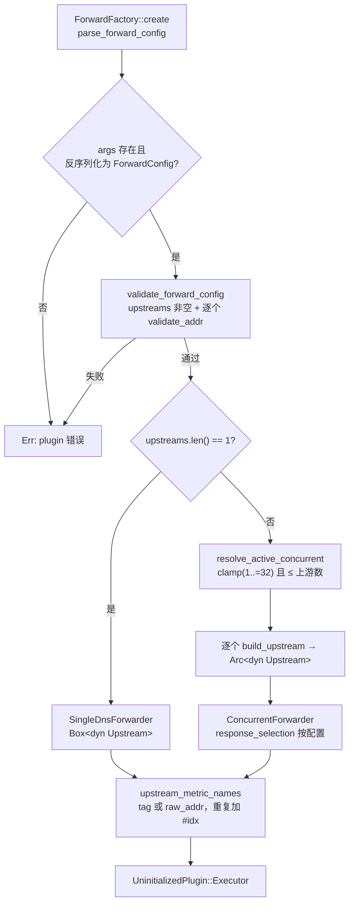
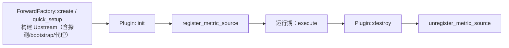
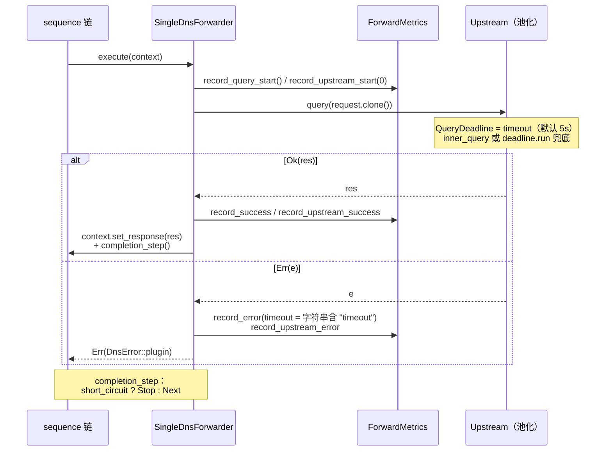
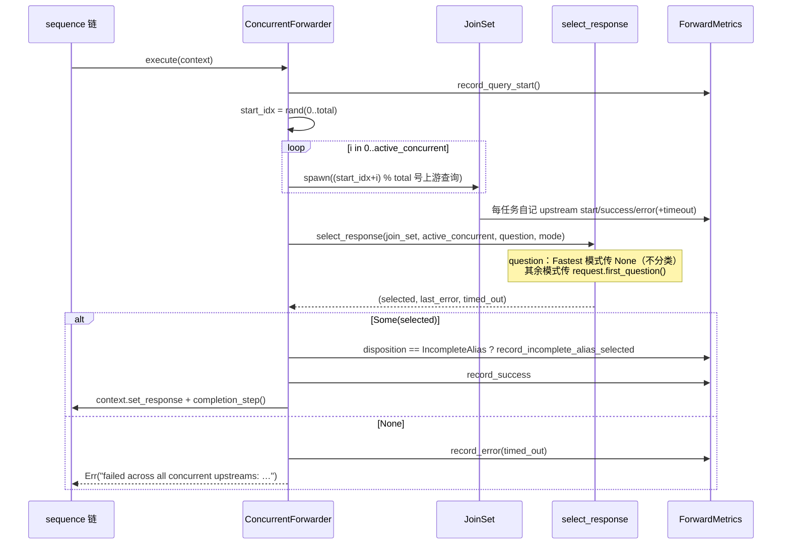
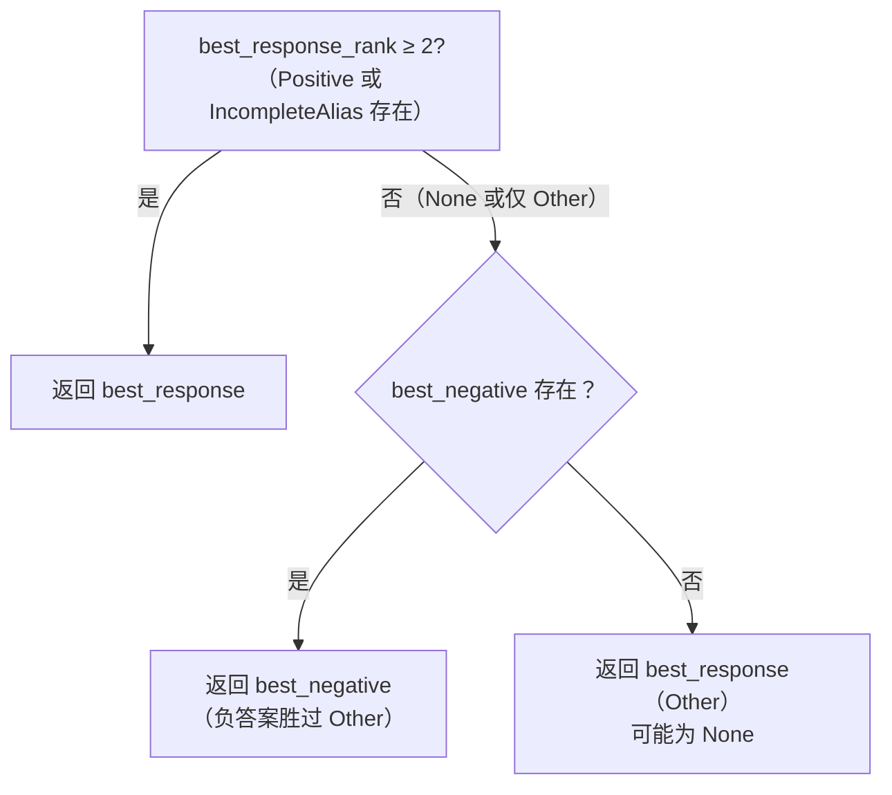
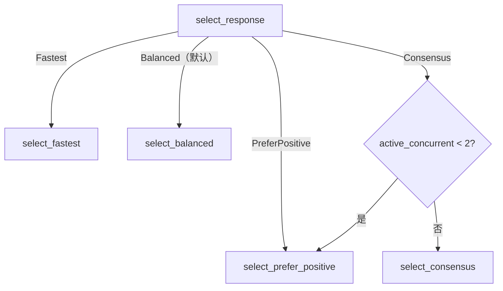
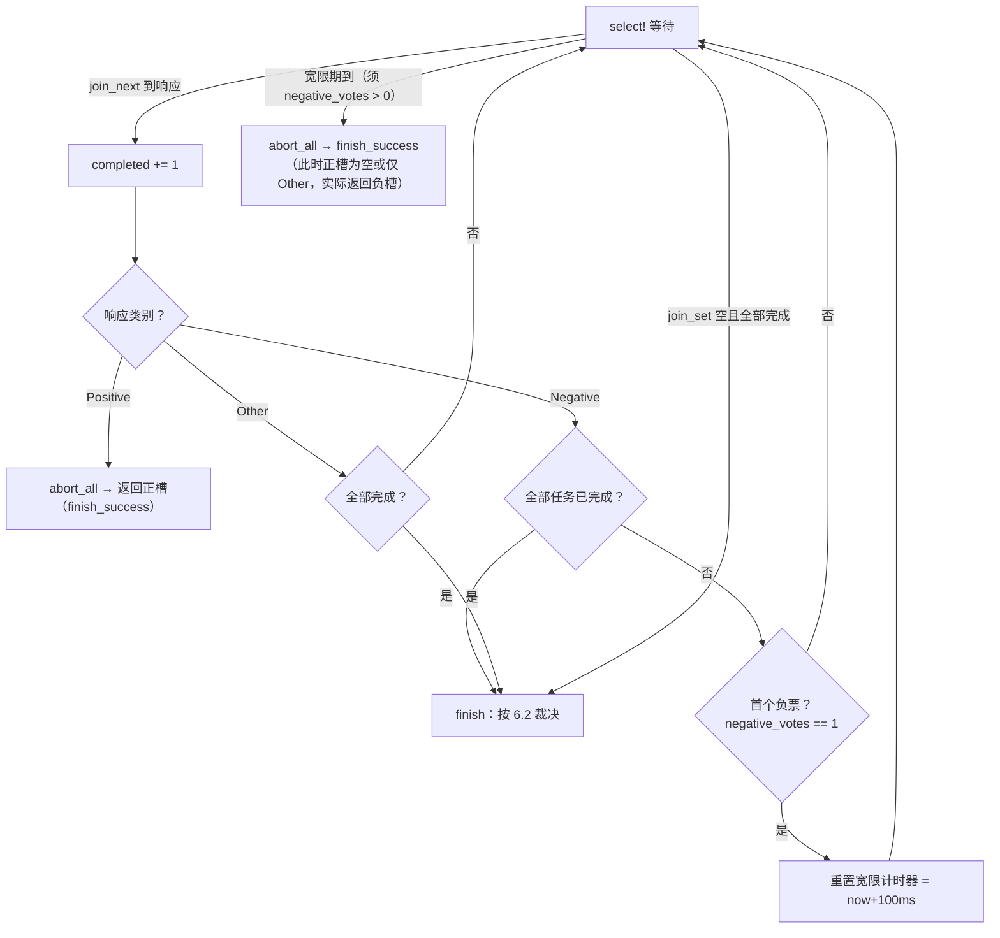
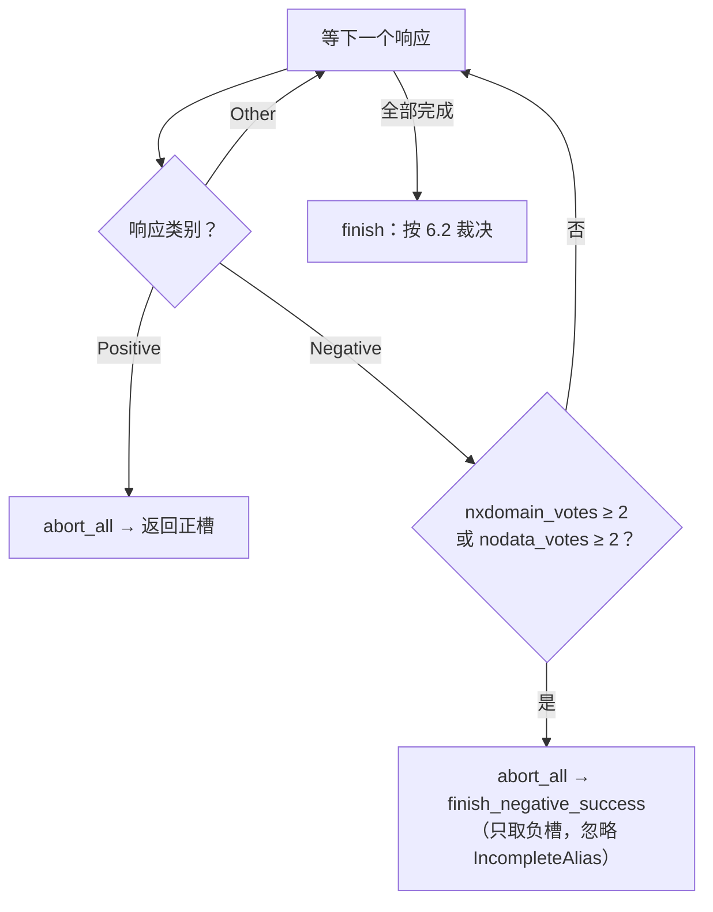
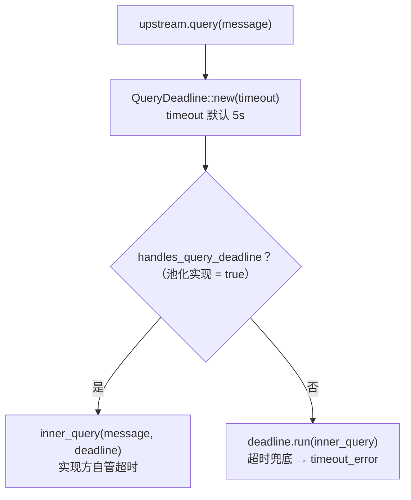

# OxiDNS `forward` 插件实现解析

> 分析基线：`v1.6.1`，分支 `fix/code-review-priorities`（HEAD `b1d81777`）。
> 代码位置：`src/plugin/executor/forward/`，响应分类复用 `src/core/response.rs`，上游抽象复用 `src/infra/network/upstream/`。
> 生态位概述见 `../oxidns-plugin.md`；本文只描述当前代码实际行为；与文档/注释不一致之处集中在第 12 节。

## 1. 插件定位

`forward` 是一个 **executor 插件**，是 OxiDNS 的"出口"：把（可能已被前面插件改写过的）请求转发给配置的上游解析器，把响应写回 `DnsContext`。它不使用 `with_next` 包裹模型（`with_next()` 保持默认 `false`），只通过返回 `ExecStep::Next` / `ExecStep::Stop` 影响序列链走向——前者让链继续（典型用途是转发后继续跑 `cache` 写入、`ipset` 等副作用插件），后者直接短路。

```yaml
# config.yaml 的最小形态
- tag: forward
  type: forward
  args:
    upstreams:
      - addr: "223.5.5.5"

- tag: main_sequence
  type: sequence
  args:
    - exec: $forward
    - exec: accept
```

核心能力：

| 能力 | 实现位置 |
|---|---|
| 单上游直连转发 | `single.rs:55-85` |
| 多上游并发扇出（随机起点 + 固定 fanout） | `concurrent.rs:96-144` |
| 4 种并发响应选择模式（fastest/balanced/prefer_positive/consensus） | `selection.rs:173-312` |
| 查询感知的响应分类（正/负/别名/其他） | 复用 `core/response.rs:62-141` |
| 5 种上游协议（UDP/TCP/DoT/DoQ/DoH） | `infra/network/upstream/` |
| quick setup（`forward 1.1.1.1 8.8.8.8 short_circuit=true`） | `config.rs:78-95`、`factory.rs:88-138` |
| 插件级 + 逐上游两级指标 | `metrics.rs` |
| 成功后短路（`short_circuit`） | `single.rs:87-96`、`concurrent.rs:86-94` |

注意：`forward_edns0opt`（`src/plugin/executor/forward_edns0opt.rs`）是独立插件，处理 EDNS0 OPT 透传，与 `forward` 无代码耦合。

## 2. 代码地图

| 文件 | 行数 | 职责 |
|---|---:|---|
| `mod.rs` | 26 | 模块声明、公共导出、`is_timeout_error` 判定 |
| `config.rs` | 152 | `ForwardConfig` 解析、校验、`concurrent` 钳制、quick setup 参数解析、默认上游构造 |
| `factory.rs` | 143 | `ForwardFactory` 注册、单/多上游分支、`UpstreamBuilder` 调用 |
| `single.rs` | 96 | `SingleDnsForwarder`：单上游直连实现 |
| `concurrent.rs` | 145 | `ConcurrentForwarder`：多上游并发实现 + `JoinSet` 任务编排 |
| `selection.rs` | 368 | `ResponseSelectionMode` 枚举、`SelectionState` 状态机、4 种选择算法 |
| `metrics.rs` | 257 | `ForwardMetrics`/`UpstreamMetrics` 原子计数器 + `MetricSource` 导出 |
| `tests.rs` | 872 | 配置解析、工厂分支、4 种选择模式、指标行为的单元测试 |

运行时结构：

| 结构 | 关键点 |
|---|---|
| `ForwardConfig` | `upstreams: Vec<UpstreamConfig>`（必填非空）+ `concurrent: Option<usize>` + `response_selection`（默认 `balanced`）+ `short_circuit: bool`（默认 `false`）（`config.rs:14-34`） |
| `SingleDnsForwarder` | `tag` + `Box<dyn Upstream>` + `short_circuit` + `Arc<ForwardMetrics>`（`single.rs:22-35`） |
| `ConcurrentForwarder` | `tag` + `active_concurrent: usize`（创建期固定）+ `Vec<Arc<dyn Upstream>>` + `short_circuit` + `response_selection` + `Arc<ForwardMetrics>`（`concurrent.rs:23-39`） |
| `SelectionState<'a>` | 选择过程累积状态：正/负答案槽位、投票计数、最后错误/超时标记（`selection.rs:56-70`） |
| `SelectedResponse` | `message: Message` + `disposition: Option<ResponseDisposition>`（Fastest 模式恒为 `None`）（`selection.rs:50-54`） |
| `ForwardMetrics` | 插件级 7 个计数器 + 按上游索引对齐的 `Vec<UpstreamMetrics>`，全部 `Relaxed` 原子（`metrics.rs:48-59`） |

常量（`selection.rs:17-19`、`config.rs:11`）：

| 常量 | 值 | 含义 |
|---|---|---|
| `MAX_CONCURRENT_QUERIES` | 32 | 扇出上限 |
| `BALANCED_NEGATIVE_GRACE` | 100ms | balanced 模式负答案宽限期 |
| `CONSENSUS_NEGATIVE_VOTES` | 2 | consensus 模式负答案所需同型票数 |
| `NEGATIVE_RESPONSE_RANK` | 2 | 负答案的响应排名 |
| `MAX_CNAME_HOPS` | 16 | 响应分类的 CNAME 链深度上限（`core/response.rs:18`） |

## 3. 配置与工厂创建路径

`ForwardFactory` 通过 `#[plugin_factory("forward")]` 静态注册（`factory.rs:24`），声明了 `create`（完整 YAML args）和 `quick_setup`（CLI/API 内联表达式）两条创建路径。



要点：

- `args` 整体缺失或反序列化失败直接报错（`config.rs:36-44`）；`upstreams` 为空或地址非法报错（`config.rs:46-63`）。
- `concurrent` 缺省为 1，钳制到 `1..=32` 且不超过上游数（`config.rs:69-76`）——即**多上游配置默认也是串行查询**，只有显式配置 `concurrent ≥ 2` 才并发扇出。
- 上游构建走 `UpstreamBuilder::with_upstream_config`（`factory.rs:141-143`），地址解析、协议探测、bootstrap、代理全部在初始化期完成，请求热路径只做查询。
- **quick setup 例外**：多上游 quick setup 的 `concurrent` 传 `Some(MAX_CONCURRENT_QUERIES)`（`factory.rs:127-129`），即 `forward 223.5.5.5 8.8.8.8` 形式默认全量并发（仍被上游数钳制），与 YAML 路径默认 1 不同。
- quick setup 参数支持尾缀循环剥离：`forward 1.1.1.1 8.8.8.8 short_circuit=true` → 两个上游 + 短路；非法值（如 `short_circuit=yes`）报错（`config.rs:97-129`）。quick setup 的上游只用默认 `UpstreamConfig`（`config.rs:131-152`），不支持 bootstrap/代理等字段。

## 4. 生命周期



生命周期极简：没有后台任务、没有延迟初始化、没有 reload 钩子。所有可能失败的工作（地址解析、连接池建立、bootstrap 配置）都在工厂创建期完成，`init` 只注册指标源。staged reload 时旧实例销毁即注销指标，新实例以新 tag/同 tag 重新注册。

## 5. 请求主路径

### 5.1 单上游：`SingleDnsForwarder::execute`



要点：

- 单上游路径**不做响应分类**——`disposition` 概念不存在，`forward_incomplete_alias_selected_total` 恒不增长（`tests.rs:396`）。
- 请求体 `request.clone()` 一份；响应 Message 通过 `context.set_response` 移入上下文。
- 失败时直接返回 `Err`，sequence 引擎收到 `Err` 会中断整条链（`chain.rs:196-228`），后续 `exec` 不再执行，请求以失败上抛给 server。

### 5.2 多上游：`ConcurrentForwarder::execute`



要点：

- **随机起点轮转**：`start_idx = rand::rng().random_range(0..total)`，第 i 个任务查 `(start_idx + i) % total` 号上游（`concurrent.rs:106-109`）。这是唯一的负载分散机制——没有健康检查、权重或失败降级；每个上游每轮至多被查询一次，失败不重试。
- 每个上游任务在子任务内部自记 `upstream` 级指标，主任务只记插件级指标（`concurrent.rs:113-121`）。
- 任务数固定为 `active_concurrent`（创建期钳制后 ≤ 上游数），不会按失败情况动态补发。
- `JoinError`（子任务 panic/取消）被当作普通错误记录，不算 timeout（`selection.rs:120-122`）。
- 全部失败时兜底错误文案为 `"no upstream response"`（`concurrent.rs:73-82`）。

## 6. 并发响应选择（selection.rs）

### 6.1 响应分类基础

选择算法依赖 `core/response.rs::classify_response` 把每个响应映射为 `ResponseDisposition`，再映射为四档排名（`selection.rs:344-368`）：

| ResponseDisposition | 排名 | ResponseClass | 判定要点（`core/response.rs:62-141`） |
|---|---:|---|---|
| `CompletePositive` | 4 | Positive | 请求的 RR 类型存在于 QNAME 或 CNAME 链末端 |
| `IncompleteAlias` | 3 | Other* | 只证明了别名存在（如 CNAME 有但末端无 A 记录），未证明最终答案 |
| `DefinitiveNegative(kind)` | 2 | Negative | NXDomain；或 NoError 且（空 answers 或 negative SOA）→ NxDomain/NoData |
| `Other` | 1 | Other | 响应 question 不匹配、非 NoError/NXDomain rcode、CNAME 冲突/循环、Chaos 类记录等 |

> *`IncompleteAlias` 的 `ResponseClass` 是 `Other`，**不投负票**——只有 `DefinitiveNegative` 才计入 `negative_votes`/`nxdomain_votes`/`nodata_votes`（`selection.rs:90-112`）。

分类遍历 CNAME 链最多 16 跳，冲突别名（同一 owner 两个不同 target 且无请求类型记录）和链环都判为 `Other`；请求 RR 与冲突别名同 owner 时 RR 胜出。

### 6.2 状态机的汇总规则

`SelectionState`（`selection.rs:56-171`）维护两个答案槽位：

- **正答案槽** `best_response`：仅当新响应排名 ≥ 当前排名时替换（同级后者覆盖前者）；
- **负答案槽** `best_negative_response`：每个负响应直接覆盖（保留最后一个），同时按 `NxDomain`/`NoData` 分别计票。

最终裁决 `take_selected_response`（`selection.rs:124-137`）：



即优先级为 **Positive / IncompleteAlias > DefinitiveNegative > Other**。

### 6.3 四种选择模式



**Fastest**（`selection.rs:193-215`）——第一个到达的成功响应立即胜出，`abort_all()` 取消其余任务；transport 错误永远不"胜出"。完全不分类响应（question 传 `None`），因此别名指标也不适用。

**Balanced**（默认，`selection.rs:235-282`）——用 `tokio::select!` 在"等下一个响应"与"100ms 负答案宽限期"之间竞争：



要点：

- 宽限计时器在**第一个负答案到达时**启动，后续负答案不重置；100ms 内等不到 Positive 就带负答案返回。
- 守卫条件 `if state.negative_votes > 0`（`selection.rs:276`）保证没有负票时计时器永不触发。
- IncompleteAlias 属于 `Other`，不触发宽限、不会提前返回，balanced 会继续等正答案（`tests.rs:586`）。
- 全部任务完成（`completed >= active_concurrent`）时无条件立即裁决，不再等宽限。
- 宽限期返回走 `finish_success()`，会清掉 `last_error`/`last_timeout`——即使此前的错误被负答案"救回"，也不再计为插件级失败。

**PreferPositive**（`selection.rs:217-233`）——正答案立即胜出；负答案与其他响应都继续等待，直到全部任务完成后统一裁决。是最保守、通常最慢的模式，但最大化"宁缺毋滥"。

**Consensus**（`selection.rs:284-312`）——正答案立即胜出；**同型**负票（NXDomain 或 NoData 任一计数）达到 2 时 `abort_all` 并返回负答案：



要点：

- 票型分歧（1 × NXDomain + 1 × NoData）不算共识，继续等（`tests.rs:766`）。
- CNAME-only 响应（无 SOA）不是负票（`tests.rs:795`）；CNAME + negative SOA 判 NoData，是负票（`tests.rs:850`）。
- `finish_negative_success` 只取负槽：即便已收到 IncompleteAlias，共识负答案仍胜出（`tests.rs:734`）。
- fanout < 2 时直接退化为 PreferPositive（单任务永远凑不齐 2 票）。

四种模式的取舍总结：

| 模式 | 正答案 | 负答案 | 延迟特征 | 典型场景 |
|---|---|---|---|---|
| `fastest` | 第一个胜出 | 第一个胜出 | 最低 | 追求极速，接受偶发误判 |
| `balanced`（默认） | 立即胜出 | 等首个负票后 100ms 宽限 | 低 | 通用默认 |
| `prefer_positive` | 立即胜出 | 等全部完成 | 最高 | 上游质量参差，宁慢勿错 |
| `consensus` | 立即胜出 | 同型 2 票即返回 | 中 | 多上游交叉验证，防单点污染 |

## 7. 上游查询与协议

`Upstream` trait（`infra/network/upstream/traits.rs:15-108`）对 forward 暴露的契约非常窄：



`UpstreamConfig` → `ConnectionInfo` 的转换（`config.rs:364-535`）在工厂创建期完成，要点：

| 协议 | scheme | 默认端口 |
|---|---|---|
| UDP | `udp://` 或无前缀裸地址 | 53 |
| TCP | `tcp://` / `tcp+pipeline://` | 53 |
| DoT | `tls://` / `tls+pipeline://` | 853 |
| DoQ | `quic://` / `doq://` | 853 |
| DoH | `https://` / `doh://` / `h3://`（强制 HTTP/3） | 443 |

- **bootstrap 与 dial_addr 互斥**：`dial_addr`（直连 IP，保留 SNI）优先，配置了 `dial_addr` 时 `bootstrap` 被忽略并告警；主机名既无 `bootstrap` 也无 `dial_addr` 时回退到 outbound profile 的 resolver，最后才依赖系统解析器。
- **SOCKS5 代理**：本地 `socks5` 字段优先于 outbound profile；仅 TCP/DoT/DoH(h2) 生效，UDP/DoQ/DoH(h3) 配置了也会被忽略。
- 连接复用由池层（`pool/`、`pooled.rs`）负责，`idle_timeout`/`max_conns`/`min_conns` 控制池行为；`enable_pipeline` 支持 TCP/DoT 单连接多路并发。

forward 插件自身对协议无感知——它只持有 `Box<dyn Upstream>` / `Arc<dyn Upstream>` 并调用 `query()`。

## 8. 可观测性

两级指标（`metrics.rs:141-238`），labels 均含 `plugin_tag`：

| 指标 | 级别 | 说明 |
|---|---|---|
| `forward_query_total` | 插件 | execute 调用次数 |
| `forward_success_total` | 插件 | 成功设置响应次数 |
| `forward_error_total` / `forward_timeout_total` | 插件 | 失败/超时次数 |
| `forward_incomplete_alias_selected_total` | 插件 | 选择算法选中 IncompleteAlias 的次数（仅选择感知的并发模式） |
| `forward_latency_count` / `forward_latency_sum_ms` | 插件 | 延迟统计（count+sum，自算均值） |
| `forward_upstream_query_total` 等 6 项 | 上游 | 同构的逐上游计数 |

- 上游 label 值取 upstream `tag`，缺省用 `raw_addr`；重复时追加 `#<idx>` 保证序列唯一（`metrics.rs:245-257`）。名称集合启动期固定，符合指标层低基数约束。
- 全部为 `Relaxed` 原子，热路径零锁；时间源统一走 `AppClock::elapsed_millis()`。
- `init` 注册、`destroy` 注销 `MetricSource`（`single.rs:43-52`、`concurrent.rs:47-55`）。

## 9. 错误处理语义

- **timeout 判定靠字符串匹配**：`is_timeout_error` 检查错误文本的小写形式是否包含 `"timeout"`（`mod.rs:21-23`），用于拆分 `error_total` 与 `timeout_total`。上游错误文案变化会误分类（见第 12 节）。
- **失败即失败**：单上游 Err、多上游全失败都返回 `Err(DnsError::plugin(...))`。sequence 引擎传播该错误并中断链（`chain.rs:196-228`）——forward 之后排队的 `accept`、cache 写入等都不会执行。
- **部分成功不是失败**：只要选择算法返回了任一响应（哪怕全部上游中只有 1 个成功），就计 `success_total`；`last_error` 信息只保留在日志里。
- **`finish_success` 吞错误**：balanced 宽限期命中、任何模式的正答案提前返回路径都会清空 `last_error`/`last_timeout`，插件级指标只记成功。

## 10. 测试覆盖（tests.rs）

| 测试组 | 代表用例 |
|---|---|
| 配置校验 | 空 upstreams 拒绝、非法 addr 拒绝、域名上游地址不解析也接受（`tests.rs:207-238`） |
| quick setup | `short_circuit` 尾缀解析、非法值报错、多上游接受（`tests.rs:240-317`） |
| concurrent 钳制 | 默认 1、上限为上游数、上限 32（`tests.rs:319-334`） |
| 单上游行为 | 成功设响应、short_circuit 返回 Stop、错误/超时指标、不适用别名指标（`tests.rs:337-416`） |
| 并发行为 | 成功短路、NoError 胜过早期 SERVFAIL、无优选时返回最后非优选 rcode（`tests.rs:418-539`） |
| Fastest | 早期 NXDomain 直接返回（`tests.rs:541`） |
| Balanced | 负答案后短暂等待、CNAME-only 后等完整答案、CNAME-only 胜过负答案兜底（`tests.rs:564-632`） |
| PreferPositive | 迟到正答案胜出、CNAME-only 相关边界（`tests.rs:634-702`） |
| Consensus | 2 票返回、票型分歧等待、CNAME-only 不计票、CNAME+SOA 计 NoData（`tests.rs:704-872`） |

测试通过 mock `Upstream`（可控延迟/rcode/错误注入，`tests.rs:47-150`）覆盖选择算法的时序行为，不依赖真实网络。

## 11. 设计要点与热路径考量

- **创建期重、热路径轻**：地址探测、bootstrap、代理、连接池都在 `create` 完成；热路径只有 `request.clone()`（每任务一份）、JoinSet spawn、原子计数。
- **`#[hotpath::measure]`** 标注两个 `execute`，纳入性能剖析（`single.rs:56`、`concurrent.rs:60`）。
- **无重试、无健康检查**：fanout 内每个上游至多尝试一次；失败上游与成功上游在下一轮查询中概率均等。可用性靠多上游并发 + 选择模式兜底。
- **abort_all 收敛**：任何"提前返回"路径（正答案、宽限期、共识达成）都先 `abort_all()`，避免僵尸任务继续占用连接池。
- **克隆换隔离**：JoinSet 任务各自持有 `Message` 克隆与 `Arc` 克隆，无共享可变状态，选择状态集中在主任务的 `SelectionState`。
- **资源上限显式**：fanout ≤ 32（`MAX_CONCURRENT_QUERIES`），连接池默认 ≤ 64（`ConnectionInfo::DEFAULT_MAX_CONNS_SIZE`），CNAME 分类 ≤ 16 跳，防放大。

## 12. 观察与潜在问题

1. **错误消息与实际不符**：`args` 缺失时的报错文案为 "requires 'concurrent' and 'upstreams' configuration"（`config.rs:37-39`），但 `concurrent` 实际是可选字段且缺省 1；该文案只在 `args` 整体缺失时触发，容易误导排障。
2. **timeout 判定脆弱**：`is_timeout_error` 靠错误字符串包含 `"timeout"`（`mod.rs:21-23`）。上游实现若改用 "deadline exceeded" 等措辞，超时会被误计入普通 `error_total` 而非 `timeout_total`。更稳妥的做法是让错误类型携带结构化的超时标志（`QueryDeadline::timeout_error()` 已有类型化路径可利用）。
3. **quick setup 与 YAML 默认行为不一致**：多上游 quick setup 默认全量并发（`factory.rs:127-129`），YAML 路径默认 `concurrent: 1`（串行）。两者都会被文档读者按"默认 1"预期理解，quick setup 的隐式高扇出容易被忽略。
4. **balanced 宽限与共识阈值硬编码**：100ms 宽限期（`selection.rs:17`）与 2 票共识（`selection.rs:18`）不可配置，跨地域高延迟部署无法调优。
5. **随机起点无粘性**：每次查询独立随机选起点，同一客户端的连续查询可能命中不同上游；没有会话亲和或"上次最快的上游优先"记忆。
