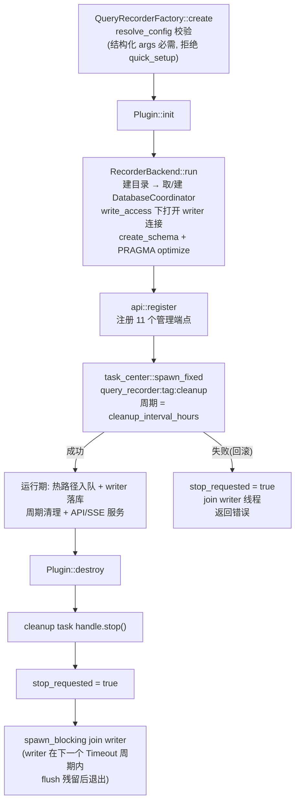
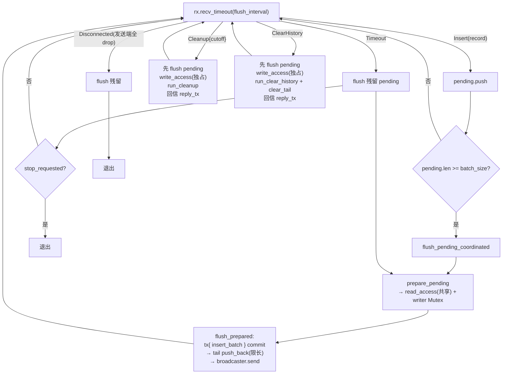
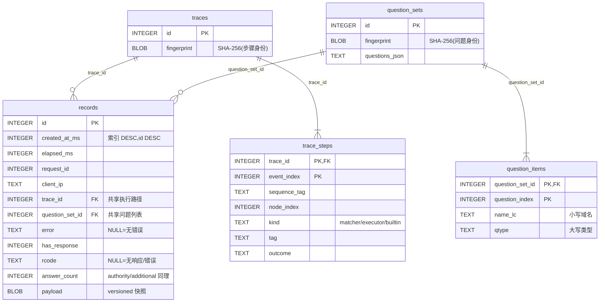
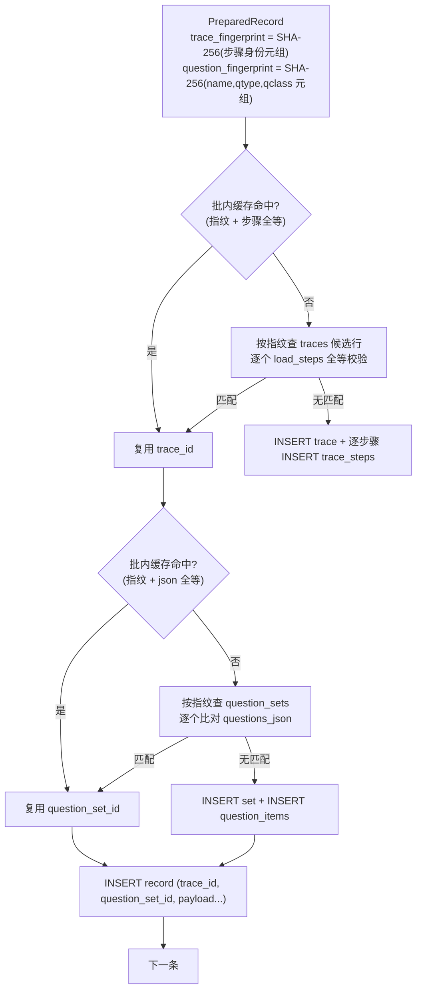
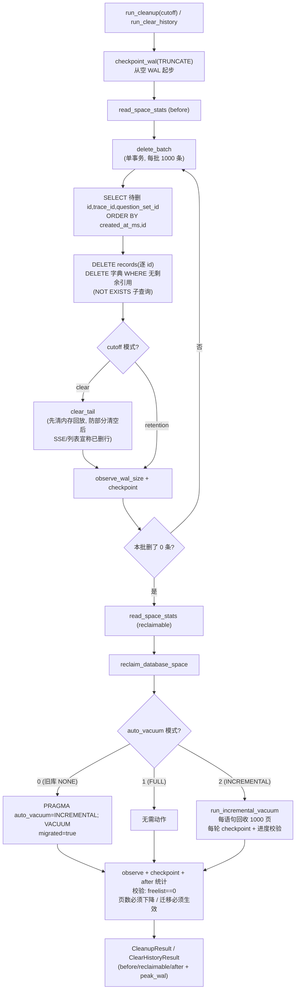
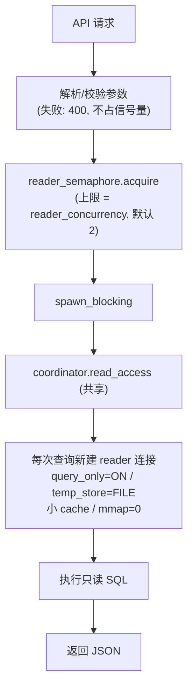

# OxiDNS `query_recorder` 插件实现解析

> 分析基线：main v1.7.1（`ad2046d3`）· 2026-11-22。
> 代码位置：`src/plugin/executor/query_recorder/`，执行路径采集依赖 `src/core/context.rs` 的 `ExecutionPath` 与 sequence 链的 `_sequence-step-recording` 埋点。
> 本文只描述 main 实际行为，行号均指源码文件。

## 1. 插件定位

`query_recorder` 是一个 **executor 插件**，定位为「纯旁路观察者」：它包裹下游链（`with_next() = true`），在进入时抓取请求快照、`next` 返回后抓取响应快照与执行路径事件，然后**原样透传**下游结果。它从不修改响应、从不短路链路，只负责把结构化记录写入 SQLite 并通过管理 API 暴露查询/统计/实时流能力。

```yaml
- tag: recorder_main
  type: query_recorder
  args:
    path: ./data/queries.sqlite
- exec: $recorder_main
- exec: forward 1.1.1.1
```

核心能力与实现位置：

| 能力 | 实现位置 |
|---|---|
| 请求/响应/错误/耗时/执行路径快照采集 | `mod.rs:159-188`、`capture.rs:43-135` |
| 有界队列 + 专用 writer 线程异步落库（热路径零 SQLite 开销） | `backend.rs:269-277`、`store.rs:127-242` |
| v2 共享字典：执行路径（traces）与 Question 列表（question_sets）去重 | `persistence.rs:231-357` |
| 大响应快照 zlib 压缩（带字节阈值与无损回退） | `payload.rs:55-141` |
| 内存尾缓冲 + SSE 实时推送 | `backend.rs`、`api.rs:274-345` |
| 按 tag 隔离的 v2 表族 + 同库多 recorder 协调 | `store.rs:77-89`、`backend.rs:116-175` |
| 周期保留清理 + 空间回收（WAL 受控、auto_vacuum 迁移） | `store.rs:304-535` |
| REST 管理 API（列表/详情/清空/6 类统计/SSE 流） | `api.rs:792-833` |

编译门控（`Cargo.toml:283、366`）：

- `plugin-query-recorder = ["api", "_sequence-step-recording", "dep:rusqlite", "dep:flate2"]`
- `_sequence-step-recording` 打开 sequence 链的 `record_event` 埋点（`sequence/chain.rs:405-424`）：只有该 feature 存在，sequence 才会把每个节点（matcher 判定结果、executor 进入、链出口）作为 `ExecutionPathEvent` 追加到 `DnsContext.execution_path`。没有这个 feature，即使 recorder 调用 `enable_execution_path()`，事件列表也保持为空。

## 2. 代码地图

| 文件 | 行数（约） | 职责 |
|---|---:|---|
| `mod.rs` | 290 | 配置解析/校验、插件生命周期、热路径 `execute_with_next`、工厂注册 |
| `model.rs` | 366 | 全部数据结构：配置、表名、记录行、查询/过滤、统计响应、时间桶枚举 |
| `backend.rs` | 367 | `RecorderBackend`、writer 命令通道、`DatabaseCoordinator`（同库协调）、清理/清空入口 |
| `store.rs` | 1740 | writer 线程主循环、SQLite PRAGMA、表名生成、读查询与统计 SQL、删除与空间回收 |
| `schema.rs` | 119 | v2 表族 DDL（记录/共享字典/meta）、schema_revision 校验 |
| `persistence.rs` | 452 | `PreparedRecord` 准备、批量插入（字典去重）、读端装配 |
| `capture.rs` | 399 | `PendingRecord::take_to_record`：Message → JSON 快照（Question/RR/EDNS/执行路径） |
| `payload.rs` | 231 | 版本化快照编码（RAW/ZLIB）与严格解码校验 |
| `api.rs` | 913 | 11 个管理端点注册、查询参数解析、SSE 流、读并发闸门 |
| `tests.rs` / `v2_tests.rs` | 2100+ / 640+ | 行为测试、统计正确性、空间回收、共享字典、schema 隔离、基准 |
| `fixtures/v1.sql` | 79 | v1 表结构样本（仅用于测试验证 v1 隔离，永不迁移） |

运行时结构：

| 结构 | 关键点 |
|---|---|
| `QueryRecorder` | `tag + ResolvedRecorderConfig + Option<Arc<RecorderBackend>> + cleanup_task_handle`（`mod.rs:62-68`） |
| `RecorderBackend` | 每个 recorder 实例一份：有界 `SyncSender` 队列、`stop_requested`、writer `JoinHandle`、内存尾缓冲 `Mutex<VecDeque<RecordDetail>>`、`broadcast::Sender`、丢包计数、读信号量、同库协调器（`backend.rs:22-35`） |
| `DatabaseCoordinator` | 按**规范化路径**全局共享：`RwLock<()>`（access）+ `Mutex<()>`（writer），串行化同文件写入、互斥维护操作（`backend.rs:116-140`） |
| `PendingRecord` | 热路径产物：请求/响应 Message、时间、耗时、执行路径切片、客户端地址、错误（`model.rs:130-140`） |
| `PreparedRecord` | writer 线程产物：API 形态 `RecordDetail` + questions_json + 两个 SHA-256 指纹 + 编码快照（`persistence.rs:139-188`） |
| `EncodedPayload` | `{version, codec, raw_len, data}`，codec = 0 RAW / 1 ZLIB（`payload.rs:22-27`） |

## 3. 生命周期



要点：

- **init 的建库阶段持 `write_access`**：打开数据库、建 schema 都在协调器写锁内完成（`backend.rs:192-211`），与其它 recorder 对同一文件的并发 init/清理互斥。
- **schema 是全有全无的**：检测到 recorder 自己的 6 张表中「部分存在」直接报错 `incomplete v2 schema`；全部存在则校验 `meta.schema_revision == "1"`，否则报 `unsupported schema revision`（`schema.rs:11-54`）。v1 表（裸名 `records/steps/questions/meta`）从不被读取、迁移或删除——新旧表族靠表名前缀 `qr_{tag}_{hash}_v2_` 天然隔离。
- **周期清理任务由任务中心托管**（`mod.rs:82-120`）：每次触发计算 `cutoff = now - retention_days`，经 `spawn_blocking` 调 `backend.cleanup(cutoff)`。清理任务启动失败会回滚 writer 线程并让 init 失败。
- **destroy 不丢数据**：writer 线程以 `recv_timeout(flush_interval)` 轮询，`stop_requested` 只在「Timeout 分支 flush 完残留」后检查（`store.rs:212-225`），所以退出前最多再等一个 flush 周期，不会丢已入队记录。

## 4. 请求热路径

### 4.1 时序

```mermaid
sequenceDiagram
    participant C as 客户端
    participant Seq as sequence 链
    participant R as query_recorder
    participant D as 下游 (forward/...)
    participant W as writer 线程
    C->>Seq: DNS 查询
    Seq->>R: execute_with_next(next)
    R->>R: request.clone()<br/>enable_execution_path()<br/>step_start_index = path_len
    R->>D: next.next(ctx) (continue_next!)
    Note over D: matcher/executor 事件追加到 execution_path<br/>(需 _sequence-step-recording feature)
    D-->>R: Result<ExecStep> + 可能的 response
    R->>R: 组装 PendingRecord<br/>(响应克隆/耗时/错误/路径切片)
    R->>W: queue_tx.try_send(Insert)<br/>非阻塞; 满则 dropped_total++ + warn
    R-->>Seq: 原样返回 result (不改动)
    Seq-->>C: 最终响应
```

### 4.2 关键细节（`mod.rs:159-188`）

- **观察者语义**：`result`（含 `ExecStep` 与错误）原样返回，响应内容零改动。即使下游出错，也会生成一条带 `error` 字段的记录（`has_response = false`）。
- **路径切片语义**：`step_start_index = execution_path_len()` 在进入时定格；`PendingRecord` 携带整段路径克隆与起点，落库前由 `take_to_record` 通过 `events_from(step_start_index)` 切出子树事件（`capture.rs:61-66`）。因此链上多个 recorder 各自只记录**自己子树**内的事件，天然不重叠；同一请求被多个 recorder 记录时各自持有独立 trace。
- **`execute()` 兜底路径**：无 next 时等价于 `execute_with_next(None)`，`continue_next!` 返回 `ExecStep::Next`——recorder 作为链尾节点也能正常记录。
- **热路径成本**：两次 `Message` 克隆（入口请求、返回后响应）+ `PendingRecord` 堆分配 + `try_send`（失败只计数告警，绝不阻塞请求）。**热路径上没有任何 SQLite 调用**。
- **时间戳**：`AppClock::now()` 量耗时、`Timestamp::now()` 量落库时间戳，两个字段分开存。

## 5. 异步记录管线（writer 线程）

每个 recorder 独占一条 OS 线程（名为 `query-recorder-{tag}`），独占一条 SQLite 连接（`backend.rs:231-251`）。主循环是一个命令泵：



要点：

- **批量阈值 + 定时兜底**：攒够 `batch_size`（默认 256）立即落库；不足则由 `recv_timeout` 超时（默认 200ms）触发 flush——低流量时记录延迟上限就是一个 flush 间隔。
- **flush 的锁序**：先 `prepare_pending`（纯 CPU：JSON 快照 + SHA-256 指纹 + 可选 zlib），再拿协调器 `read_access`（共享，允许同库其它 recorder 同时 flush 各自连接）+ `writer` Mutex（同一文件写入串行）（`store.rs:244-257`）。
- **先提交、后广播**：`flush_prepared` 先 `tx.commit()`，再更新内存尾缓冲与 broadcast（`store.rs:259-287`）——SSE 订阅者与 `/stream?tail=N` 回放只会看到已提交行，不会出现「推送了但查不到」的窗口。
- **Cleanup/ClearHistory 复用同一条队列**：`backend.cleanup()` 用阻塞 `send` 投递命令并同步等回信（`backend.rs:279-301`）。队列满时清理命令排队等待而不是被跳过（有专门测试 `tests.rs:774`）；命令处理前会先 flush 手头 pending，保证清理判定基于最新数据。清理失败只回信错误，writer 继续运转（`tests.rs:734`）。
- **丢包可观测**：`try_send` 失败（队列满）时 `dropped_total.fetch_add(1)` + `warn!`（`backend.rs:269-277`）。记录是尽力而为的，过载时优先保住 DNS 服务。

## 6. v2 存储模型

### 6.1 表族与命名

表名由 `table_names(tag)` 生成（`store.rs:77-89`）：前缀 `qr_{safe_tag}_{fnv1a_hex(tag)}_v2_`。tag 先做「小写字母数字+`_` 以外全部替换为 `_`」的净化，再叠加 tag 原始字节的 FNV-1a 64 位哈希——既保证 SQL 安全，又避免不同 tag 净化后撞名。

| 表 | 结构 | 用途 |
|---|---|---|
| `*_records` | 标量列（时间/耗时/请求 ID/客户端 IP/请求标志/opcode/错误/响应标志/三节计数）+ `trace_id`、`question_set_id` 外键 + 快照 BLOB 四元组 `payload_version/codec/raw_len/payload` | 每次查询一行 |
| `*_traces` | `id + fingerprint BLOB`（步骤身份的 SHA-256） | 执行路径共享字典 |
| `*_trace_steps` | `(trace_id, event_index) PK`，`WITHOUT ROWID`；索引 `(kind, tag, outcome, trace_id)` | 路径展开步骤 |
| `*_question_sets` | `id + fingerprint + questions_json` | Question 列表共享字典 |
| `*_question_items` | `(question_set_id, question_index, name_lc, qtype) PK`，`WITHOUT ROWID`；索引 `(qtype, question_set_id)` | 问题展开，供 qname/qtype 过滤与统计 |
| `*_meta` | key/value，`schema_revision = '1'` | 版本标记 |

records 索引（`schema.rs:107-110`）：`(created_at_ms DESC, id DESC)`（列表排序 + 游标）、`trace_id`、`question_set_id`、`rcode COLLATE NOCASE`。

### 6.2 实体关系



设计动机：典型流量中「执行路径」和「问题列表」的基数远小于记录数（成千上万条查询往往命中同几条链路）。把这两个不可变对象抽成字典表，records 行保持很窄的标量形态，列表页与统计页无需反序列化 BLOB 即可过滤排序。

### 6.3 写入去重与指纹防碰撞

`insert_batch` 逐条处理（`persistence.rs:231-357`）：



- **指纹是「候选索引」而非身份证明**：SHA-256 碰撞概率极低，但代码仍做内容全等校验（步骤序列 `load_steps(...)==p.detail.steps`、questions_json 字符串比对），并有注入碰撞的专门测试（`v2_tests.rs:79`）。指纹列上的索引保证候选查找是 O(1) 级，全等校验只发生在候选上。
- **身份元组刻意收窄**：trace 指纹只含 `(event_index, sequence_tag, node_index, kind, tag, outcome)`，注释明确「未来加入的请求级时序/数值不得混入共享身份」（`persistence.rs:164-179`）。
- **批内缓存**：`BatchCache` 让同一批里重复路径/问题免查库。
- **事务边界**：整批一个事务，任何一步失败整批回滚，不产生孤儿字典行（`v2_tests.rs:147`）。

### 6.4 读端装配

`assemble_records`（`persistence.rs:393-447`）按 500 个 id 一批取回 question_sets JSON，并校验 traces 全部存在（缺失即报错——防御清理与读取竞争）；`StoredRecord::into_api` 再解码 payload BLOB 补齐 EDNS/RR 节数据。

## 7. 快照 payload 编码

响应快照（`payload.rs`）是版本化、与 API 行结构解耦的 BLOB：

- 内容：`req_edns_json + answers + authorities + additionals + signature + resp_edns`（`SnapshotRef`，不含请求 questions——那在字典表里）。注意 v2 的 `records` 表**没有** `req_edns_json` 列，它整个藏在 payload 里（对比 v1：每个 JSON 节都是独立列）。
- 编码策略（`payload.rs:55-88`）：
  - `2 KiB ≤ raw ≤ 16 MiB` 且 zlib 后 ≤ 原始 80% → `ZLIB`（`Compression::fast`）；
  - 否则存 `RAW`——太小的压不出收益，太大的超过解码安全上限直接不压。
- 解码（`payload.rs:90-141`）是**严格模式**：校验 version/codec 白名单、`raw_len` 与数据长度一致、分块 zlib 解压过程中累计输出不得超过 `raw_len`、流必须 `StreamEnd` 结束、不允许尾随字节。任何截断/翻转/篡改都拒绝（有逐字节翻转的穷举测试 `payload.rs:193`）。`raw_len > 16 MiB` 的压缩载荷拒绝解码，防解压炸弹。

## 8. 保留清理与空间回收

周期清理（retention）与手动清空走同一套「分批删除 + WAL 控制 + 空间回收」管线（`store.rs:304-535`）：



要点：

- **WAL 增长受控**是整段设计的主线：大批量 DELETE 的事务日志会让 WAL 接近被删数据体量，所以「每批删除 → 观察 WAL 峰值 → `wal_checkpoint(TRUNCATE)`」循环推进；`incremental_vacuum` 同样分批并在批间截断 WAL（`store.rs:507-535`），避免「主文件变小、WAL 峰值失控」。日志字段专门记录 `wal_bytes_peak`。
- **删除与字典回收同事务**：字典条目只有在其下无任何 records 引用时才删（`NOT EXISTS`），事务化保证失败批次不留孤儿（`store.rs:302-359`）。
- **部分清空的一致性**：clear_history 在每批可失败的 checkpoint 之前先清内存尾缓冲，保证「部分成功」时 SSE/内存回放不会宣称数据库里已不存在的行（`store.rs:413-430`，专门测试 `store.rs:1620`）。
- **旧库迁移一次性完成**：`auto_vacuum=0` 的库（含 v1 时代遗留）在首次回收时迁移到 INCREMENTAL 并 VACUUM 重写；迁移后校验模式确已生效（`store.rs:458-484`，测试 `tests.rs:573/605`）。
- **进度防御**：回收后若 freelist 非零、或页数没有下降、或 incremental_vacuum 一轮无进展，直接报错——宁可失败也不静默假回收。

## 9. 管理 API

`init` 时以插件 tag 为前缀注册（`api.rs:792-833`，feature `api` 关闭时宏退化为 no-op，但本插件 feature 依赖强制含 `api`）：

| 端点 | 方法 | 说明 |
|---|---|---|
| `/records` | GET | 游标分页列表（默认 100，上限 500），支持时间窗 + 过滤器 |
| `/records/{id}` | GET | 单条详情（含展开的 steps） |
| `/records` | DELETE | 清空全部历史（复用第 8 节管线，等回信） |
| `/stats/plugins` | GET | 按 (kind, tag) 聚合 checked/matched/executed/query_hits |
| `/stats/top_clients` | GET | 客户端 IP 桶 |
| `/stats/top_qnames` | GET | 域名桶（按 question_items 展开计数） |
| `/stats/qtype`、`/stats/rcode` | GET | 分布统计；rcode 无值时分 `_ERROR`/`_NO_RESPONSE`/`_UNKNOWN` 桶 |
| `/stats/latency` | GET | avg/p50/p95/p99/max + 直方图（10/20/50/100/300/1000ms 边界）+ 慢查询 Top |
| `/stats/timeseries` | GET | 时间桶序列（minute/hour/auto），桶内 total/error/no_response/servfail/avg/p95 |
| `/stream` | GET | SSE 实时流 |

共同约束：

- **统计端点强制有界时间窗**：`since_ms`/`until_ms` 必填、`since < until`、跨度 ≤ 24h（`api.rs:626-643`）。参数非法时**在获取读信号量之前**就返回 400，不会排队等待（专门测试 `api.rs:843`）。
- **采样上限**：所有统计基于最近 `PLUGIN_STATS_SAMPLE_LIMIT = 10_000` 条记录的 CTE 样本（`store.rs:686-709`），响应携带 `sample_size/sample_truncated/sample_since_ms/sample_until_ms` 元数据，前端可据此提示「样本截断」。
- **过滤子查询不相关化**：`matcher_tag`、`qname`、`qtype` 等过滤走 `trace_id/question_set_id IN (SELECT ...)` 形式，保持字典成员判定独立于每条候选记录（`store.rs:1413-1507`）。
- **游标**：`<created_at_ms>:<id>`，按 `(created_at_ms DESC, id DESC)` 取 `limit+1` 行判定 has_more，多出的一行只用于探测、不进结果。

### 9.1 SSE 流

```mermaid
flowchart TD
    H["GET /stream?tail=N"] --> P["tail = min(N, memory_tail)<br/>(缺省 0: 不回放)"]
    P --> T["锁定 tail 缓冲<br/>取最后 N 条快照克隆"]
    T --> B["broadcaster.subscribe()"]
    B --> S["unfold 流: 先逐帧发送 pending 回放<br/>然后 select 等待"]
    S -->|"broadcast 收到新记录"| F["event: record<br/>data: RecordDetail JSON"]
    S -->|"15s 无流量"| HB["`: heartbeat` 注释帧保活"]
    S -->|"Lagged(订阅慢)"| C2["跳过丢失计数, 继续收"]
    S -->|"Closed"| X["流结束"]
```

- 实时帧与内存尾缓冲同源（writer 在 commit 后同时喂两者，见第 5 节），回放与实时衔接不重不漏（测试 `tests.rs:2007`）。
- 订阅者消费慢导致 broadcast 落后时按 Lagged 处理继续推最新帧，不重放历史；历史回放只有连接建立时的 `tail=N` 一次。

### 9.2 读路径与并发闸门



每次查询都新开连接看似昂贵，实为刻意取舍：reader 连接带 `query_only` 且不预留大缓存，多个仪表盘请求并发时不会各自囤积内存；WAL 模式保证读不阻塞写。清空历史（write_access 独占）会等活跃 reader 完成，但**不等 API 读信号量**——清空走 writer 队列，与信号量体系正交（测试 `tests.rs:471`）。

## 10. 同库多 recorder 协调

多个 recorder 配置同一个数据库文件（规范化路径相同，含大小写/相对路径归一，`backend.rs:160-175`）时，共享同一个 `DatabaseCoordinator`（进程内 `OnceLock<Mutex<HashMap<PathBuf, Weak>>>` 注册表，随实例销毁自动清理，`backend.rs:142-158`）：

| 操作 | access 锁 | writer 锁 | 说明 |
|---|---|---|---|
| init / 建表 | write（独占） | — | 与清理互斥 |
| 批量 flush（各 recorder writer 线程） | read（共享） | 独占 | 多 recorder 可并发 flush 各自连接，同文件写入由 Mutex 串行 |
| API 读查询 | read（共享） | — | 与 flush 并行（WAL） |
| cleanup / clear_history | write（独占） | — | 排除一切读写，等活跃 reader 完成 |

配合同库测试：`tests.rs:676`（一个 recorder 清空不影响另一个）、`tests.rs:635`（清理等待活跃 reader）。

## 11. 配置参数

| 字段 | 默认值 | 校验 | 说明 |
|---|---|---|---|
| `path` | 必填 | 非空 | SQLite 文件路径；父目录自动创建；同路径 recorder 共享协调器 |
| `queue_size` | 8192 | > 0 | 有界命令队列容量；满时丢弃记录并计数 |
| `batch_size` | 256 | > 0 | writer 攒批阈值 |
| `flush_interval_ms` | 200 | > 0 | writer 轮询/兜底 flush 周期，同时是 destroy 退出延迟上限 |
| `memory_tail` | 1024 | > 0 | 内存尾缓冲长度 + broadcast 通道容量（下限 16）+ SSE 回放上限 |
| `retention_days` | 7 | ≥ 1 | 周期清理保留天数 |
| `cleanup_interval_hours` | 1 | ≥ 1 | 周期清理触发间隔 |
| `reader_concurrency` | 2 | > 0 | 统计/列表读并发信号量 |

配置解析把全部 `Option<T>` 在 `resolve_config`（`mod.rs:202-272`）落成 `ResolvedRecorderConfig`，零值一律拒绝（`tests.rs:1991`）；工厂仅接受结构化 args，`quick_setup` 明确不支持（`tests.rs:1981`）。

## 12. 测试布局

- `tests.rs`（行为面）：捕获语义（无响应/结构化响应）、热路径入队、游标分页、过滤器（qname/qtype/rcode/client_ip/matcher_tag/status/时间窗）、插件统计、top/分布/延迟/时间序列、统计时间窗强制、表名含 tag 哈希与版本、PRAGMA 断言、周期/手动回收（含旧库迁移）、同库协调、清理失败与队列满场景、SSE 历史、队列压力基准。
- `v2_tests.rs`（存储面）：共享对象跨批次/重启/回收存活、指纹碰撞注入下内容保全、插入失败整批回滚、缺失共享引用报错、schema_revision 与 v1 隔离、快照全节往返、查询计划使用保留索引（EXPLAIN QUERY PLAN 断言）、schema 初始化原子性、存储变体与有界统计过滤基准。
- `payload.rs` / `capture.rs` / `api.rs` / `store.rs` 内嵌单测：压缩阈值与无损回退、逐字节损坏穷举、EDNS 不透明选项命名、非法统计参数不等待读信号量、清空时序（tail 先清）。

## 13. 设计要点与性能考量

1. **热路径与存储完全解耦**：`execute_with_next` 只做克隆 + 入队；SQLite 全部发生在专用线程（写）或 `spawn_blocking`（读）。DNS 请求延迟不随记录量、统计查询、清理波动。唯一代价是队列满时的丢包（显式计数，绝不背压请求）。
2. **观察者不劫持链路**：不返回 `Stop`/`Return`、不改响应；错误与 ExecStep 原样传播。`with_next() = true` 使 sequence 把「下游子链」整体交给它包裹。
3. **字典化降基数**：执行路径与问题列表抽为共享表后，高频流量下 records 行窄、索引小、统计 JOIN 廉价；指纹索引 + 内容全等校验把正确性从哈希假设中解放出来。
4. **大对象延迟到 writer**：JSON 快照、SHA-256、zlib 都在 writer 线程做（`prepare_pending`），热路径连编码都不做。
5. **空间安全是显式契约**：WAL 峰值观测、分批 checkpoint、incremental_vacuum 分批、进度/freelist 校验、旧库迁移验证——回收失败宁可报错也不留下「看起来成功」的假象。
6. **读侧资源可控**：`reader_concurrency` 信号量 + 每查询轻量连接 + `query_only`，防止仪表盘并发把内存吃穿；非法参数先于信号量拒绝。
7. **执行路径按子树切片**：`step_start_index` 让每个 recorder 只归属自己子树的事件，多 recorder 场景下 trace 互不污染；同链路重复流量在字典表中只存一份。
