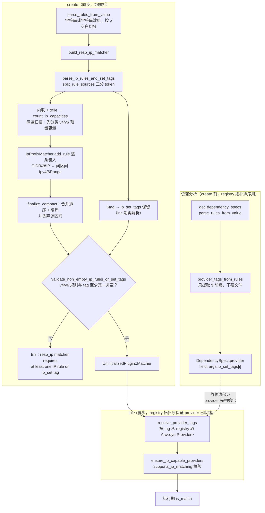
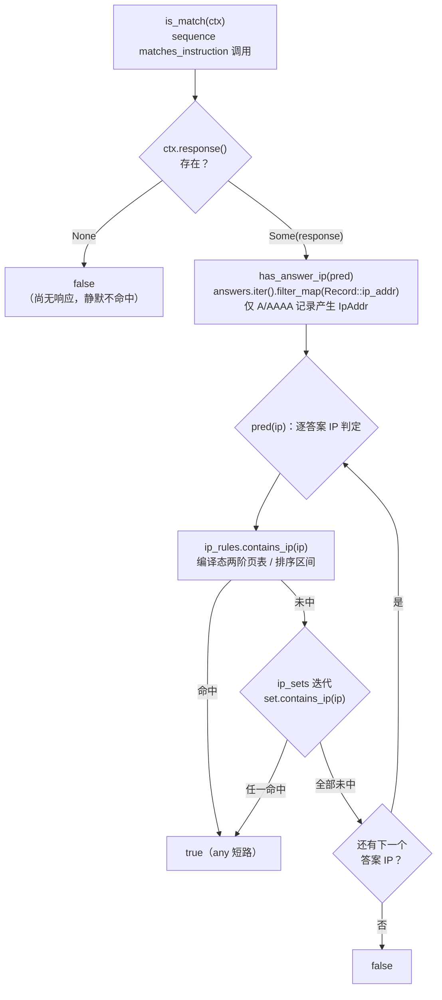
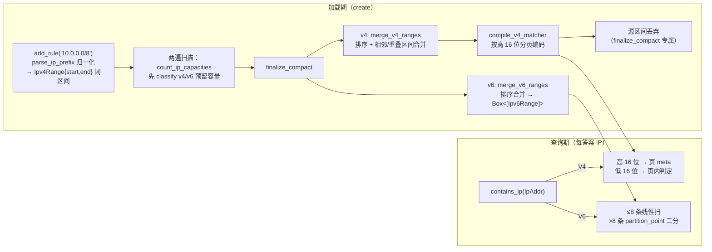

# OxiDNS `resp_ip` matcher 实现解析

> 分析基线：main v1.7.1-14（`4a8d6a55`）· 2026-11-15。
> 代码位置：`src/plugin/matcher/resp_ip.rs`（199 行，含测试）；共享基建 `src/plugin/matcher/rules/`（528 行）、`src/core/rule_matcher/ip.rs`、`crates/proto/src/message.rs`。
> 类别级上下文见 [oxidns-plugin-matcher.md](oxidns-plugin-matcher.md)（`resp_ip` 是其中第 4 节"数据类 matcher"五插件之一）；本文只展开 `resp_ip` 自身的实现细节。

## 1. 定位与职责

`resp_ip` 是**响应侧 IP 谓词**：检查上游响应 answer 区中的 A/AAAA 记录地址，命中内联 IP 规则或引用的 IP provider 即返回 true。它不产生 DNS 语义副作用，典型的 sequence 用法是"根据上游返回的地址做二次处置"——例如筛选出解析到 CDN/污染地址的响应再走 `ipset`/`nftset` 或重定向分支。

```yaml
# 完整配置形态（website/docs/plugin-reference/matcher/response.mdx）
- tag: matched_resp_ip
  type: resp_ip
  args:
    - "100.64.0.0/10"        # 内联 CIDR / 裸 IP
    - "$special_targets"     # $ip_set provider 引用
    - "&/path/rules.txt"     # 规则文件（create 期读取）
```

```yaml
# sequence quick setup 内联形态
- matches: "resp_ip 10.0.0.0/8"
```

语义要点（由 `resp_ip.rs:105-111` 与三个内嵌测试共同锁定）：

- **只看 answer 区**——authority/additional 中的 A 记录（如 glue）不计入（`test_resp_ip_matcher_only_checks_answer_section`）。
- **只认 A/AAAA 记录**——answer 中的 CNAME、TXT 等非 IP 记录被 `Record::ip_addr` 过滤掉（`test_resp_ip_matcher_only_checks_ip_rr`）。
- **无响应返回 false**——matcher 常被挂在"上游查询之后"的规则上，前置规则尚未产生响应时静默不命中（`test_resp_ip_matcher_matches_a_record_and_requires_response`）。
- **多答案 OR**——任一答案 IP 命中即 true（`Iterator::any` 短路）。

## 2. 代码地图

| 组件 | 位置 | 在 resp_ip 中的角色 |
|---|---|---|
| `RespIpFactory` | `resp_ip.rs:30-64` | 工厂：依赖边提取、create、quick setup |
| `build_resp_ip_matcher` | `resp_ip.rs:66-76` | create/quick setup 共用装配函数 |
| `RespIpMatcher` | `resp_ip.rs:78-84` | 运行期实例：内联规则 + provider 列表 |
| `rules/config.rs` | `rules/config.rs:8-30` | args/quick setup 参数 → token 列表 |
| `rules/sources.rs` | `rules/sources.rs:66-134` | token 三分（内联/文件/$tag）+ IP 规则编译 |
| `rules/providers.rs` | `rules/providers.rs:21-50` | provider 解析与 IP 能力校验 |
| `IpPrefixMatcher` | `core/rule_matcher/ip.rs:255-412` | 内联规则的编译容器与热路径查询 |
| `Message::has_answer_ip` | `crates/proto/src/message.rs:643-648` | answer 区逐 IP 回调 |
| `Record::ip_addr` | `crates/proto/src/record.rs:156-158` | A/AAAA → `IpAddr` 提取 |
| `Provider::contains_ip` | `plugin/provider/mod.rs:66-68` | `$ip_set`/`$geoip` 命中接口 |

## 3. 生命周期：三阶段流水

`resp_ip` 遵循标准插件生命周期，且**create 与 quick setup 汇入同一个装配函数**（`build_resp_ip_matcher`），规则 token 语义完全一致：



要点：

- **依赖边在工厂期生成**（`resp_ip.rs:35-41`）：字段名形如 `args.ip_set_tags[0]`，registry 据此把 `$tag` 引用的 provider 排在 matcher 之前初始化。`provider_tags_from_rules`（`sources.rs:126-134`）刻意**不读取 `&file`**——依赖分析阶段不应有文件 I/O，不存在的文件路径在此阶段不报错。
- **quick setup 的依赖边字段前缀不同**（`resp_ip.rs:43-49`）：`get_quick_setup_dependency_specs` 用裸 `ip_set_tags`（无 `args.` 前缀），因为 quick setup 参数不是 YAML args 树，而是单个字符串参数（`resp_ip 10.0.0.0/8,$set` → 按 `,`/空白切分后走同一装配函数）。
- **规则解析执行两次**：依赖分析一次、create 一次。两次都是纯内存解析（文件读取发生在 create 的 `scan_ip_rules` 里），代价可接受；副作用是 `&file` 内容非法会在 create 期报错，而 `$tag` 不存在或能力不符在 init 期报错——**配置错误的暴露阶段由规则形态决定**。
- **`finalize_compact` 而非 `finalize`**（`sources.rs:79`）：编译后的查询结构拥有全部数据，源区间被清空/移走，不保留重复副本（与 `ip_set`/`geoip` 一致，2026-05 release 记录过这次内存优化）。

## 4. 求值热路径：`is_match`

`resp_ip.rs:103-111` 全部实现只有 6 行有效代码，带 `#[hotpath::measure]` 剖析标注，同步无 await：

```rust
fn is_match(&self, context: &mut DnsContext) -> bool {
    context.response().is_some_and(|response| {
        response.has_answer_ip(|ip| {
            self.ip_rules.contains_ip(ip) || self.ip_sets.iter().any(|set| set.contains_ip(ip))
        })
    })
}
```



要点：

- **`is_some_and` 消掉 Option 匹配**：无响应直接短路 false，不进入答案遍历。
- **`has_answer_ip`（`message.rs:643-648`）是零分配回调**：`filter_map(Record::ip_addr).any(pred)` 把"提取 + 过滤 + 判定"融进一次遍历，不为 IP 列表建中间 `Vec`（对比 `answer_ips()` 会分配）。
- **内联规则与 provider 是 OR**，且顺序固定：先查编译过的本地 `IpPrefixMatcher`（无锁无间接），再线性扫 `ip_sets`（`Vec<Arc<dyn Provider>>`，通常 0-2 个元素）。provider 的动态派发查询放最后，让最便宜的路径先短路。
- **`ip_set` provider 自身也可能级联**（`provider/ip_set.rs:136-149`）：先查快照 matcher，再委托它引用的 `referenced_sets`——resp_ip 视角的一次 `contains_ip` 在 provider 内部可能是多级链，但 resp_ip 不感知。
- **每个答案 IP 独立判定，命中即停**：100 条答案里第 1 条命中时，后 99 条不再触碰任何数据结构。

## 5. `IpPrefixMatcher`：内联规则的编译与查询

内联规则（含 `&file` 行）由 `parse_ip_rules_and_set_tags` 装入 `IpPrefixMatcher`（`core/rule_matcher/ip.rs`）。加载与查询分离，符合"启动期做重活、热路径零分配"的类别约束：



IPv4 采用两级结构：高 16 位选中 65536 个页之一，每页按合并后的低 16 位区间数选择**最轻编码**（`ip.rs:453-547`）：

| 页内区间数（合并后） | 编码 | 查询方式 |
|---|---|---|
| 0 | `EMPTY` | 直接 false |
| 1 且覆盖全页 | `FULL` | 直接 true |
| 1 | `INLINE1` | 单区间上下界比较 |
| 2 | `INLINE2` | 两组比较按位或 |
| 3-4 | `INLINE4` | 3/4 组比较按位或（`len` 字段区分） |
| >4 | `BITMAP` | 1024 个 u64 字位图，`word & (1 << bit)` |

跨页区间（如 `/15`）会被拆到首尾页并在中间页写满 `FULL`（`ip.rs:428-445`）。整个查询路径 `contains_ip`（`ip.rs:388-395`）只做整数移位、比较和数组索引，无分配无锁，同样带 `#[hotpath::measure]`。

IPv6 则简单得多：合并后的非重叠区间排成 `Box<[Ipv6Range]>`，≤8 条线性扫（小集合比间接寻址快），超过则 `partition_point` 二分（`ip.rs:236-247`）。

规则文本层面，IPv6 走标准库 `IpAddr` 解析（`parse_ip_prefix`，`ip.rs:708-771`），支持 RFC 4291 全部压缩写法（`2001:db8::/32`、`::ffff:192.0.2.1` 嵌入）；解析后统一归一化为 u128 位串 + 掩码，`2001:db8:0:0::/32` 与 `2001:db8::/32` 装载结果相同且编译期合并。不接受 zone ID（`fe80::1%eth0`）、方括号包裹（`[2001:db8::1]` 是 SocketAddr/URI 语法，裸 `IpAddr` 字面量解析直接失败）与多 `/`（如 `.../32/48`）。

`resp_ip` 不直接调用这套结构的编译函数——`rules/sources.rs` 是唯一装配方，matcher 侧只见 `IpPrefixMatcher` 成品。

## 6. 与同族 matcher 的对比

`client_ip` / `resp_ip` / `ptr_ip` 三个 IP 类 matcher 共享 `parse_ip_rules_and_set_tags` + `ensure_ip_capable_providers` 全套基建，差异只在**IP 来源**与**遍历形状**：

| matcher | IP 来源 | 遍历形状 | 前置条件 |
|---|---|---|---|
| `client_ip` | `ctx.peer_addr()` 客户端源地址 | 单 IP 判定 | 无 |
| `resp_ip` | 响应 answer 区 A/AAAA | 逐答案 IP，any 短路 | 必须已有响应 |
| `ptr_ip` | PTR 反解结果 | 反解出的 IP | question qtype=PTR |

三者与 `qname`/`cname` 的区别仅是"域名规则编译成 `DomainRuleMatcher`"换成"IP 规则编译成 `IpPrefixMatcher`"，能力校验从 `supports_domain_matching` 换成 `supports_ip_matching`——模板同构，第 4 节类别文档的创建-求值流程图对 resp_ip 逐框成立。

## 7. 测试覆盖

`resp_ip.rs:114-199` 三个测试聚焦**求值语义边界**，正好对应第 1 节的三条要点：

| 测试 | 锁定的行为 |
|---|---|
| `test_resp_ip_matcher_only_checks_ip_rr` | answer 中非 IP 记录（构造为 A 地址不在规则内）不命中 |
| `test_resp_ip_matcher_only_checks_answer_section` | additional 区命中规则的 A 记录不计入 |
| `test_resp_ip_matcher_matches_a_record_and_requires_response` | 无响应 false；answer A 命中 true |

共享基建的测试分布在各自模块：token 切分与三分（`config.rs`、`sources.rs`）、`IpPrefixMatcher` 的区间合并/跨页/页编码边界（`ip.rs` 约 30 个测试）、provider 能力校验由集成测试覆盖。注意 `resp_ip.rs` 里 `parse_ip_prefix_matcher` 是 `#[cfg(test)]` 专用入口——生产路径只能经 `parse_ip_rules_and_set_tags`。

## 8. 设计要点与观察

**设计要点**：

- **同步求值 + 启动期编译**：`is_match` 无 await 无分配；文件读取、CIDR 解析、区间合并、页表编译全部在 create 期完成，provider 绑定与能力校验在 init 期完成——热路径只剩查表和动态派发。
- **错误暴露分阶段**：规则语法/文件内容错误在 create（启动即失败），`$tag` 不存在或 provider 无 IP 能力在 init（同样启动即失败，但发生在依赖解析后）——用户排障时看报错阶段即可定位是规则写错还是引用配错。
- **命中顺序即成本顺序**：本地编译规则（O(1)~O(log n)）先于 provider 线性扫，provider 内部再级联——三层结构按成本递增排列，任一层命中即短路。

**观察**：

1. **答案区大时是 O(答案数 × 查询成本)**：`has_answer_ip` 不去重，CNAME 链返回多个 A/AAAA 时逐个判定。通常答案数是个位数，成本可忽略；但极端场景（如 `all:` 合成响应）下每个 IP 都要过一遍 provider 链。
2. **`ip_sets` 扫描无家族预判**：`ip_rules.contains_ip` 内部对 v4/v6 分家（v4 查询不碰 v6 结构），但 `ip_sets.iter().any(...)` 会把 v4 地址也喂给只含 v6 规则的 provider——`ip_set` 内部有 `has_family_rules` 快速判空（`ip_set.rs:140-147`）兜底，成本是一次快照读取，不构成热点，但语义上是"provider 自我优化"而非"调用方裁剪"。
3. **`&mut DnsContext` 只读使用**：与全部 21 个 matcher 一致（类别文档第 9 节），resp_ip 不写上下文；`is_some_and` 闭包里对 `response` 的借用是只读的。
4. **两次解析 args 的一致性**：`get_dependency_specs` 与 `create` 各调一次 `parse_rules_from_value`，两次结果必须一致才能保证"依赖边 ⊇ 实际引用"。当前实现中两者是同一个纯函数，天然一致；若未来在 create 期加入参数变换（如规则重写），需要同步改依赖提取，否则拓扑序可能漏边。
5. **quick setup 参数无引号转义**：`resp_ip 10.0.0.0/8,$set` 按 `,`/空白切分，规则 token 本身不含这两类字符（IP/CIDR/tag 均不会），当前规则语法下无歧义；这是继承自共享 `parse_quick_setup_rules` 的通用约束，不是 resp_ip 特有。
