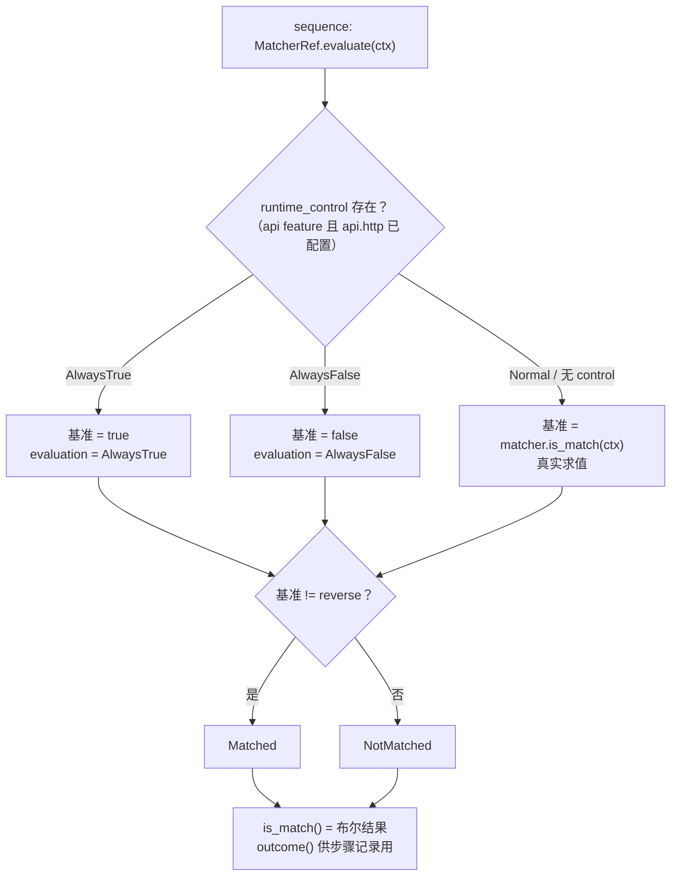
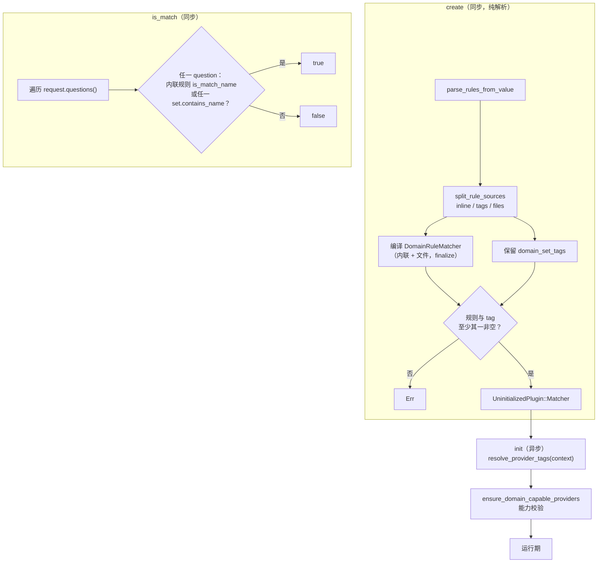
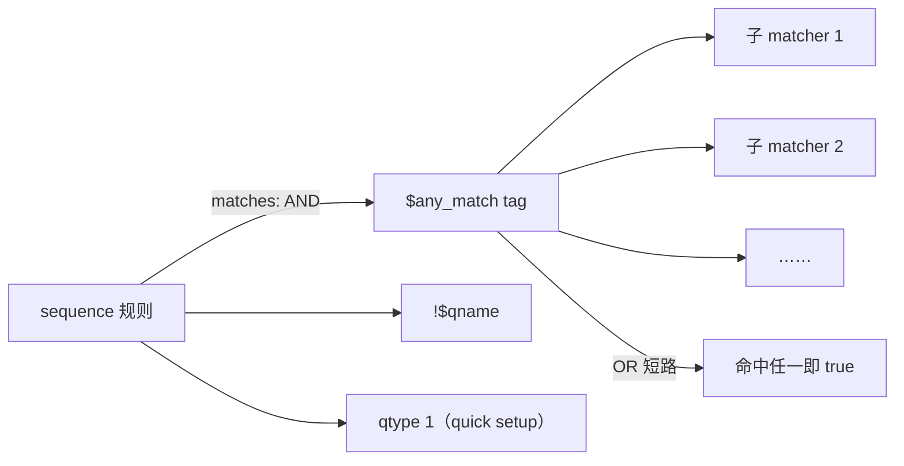
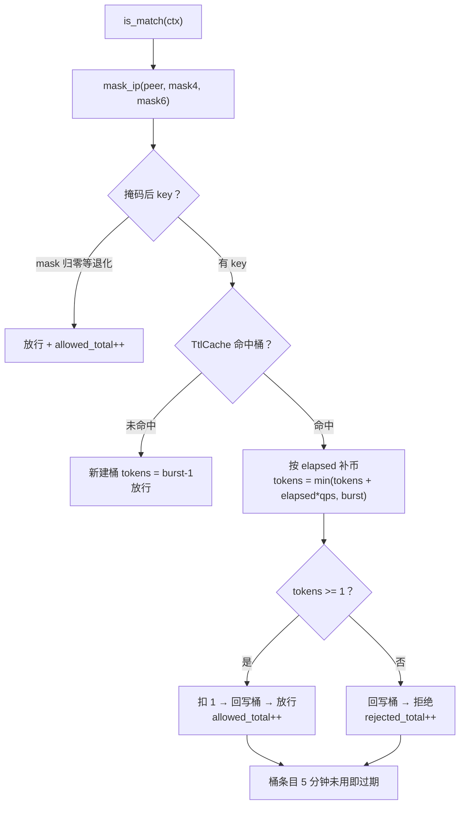

# OxiDNS matcher 插件类别实现解析

> 分析基线：`v1.6.1`，分支 `fix/code-review-priorities`（HEAD `04ac8a64`）。
> 代码位置：`src/plugin/matcher/`（`mod.rs` 192 行、`control.rs` 149 行、`rules/` 528 行、20 个插件共约 4100 行，均含测试）；
> 消费方接线在 `src/plugin/executor/sequence/chain.rs`，运行时控制注册见 `../registry/oxidns-plugin-registry.md` 第 7/9 节。
> 本文只描述当前代码实际行为；与文档/注释不一致之处集中在第 11 节。

## 1. 类别定位

matcher 是**纯谓词**插件：从 `DnsContext` 读取请求/响应/元数据状态，返回布尔决策，不产生 DNS 语义副作用。sequence 用它在指令级分支——一条规则的全部 matcher 都通过才执行对应的 executor（AND 语义，`chain.rs:388-400`）， matcher 自身不改变请求处理走向。

```yaml
# 典型用法：matches 全部通过才执行 exec
- tag: main_sequence
  type: sequence
  args:
    - matches:
        - $cn_client            # 引用已配置 matcher
        - "!$has_resp"          # 表达式级取反
        - qtype 1               # quick setup 内联
      exec: $forward_domestic
```

与 executor 类别的一个显著差异：**matcher 的求值是同步的**——`Matcher::is_match(&self, context: &mut DnsContext) -> bool` 没有 `async`，请求热路径上不引入 await 点（`matcher/mod.rs:53-56`）。

类别契约（`matcher/mod.rs:16-17` 模块注释）："Matchers should stay fast and side-effect free"。20 个注册插件中唯一例外是 `rate_limiter`（第 8 节）。

## 2. 代码地图

| 文件 | 行数 | 职责 |
|---|---:|---|
| `mod.rs` | 192 | `Matcher` trait、`MatcherRef`（取反 + 运行时控制包装）、`MatcherEvaluation` 四态、`parse_matcher_expr` |
| `control.rs` | 149 | `MatcherRuntimeControl`（AtomicU8 运行时模式）+ 取反语义测试 |
| `rules/` | 528 | 规则解析（config/numeric）、源分类（sources）、provider 绑定（providers）——数据类 matcher 共享基建 |
| 20 个插件 | ~4100 | 见第 5 节能力总表 |

`mod.rs` 之外的关键协作：

| 组件 | 职责 |
|---|---|
| `sequence/chain.rs:388-400` | `matches_instruction`：全部 matcher 通过才执行指令；`_sequence-step-recording` feature 下记录每次求值 outcome |
| `registry/mod.rs:531-547` | `get_matcher_ref_dependency`：解析 matcher tag 时捆绑该 tag 的运行时控制 |
| `core/rule_matcher` | `DomainRuleMatcher` / `IpPrefixMatcher`：域名/IP 规则的编译与查询容器（rules/ 的下游） |
| `plugin::Provider` | `contains_name/contains_ip/contains_question`：matcher 引用的数据集 |

## 3. 求值架构：MatcherRef 与四态评估

matcher 从不以裸 `dyn Matcher` 进入执行链，一律被包成 `MatcherRef`（`mod.rs:59-67`）：**具体 matcher + 表达式级取反（`!` 前缀）+ 可选运行时控制**。三者语义顺序固定：先运行时模式覆盖基准结果，再应用取反（`mod.rs:145-169`）。



要点（`mod.rs:83-112`、`control.rs:18-60`）：

- `MatcherEvaluation` 四态：`Matched` / `NotMatched` 是正常路径；`AlwaysTrue { matched }` / `AlwaysFalse { matched }` 只在 API 运行时覆盖下出现，`matched` 字段已含取反结果，供步骤记录区分"真匹配"与"被强制"。
- 运行时控制是**每个配置 tag 一个** `AtomicU8`（`Normal/AlwaysFalse/AlwaysTrue`），`Relaxed` 读写，所有引用共享——API 改一个 matcher 的模式，全部引用它的 sequence 规则同步生效。
- 覆盖模式下**根本不调用** `is_match`（control 测试断言调用计数不增长，`control.rs:120-142`）——被禁用的 matcher 连热路径求值成本都没有。
- 取反在基准之后：`AlwaysTrue` 模式下 `!matcher` 的引用求值为 `AlwaysFalse { matched: false }`（先 true，再取反）。`matched != reverse` 的比较一行同时完成取反与归类（`mod.rs:164-168`）。
- `parse_matcher_expr`（`mod.rs:178-192`）只剥 `!` 前缀，返回 `(reverse, 表达式体)`；`$tag` 引用与 `type param` quick setup 的区分由 `PluginRef::from_str` 完成。

sequence 侧接线（`chain.rs:388-400`）：`matches_instruction` 对指令的 matcher 列表逐个 `evaluate`，任一未通过立即短路返回 false（跳过该指令）；`_sequence-step-recording` feature 下每次求值都记录 `outcome()`（如 `always_false_not_matched`），供调试回放。

## 4. 数据类 matcher 的共享基建（rules/）

`qname`/`cname`/`client_ip`/`resp_ip`/`ptr_ip` 五个插件共享同一套"规则 → 匹配器编译 + provider 绑定"基建：

**规则解析**（`rules/config.rs`）：

- `parse_rules_from_value`：YAML 字符串或字符串数组，token 按 `,` 与空白切分（`config.rs:116-122`）。
- `parse_enum_rules_from_value`：额外接受 0-65535 无符号数字（qtype/qclass/rcode 用）。
- `parse_quick_setup_rules`：quick setup 参数同样按 `,`/空白切分。

**源分类**（`rules/sources.rs:98-123`）——每条规则 token 按前缀三分为：

| 前缀 | 含义 | 去向 |
|---|---|---|
| `$tag` | provider 引用 | `set_tags`，成为依赖图边 |
| `&path` | 规则文件 | `files`，启动期读取 |
| 其他 | 内联规则 | `inline_rules` |

`provider_tags_from_rules`（`sources.rs:126-134`）只提取 `$` 引用、**不碰文件**——依赖分析阶段不需要打开 `&file`。

**编译与绑定**：域名规则编译为 `DomainRuleMatcher`（支持 `full:`/`keyword:`/`regexp:`/`domain:` 前缀表达式，`sources.rs:29-49`），IP 规则编译为 `IpPrefixMatcher`（两遍扫描：先计数预留 v4/v6 容量再填充，`sources.rs:66-81`）；provider 在插件 `init` 时通过 `resolve_provider_tags` 从 registry 解析，并校验能力（`supports_domain_matching` / `supports_ip_matching`，`rules/providers.rs:34-68`）。

以 `qname` 为例的完整创建-求值流程（`client_ip`/`cname`/`resp_ip`/`ptr_ip` 同构）：



要点：

- 依赖边在工厂 `get_dependency_specs` 生成（`qname.rs:33-39`），字段名如 `args.domain_set_tags[0]`，保证 provider 先于 matcher 初始化（registry 拓扑序）。
- 内联规则与 provider 在求值期是 **OR** 关系，多 question 也是 OR（任一 question 命中即匹配）。
- quick setup 路径（`qname.rs:58-61`）与 create 走同一 `build_*_matcher`，规则 token 语义完全一致。

## 5. 插件能力总表

| type | 匹配目标 | 规则形态 | provider 能力 | 求值语义 |
|---|---|---|---|---|
| `qname` | 请求 QNAME | 域名规则 + `$domain_set` + `&file` | domain | 多 question OR |
| `cname` | 响应 CNAME 目标 | 同上 | domain | 响应缺失返回 false |
| `client_ip` | 客户端源 IP | IP 规则 + `$ip_set` + `&file` | ip | 单 IP |
| `resp_ip` | 响应 A/AAAA | 同上 | ip | `has_answer_ip` 回调逐 IP |
| `ptr_ip` | PTR 反解出的 IP | 同上 | ip | 仅 qtype=PTR 的 question |
| `question` | 请求 question 元组 | 无内联规则 | 必须有（`contains_question`） | 多 question OR |
| `qtype` | question 类型 | 枚举名或 0-65535 数字 | 无 | AHashSet 集合查询 |
| `qclass` | question 类别 | 同上 | 无 | 同上 |
| `rcode` | 响应 rcode | `Rcode::from_token` 或数字 | 无 | 无响应返回 false |
| `mark` | marks 集合 | u32 列表 | 无 | `is_disjoint` 取反，单次位判 |
| `any_match` | 子 matcher 组合 | matcher 表达式列表 | 间接（经子 matcher） | OR 短路 |
| `string_exp` | 上下文字符串 | `source op arg...` 表达式 | 无 | 单表达式 |
| `env` | 环境变量 | `KEY` 或 `KEY=VALUE` 条件列表 | 无 | 条件 AND，init 缓存 |
| `time` | 当前时刻 | periods（时区/HH:MM/星期/日） | 无 | 窗口 OR，条件 AND，位掩码 |
| `random` | 概率采样 | 单个概率值 | 无 | 随机数 < p |
| `has_resp` | 是否已有响应 | 无 | 无 | `response().is_some()` |
| `has_wanted_ans` | 答案含请求类型 RR | 无 | 无 | 优先单 question 判定 |
| `rate_limiter` | 令牌桶放行 | `qps burst mask4 mask6` | 无 | **有状态**，true=放行 |
| `_true` | 恒真 | 无 | 无 | 常量，测试/占位 |
| `_false` | 恒假 | 无 | 无 | 常量，测试/占位 |

按形态分四组：**集合查询**（qtype/qclass/rcode/mark，规则编译成 HashSet，O(1)）、**规则+provider 数据类**（第 4 节五插件 + question）、**表达式/环境**（string_exp/env/time/random）、**常量与组合**（_true/_false/any_match/has_resp/has_wanted_ans）。`rate_limiter` 独立成组。

## 6. 组合 matcher：any_match

`any_match` 是唯一的 matcher-组合-matcher 插件（`any_match.rs`），与 sequence 的 AND 语义互补：

- `args` 是 matcher 表达式列表（支持 `$tag`、`!$tag`、`type param` quick setup），`is_match` 对子 matcher **OR 且首个命中即短路**（`any_match.rs:177-188`）。
- 子 matcher 解析发生在 `any_match` 的 `init`：tag 引用走 `context.matcher_ref`（共享该 tag 的运行时控制），quick setup 走 `init_quick_setup` 合成 tag `qs.match.<any_tag>.<idx>.<type>`（`any_match.rs:147-168`）——这是 registry 分析中"quick setup 不进 registry"路径的又一消费者。
- 依赖边同样两态：tag 引用生成 `DependencySpec::matcher`，子 quick setup 经 `expand_quick_setup_dependency_specs` 展开（如 `args.matchers[4] -> quick_setup(qname).domain_set_tags[0]`，`any_match.rs:36-62`），保证深层数据集依赖也能进拓扑序。



注意语义组合：sequence 对 matcher 列表取 AND，any_match 内部取 OR，表达式 `!` 在两层都可用——`(A AND B) AND !(C OR D)` 这类逻辑可以不写新插件直接拼出来。

## 7. 表达式与环境类

### string_exp（`string_exp.rs`，503 行）

单一表达式 `source op arg...`（或紧凑形式 `sourceop arg...`，如 `qnameprefix www.`，`string_exp.rs:269-278`）：

- **9 个源**：`qname`（normalized）/`qtype`/`qclass`/`rcode`/`resp_ip`（逗号连接）/`mark`（逗号连接）/`client_ip`/`server_name`/`url_path`，外加 `$ENV_KEY` 环境变量源（`string_exp.rs:106-117`、`158-222`）。
- **6 个操作**：`eq`/`prefix`/`suffix`/`contains`/`regexp`（多参数 OR，regex 启动期编译）/`zl`（零长度判空）（`string_exp.rs:120-127`、`224-235`）。
- **env 源在 init 缓存一次**（`string_exp.rs:135-140`）——运行期修改环境变量不影响已初始化实例，与 `env` matcher 一致的"启动快照"语义。
- 无 provider 支持，不产生依赖边；regexp 参数非法在 create 期即报错。

### env（`env.rs`，372 行)

条件列表（`KEY` 存在性 或 `KEY=VALUE` 精确比较），**AND** 语义（`env.rs:203`）。每个条件在 `init` 读取一次环境变量并缓存 exists/value（`env.rs:147-151`、`172-176`），热路径零系统调用。

### time（`time.rs`，667 行）

日历窗口匹配器，配置 `timezone` + `periods`（最多 64 个，`time.rs:31`），窗口之间 OR、窗口内条件 AND。启动期把所有窗口编译成紧凑位掩码（`CompiledPeriod`，`time.rs:52-58`）：`start/end` 分钟数、星期掩码 u8、日期掩码 u32；时区解析一次（配置的 IANA 名或系统时区，`time.rs:138-170`）。

热路径（`time.rs:371-382`）：读墙钟 → 一次转目标时区 → 取当日分钟数 + 今/昨两天的日掩码 → 逐窗口位运算判断，无分配无锁。

跨午夜窗口处理（`time.rs:349-361`）：

| start/end 关系 | 判定 |
|---|---|
| 无 start 无 end | 仅按日掩码（星期/日期）匹配 |
| start < end | 正常区间：`start ≤ now < end` 且当日掩码匹配 |
| start > end（跨午夜） | `now ≥ start` 用**今天**掩码；`now < end` 用**昨天**掩码 |
| start == end | create 期报错 |

### random（`random.rs`）

单概率参数（0.0-1.0 校验），`is_match` 掷随机数。用于灰度/采样策略；本身无记忆——连续调用独立采样，流量占比是概率期望而非精确配额。

## 8. 有状态例外：rate_limiter（`rate_limiter.rs`，435 行）

令牌桶限速 matcher，按**掩码聚合后的客户端 IP** 分桶：`is_match` 返回 true = 消耗一枚令牌放行，false = 桶空拒绝。它是类别里唯一有状态、有副作用、有后台任务的 matcher。



要点（`rate_limiter.rs:45-50`、`176-221`、`223-269`）：

- 默认 `qps=20`、`burst=40`、`mask4=32`（按 /32 逐 IP）、`mask6=48`；`mask4=0` 表示全部 v4 客户端共享一个桶（掩码成 `0.0.0.0`）。
- 桶容器复用 `infra/cache/ttl.rs` 的 `TtlCache`（容量 4096 起步）；`init` 里 `task_center::spawn_fixed` 每 30s 批量清理过期桶（每批 2048，`rate_limiter.rs:183-201`），失败回滚指标注册与 started 标志。
- 指标两级：`ratelimit_allowed_total` / `ratelimit_rejected_total`（labels: plugin_tag）。
- 与 forward 的选择模式正交：它是 matcher，通常接在 sequence 的 `matches` 上把超速客户端导向 reject/black_hole 分支。

## 9. 上下文访问面与 `&mut` 签名

matcher 能读到的 `DnsContext` 面（`core/context.rs`）：

| 访问器 | 用途 | 消费者 |
|---|---|---|
| `peer_addr()` | 客户端地址 | client_ip、rate_limiter、string_exp(client_ip) |
| `request()` / `first_qtype()` 等 | 问题段 | qname/qtype/qclass/question/ptr_ip/has_wanted_ans |
| `response()` | 响应段（可能无） | rcode/resp_ip/cname/has_resp/has_wanted_ans/string_exp(rcode/resp_ip) |
| `marks()` | 请求级 mark 集合 | mark、string_exp(mark) |
| `server_name()` / `url_path()` | 监听器元数据 | string_exp（DoH 路径等） |

`is_match` 接收 `&mut DnsContext`，但**全部 20 个实现都只读上下文**——没有任何 matcher 调用 `marks_mut()`/`request_mut()`/`response_mut()`（marks 的写入由 sequence 的 `set_mark` 内建指令完成）。`&mut` 签名为未来"匹配并标注"类 matcher 留了口子，也使 `DnsContext` 的内部可变性（如延迟解析字段）无需额外同步。

## 10. 测试覆盖

| 位置 | 覆盖 |
|---|---|
| `control.rs:62-149` | 运行时模式在取反**之前**固定基准结果；覆盖模式下 matcher 不被调用 |
| 各插件内嵌 `#[cfg(test)]` | 规则解析边界（空规则/数字越界/非法 token）、is_match 正反例、quick setup 校验 |
| `any_match.rs:206-321` | 依赖边提取（tag + 嵌套 quick setup 展开）、取反组合、经 registry 的端到端初始化 |
| `time.rs` 尾部 | 窗口编译校验（start==end 拒绝、weekday/monthday 越界）、跨午夜匹配 |
| `rate_limiter.rs:383-435` | 令牌消耗/耗尽、v4/v6 掩码正确性、quick setup 校验 |
| `sequence/chain.rs:1023-1064` | 运行时模式的 outcome 记录（`always_false_not_matched` 等） |

## 11. 设计要点与观察

**设计要点**：

- **同步求值**是类别级约束：matcher 无 await，sequence 的匹配段不引入任务切换；数据类 matcher 的一切可能昂贵操作（文件读取、regex 编译、provider 解析、TTL 查询结构构建）都在 create/init 完成。
- **热路径标注**：数据类与表达式类 matcher 的 `is_match` 均带 `#[hotpath::measure]`，纳入性能剖析。
- **取反分层**：表达式级 `!`（MatcherRef）与运行时覆盖（control）解耦，语义顺序"先覆盖后取反"由单一实现点（`MatcherRef::evaluate`）保证，control.rs 测试锁死该顺序。
- **快照语义统一**：env matcher、string_exp 的 env 源都在 init 读取环境变量并缓存——运行期环境变化不生效；`time` 则相反，每请求读实时时钟（它匹配的对象就是"现在"）。
- **能力校验前置**：provider 绑定在 init 期校验 `supports_*_matching`，配置错误在启动期暴露而非首个请求。

**观察**：

1. **`&mut DnsContext` 宽于实际需要**：20 个实现无一写上下文（第 9 节）。签名统一有未来价值，但当前读者可能误以为 matcher 会修改请求——文档注释的 "side-effect free" 与 `&mut` 并存需要读者自行消解。
2. **`rate_limiter` 偏离类别契约**：有状态（TtlCache）、有副作用（计数器）、有后台清理任务。语义上"匹配=放行"建模合理，但它是 matcher 里唯一 destroy 需要停任务的插件——把 rate_limiter 挂在多个 sequence 分支下时，同一请求可能多次进入 `is_match`，每次都会消耗令牌（AND 链中多个 matcher 各自计数是独立桶，不受影响；但同一条链上重复引用同一 rate_limiter tag 会双重扣币）。
3. **quick setup 合成 tag 格式不统一**：any_match 生成 4 段 `qs.match.<any_tag>.<idx>.<type>`（`any_match.rs:153`），sequence 生成 5 段 `qs.match.<seq_tag>.<node>.<match>.<type>`（`chain.rs:655-658`）。前缀同为 `qs.match.`，排障时按段数区分来源。
4. **`has_wanted_ans` 的双路径判定**（`has_wanted_ans.rs:75-90`）：先按单 question 的 qtype 判断响应答案，失败再回退到多 question 集合比较——两条路径的语义边界（`queries.len() == 1` 分支）值得使用者在多 question 请求下留意。
5. **`mark` matcher 与 sequence `set_mark` 的时序耦合**：mark 匹配的是"当前 marks 集合"，同一 sequence 内 set_mark 指令先于后续规则执行，因此 mark matcher 的结果依赖规则顺序——这是 matcher 类别里少数"求值顺序敏感"的场景。
6. **`string_exp` 紧凑语法的边界**：`split_compact_source_op` 按"token 以操作名结尾"识别（`string_exp.rs:269-278`），`zl` 无参数场景紧凑写法 `qnamezl` 可用，但源名以操作名为后缀的巧合组合（如假设存在的 `eqq` + `eq`）会优先被拆成 `eq` + `q`——当前 9 个源名无此冲突，属理论边界。
