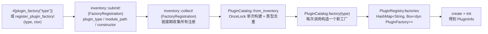
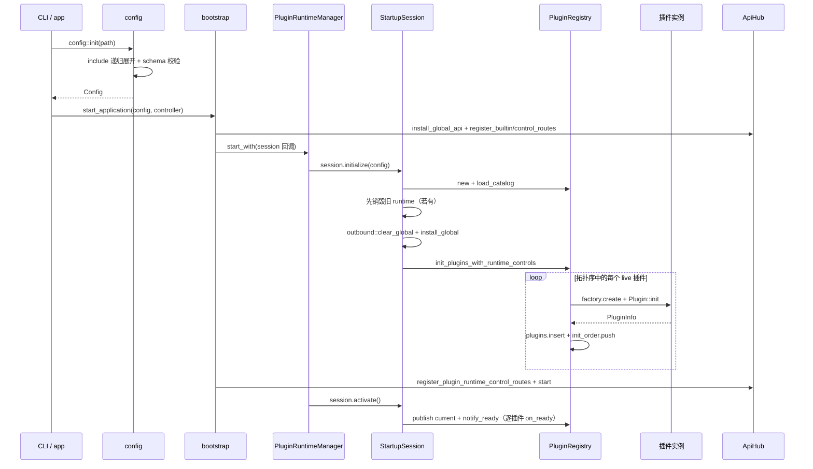
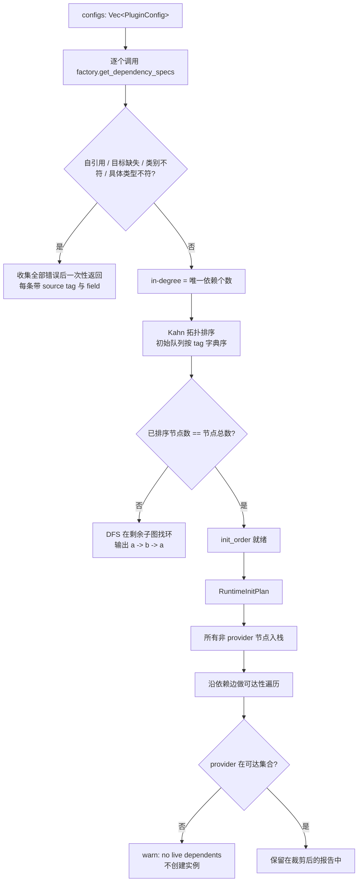
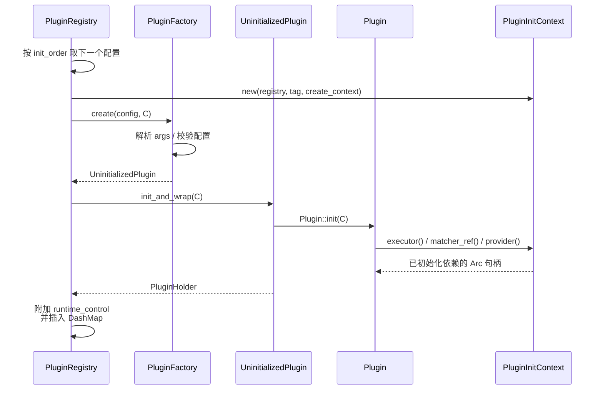
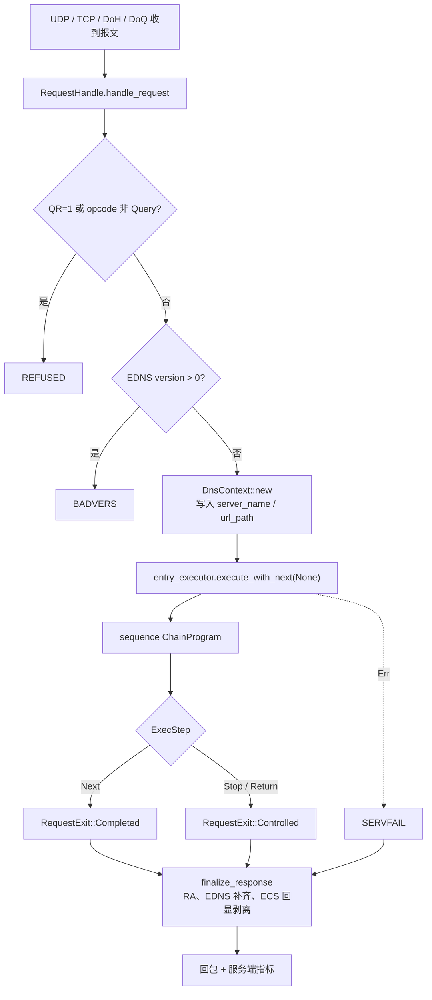
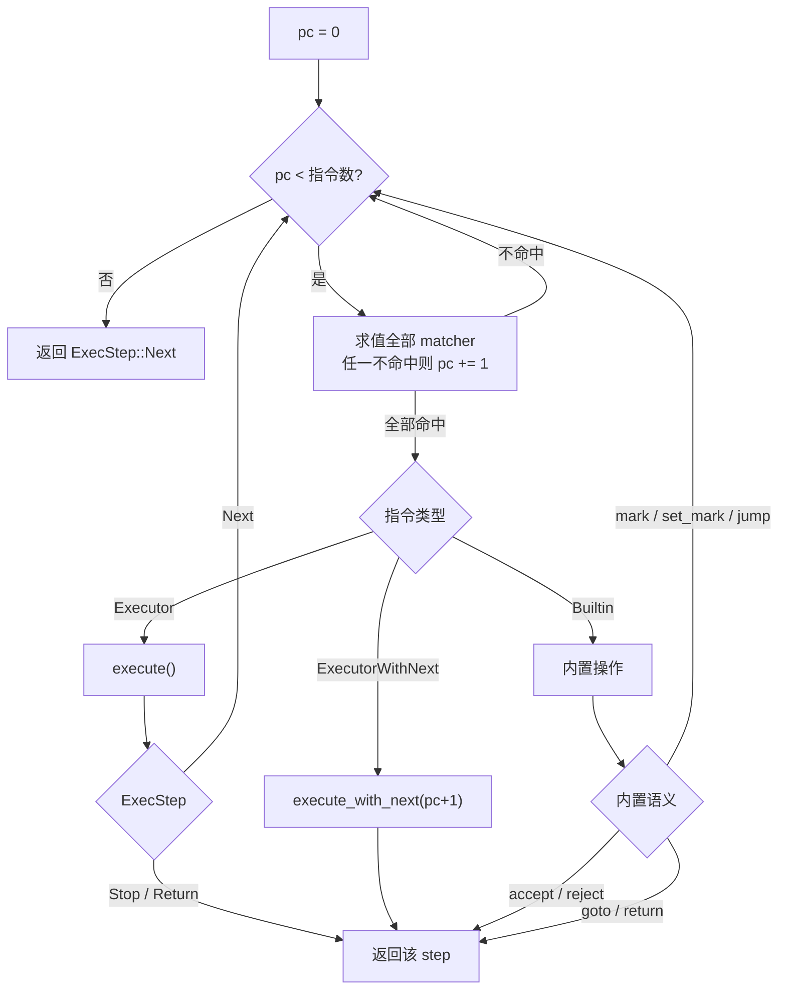
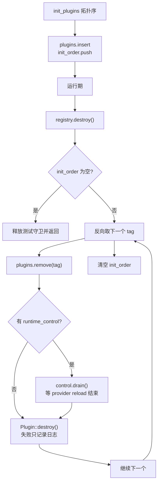

# OxiDNS 插件系统实现解析

> 分析基线：main `v1.7.1`（`ad2046d3`）· 2026-11-14。
> 代码位置：`src/plugin/`（`mod.rs`、`registry/`、`dependency.rs` 以及四个类别目录），注册宏在 `crates/macros/`，启动/停止装配在 `src/app/bootstrap.rs`，reload 编排在 `src/app.rs`。
> 插件是**编译期静态注册**的 Rust 实现，不是动态库；"没有某个插件"由 Cargo feature 裁剪决定。
> 本文只描述当前代码的实际行为；与文档/注释不一致之处集中在第 14 节。本分支独有的实现集中列在第 16 节。

## 1. 设计定位

OxiDNS 把协议、策略、数据集都拆成插件，运行时只有一条以 `DnsContext` 为中心的请求管线：

| 类别 | Trait | 职责 | 请求期角色 |
|---|---|---|---|
| `server` | `Server: Plugin` | 监听 UDP/TCP/DoT/DoH/DoQ，把网络报文变成 `Message` | 入口 |
| `executor` | `Executor: Plugin` | 转发、缓存、改写、拒绝、副作用 | 主流程 |
| `matcher` | `Matcher: Plugin` | 纯谓词，供 `sequence` 分支 | 判定 |
| `provider` | `Provider: Plugin` | 可复用数据集（域名集/IP 集/GeoIP） | 数据源 |

源码中注册的插件类型数量（受 feature 裁剪影响）：

| 类别 | 数量 | 说明 |
|---|---:|---|
| server | 4 | `udp_server` / `tcp_server` / `http_server`（DoH/DoH3）/ `quic_server`（DoQ） |
| executor | 37 | 35 个 `#[plugin_factory]` + `prefer_ipv4` / `prefer_ipv6` |
| matcher | 21 | 含 `has_cname`，以及 `_true` / `_false` 两个恒等谓词 |
| provider | 6 | `domain_set` / `ip_set` / `geosite` / `geoip` / `adguard_rule` / `dynamic_domain_set` |

设计上的三条硬约束：

1. **启动期完成解析**：`sequence` 在 `init` 时就把 matcher/executor 引用解析成 `Arc<dyn ...>`，请求期不再查注册表。
2. **注册表是运行时的唯一持有者**：所有实例以 `Arc<PluginInfo>` 存在 `DashMap` 中，插件之间通过 `PluginInitContext` 拿依赖。
3. **生命周期与请求路径解耦**：`init` / `destroy` 只在启动、关闭、热重载时发生，请求路径只接触 `Arc` 与插件自身的内部状态。

## 2. 代码地图

| 文件 | 行数 | 职责 |
|---|---:|---|
| `src/plugin/mod.rs` | 605 | `Plugin` / `PluginType` / `PluginFactory` / `PluginHolder` 定义，inventory 注册入口，`analyze_configuration` |
| `src/plugin/registry/mod.rs` | 694 | `PluginRegistry`：工厂表、实例表、初始化顺序、依赖注入、`on_ready` 通知、销毁 |
| `src/plugin/registry/catalog.rs` | 89 | 进程级 `PluginCatalog`（`OnceLock`），从 inventory 构建并去重 |
| `src/plugin/registry/context.rs` | 194 | `PluginInitContext` 与 `PluginResolver` |
| `src/plugin/registry/init_plan.rs` | 136 | 从依赖报告派生运行期初始化计划（裁剪不可达 provider）与创建上下文 |
| `src/plugin/registry/runtime.rs` | 341 | `PluginRuntimeManager` + `StartupSession`：`initialize` / `activate` / `abort` / `stop_with`，全局单例 |
| `src/plugin/registry/tests.rs` | 969 | registry、世代生命周期与托管启动的测试 |
| `src/plugin/dependency.rs` | 664 | 依赖图构建、校验、Kahn 拓扑排序、找环 |
| `src/plugin/runtime_control.rs` | 28 | matcher/provider 运行期控制枚举 |
| `src/plugin/{server,executor,matcher,provider}/mod.rs` | — | 类别 trait 与模块清单 |
| `src/app/bootstrap.rs` | 222 | 托管生命周期：`start_application` / `stop_application` |
| `src/app.rs` | 501 | 前台运行：`run_foreground` / `run_application` / `run_control_loop` / `reload_application` |
| `crates/macros/src/lib.rs` | 52 | `#[plugin_factory("type")]` 过程宏 |

关键类型：

| 类型 | 作用 |
|---|---|
| `UninitializedPlugin` | 工厂返回的未初始化枚举（四个变体），`init_and_wrap()` 负责 `init` + `Arc` 包装（`plugin/mod.rs:85-106`） |
| `PluginHolder` | 已初始化的四类 `Arc<dyn ...>` |
| `PluginInfo` | 实例容器：`tag`、`plugin_name`、`plugin_type`（`PluginType` 枚举）、`plugin_holder`、`args`、`runtime_control` |
| `PluginType` | 类别枚举（Server/Executor/Matcher/Provider），由 `PluginHolder` 推导（`plugin/mod.rs:274`） |
| `PluginCreateContext` | 创建期元数据：`dependents`（反向依赖列表，`PluginDependent` 含 `kind`），当前无生产消费者 |
| `PluginInitContext<'a>` | 传给 `create` / `init` 的解析器句柄：`executor()`、`matcher_ref()`、`provider()`、`dependents()`、`init_quick_setup()` |
| `PluginRuntimeManager` | 全局运行时拥有者：`RwLock<Option<Arc<PluginRuntime>>>` + 生命周期异步锁 + `AppController`，通过 `start_with` / `stop_with` 托管世代切换 |
| `StartupSession` | 一次序列化启动所拥有的候选资源：`candidate` + 测试 guard，`initialize` / `activate` / `abort` 三段式 |

## 3. 注册与发现



要点：

- 过程宏只接受**无状态工厂**（unit struct 或空 `{}`）。需要携带构造参数时用 `register_plugin_factory!`，例如 `prefer_ipv4` / `prefer_ipv6` 共用 `DualSelectorFactory::new(RecordType::A/AAAA)`（`src/plugin/executor/dual_selector.rs:405-406`）。
- `PluginCatalog` 是进程级不可变的"有哪些类型"清单；`PluginRegistry` 是可变的"当前这代运行时有谁"清单。一次进程可以构建多代 registry（reload），但 catalog 只构建一次。
- 重复 `plugin_type` 会在 catalog 构建时直接报错（`catalog.rs:30-44`），`analyze_configuration()` 也做同样检查（`src/plugin/mod.rs:122-127`），保证配置校验和运行期看到同一份清单。
- **类别是推断出来的，不是声明的**：`dependency_kind_from_module_path()` 对 `module_path!()` 做子串匹配，识别 `::plugin::server::`、`::plugin::executor::`、`::plugin::matcher::`、`::plugin::provider::`（`src/plugin/mod.rs:191-206`）。放在这四个目录之外的插件会被判定为 `Unknown`，`plugin::tests` 里有覆盖全部注册项的一致性断言（`src/plugin/mod.rs:579-592`）。
- 能力清单对外由 `build_info::snapshot()` 暴露：它遍历 catalog 按 `DependencyKind` 分组，得到 `supported_plugins.{servers,executors,matchers,providers}`（`src/build_info.rs:66-79`）。

## 4. 启动装配



启动走**托管生命周期**（managed lifecycle）：候选构建、路由注册、激活全部放在 `PluginRuntimeManager` 的一次 `start_with` 调用里，由 `StartupSession` 独占持有：

1. **配置阶段**：`config::init()` 读文件、展开 `include`、做 schema 校验（`src/config/mod.rs:42-48`）；`validate_file()` / `validate_text()` 额外调用 `plugin::analyze_configuration()` 只做依赖图校验（`src/config/mod.rs:51-75`）。
2. **启动阶段**（`bootstrap::start_application`，`src/app/bootstrap.rs:26-95`）：先安装全局 API hub 并注册内置/控制路由，再通过 `start_with` 进入会话；`session.initialize()` 构建 registry。整个过程包在 `catch_unwind` 里，panic 也算启动失败。
3. **激活阶段**（`StartupSession::activate`，`runtime.rs:93-105`）：发布 `current` 指针并 `notify_ready()`——按 `init_order` 对每个配置插件调 `Plugin::on_ready()`（`registry/mod.rs:636-645`）。激活是同步且不可失败的；启动回调成功后不会再有可失败的步骤。
4. **停止阶段**（`bootstrap::stop_application`，`src/app/bootstrap.rs:97-119`）：先停 API（`clear_global_api` + `api_hub.stop()`），再 `stop_with` 销毁 runtime、`outbound::clear_global()`，最后 `infra::task::stop_all()` 并清理 controller。

失败路径是显式设计的：`initialize` 或之后的任何失败都会走 `StartupSession::abort()`（`runtime.rs:107-112`），销毁已初始化的候选并清理 outbound；`bootstrap` 侧再停 API、清理 controller（`bootstrap.rs:79-91`）。回调的调用方被取消也不会把候选"卡"在初始化与激活之间——激活/中止始终由被 spawn 的任务完成。

`PluginRuntimeManager::init_runtime()`（`runtime.rs:129-132`）是 `start_with` 的单运行时封装，供嵌入方与测试通过 `plugin::init(config)` 使用；应用主路径走 `bootstrap::start_application`。

## 5. 依赖解析

依赖不是靠字段名猜的，而是每个工厂实现 `get_dependency_specs()` 显式声明：`field`（配置里的字段路径，用于错误信息）、`target_tag`、`expected_kind`、可选的 `expected_plugin_type`（`src/plugin/dependency.rs:101-173`）。



实现细节：

- **错误聚合**：缺少依赖、类型不符、自引用都会先累积再统一报错，避免"修一个报一个"（`dependency.rs:319-324`）。
- **去重**：同一对 `(source, target)` 只算一条入边，但 `edges` 会保留多个 `field`，方便错误信息定位（`dependency.rs:227-311`）。
- **环检测**：Kahn 排不完时不满足于"有环"，而是用 DFS 在剩余子图里还原一条具体路径（`dependency.rs:397-454`）。
- **不可达 provider 裁剪**：`build_runtime_init_plan()` 把 server/executor/matcher 全当作根，只有**没有任何路径引用到**的 provider 会被跳过（`registry/init_plan.rs:23-97`）。这意味着"声明了一个 provider 但没被引用"不会加载它，只留一条 warn 日志。
- **创建上下文**：`build_create_contexts()` 把反向边整理成"谁依赖我"的列表，随 `PluginInitContext::dependents()` 提供（`init_plan.rs:99-136`）。当前生产代码没有消费者，只有测试用它验证裁剪结果。

## 6. 创建与初始化



`init_plugins_with_runtime_controls()` 的流程（`registry/mod.rs:187-345`）：

| 阶段 | 动作 | 失败后果 |
|---|---|---|
| 前置 | tag 唯一性检查（`registry/mod.rs:194-201`） | 直接返回，未创建任何实例 |
| Step 0 | 插件类型存在性检查（`registry/mod.rs:204-212`） | 直接返回 |
| Step 1 | 依赖分析 + 裁剪不可达 provider（`registry/mod.rs:214-252`） | 直接返回 |
| Step 2 | 对 live 插件执行 `prepare_startup()`（按配置顺序，`registry/mod.rs:254-274`） | 直接返回，尚未创建实例 |
| Step 3 | 按拓扑序 `create` + `init` + 插入（`registry/mod.rs:290-343`） | 已创建的实例由 `StartupSession::abort()` 统一 `destroy()` |

关键约束：

- **依赖必须先于依赖者初始化**，所以拓扑序同时是创建序；依赖注入用的是 `Arc` 克隆，不是重入注册表查询。
- **`prepare_startup()` 只做前置副作用**（如 `download` 需要先把文件准备好），不创建插件实例，且按配置书写顺序执行，保证可预测。
- **`PluginInitContext` 会做类别校验**：`get_executor_dependency_of_type()` 等不仅查 tag，还核对实际类别与具体 `plugin_name`，错误信息里带 field 路径（`registry/mod.rs:481-508`）。
- **运行期控制只挂在两类插件上**：`provider` 总是有 `ProviderRuntimeControl`；`matcher` 只有在 `api` feature 开启且配置了 `api.http` 时才挂 `MatcherRuntimeControl`（`registry/mod.rs:371-401`、`runtime.rs:87`）。
- **初始化失败即整代失败**：`start_with` 在启动回调出错（含 panic）时调用 `session.abort()`，对候选 registry 按已完成顺序反向清理并清空 outbound 全局状态（`runtime.rs:107-112`、`174-183`），不会留下半初始化状态。
- **`on_ready()` 是启动成功后的通知钩子**：只在激活时对配置插件调用，要求快速、无副作用失败、幂等；失败的候选直接进入 `destroy`，不会收到它（`plugin/mod.rs:352-368`、`registry/mod.rs:636-645`、`runtime.rs:103`）。

## 7. 请求执行模型



`RequestHandle` 是四个 server 插件共享的请求生命周期（`src/plugin/server/request.rs:41-169`）：

- 入口先做协议层校验：伪造响应（QR=1）、非 Query opcode、EDNS version > 0 都不会进入管线，直接构造 REFUSED / BADVERS。
- 只有通过校验才创建 `DnsContext`，然后调用 `entry_executor.execute_with_next(&mut context, None)`。传 `None` 表示"这是最外层链"，`sequence` 内部再把它自己的指令流接起来。
- 执行结果只分三种：`Next`（自然结束）、`Stop`/`Return`（被插件控制）、`Err`（SERVFAIL）。
- `finalize_response()` 统一补 RA、按请求补 EDNS（`request.rs:171`）。

### 7.1 ExecStep 与 next 续延

| 返回 | 含义 |
|---|---|
| `ExecStep::Next` | 当前链继续；在最外层表示自然完成 |
| `ExecStep::Stop` | 立即停止当前链，通常已写入响应 |
| `ExecStep::Return` | 结束当前 sequence，把控制权交回调用方（用于子 sequence） |

`Executor::execute_with_next()` 默认实现就是"先执行自己，`Next` 时再调用下游"（`src/plugin/executor/mod.rs:118-128`）；只有 `with_next() == true` 的插件（如 `cache`，以及开启 `refused_with_next` 时的 `fallback`）才会拿到 `ExecutorNext` 句柄，从而在**下游返回之后**再做处理。`continue_next!` 宏统一了"有 next 就调用、没有就返回 Next"的写法。

### 7.2 sequence 指令循环



`ChainProgram` 是扁平指令流 + 程序计数器（`src/plugin/executor/sequence/chain.rs:103-180`）：

- 一条规则编译成一条 `Instruction`：`matchers: Vec<MatcherRef>` + `op`（`Executor` / `ExecutorWithNext` / `Builtin`）。
- **matcher 之间是 AND 关系**，全部命中才执行 `exec`（`chain.rs:386-402`）。
- `ExecutorWithNext` 一定结束当前这层循环：它把 `pc+1` 包成 `ExecutorNext` 交给插件，由插件决定何时、是否继续。
- 内置操作（`chain.rs:275-384`）：

| 内置 | 语义 |
|---|---|
| `accept` | 返回 `Stop`，保留当前响应 |
| `reject [rcode]` | 用请求构造响应并 `Stop`，默认 `REFUSED` |
| `return` | 返回 `Return`，交回上层 sequence |
| `jump <sequence>` | 调用子 sequence，`Stop` 向外传播，`Next`/`Return` 继续本层 |
| `goto <sequence>` | 调用子 sequence 并直接传播其返回 |
| `mark` / `set_mark` | 追加 / 替换 `DnsContext` 的 mark 集合 |

`jump` / `goto` 的目标必须是 `sequence` 类型（`executor_of_type`），且不允许写 `$` 前缀（`sequence/mod.rs:67-83`）。

## 8. quick setup

配置里写 `exec: "cache short_circuit"` 这种形式时不会创建全局插件，而是在**拥有者初始化时**临时创建：

| 场景 | 合成 tag |
|---|---|
| executor | `qs.exec.<sequence_tag>.<node_index>.<plugin_type>` |
| matcher | `qs.match.<sequence_tag>.<node_index>.<match_index>.<plugin_type>` |

- 依赖声明走 `PluginFactory::get_quick_setup_dependency_specs()`，字段名会被改写成 `args[i].exec -> quick_setup(type).inner`，这样报错能指回原始配置位置（`src/plugin/mod.rs:229-273`）。
- 实例通过 `PluginInitContext::init_quick_setup()` 创建并 `init`，**不进入** registry 的 `DashMap`，因此不出现在插件 API 与 `plugin_count()` 里。
- 生命周期归拥有者：`Sequence::destroy()` 会逐个销毁自己的 quick setup executor/matcher（`sequence/mod.rs:145-166`）。
- 工厂默认不实现 `quick_setup()`，直接返回"quick setup is not supported"，所以支持哪些简写完全由插件自己决定。

## 9. 运行期控制

| 控制 | 载体 | 语义 |
|---|---|---|
| matcher 模式 | `MatcherRuntimeControl`（`AtomicU8`） | `normal` / `always_false` / `always_true` |
| provider 重载 | `ProviderRuntimeControl` | 串行化 `reload()`，并发请求直接 `Busy` |

matcher 模式的关键顺序：**先应用运行期模式，再套表达式取反**（`matcher/mod.rs:145-168`）。

| 模式 | 引用 `$m` | 引用 `!$m` |
|---|---|---|
| `normal` | 真实结果 | 真实结果取反 |
| `always_true` | 命中 | 不命中 |
| `always_false` | 不命中 | 命中 |

provider 重载（`provider/control.rs:48-80`）：

- `try_lock_owned()` 抢占，抢不到立即返回 `Busy`，不排队，避免 API 请求堆积。
- 真正的 `reload()` 在独立 `tokio::spawn` 中执行并持有锁：调用方被取消不会提前释放所有权。
- 运行期销毁时先 `drain()`：置 `accepting_reloads = false` 并等待锁，确保旧的 reload 不会与新实例初始化重叠。

API 路由由 `register_plugin_runtime_control_routes()` 统一挂在 `/plugins/<tag>/...` 下。

## 10. 热重载

main 的 reload 是**先停后建**（stop-then-rebuild），由应用层编排，没有候选代与旧代并存的阶段：

```mermaid
sequenceDiagram
    participant LOOP as app 控制循环
    participant CTRL as AppController
    participant APP as reload_application
    participant BS as bootstrap
    participant MGR as PluginRuntimeManager
    participant OLD as 旧 runtime
    LOOP->>APP: ControlCommand::Reload
    APP->>CTRL: mark_reload_started(配置版本 SHA256)
    APP->>APP: load_and_validate_reload_config
    APP->>CTRL: 失败 → mark_reload_failed（旧配置继续服务）
    APP->>BS: stop_application(旧 assembly)
    BS->>MGR: stop_with → 销毁旧 runtime
    Note over OLD: 此刻存在短暂停服窗口
    APP->>BS: start_application(新配置)
    BS->>MGR: start_with → 构建 + 激活新 runtime
    APP->>CTRL: 成功 → mark_reload_succeeded
    APP->>BS: 失败 → start_application(previous_config) 回滚
```

`reload_application`（`src/app.rs:379-437`）的完整语义：

1. **加载与校验先行**：`load_and_validate_reload_config()`（`app.rs:438-455`）重新执行 `config::init()` + `plugin::validate_configuration()`；失败只 `mark_reload_failed`，旧代不受影响、继续服务。
2. **停止旧代**：`bootstrap::stop_application(assembly)` 停 API、销毁 runtime。此时到新代监听就绪之间没有服务在跑，这是有意接受的取舍。
3. **启动新代**：`bootstrap::start_application(candidate)`；成功则替换 assembly 与 current_config，`mark_reload_succeeded()`。
4. **失败回滚**：新代启动失败时用 `previous_config` 再走一次 `start_application`；恢复成功记 `mark_reload_failed("reload failed and previous configuration was restored: ...")`，恢复失败则同时报告 reload 与 rollback 两个错误并向上传播。

`GET /reload/status` 返回 `ReloadSnapshot`（`src/infra/control.rs:203`）：`status`、`pending`、`in_progress`、`last_started_ms`、`last_completed_ms`、`last_success_ms`、`last_error`、`running_version` / `target_version`（配置文件 SHA256）。没有阶段(phase)机。

## 11. 生命周期与销毁



- **销毁严格反向**：`init_order` 是拓扑序，反向即"依赖者先销毁"，避免下游还持有已销毁的上游 `Arc`（`registry/mod.rs:648-681`）。
- **单插件失败不阻断**：`destroy()` 出错只 `error!` 记录，继续销毁下一个。
- **server 自己管生命周期**：`init()` 内绑定端口、spawn 监听任务并等待启动 oneshot；`destroy()` 注销指标、发送 shutdown、`await` 任务句柄（`server/tcp.rs:160-176`）。`Server::run()` 在生产代码中没有调用点（见第 14 节）。
- **世代切换没有双代并存**：reload 与冷启动都先销毁旧 runtime 再构建新代（`runtime.rs:74-78`），socket 构造虽然设置了 `reuse_address` / `reuse_port`（`udp.rs:293`、`tcp.rs:441`），但主路径不依赖"两代同时监听"；切换期间存在短暂无人监听的窗口。

## 12. 插件 API 与指标

- `register_plugin_api!(tag, GET "/path" => handler, ...)` 在 `api` feature 下把路由挂到 `/plugins/<tag>`；没有 `api` feature 时宏展开成恒 `Ok(())`，插件代码不需要 `cfg` 包裹（`src/api/macros.rs`）。
- 插件在 `init()` 里注册路由，因此**路由注册的时机等于插件初始化时机**；`bootstrap::start_application` 先安装全局 hub，再进入 `session.initialize()`，保证插件注册的路由落到本次启动的 hub 上。
- 指标通过 `register_metric_source` / `unregister_metric_source` 在 `init` / `destroy` 中成对出现（`src/infra/observability/metrics.rs:124,134`），全局 `/api/metrics` 按 `plugin_tag` 区分实例。

## 13. 构建期能力清单

| 来源 | 内容 |
|---|---|
| `Cargo.toml` features | `minimal` / `standard` / `full` 三个 bundle，`default = ["full"]` |
| 类别 `mod.rs` 的 `#[cfg(feature = ...)]` | 决定哪些插件模块参与编译 |
| `inventory` | 决定编译进来的模块里有哪些工厂 |
| `build_info::snapshot()` | 输出 bundle、enabled_features、按类别分组的 `supported_plugins` |

因此"当前版本支持哪些插件"应当以 `build_info` 的实际输出或 catalog 为准，而不是读文档里的清单——feature 裁剪会改变结果，但类型名与依赖关系不会。

## 14. 设计评述

### 做得好的地方

- **注册与运行分离**：`PluginCatalog`（不可变、进程级）与 `PluginRegistry`（可变、按代）职责清晰，reload 只需重建后者。
- **依赖是声明式的**：工厂显式返回 `DependencySpec`，错误信息带 `field` 路径；环检测能给出具体路径，而不是只报"有环"。
- **请求期零注册表查询**：`sequence` 在初始化时完成所有解析，热路径只有 `Arc` 解引用和指令分发。
- **候选独占 + 无条件清理**：`StartupSession` 拥有候选，`start_with` 用 `catch_unwind` 把 panic 也归入启动失败；成功路径必 activate、失败路径必 abort，调用方被取消也不会把候选"悬"在两态之间（`runtime.rs:135-183`）。
- **并发安全边界明确**：provider reload 用 try-lock 拒绝并发而非排队，销毁时 drain 等待，取消调用方不会泄漏所有权。

### 需要留意的取舍与风险

1. **类别靠模块路径字符串推断**：新增插件若不在 `src/plugin/<category>/` 下会被判为 `Unknown`，`plugin::tests` 只能覆盖"已注册项"，无法阻止新目录写错。
2. **未引用的 provider 会被静默跳过**：只声明不用会得到一条 warn，实例不存在；如果将来出现"仅供 API 使用"的 provider，这条裁剪规则需要重新评估。
3. **`PluginCreateContext.dependents` 仍无生产消费者**：只有 `registry::tests` 用它验证裁剪结果，字段本身保留是为了给"需要知道自己被谁引用"的插件留接口。
4. **`resolve_dependencies()` 非测试构建未使用**：真正的路径是 `analyze_dependencies()` + `init_plan`，旧函数仅 `cfg_attr(not(test), allow(dead_code))` 保留（`dependency.rs:181`）。
5. **依赖声明解析失败会被吞掉**：`sequence`、`cron` 等在 `get_dependency_specs()` 里对 YAML 解析失败直接返回空列表，导致"依赖图看起来正常"，真正的配置错误推迟到 `create()` 才报。诊断位置后移，配置复杂时可读性下降。
6. **校验与创建是两条路径**：`validate_configuration()` 只做图分析，不调用 `create()`，所以 `oxidns check` 通过不代表参数能成功解析。
7. **每次校验都实例化全部工厂**：`analyze_configuration()` 遍历 inventory 时为所有注册类型构造工厂（不只为配置里的类型），启动期成本随插件总数线性增长。
8. **`PluginHolder` 的强转是 panic 式**：`to_executor()` 等在不匹配时直接 `panic!`。正常路径由 `get_*_dependency` 提前校验，但绕过 registry 直接强转属于未定义使用。
9. **reload 是 stop-then-rebuild**：新配置加载成功后旧代先被完全销毁，切换期间有短暂停服窗口；回滚路径同样要经历一次完整的 stop + start。对"零停机"有要求的场景需要评估这个窗口（本分支曾实现 staged reload，未进 main，见第 16 节）。

## 15. 相关测试

| 测试 | 覆盖点 |
|---|---|
| `test_dependency_kind_from_module_path_for_all_registered_plugins` | 所有注册项都能归入四个类别之一 |
| `test_reports_missing_dependency_with_field_context` | 缺失依赖报错带 field |
| `test_reports_type_mismatch_with_field_context` | 类别不符报错 |
| `test_reports_cycle_path` | 环检测输出具体路径 |
| `test_build_runtime_init_plan_skips_unreachable_provider_chain` | 不可达 provider 裁剪 |
| `test_init_plugins_filters_create_contexts_to_live_dependents` | 创建上下文只含 live 依赖者 |
| `test_init_runtime_failure_leaves_runtime_stopped` | 初始化失败不留半成品 |
| `destroy_waits_for_cancelled_provider_reload` | 销毁等待被取消的 reload |
| `concurrent_reload_is_rejected_instead_of_queued` | provider reload 并发拒绝 |
| `runtime_modes_fix_the_base_result_before_reference_negation` | matcher 模式先于取反 |
| `test_run_executes_continuation_callbacks_in_lifo_order` | `next` 续延顺序 |
| `matcher_runtime_control_is_not_attached_when_api_is_not_running` | 无 API 时不挂 matcher 控制 |
| `failed_candidate_preserves_both_cache_dumps` | 候选失败不破坏新旧两份缓存 dump |
| `startup_cancellation_and_concurrent_shutdown_preserve_activation` | 启动被取消/并发停止时激活语义不被跳过 |
| `startup_late_failure_aborts_without_publishing_or_dumping` | 晚期失败中止且不发布运行时 |
| `startup_panic_cleans_up_the_owned_candidate` | 启动 panic 也会清理候选 |
| `failed_reload_restores_historical_cache`（`src/app.rs`） | reload 失败回滚后缓存内容恢复 |
| `failed_api_start_preserves_cache_dump`（`src/app/bootstrap.rs`） | API 启动失败时缓存 dump 不丢 |

运行方式（按需选择，避免全量）：

```bash
cargo test --lib plugin::registry
cargo test --lib plugin::dependency
cargo test --lib plugin::executor::sequence
```

## 16. 分支特有实现（未进 main）

以下实现只存在于 `fix/code-review-priorities` 分支，main（v1.7.1）没有对应代码：

- **Staged reload（零停机热重载）**：候选 API hub 提前安装、`stage_runtime` / `commit_staged_runtime` 两段式、指标 staging（`begin/flush/abort_metric_staging`）、`prepare_assembly` / `activate_assembly` 编排、SO_REUSEPORT 双代并存。提交：`36b27388`、`b7c93320`、`72637c47`、`cd9881f4`、`03ac4154`。设计与 PR 系列见 `pr-doc/pr-series-staged-reload.md`、`pr-doc/design-zero-downtime-reload.md`。
- **信号量连接池重构**：上游连接池改为信号量模型。提交：`ac055074`、`cd9f5cbc`、`3e3db421`；见 `pr-doc/pr-series-semaphore-pools.md`、`pr-doc/design-semaphore-pool-refactor*.md`。
- **cache single-flight**：并发缓存击穿合并。提交：`4c4cb1dc`、`659dcf15`；见 `pr-doc/pr-body-cache-hardening.md`、`pr-doc/pr-split-cache-hardening.md`。
- **`drop_edns0opt` executor 与 `edns0opt` matcher**：main 只有 `forward_edns0opt` executor；`EdnsOption::code()` 方法本身已在 main（`crates/proto/src/rdata/basic.rs:649`）。见 `pr-doc/pr-body-edns0-option-code.md`、`pr-doc/pr-body-edns0opt-matcher.md`、`pr-doc/pr-series-edns0.md`。
- **历史残留清理的落点差异**：分支提交 `31f20124` 删除了 `PluginCreateContext.candidate` 恒 false 字段并把 `Server::run()` 标记为 `#[deprecated]`。main 上 `candidate` 字段本就不存在（该清理与 main 现状一致），但 `Server::run()` 在 main 仍是普通 trait 方法、未标 deprecated。
