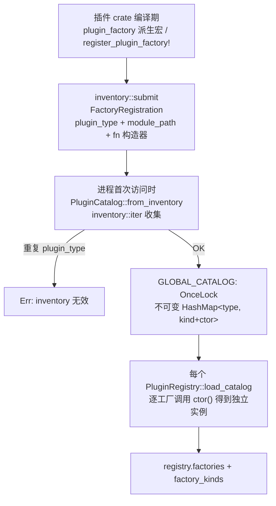
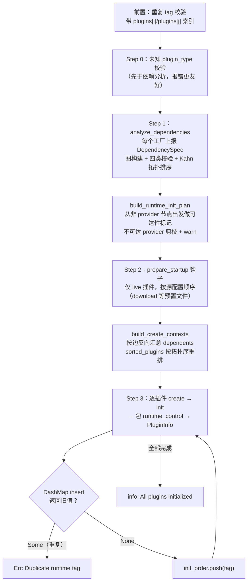
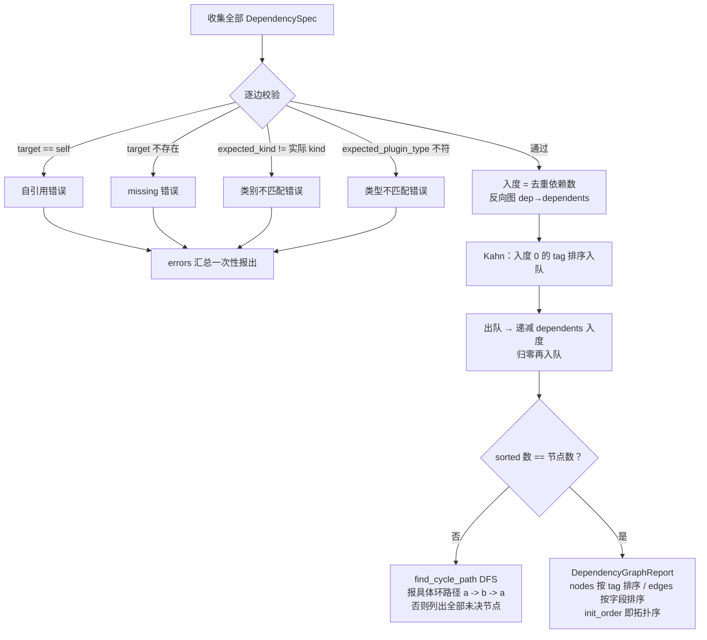
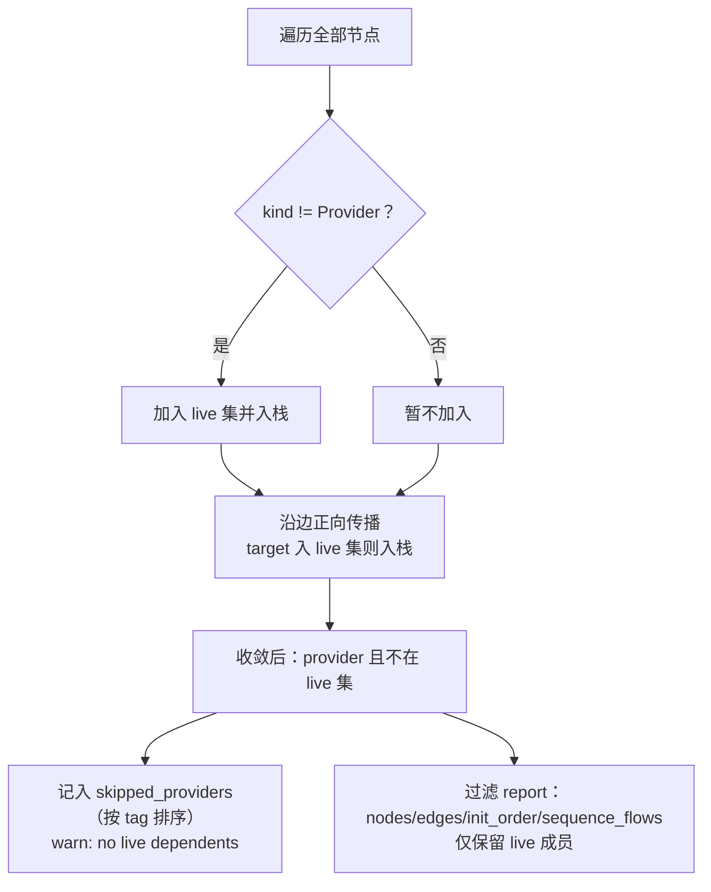
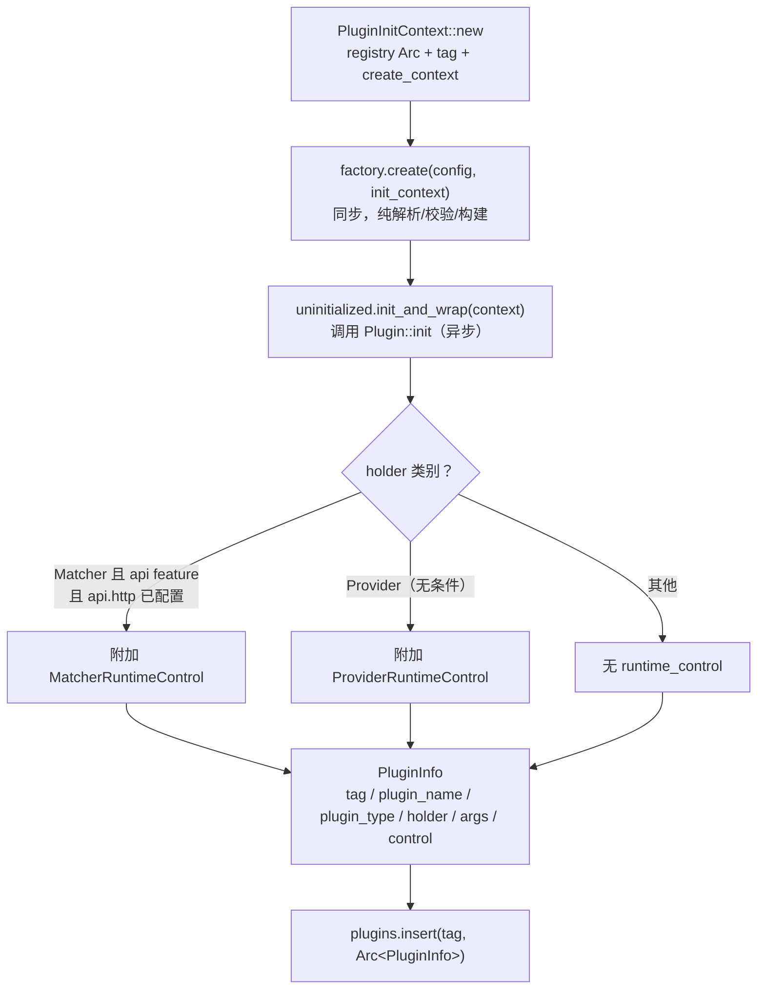
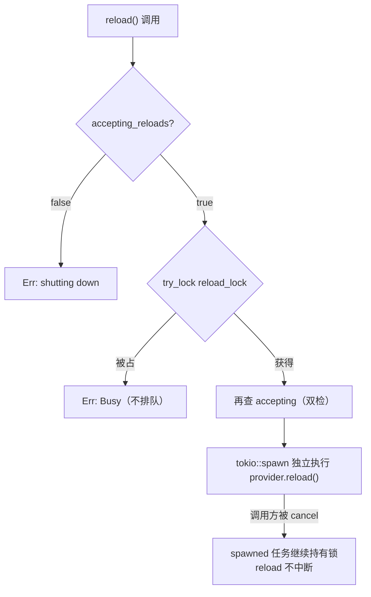
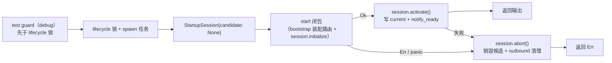
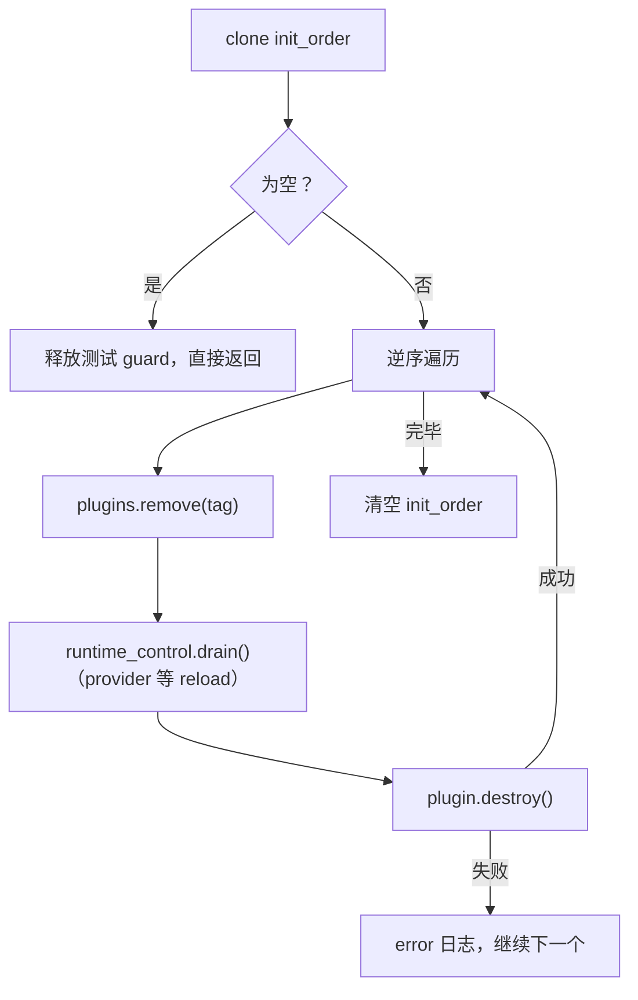

# OxiDNS 插件 registry 实现解析

> 分析基线：main `v1.7.1`（`ad2046d3`）· 2026-11-14。
> 代码位置：`src/plugin/registry/`（`catalog.rs` 89 行、`context.rs` 194 行、`init_plan.rs` 136 行、`mod.rs` 694 行、`runtime.rs` 341 行、`tests.rs` 969 行）；
> 运行时结构定义在 `src/plugin/mod.rs`（605 行），依赖分析在 `src/plugin/dependency.rs`（664 行），应用集成在 `src/app/bootstrap.rs`（`start_application` / `stop_application`）与 `src/app.rs`（`reload_application`）。
> 生态位概述见 `../oxidns-plugin.md`；本文只描述当前代码实际行为；与文档/注释不一致之处集中在第 13 节；本分支独有实现见第 14 节。

## 1. 定位

`registry` 不是插件，而是**插件系统的基础设施**：它把"编译期注册的工厂目录"变成"运行期可服务的插件实例集合"，并负责依赖解析、初始化排序、运行时控制、世代切换（reload/重启）与销毁。所有插件（server/executor/matcher/provider）的生命周期都从这里经过。

三层结构：

| 层 | 类型 | 生命周期 | 职责 |
|---|---|---|---|
| 工厂目录 | `PluginCatalog` | 进程级，`OnceLock` 不可变 | 从 inventory 收集全部 `#[plugin_factory]` 注册，按 plugin_type 提供构造函数 |
| 实例注册表 | `PluginRegistry` | 每个运行时世代一份 | 工厂表 + 实例表（tag → `PluginInfo`）+ 初始化顺序 + 依赖解析 API |
| 世代管理器 | `PluginRuntimeManager` | 进程级单例 | 持有"当前 runtime"指针、经 `start_with` / `stop_with` 串行化世代切换、托管 `AppController` |

`PluginBuildSession` 与 `PluginRuntime` 都是 `PluginRegistry` 的类型别名（`registry/mod.rs:75-76`）——同一个结构在"构建期"和"运行期"扮演两种角色，仅用别名与生命周期所有权表达区分。

## 2. 代码地图

| 文件 | 行数 | 职责 |
|---|---:|---|
| `mod.rs` | 694 | `PluginRegistry` 结构、`init_plugins_with_runtime_controls` 初始化、`notify_ready`、依赖解析 getter、销毁、锁中毒恢复辅助 |
| `catalog.rs` | 89 | 进程级不可变工厂目录，inventory 收集 + 重复类型检测 |
| `context.rs` | 194 | `PluginInitContext`（工厂/插件拿到的解析器门面）、`PluginResolver` trait、`init_quick_setup` |
| `init_plan.rs` | 136 | 从依赖图报告推导初始化计划：live 集剪枝、跳过 provider、构造 create contexts |
| `runtime.rs` | 341 | `PluginRuntimeManager` + `StartupSession`：`initialize`/`activate`/`abort`/`stop_with` 世代管理、AppController 集成、全局门面函数 |
| `tests.rs` | 969 | 重复 tag、锁中毒恢复、provider 剪枝、运行时控制、quick setup dependents 传递、托管启动的取消/中止/panic 语义等 |

`registry` 之外的关键协作文件：

| 文件 | 职责 |
|---|---|
| `src/plugin/mod.rs` | `Plugin`/`PluginFactory`/`UninitializedPlugin`/`PluginHolder`/`PluginInfo`/`PluginType`、inventory 注册宏、`analyze_configuration` 静态分析入口 |
| `src/plugin/dependency.rs` | `DependencySpec`、图构建 + 四类校验、Kahn 拓扑排序、DFS 环路径提取 |
| `src/plugin/runtime_control.rs` | `PluginRuntimeControl` 枚举（Matcher/Provider 两态）+ `drain` 分发 |
| `src/plugin/provider/control.rs` | `ProviderRuntimeControl`：reload 串行化（try_lock）、shutdown 拒绝、drain |
| `src/app/bootstrap.rs` | `start_application`（构建候选并激活）→ `stop_application` 编排 |
| `crates/macros/src/lib.rs` | `#[plugin_factory]` 派生宏（仅支持无状态 unit struct） |

## 3. 工厂注册路径

要点（`catalog.rs:26-47`、`plugin/mod.rs:154-206`）：

- 注册信息只有三个字段：类型名、`module_path!()`、`fn() -> Box<dyn PluginFactory>`。**类别（DependencyKind）不靠注册者声明，而是从 module_path 字符串推断**：包含 `::plugin::server::` → Server，executor/matcher/provider 同理（`plugin/mod.rs:191-206`）；有单元测试保证所有注册插件都能落到合法类别（`plugin/mod.rs:579-592`）。
- `#[plugin_factory]` 宏只接受无状态的 unit struct / 空 brace struct；有状态工厂须改用 `register_plugin_factory!`（`crates/macros/src/lib.rs:31`）。
- 目录进程级只建一次（`OnceLock`，失败结果也被缓存——重复类型错误会永久生效）；但**每个 PluginRegistry 通过 `iter_factories()` 重新调用构造函数**得到自己的工厂实例（`registry/mod.rs:143-148`）。工厂无状态，克隆成本低。
- `analyze_configuration`（`plugin/mod.rs:111-164`）绕过 registry 直接从 inventory 重建工厂表做静态依赖分析，供 config 加载、CLI 校验和 API 依赖图端点使用——启动主路径不走它。

## 4. 启动初始化主流程

入口在 `PluginRuntimeManager`：应用冷启动与 reload 都经 `bootstrap::start_application` → `start_with` → `StartupSession::initialize`（`runtime.rs:65-91`），落到 `PluginRegistry::init_plugins_with_runtime_controls`（`registry/mod.rs:187-345`）。`init_runtime`（`runtime.rs:129-132`）是同一机制的独立运行时封装。

要点：

- **依赖收集刻意保持轻量**（`registry/mod.rs:214-222` 注释）：启动期只做图校验，完整的 schema 解析/校验只发生在各工厂 `create()` 内一次，避免双重解析。
- **prepare_startup 按源配置顺序而非拓扑序**（`registry/mod.rs:254-260` 注释）：启动副作用（如 download 建预置文件）只要求可预测，不要求依赖先就绪。
- **失败即回滚**：`start_with` 里启动回调（含 `init_plugins_with_runtime_controls`）失败或 panic 都会走 `StartupSession::abort()`——候选 `destroy()` 逆序清掉已初始化插件、`outbound::clear_global()`（`runtime.rs:107-112`、`174-183`）；`bootstrap` 侧再停 API、清理 controller（`bootstrap.rs:79-91`）。
- **outbound 全局先于插件初始化安装**：`initialize` 先 `outbound::clear_global()` 再 `outbound::install_global()`，然后才 `init_plugins_with_runtime_controls`（`runtime.rs:81-89`）——插件初始化期看到的就是本代 outbound，不存在"候选看到旧 profile"的问题（旧代已在 `initialize` 开头销毁，`runtime.rs:74-78`）。
- **重复运行时 tag 防御**：DashMap 的 `insert` 会静默覆盖，故检查返回值（`registry/mod.rs:330-340`）。配置期已在前置步骤拦截，这里兜底 quick setup 等运行时合成 tag 的冲突。
- 每个插件的创建参数里都带上了"谁引用我"（dependents），见第 8 节。

## 5. 依赖分析与拓扑排序（dependency.rs）

每个工厂通过 `get_dependency_specs` 声明"我引用了谁"。以 sequence 为例（`sequence/mod.rs:347-395`）：把每条规则的 `matches[i]` / `exec` 解析成 `DependencySpec::matcher/executor(...)`，quick setup 表达式则递归展开被引工厂的 `get_quick_setup_dependency_specs` 并生成 `args[i].exec -> quick_setup(type).field` 复合字段名（`plugin/mod.rs:229-273`）。

要点（`dependency.rs:198-454`）：

- 四类校验（自引用/缺失/类别/具体类型）**先收集全部错误再一次性报出**（`dependency.rs:319-324`），不是遇错即停，方便用户一次修完配置。
- **确定性**：初始队列按 tag 排序（`dependency.rs:328-337`）、边按 `(field, target_tag, expected_kind)` 排序（`dependency.rs:298-307`）、节点按 tag 排序——同一份配置永远产出同一份 report 与 init_order。这对 CLI diff、API 图端点和测试都重要。
- 环检测在 Kahn 之后：若拓扑序不完整，用三色标记 DFS 在剩余节点中**提取具体环路径**（`find_cycle_path`，`dependency.rs:397-454`），报错形如 `Circular dependency detected: a -> b -> a`；理论上 DFS 找不到环时退化为列出全部未决节点（防御分支）。
- `resolve_dependencies`（`dependency.rs:181-196`）是早期 API，现标记 `cfg_attr(not(test), allow(dead_code))` 仅测试使用；主路径是 `analyze_dependencies` + registry 自己消费 report。

## 6. Live 集剪枝（init_plan.rs）

依赖图完整拓扑排序后，`build_runtime_init_plan` 做**可达性剪枝**：provider 只有被非 provider 插件（间接）引用才初始化。

要点（`init_plan.rs:23-97`）：

- 起点是**全部非 provider 插件**——server/executor/matcher 天然 live；provider 链（provider → provider）会通过边传播正确保留（`init_plan.rs:32-49`）。
- 未被引用的 provider（及其独占依赖）被跳过初始化并告警，但不报错——配置里"备用"数据集是合法的。
- `build_create_contexts`（`init_plan.rs:99-136`）按边反向汇总：target 的 dependents 列表 = 所有指向它的边（`PluginDependent` 含 `tag`/`plugin_type`/`kind`/`field`），显式排序，且**只含 live 边**——剪掉的 provider 不会出现在任何 dependents 里（有专项测试 `tests.rs:484`）。

## 7. 单个插件的创建与初始化

`create_plugin_info_and_init`（`registry/mod.rs:352-411`）是每个插件的生命周期关键点：

要点：

- `init_and_wrap`（`plugin/mod.rs:85-106`）把 `Box<dyn Xxx>` 初始化后转成 `Arc` 存入 `PluginHolder` 四态枚举；`init` 阶段插件即可通过 `init_context` 解析自己的依赖目标（依赖已按拓扑序先行初始化）。
- **runtime control 挂载规则不对称**（`registry/mod.rs:371-401`）：Provider 无条件挂（支持 API reload）；Matcher 仅在 `api` feature 且 `config.api.http.is_some()` 时挂（`runtime.rs:87` 传入开关）——无 API 的构建不为之付出 Arc/控制结构成本。
- `PluginInfo.plugin_type` 是 `PluginType` 枚举（由 `PluginHolder` 推导），`plugin_name` 保留配置里的具体类型字符串。
- `PluginInfo` 保留原始 `args`（YAML Value），供 API 运行时控制路由等按 tag 查询。

## 8. 依赖解析 API

运行期/构建期统一通过两类门面解析依赖：

| 门面 | 使用者 | 能力 |
|---|---|---|
| `PluginInitContext`（`context.rs:52-144`） | 工厂 `create` / 插件 `init` | `tag()`、`dependents()`、`executor/executor_of_type/matcher_ref/provider/provider_of_type`、`plugin`（裸 PluginInfo）、`init_quick_setup` |
| `PluginResolver` trait（`context.rs:16-50`） | 需要解析能力的其他组件 | 同上除 tag/dependents 外的解析方法，`PluginRegistry` 实现 |

所有 getter 共享同一校验骨架（`registry/mod.rs:446-597`）：缺失报 `references missing plugin`、类别不符报 `expects executor plugin, but ...`、可选的 `*_of_type` 进一步校验具体 plugin_type。`matcher_ref` 额外把表达式级取反（`reverse`）与该 matcher 配置 tag 的运行时控制捆绑成 `MatcherRef`（`registry/mod.rs:531-547`）。

**quick setup 的特殊路径**：sequence 构建链时对 `$tag` 引用走 registry 查询，对 `type param` 内联表达式则经 `init_quick_setup`（`context.rs:133-143`）直接 `factory.quick_setup` + `init_and_wrap`：

- 合成 tag 形如 `qs.exec.<seq_tag>.<node>.<type>` / `qs.match.<seq_tag>.<node>.<match>.<type>`（`sequence/chain.rs:616-620`、`652-656`）；
- 使用 `PluginCreateContext::default()`（无 dependents）；
- **不进入 `registry.plugins`，也不进 `init_order`**——它们是 sequence 私有实现细节（`registry/mod.rs:369-373` 注释），不占 `plugin_count`、不可被 API reload；
- 销毁由持有它们的 sequence 插件代劳：`Sequence::destroy` 遍历 `quick_setup_executors/matchers` 逐一调用 `destroy()`（`sequence/mod.rs:145-166`），链条闭合。

`dependents()` 是反向视图："谁引用我"。目前生产插件无消费者，属预留能力（`plugin/mod.rs:216-227`、`context.rs:76`）。

## 9. 运行时控制（runtime controls）

`PluginRuntimeControl`（`runtime_control.rs`）是挂在 `PluginInfo` 上的类别级控制句柄，当前两态：

**Provider**（`provider/control.rs:33-90`）——reload 串行化器：

- 并发 reload **立即拒绝而非排队**（`try_lock_owned`）；调用方任务被 abort 时，reload 在独立任务中继续完成并自然释放锁（有专项测试 `control.rs:136`、`209`）。
- `drain()`（`control.rs:77-80`）：置 `accepting_reloads = false` 后**等待**当前 detached reload 完成——运行时销毁用它保证"旧快照构建不会与替代者初始化重叠"。

**Matcher**（`matcher/control.rs`，`cfg(any(feature = "api", test))`）——序列链运行期的 matcher 基准结果控制（API 可动态调整匹配行为），由 `MatcherRef` 在每次求值时先查控制再应用表达式取反。

销毁时的统一语义：`PluginRuntimeControl::drain` 对 Matcher 是空操作、对 Provider 等待 reload 排空（`runtime_control.rs:21-28`）。

## 10. 运行时世代管理（runtime.rs）

`PluginRuntimeManager`（`runtime.rs:46-51`）是进程单例（`GLOBAL_MANAGER: OnceLock`，`runtime.rs:282-287`），持有：

- `current: RwLock<Option<Arc<PluginRuntime>>>` —— 当前世代指针（读多写少，请求路径只读）；
- `controller: Mutex<Option<Arc<AppController>>>` —— **唯一权威所有者**，世代切换不会丢失或竞态它（`runtime.rs:216-218` 注释）；
- `lifecycle: Arc<AsyncMutex<()>>` —— 串行化所有世代转换（启动/激活/停止）。

**托管启动 `start_with`**（`runtime.rs:135-183`）：

`StartupSession`（`runtime.rs:55-62`）独占持有 `candidate: Option<Arc<PluginRuntime>>`，从不逃出被 spawn 的托管任务——**取消观察启动结果的调用方不会把候选"卡"在初始化与激活之间**：Ok 必 activate、Err/panic 必 abort，全部由任务本身完成（`catch_unwind` 把 panic 也归入启动失败，`runtime.rs:161-166`）。

**`session.initialize`**（`runtime.rs:65-91`）：

1. 构建 `PluginRegistry` + `load_catalog`；
2. `take` 并销毁旧世代（若存在，`runtime.rs:74-78`）——即使嵌入方直接调 `init_runtime` 也不会出现双代并存；
3. `outbound::clear_global()` + `outbound::install_global()`（`runtime.rs:81-82`）；
4. `init_plugins_with_runtime_controls`（`runtime.rs:83-89`）。

候选在步骤 1 后即被 `self.candidate` 持有，之后任何可失败操作出错都由 `abort()` 兜底清理。

**`activate` / `abort`**：`activate`（`runtime.rs:93-105`）取走候选、写 `current` 指针并 `notify_ready()`（逐配置插件调 `on_ready`），同步且不可失败；`abort`（`runtime.rs:107-112`）销毁候选并清 outbound。

**停止 `stop_with`**（`runtime.rs:194-213`）：`before_plugins` 回调（bootstrap 用它停 API）→ `take` current → 旧世代 `destroy()` → `outbound::clear_global()` → `after_plugins` 回调（`task::stop_all` + 清 controller）。`destroy_runtime`（`runtime.rs:186-188`）是它的空回调封装。

**reload 编排**在应用层（`src/app.rs:379-437`）：`reload_application` 调 `bootstrap::stop_application`（走 `stop_with` 销毁旧代）后再次 `start_application`（走 `start_with` 建新代）——**先停后建，失败用 previous_config 回滚**；没有 staged/候选并存的世代切换。详情见 `../oxidns-plugin.md` 第 10 节。

debug 构建有可选的测试串行化开关（`enable_runtime_test_serialization` + `TestRuntimeGuard`，`runtime.rs:16-39`）：测试持 `OwnedMutexGuard` 存入 registry，下一个 init 需等前一个测试的运行时真正销毁——guard 的获取刻意放在 lifecycle 锁**之外**，避免死锁（`runtime.rs:140-146` 注释）。

## 11. 销毁流程

`PluginRegistry::destroy`（`registry/mod.rs:648-681`）：

要点：

- **逆 init_order 销毁**——依赖者先于被依赖者消亡，与初始化严格对称。
- 销毁前先 `drain` runtime control，保证 provider 的异步 reload 不会与销毁竞态（第 9 节）。
- 单个插件 destroy 失败**不中断**整体销毁，只记 error。
- 世代销毁由 manager 驱动（`stop_with` / `abort`），`AppController` 的清除由 app 层负责。

## 12. 测试覆盖（registry/tests.rs）

| 测试组 | 代表用例 |
|---|---|
| 基础行为 | registry 创建、查询不存在的 tag 返回 None（`tests.rs:38-49`） |
| 错误传播 | init 失败后运行时保持停止态（`tests.rs:73`）、`current` RwLock 中毒可恢复（`tests.rs:97`） |
| 运行时控制 | 无 API 时不挂 matcher control（`tests.rs:52`）；destroy 等待被取消的 provider reload（`tests.rs:186`）；reload 拒绝非 provider/缺失 tag（`tests.rs:627,673`） |
| 初始化计划 | 不可达 provider 链剪枝、quick setup dependents 传入 create context、create contexts 只含 live dependents（`tests.rs:319,395,484`） |
| 托管启动 | 候选失败保留新旧两份缓存 dump（`tests.rs:722`）；启动取消/并发停止不丢激活（`tests.rs:795`）；晚期失败中止且不发布（`tests.rs:870`）；启动 panic 清理候选（`tests.rs:903`）；停止等待被取消的启动完成清理（`tests.rs:936`） |

`plugin/mod.rs`、`dependency.rs`、`provider/control.rs`、`matcher/control.rs` 与 `src/app.rs`、`src/app/bootstrap.rs` 内嵌测试另覆盖：全量注册插件的 kind 推断、拓扑序确定性、四类校验错误文案、环路径提取、reload 失败回滚恢复缓存。

## 13. 设计要点与观察

**设计要点**：

- **毒锁恢复**：本模块所有 `Mutex`/`RwLock` 都经 `lock_mutex`/`read_rwlock`/`write_rwlock` 包装，中毒时恢复守卫值而非传播 panic（`registry/mod.rs:49-70`）——持锁线程 panic 不应永久瘫痪世代切换，也不应把失败的 init 误判为成功。临界区本身都极小（swap/take/clone）。
- **DashMap 换取 `Arc<Self>` 内部可变性**：`plugins` 用 DashMap 使 registry 可以 `Arc` 共享给插件的同时继续注册实例。
- **无状态工厂 + 每世代重建**：目录进程级一份不可变，工厂实例每世代新造——世代之间零共享，reload 隔离彻底。
- **错误一次报全**：依赖校验收集全部错误统一返回，改善配置排错体验。
- **确定性排序贯穿**：Kahn 初始队列、边、节点、dependents、skipped providers 全部显式排序。

**观察**：

1. **重复 tag 双重校验**：`init_plugins` 的前置检查（`registry/mod.rs:194-201`，报 `plugins[i]`/`plugins[j]` 索引）与 `analyze_dependencies` 开头（`dependency.rs:212-218`，报依赖图错误）检查同一条件，文案与错误类别不同。前者先触发，后者实际不可达；两处信息各有价值（索引 vs 图上下文），保留可辩护但属冗余。
2. **循环内的未知类型检查不可达**：Step 0 已对全部配置做过 `factories.contains_key`，创建循环内的逐插件检查（`registry/mod.rs:307-315`）永远不触发，纯防御。
3. **`plugin_tags()` 顺序不稳定**：直接取 DashMap 迭代序（`registry/mod.rs:598-603`）；`runtime_controls()` 则显式按 tag 排序。调用方若依赖 tag 顺序需自行排序。
4. **quick setup 插件的指标孤儿**：quick setup 插件若在 `init` 里注册指标源（如 forward），其 `destroy` 由 sequence 代调，指标注销路径正常；但它们不占 `plugin_count`、不出现在任何 API 插件列表，与"tag 可见性"直觉有偏差——排障时需知道 `qs.exec.*`/`qs.match.*` 前缀 tag 的来源。
5. **`load_catalog` 与 `analyze_configuration` 的轻度重复**：两者都从 inventory 重建工厂表并做重复类型检测（`registry/mod.rs:143-148` vs `plugin/mod.rs:111-164`）。后者面向静态分析独立成套，代价是同类逻辑两份。
6. **世代切换是先停后建**：`initialize` 开头即销毁旧世代（`runtime.rs:74-78`），应用层 reload 也是 stop → start 的顺序，切换期间存在短暂停服窗口；插件初始化期看到的 outbound 一定是本代的（没有旧 profile 可见性问题），但"零停机"不在 main 的能力集内。本分支曾实现 staged reload 解除该窗口，未进 main，见第 14 节。

## 14. 分支特有实现（未进 main）

以下实现只存在于 `fix/code-review-priorities` 分支，main（v1.7.1）没有对应代码：

- **Staged reload / 候选世代并存**：`stage_runtime` / `commit_staged_runtime` / `prepare_assembly` / `activate_assembly` 两段式、候选 API hub 提前安装、指标 staging（`begin_metric_staging` / `flush_metric_staging` / `abort_metric_staging`，候选 metric 注册进暂存区避免旧代注销误删）、SO_REUSEPORT 双代绑定。提交：`36b27388`、`b7c93320`、`72637c47`、`cd9881f4`、`03ac4154`。设计与 PR 系列见 `pr-doc/pr-series-staged-reload.md`、`pr-doc/design-zero-downtime-reload.md`。
- **`PluginCreateContext.candidate` 字段**：分支提交 `31f20124` 删除了该恒为 `false`、无消费者的字段（同处补齐 `dependents` 文档）；main 的 `PluginCreateContext` 只有 `dependents`，无 candidate 语义。
- **信号量连接池重构**：`ac055074`、`cd9f5cbc`、`3e3db421`（见 `pr-doc/pr-series-semaphore-pools.md`）。
- **cache single-flight**：`4c4cb1dc`、`659dcf15`（见 `pr-doc/pr-body-cache-hardening.md`）。
- **`Server::run()` 标记 `#[deprecated]`**：main 上 `run()` 仍是普通 trait 方法，生产代码同样没有调用点（监听绑定与 spawn 发生在 `init()`）。
