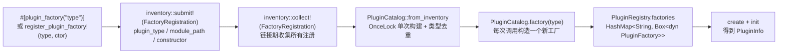
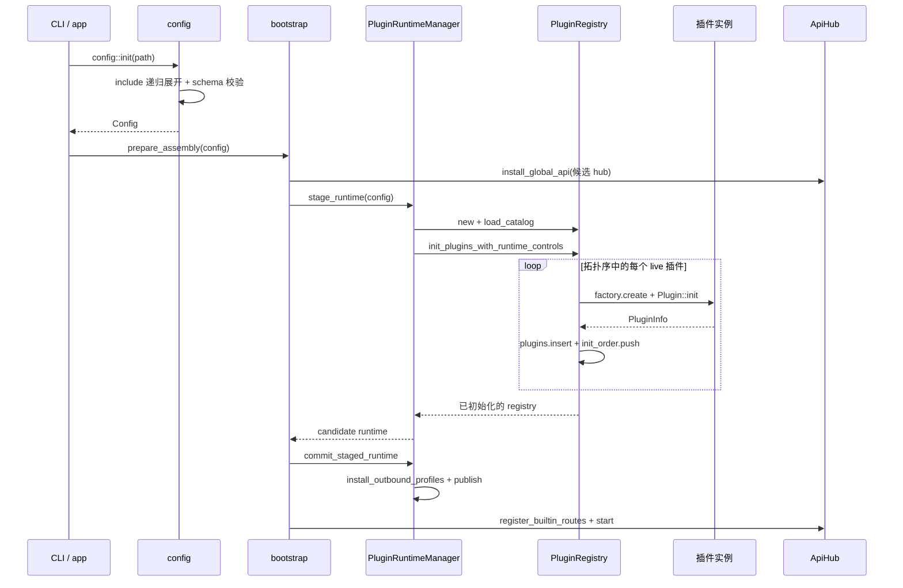
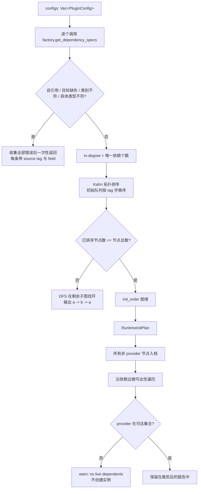
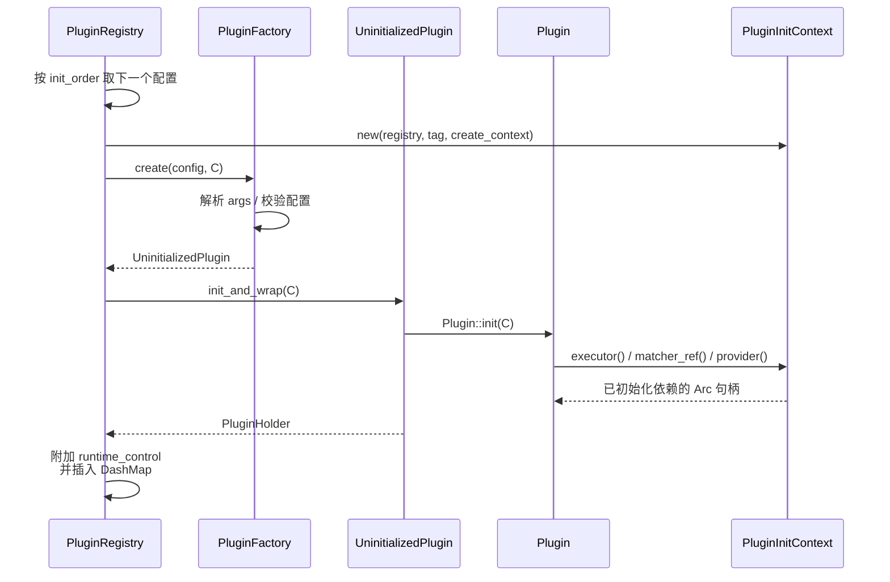
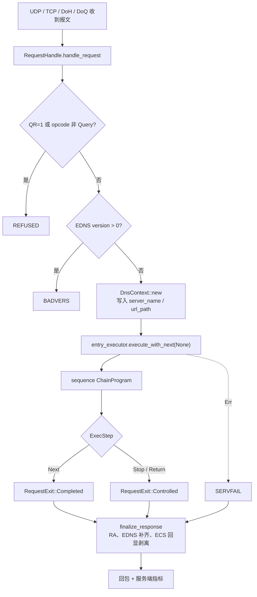
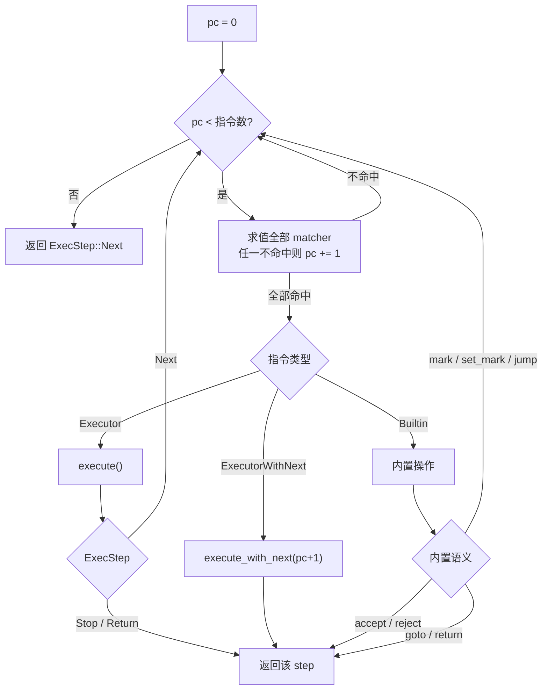
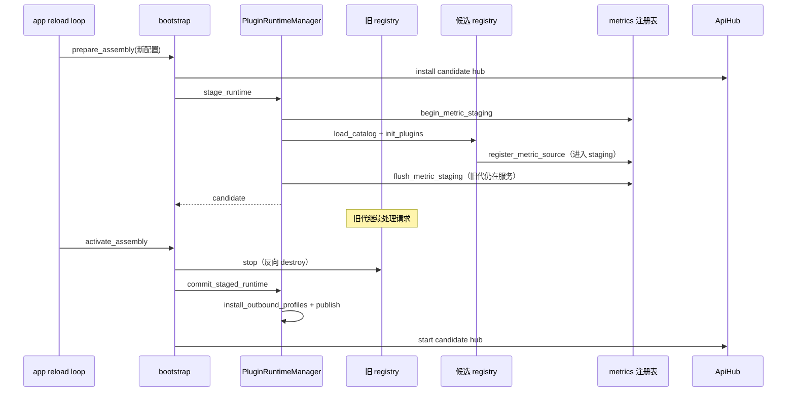
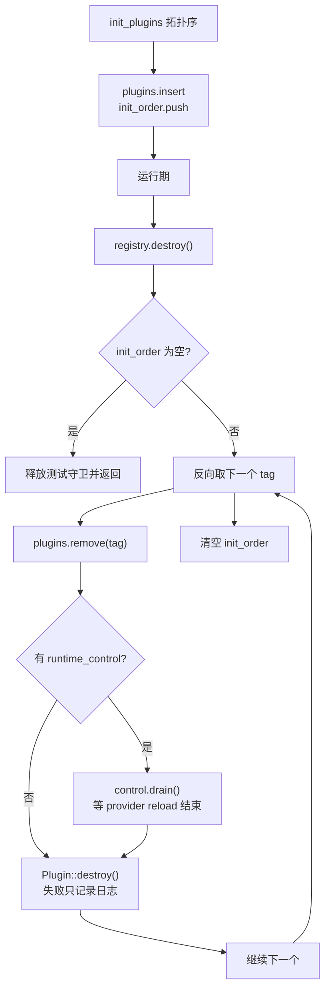

# OxiDNS 插件系统实现解析

> 分析基线：`v1.6.1`，分支 `fix/code-review-priorities`（HEAD `1028a1c0`）。
> 代码位置：`src/plugin/`（`mod.rs`、`registry/`、`dependency.rs` 以及四个类别目录），注册宏在 `crates/macros/`，启动装配在 `src/app/bootstrap.rs`。
> 插件是**编译期静态注册**的 Rust 实现，不是动态库；"没有某个插件"由 Cargo feature 裁剪决定。
> 本文只描述当前代码的实际行为；与文档/注释不一致之处集中在第 14 节。

## 1. 设计定位

OxiDNS 把协议、策略、数据集都拆成插件，运行时只有一条以 `DnsContext` 为中心的请求管线：

| 类别 | Trait | 职责 | 请求期角色 |
|---|---|---|---|
| `server` | `Server: Plugin` | 监听 UDP/TCP/DoT/DoH/DoQ，把网络报文变成 `Message` | 入口 |
| `executor` | `Executor: Plugin` | 转发、缓存、改写、拒绝、副作用 | 主流程 |
| `matcher` | `Matcher: Plugin` | 纯谓词，供 `sequence` 分支 | 判定 |
| `provider` | `Provider: Plugin` | 可复用数据集（域名集/IP 集/GeoIP） | 数据源 |

源码中注册的插件类型数量（受 feature 裁剪影响）：

| 类别 | 数量 | 说明 |
|---|---:|---|
| server | 4 | `udp_server` / `tcp_server` / `http_server`（DoH/DoH3）/ `quic_server`（DoQ） |
| executor | 35 | 33 个 `#[plugin_factory]` + `prefer_ipv4` / `prefer_ipv6` |
| matcher | 20 | 含 `_true` / `_false` 两个恒等谓词 |
| provider | 6 | `domain_set` / `ip_set` / `geosite` / `geoip` / `adguard_rule` / `dynamic_domain_set` |

设计上的三条硬约束：

1. **启动期完成解析**：`sequence` 在 `init` 时就把 matcher/executor 引用解析成 `Arc<dyn ...>`，请求期不再查注册表。
2. **注册表是运行时的唯一持有者**：所有实例以 `Arc<PluginInfo>` 存在 `DashMap` 中，插件之间通过 `PluginInitContext` 拿依赖。
3. **生命周期与请求路径解耦**：`init` / `destroy` 只在启动、关闭、热重载时发生，请求路径只接触 `Arc` 与插件自身的内部状态。

## 2. 代码地图

| 文件 | 行数 | 职责 |
|---|---:|---|
| `src/plugin/mod.rs` | 595 | `Plugin` / `PluginFactory` / `PluginHolder` 定义，inventory 注册入口，`analyze_configuration` |
| `src/plugin/registry/mod.rs` | 678 | `PluginRegistry`：工厂表、实例表、初始化顺序、依赖注入、销毁 |
| `src/plugin/registry/catalog.rs` | 89 | 进程级 `PluginCatalog`（`OnceLock`），从 inventory 构建并去重 |
| `src/plugin/registry/context.rs` | 194 | `PluginInitContext` 与 `PluginResolver` |
| `src/plugin/registry/init_plan.rs` | 142 | 从依赖报告派生运行期初始化计划（裁剪不可达 provider）与创建上下文 |
| `src/plugin/registry/runtime.rs` | 369 | `PluginRuntimeManager`：`init` / `stage` / `commit` / `destroy`，全局单例 |
| `src/plugin/dependency.rs` | 664 | 依赖图构建、校验、Kahn 拓扑排序、找环 |
| `src/plugin/runtime_control.rs` | 28 | matcher/provider 运行期控制枚举 |
| `src/plugin/{server,executor,matcher,provider}/mod.rs` | — | 类别 trait 与模块清单 |
| `src/app/bootstrap.rs` | 355 | 应用装配：候选 API hub、staged runtime、激活与停止 |
| `crates/macros/src/lib.rs` | 52 | `#[plugin_factory("type")]` 过程宏 |

关键类型：

| 类型 | 作用 |
|---|---|
| `UninitializedPlugin` | 工厂返回的未初始化枚举（四个变体），`init_and_wrap()` 负责 `init` + `Arc` 包装 |
| `PluginHolder` | 已初始化的四类 `Arc<dyn ...>` |
| `PluginInfo` | 实例容器：`tag`、`plugin_name`、`plugin_type`、`plugin_holder`、`args`、`runtime_control` |
| `PluginCreateContext` | 创建期元数据：`dependents`（反向依赖列表）、`candidate` |
| `PluginInitContext<'a>` | 传给 `create` / `init` 的解析器句柄：`executor()`、`matcher_ref()`、`provider()`、`init_quick_setup()` |
| `PluginRuntimeManager` | 全局运行时拥有者：`RwLock<Option<Arc<PluginRuntime>>>` + 生命周期异步锁 + `AppController` |

## 3. 注册与发现



要点：

- 过程宏只接受**无状态工厂**（unit struct 或空 `{}`）。需要携带构造参数时用 `register_plugin_factory!`，例如 `prefer_ipv4` / `prefer_ipv6` 共用 `DualSelectorFactory::new(RecordType::A/AAAA)`（`src/plugin/executor/dual_selector.rs`）。
- `PluginCatalog` 是进程级不可变的"有哪些类型"清单；`PluginRegistry` 是可变的"当前这代运行时有谁"清单。一次进程可以构建多代 registry（热重载），但 catalog 只构建一次。
- 重复 `plugin_type` 会在 catalog 构建时直接报错（`catalog.rs:30-44`），`analyze_configuration()` 也做同样检查（`src/plugin/mod.rs:121-127`），保证配置校验和运行期看到同一份清单。
- **类别是推断出来的，不是声明的**：`dependency_kind_from_module_path()` 对 `module_path!()` 做子串匹配，识别 `::plugin::server::`、`::plugin::executor::`、`::plugin::matcher::`、`::plugin::provider::`（`src/plugin/mod.rs:192-206`）。放在这四个目录之外的插件会被判定为 `Unknown`，`plugin::tests` 里有覆盖全部注册项的一致性断言。
- 能力清单对外由 `build_info::snapshot()` 暴露：它遍历 catalog 按 `DependencyKind` 分组，得到 `supported_plugins.{servers,executors,matchers,providers}`（`src/build_info.rs:66-78`）。

## 4. 启动装配



启动被拆成"准备"和"激活"两半，为的是热重载时新旧两代可以短暂共存：

1. **配置阶段**：`config::init()` 读文件、展开 `include`、做 schema 校验；`validate_file()` / `validate_text()` 额外调用 `plugin::analyze_configuration()` 只做依赖图校验（`src/config/mod.rs:42-74`）。
2. **准备阶段**（`bootstrap::prepare_assembly`，`src/app/bootstrap.rs:49-103`）：先安装候选 API hub，让插件的 `register_plugin_api!` 落到候选 hub；再 `stage_runtime()` 构建候选 registry。失败时恢复旧 hub、清理 controller，旧的一代不受影响。
3. **激活阶段**（`activate_assembly`，`src/app/bootstrap.rs:108-160`）：`commit_staged_runtime()` 切换出站配置并发布候选；然后注册内置路由、控制路由、插件运行期控制路由，启动 API hub。
4. **停止阶段**（`stop`）：停 API、`destroy_runtime()`、清理 controller。

`PluginRuntimeManager::init_runtime()`（先销毁旧运行时再构建，`runtime.rs:62-99`）仍保留为简单的单运行时入口；应用主路径走的是 `stage_runtime` + `commit_staged_runtime`。

## 5. 依赖解析

依赖不是靠字段名猜的，而是每个工厂实现 `get_dependency_specs()` 显式声明：`field`（配置里的字段路径，用于错误信息）、`target_tag`、`expected_kind`、可选的 `expected_plugin_type`（`src/plugin/dependency.rs:101-173`）。



实现细节：

- **错误聚合**：缺少依赖、类型不符、自引用都会先累积再统一报错，避免"修一个报一个"（`dependency.rs:319-324`）。
- **去重**：同一对 `(source, target)` 只算一条入边，但 `edges` 会保留多个 `field`，方便错误信息定位（`dependency.rs:227-311`）。
- **环检测**：Kahn 排不完时不满足于"有环"，而是用 DFS 在剩余子图里还原一条具体路径（`dependency.rs:397-454`）。
- **不可达 provider 裁剪**：`build_runtime_init_plan()` 把 server/executor/matcher 全当作根，只有**没有任何路径引用到**的 provider 会被跳过（`registry/init_plan.rs:23-97`）。这意味着"声明了一个 provider 但没被引用"不会加载它，只留一条 warn 日志。
- **创建上下文**：`build_create_contexts()` 把反向边整理成"谁依赖我"的列表，随 `PluginInitContext::dependents()` 提供（`init_plan.rs:99-142`）。当前生产代码没有消费者，只有测试用它验证裁剪结果。

## 6. 创建与初始化



`init_plugins_with_runtime_controls()` 的四个阶段（`registry/mod.rs:187-346`）：

| 阶段 | 动作 | 失败后果 |
|---|---|---|
| Step 0 | tag 唯一性、插件类型存在性检查 | 直接返回，未创建任何实例 |
| Step 1 | 依赖分析 + 裁剪不可达 provider | 直接返回 |
| Step 2 | 对 live 插件执行 `prepare_startup()`（按配置顺序） | 直接返回，尚未创建实例 |
| Step 3 | 按拓扑序 `create` + `init` + 插入 | 已创建的实例由 `build_registry` 统一 `destroy()` |

关键约束：

- **依赖必须先于依赖者初始化**，所以拓扑序同时是创建序；依赖注入用的是 `Arc` 克隆，不是重入注册表查询。
- **`prepare_startup()` 只做前置副作用**（如 `download` 需要先把文件准备好），不创建插件实例，且按配置书写顺序执行，保证可预测。
- **`PluginInitContext` 会做类别校验**：`get_executor_dependency_of_type()` 等不仅查 tag，还核对实际类别与具体 `plugin_name`，错误信息里带 field 路径（`registry/mod.rs:461-507`）。
- **运行期控制只挂在两类插件上**：`provider` 总是有 `ProviderRuntimeControl`；`matcher` 只有在 `api` feature 开启且配置了 `api.http` 时才挂 `MatcherRuntimeControl`（`registry/mod.rs:368-397`、`runtime.rs:133`）。
- **初始化失败即整代失败**：`build_registry()` 在 `init_plugins` 出错时对候选 registry 调用 `destroy()`，按已完成顺序反向清理，不会留下半初始化状态。

## 7. 请求执行模型



`RequestHandle` 是四个 server 插件共享的请求生命周期（`src/plugin/server/request.rs:44-167`）：

- 入口先做协议层校验：伪造响应（QR=1）、非 Query opcode、EDNS version > 0 都不会进入管线，直接构造 REFUSED / BADVERS。
- 只有通过校验才创建 `DnsContext`，然后调用 `entry_executor.execute_with_next(&mut context, None)`。传 `None` 表示"这是最外层链"，`sequence` 内部再把它自己的指令流接起来。
- 执行结果只分三种：`Next`（自然结束）、`Stop`/`Return`（被插件控制）、`Err`（SERVFAIL）。
- `finalize_response()` 统一补 RA、按请求补 EDNS、按 `disable_ecs` 剥离响应里的 ECS 回显。

### 7.1 ExecStep 与 next 续延

| 返回 | 含义 |
|---|---|
| `ExecStep::Next` | 当前链继续；在最外层表示自然完成 |
| `ExecStep::Stop` | 立即停止当前链，通常已写入响应 |
| `ExecStep::Return` | 结束当前 sequence，把控制权交回调用方（用于子 sequence） |

`Executor::execute_with_next()` 默认实现就是"先执行自己，`Next` 时再调用下游"（`src/plugin/executor/mod.rs:116-126`）；只有 `with_next() == true` 的插件（如 `cache`，以及开启 `refused_with_next` 时的 `fallback`）才会拿到 `ExecutorNext` 句柄，从而在**下游返回之后**再做处理。`continue_next!` 宏统一了"有 next 就调用、没有就返回 Next"的写法。

### 7.2 sequence 指令循环



`ChainProgram` 是扁平指令流 + 程序计数器（`src/plugin/executor/sequence/chain.rs:132-180`）：

- 一条规则编译成一条 `Instruction`：`matchers: Vec<MatcherRef>` + `op`（`Executor` / `ExecutorWithNext` / `Builtin`）。
- **matcher 之间是 AND 关系**，全部命中才执行 `exec`（`chain.rs:386-403`）。
- `ExecutorWithNext` 一定结束当前这层循环：它把 `pc+1` 包成 `ExecutorNext` 交给插件，由插件决定何时、是否继续。
- 内置操作（`chain.rs:275-384`）：

| 内置 | 语义 |
|---|---|
| `accept` | 返回 `Stop`，保留当前响应 |
| `reject [rcode]` | 用请求构造响应并 `Stop`，默认 `REFUSED` |
| `return` | 返回 `Return`，交回上层 sequence |
| `jump <sequence>` | 调用子 sequence，`Stop` 向外传播，`Next`/`Return` 继续本层 |
| `goto <sequence>` | 调用子 sequence 并直接传播其返回 |
| `mark` / `set_mark` | 追加 / 替换 `DnsContext` 的 mark 集合 |

`jump` / `goto` 的目标必须是 `sequence` 类型（`executor_of_type`），且不允许写 `$` 前缀（`sequence/mod.rs:67-82`）。

## 8. quick setup

配置里写 `exec: "cache short_circuit"` 这种形式时不会创建全局插件，而是在**拥有者初始化时**临时创建：

| 场景 | 合成 tag |
|---|---|
| executor | `qs.exec.<sequence_tag>.<node_index>.<plugin_type>` |
| matcher | `qs.match.<sequence_tag>.<node_index>.<match_index>.<plugin_type>` |

- 依赖声明走 `PluginFactory::get_quick_setup_dependency_specs()`，字段名会被改写成 `args[i].exec -> quick_setup(type).inner`，这样报错能指回原始配置位置（`src/plugin/mod.rs:236-278`）。
- 实例通过 `PluginInitContext::init_quick_setup()` 创建并 `init`，**不进入** registry 的 `DashMap`，因此不出现在插件 API 与 `plugin_count()` 里。
- 生命周期归拥有者：`Sequence::destroy()` 会逐个销毁自己的 quick setup executor/matcher（`sequence/mod.rs:145-166`）。
- 工厂默认不实现 `quick_setup()`，直接返回"quick setup is not supported"，所以支持哪些简写完全由插件自己决定。

## 9. 运行期控制

| 控制 | 载体 | 语义 |
|---|---|---|
| matcher 模式 | `MatcherRuntimeControl`（`AtomicU8`） | `normal` / `always_false` / `always_true` |
| provider 重载 | `ProviderRuntimeControl` | 串行化 `reload()`，并发请求直接 `Busy` |

matcher 模式的关键顺序：**先应用运行期模式，再套表达式取反**（`matcher/mod.rs:145-169`）。

| 模式 | 引用 `$m` | 引用 `!$m` |
|---|---|---|
| `normal` | 真实结果 | 真实结果取反 |
| `always_true` | 命中 | 不命中 |
| `always_false` | 不命中 | 命中 |

provider 重载（`provider/control.rs:48-90`）：

- `try_lock_owned()` 抢占，抢不到立即返回 `Busy`，不排队，避免 API 请求堆积。
- 真正的 `reload()` 在独立 `tokio::spawn` 中执行并持有锁：调用方被取消不会提前释放所有权。
- 运行期销毁时先 `drain()`：置 `accepting_reloads = false` 并等待锁，确保旧的 reload 不会与新实例初始化重叠。

API 路由由 `register_plugin_runtime_control_routes()` 统一挂在 `/plugins/<tag>/...` 下。

## 10. 热重载



staged reload 的三个易错点，代码都做了显式处理：

1. **指标重名**：新旧两代插件 tag 相同，`register_metric_source` 会把候选的注册"寄存"在 staging 列表；提交时 flush，旧代销毁时只注销自己那份（`src/infra/observability/metrics.rs:126-200`、`runtime.rs:159-192`）。
2. **插件 API 路由归属**：候选 hub 在 `stage_runtime` **之前**安装为全局，插件的 `init` 才会把路由注册进候选而不是旧 hub（`bootstrap.rs:55-67`）。
3. **出站配置**：候选初始化期间仍看到旧代的 outbound profiles；`commit` 时才切换。这是有意的取舍，注释里写明了候选在 init 阶段拨号会用到旧配置（`runtime.rs:151-170`）。

## 11. 生命周期与销毁



- **销毁严格反向**：`init_order` 是拓扑序，反向即"依赖者先销毁"，避免下游还持有已销毁的上游 `Arc`（`registry/mod.rs:632-663`）。
- **单插件失败不阻断**：`destroy()` 出错只 `error!` 记录，继续销毁下一个。
- **server 自己管生命周期**：`init()` 内绑定端口、spawn 监听任务并等待启动 oneshot；`destroy()` 注销指标、发送 shutdown、`await` 任务句柄（`server/tcp.rs:166-198`）。
- **两代并存期间的资源**：Unix 上靠 SO_REUSEPORT 让候选先绑定同端口，旧代 stop 后才提交新代，因此没有"无人监听"的窗口；非 Unix 平台走 stop-the-world 回退，切换期间会短暂停服。

## 12. 插件 API 与指标

- `register_plugin_api!(tag, GET "/path" => handler, ...)` 在 `api` feature 下把路由挂到 `/plugins/<tag>`；没有 `api` feature 时宏展开成恒 `Ok(())`，插件代码不需要 `cfg` 包裹（`src/api/macros.rs`）。
- 插件在 `init()` 里注册路由，因此**路由注册的时机等于插件初始化时机**，这也是候选 hub 必须提前安装的原因。
- 指标通过 `register_metric_source` / `unregister_metric_source` 在 `init` / `destroy` 中成对出现，全局 `/api/metrics` 按 `plugin_tag` 区分实例。

## 13. 构建期能力清单

| 来源 | 内容 |
|---|---|
| `Cargo.toml` features | `minimal` / `standard` / `full` 三个 bundle，`default = ["full"]` |
| 类别 `mod.rs` 的 `#[cfg(feature = ...)]` | 决定哪些插件模块参与编译 |
| `inventory` | 决定编译进来的模块里有哪些工厂 |
| `build_info::snapshot()` | 输出 bundle、enabled_features、按类别分组的 `supported_plugins` |

因此"当前版本支持哪些插件"应当以 `build_info` 的实际输出或 catalog 为准，而不是读文档里的清单——feature 裁剪会改变结果，但类型名与依赖关系不会。

## 14. 设计评述

### 做得好的地方

- **注册与运行分离**：`PluginCatalog`（不可变、进程级）与 `PluginRegistry`（可变、按代）职责清晰，热重载只需重建后者。
- **依赖是声明式的**：工厂显式返回 `DependencySpec`，错误信息带 `field` 路径；环检测能给出具体路径，而不是只报"有环"。
- **请求期零注册表查询**：`sequence` 在初始化时完成所有解析，热路径只有 `Arc` 解引用和指令分发。
- **失败可回滚**：候选构建失败会销毁已初始化实例；staged reload 失败时旧代继续服务，指标 staging 也会 abort。
- **并发安全边界明确**：provider reload 用 try-lock 拒绝并发而非排队，销毁时 drain 等待，取消调用方不会泄漏所有权。

### 需要留意的取舍与风险

1. **类别靠模块路径字符串推断**：新增插件若不在 `src/plugin/<category>/` 下会被判为 `Unknown`，`plugin::tests` 只能覆盖"已注册项"，无法阻止新目录写错。
2. **未引用的 provider 会被静默跳过**：只声明不用会得到一条 warn，实例不存在；如果将来出现"仅供 API 使用"的 provider，这条裁剪规则需要重新评估。
3. **`PluginCreateContext` 有两个未落地字段**：`candidate` 恒为 `false`，注释说"为 staged-reload 预留"，但 staged reload 已经实现且不依赖它；`dependents` 只有测试在用。属于历史残留，容易误导。
4. **`Server::run()` 没有调用点**：四个 server 实现都定义了它，但绑定与 spawn 实际发生在 `init()` 内。保留的死方法会让新插件作者误以为需要外部驱动。
5. **`resolve_dependencies()` 非测试构建未使用**：真正的路径是 `analyze_dependencies()` + `init_plan`，旧函数仅 `allow(dead_code)` 保留。
6. **依赖声明解析失败会被吞掉**：`sequence`、`cron` 等在 `get_dependency_specs()` 里对 YAML 解析失败直接返回空列表，导致"依赖图看起来正常"，真正的配置错误推迟到 `create()` 才报。诊断位置后移，配置复杂时可读性下降。
7. **校验与创建是两条路径**：`validate_configuration()` 只做图分析，不调用 `create()`，所以 `oxidns check` 通过不代表参数能成功解析。
8. **每次校验都实例化全部工厂**：`analyze_configuration()` 遍历 inventory 时为所有注册类型构造工厂（不只为配置里的类型），启动期成本随插件总数线性增长。
9. **`PluginHolder` 的强转是 panic 式**：`to_executor()` 等在不匹配时直接 `panic!`。正常路径由 `get_*_dependency` 提前校验，但绕过 registry 直接强转属于未定义使用。

## 15. 相关测试

| 测试 | 覆盖点 |
|---|---|
| `test_dependency_kind_from_module_path_for_all_registered_plugins` | 所有注册项都能归入四个类别之一 |
| `test_reports_missing_dependency_with_field_context` | 缺失依赖报错带 field |
| `test_reports_type_mismatch_with_field_context` | 类别不符报错 |
| `test_reports_cycle_path` | 环检测输出具体路径 |
| `test_build_runtime_init_plan_skips_unreachable_provider_chain` | 不可达 provider 裁剪 |
| `test_init_plugins_filters_create_contexts_to_live_dependents` | 创建上下文只含 live 依赖者 |
| `test_init_runtime_failure_leaves_runtime_stopped` | 初始化失败不留半成品 |
| `destroy_waits_for_cancelled_provider_reload` | 销毁等待被取消的 reload |
| `concurrent_reload_is_rejected_instead_of_queued` | provider reload 并发拒绝 |
| `runtime_modes_fix_the_base_result_before_reference_negation` | matcher 模式先于取反 |
| `test_run_executes_continuation_callbacks_in_lifo_order` | `next` 续延顺序 |
| `staged_reload_registers_plugin_scoped_routes_on_the_candidate_hub` | 候选 hub 路由归属 |

运行方式（按需选择，避免全量）：

```bash
cargo test --lib plugin::registry
cargo test --lib plugin::dependency
cargo test --lib plugin::executor::sequence
```
